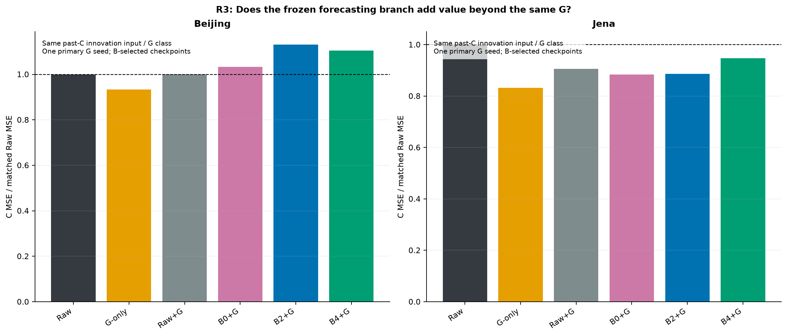
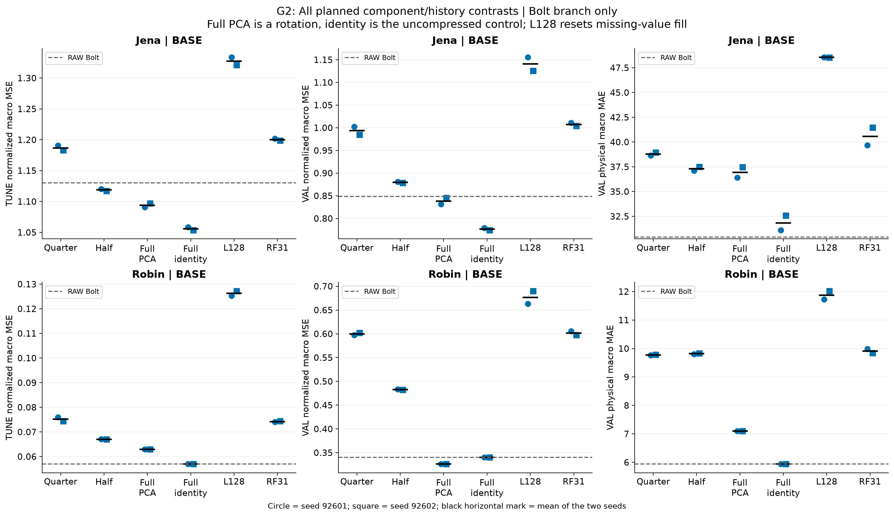
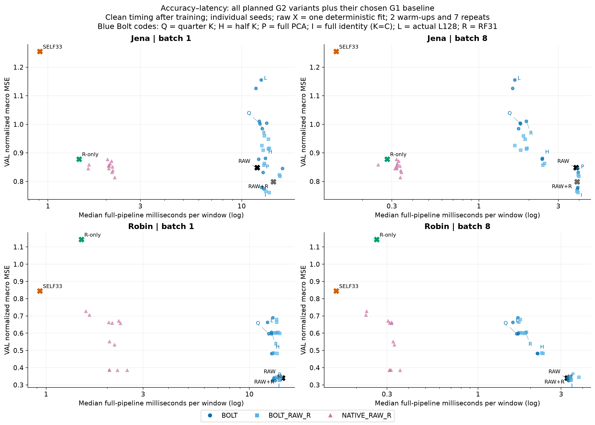
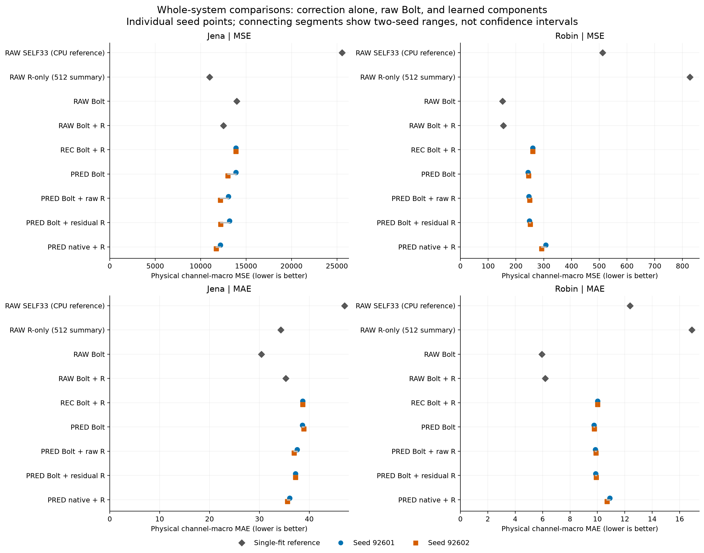
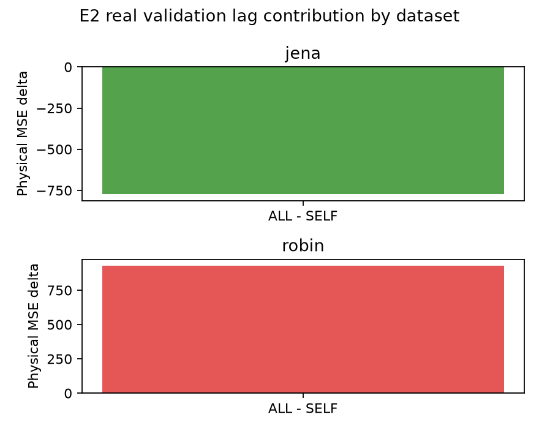
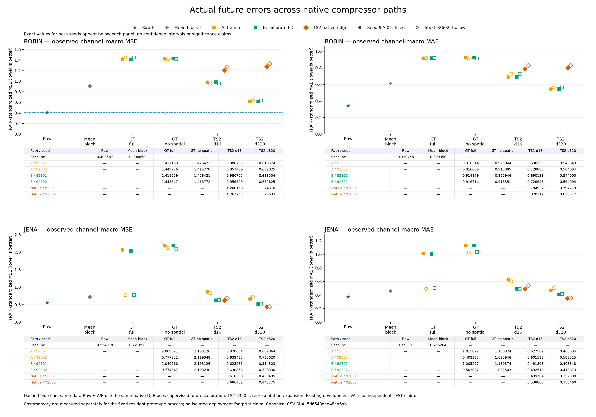
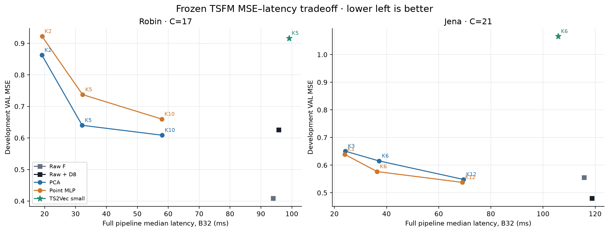
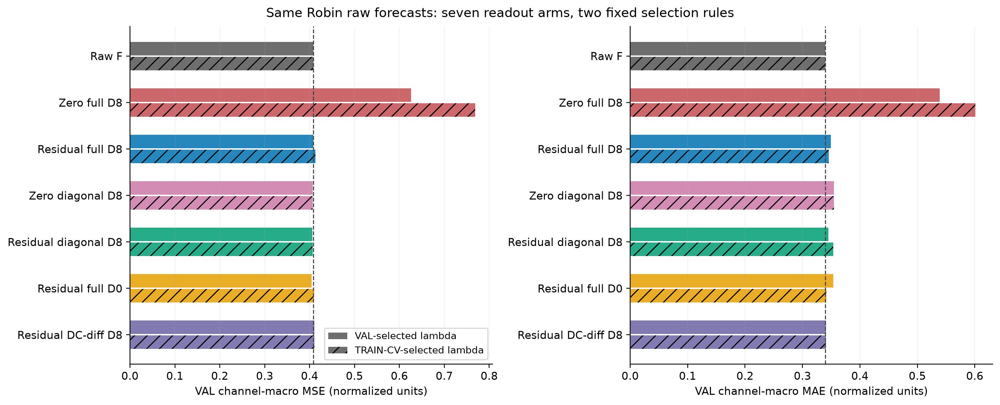
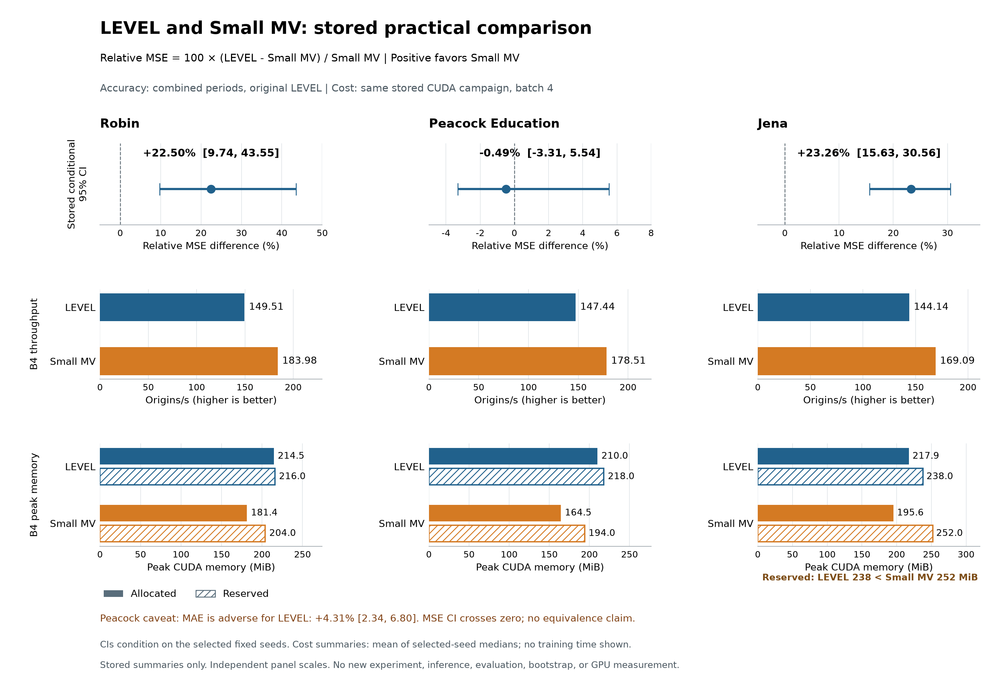
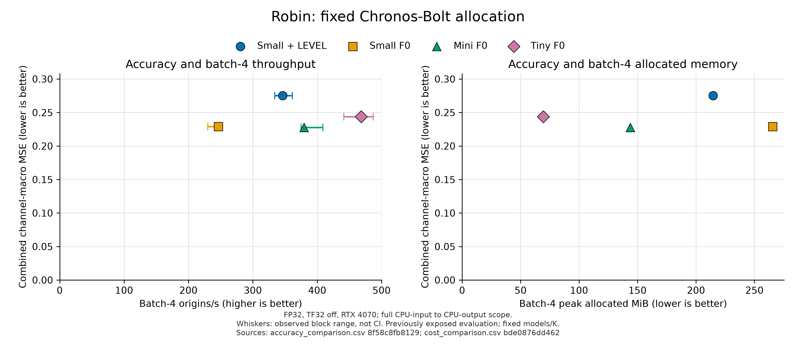

# Hierarchical TSFM PEFT screen

과거 통계 pack의 `pack_1792097901794080200/part_0000.tar.xz`를 쓰는 재현은 [단일 chunk 원바이트 수동 복원 안내](research/informs_broad_validation_20261015_v1/publication_derivatives/git_history_pack_20261017_v1/README_KO.md)를 기존 pack README·REPRODUCE·RESTORE_INDEX 절차보다 먼저 따른다. 해당 한 파일의 원 Git 바이트와 로컬 원본은 보존하며, 과거 소비자 실행 전에 같은 원 경로로 복원해야 한다.

**2026-10-17 PeMS C32 Raw/G 실제 비교 완료:** [판단·한계](research/informs_broad_validation_20261015_v1/priority_pems_subset_20261016_v1/RESULT_STATUS_KO_v1.md) · [상세 MD](research/informs_broad_validation_20261015_v1/priority_pems_subset_20261016_v1/RAW_G_KO_v1.md) · [원정밀도 CSV](research/informs_broad_validation_20261015_v1/priority_pems_subset_20261016_v1/RAW_G_RESULTS_v1.csv) · [그림과 근거](research/informs_broad_validation_20261015_v1/priority_pems_subset_20261016_v1/RAW_G_VISUALIZATION_KO_v1.md) · [4패널 SVG](research/informs_broad_validation_20261015_v1/priority_pems_subset_20261016_v1/figures/RAW_G_FOUR_PANEL_v1.svg). 같은 C32/L512/H12/V148·seed92601·A60 scaler/origin/mask에서 Raw MSE 0.09051378995956519 / G 0.08146537281056535, MAE 0.19521148986641665 / 0.18577497673500085였다. CPU2 B8 warm whole median은 Raw 1.7010823499877006초 / G 0.000370049849152565초(batch 전체)였다. 2fit·독립 FP64 2건·fresh CPU6 2건·Raw parity 2건·비용 4조건·200trial·그림을 완료했다. G는 채널별 512개 과거에 공유 MLP와 현재값 anchor를 적용하며 교차채널 혼합은 없다. G selected3 refit1911 update는 제한 학습 상태이고, Raw와 학습·구조가 달라 순수 Bolt 인과효과나 B2·압축 검증으로 해석하지 않는다. 단일 seed·반복 개발 V·상류 보간 ancestry 미확정·수렴 미확정을 유지한다. **주 후보 B2와 전체 MASTER는 미완료이며 다음 C32 B0/B2 K8은 아직 실행 입장 전이다.**

**2026-10-17 남은 두 방법군 검증 완료:** [현재 판단과 한계](research/informs_broad_validation_20261015_v1/priority_valid_family_20261016_v1/REMAINING_RESULT_STATUS_KO_v1.md) · [상세 MD](research/informs_broad_validation_20261015_v1/priority_valid_family_20261016_v1/REMAINING_FAMILY_KO_v1.md) · [원정밀도 CSV](research/informs_broad_validation_20261015_v1/priority_valid_family_20261016_v1/REMAINING_FAMILY_RESULTS_v1.csv) · [두 자료별 그림](research/informs_broad_validation_20261015_v1/priority_valid_family_20261016_v1/REMAINING_FAMILY_VISUALIZATION_KO_v1.md). Jena의 AdaPTS 저장소 port K6는 기존 B2보다 MSE가 높았고, Beijing B4 K11은 기존 B2보다 MSE가 소폭 낮지만 B8 warm whole 비용은 증가했다. 신규2 fit·전체 V·FP64·CPU6·4개 B1/B8 비용과 독립 검산·그림을 완료했다. 한 seed·반복 개발 V·제한 학습과 구조 차이가 있는 결과이며 수렴·독립 일반화·순수 인과효과·전체 MASTER 완료를 주장하지 않는다. 주 후보 B2를 유지하며 다음 PeMS C32 Raw/G와 같은 조건의 B0/B2 비교는 아직 미입장이다. 새 원격 게시 SHA는 별도 확인 대상이다.

과거 PeMS `parent_full_cpu`의 단일 V 충분통계 파일을 사용하는 재현은 [Git-history 원바이트 수동 복원 안내](research/informs_broad_validation_20261015_v1/publication_derivatives/git_history_v_stats_20261017_v1/README_KO.md)를 먼저 따른다. 이 단일 파일에 한해 새 안내가 과거 서명된 RESTORE_INDEX의 원공개경로 설명보다 우선하며, 과거 소비자 실행 전에 같은 원 경로로 복원해야 한다. 원 과학 문서와 다른 복원 계약은 보존한다.

**2026-10-17 Beijing multi-K 실제 결과:** [현재 판단·원수치·비용·그림](research/informs_broad_validation_20261015_v1/priority_multik_resume_20261016_v1/RESULT_STATUS_KO_v1.md). 두 저장점 재개 부모의6개 K 출력을 실제 검증했다. Shared K6 MSE0.775934 / max-only prefix0.893394이며, PCA보다 일관되게 좋은 결과는 아니다. 전체 V·FP64·CPU6·12비용을 완료했고 한 seed·반복 V·제한 학습/전체 MASTER 미완료를 유지한다.


**2026-10-17 Jena LoRA·B4 완료:** [기존 B2와 정확도·전체 비용 비교](research/informs_broad_validation_20261015_v1/priority_valid_family_20261016_v1/RESULT_STATUS_KO_v1.md). 같은 search3/refit1 노출에서 LoRA가 더 정확했고 작은 K의 B2는 더 빨랐다. 새2학습·전체 V·독립 검산·CPU6·새4비용과 그림을 완료했으며, B2는 기존 정확도+새 검증/비용이다. 반복 개발 V·한 seed·수렴 미확정·전체 MASTER 미완료를 유지한다.


**2026-10-17 Beijing 핵심 대조 완료:** [B0 K6·B2 K6/K11의 원수치·학습량·검산 보고](research/informs_broad_validation_20261015_v1/priority_valid_minima_20261016_v1/CORE_CONTRAST_KO_v1.md) · [그림](research/informs_broad_validation_20261015_v1/priority_valid_minima_20261016_v1/CORE_CONTRAST_VISUALIZATION_KO_v1.md). 이번 같은 K6 조건에서는 B2 앞단의 추가 이득이 확인되지 않았고, K11의 낮은 오차와 큰 전체 비용을 함께 확인했다. 실제2학습·전체 V·독립 재채점·체크포인트 재추론·새4비용까지 완료했다. 반복 개발 V·단일seed·서로 다른 선택 학습량의 조건부 결과이며 전체 MASTER·수렴·일반화는 미완료다. 아래는 이전 시점의 기록을 보존한다.

**2026-10-16 Beijing 후순위 검증 완료:** [B2·causal·bidirectional K6의 실제 학습/전체 V·FP64·checkpoint 재추론·전체 비용·보고서와 그림](research/informs_broad_validation_20261015_v1/priority_valid_minima_20261016_v1/README_KO.md). [고정 nested PCA K3/6/11 비용과 그림](research/informs_broad_validation_20261015_v1/priority_nested_cost_20261016_v1/VISUALIZATION_KO_v1.md)도 완료했다. 반복 개발 V·단일 seed·서로 다른 선택 refit 길이의 결과이며, 전체 MASTER·수렴·독립 일반화는 미완료다. 이전 후속의 공개 통계3개는 [원 바이트 복원 안내](research/informs_broad_validation_20261015_v1/stats_packs/pack_numeric_priority_followup_20261016_v1/README_KO.md)를 통해 복원한다. 아래 내용은 각 작성 시점의 기록이다.


**2026-10-16 최신 우선 후속 검증:** [Jena 두 seed와 PeMS08 동일 표현 no-Bolt 비교·원수치·CPU 비용·그림](research/informs_broad_validation_20261015_v1/priority_core_followup_20261016_v1/README_KO.md). Jena의 두 seed 모두 B2가 B0보다 MSE가 낮았지만 추가 seed의 MAE 차이는 작았다. PeMS08은 같은 최종 P/E/D·전체 과거·CPU 전체 V148에서 Bolt가 선형 head보다 정확했고 추론 비용은 훨씬 컸다. Ridge·G·LoRA를 포함한 전체 우위와 독립 일반화는 미확인이다. 우선 검증 완료와 원 MASTER의 미완료 범위를 구분한다. 아래 진행 기록은 작성 시점 snapshot이다.

**2026-10-16 우선순위 변경 후 실제 Jena 핵심 검증:** [B2·동일 표현 no-Bolt·별도 학습 no-Bolt·Raw/Ridge/G/PCA/LoRA의 정확도·CPU 비용](research/informs_broad_validation_20261015_v1/priority_b2_validation_20261016_v1/README_KO.md). 기존 scheduler와 실제 학습2개를 중단하고 checkpoint10개를 보존했다. 새 직접 대조2개는 학습·전체 V·독립 재채점·CPU 재추론·비용까지 완료했다. B2는 B0·직접 대조보다 나았으나 ridge/G/LoRA 대비 전체 우위는 미확보다. PeMS08·추가 seed는 후속이며 기존 전체 큐는 자동 재개하지 않는다. 아래의 과거 진행 기록은 작성 시점 snapshot이다.

동일 Chronos-Bolt-small + LoRA에서 실제 hierarchy 관계의 추가 예측 가치를 평가합니다.
이 hierarchy screen의 실행 계약은 [MASTER](docs/00_MASTER_CLI_hierarchical_tsfm_peft_new_pc_20260921.txt)입니다. 별도 승인된 채널 압축 잔차 연구는 아래 결과 색인과 해당 PLAN을 따릅니다.
실행 기록은 `results/hier_peft_screen_v1/`에 저장합니다. 논문 PASS를 주장하지 않습니다.

## INFORMS 확대 검증: 부분 결과 (2026-10-16)

- **후속 CPU 결과 검산 완료:** [Jena 표현4조건의 전체 V·같은 CPU 비용·Raw 분할 진단](research/informs_broad_validation_20261015_v1/postT_V_only_cpu_lag_20261016_v1/RESULTS_WITH_COST_KO.md), [고정 PCA6조건의 V·CPU 비용](research/informs_broad_validation_20261015_v1/postT_V_only_cpu_fixed_pca_20261016_v1/RESULTS_WITH_COST_KO.md). Jena 시간 혼합은 시점별 압축보다 나았으나 ridge/G를 이기지 못했고, 지연 구조의 추가 가치도 미확인입니다. 새 비용24조건의 원 trial 재집계가 통과했으며 Raw 비용2조건은 출력 일치 guard 실패로 숫자가 없습니다. [검색3epoch 당시 기록](research/informs_broad_validation_20261015_v1/postT_V_only_cpu_lag_20261016_v1/PROGRESS_E3_KO.md)은 보존합니다. 해당 큰 큐는 최신 우선순위 지시로 중단했으며, 당시 예정15개를 완료 수에 넣지 않았습니다.

- [full-C 고정 PCA의 추가 진단](research/informs_broad_validation_20261015_v1/diagnostics/fullC_fixed_basis_diagnostic_20261016_v1/RESULTS_KO.md): 정보 차원을 유지한 좌표 변환에서도 MSE·MAE가 달랐습니다. 6방법 저장V 재채점·basis 검산·270행 분해·실제 그림이며 새 모델 학습 완료는 아닙니다.

**PARTIAL.** Beijing·Jena·Electricity·PeMS08에서 채널 압축, 시간 처리, 같은 G의 예측 결합, 지연 압축과 가변 K를 실제 비교했습니다. V의 결합 이득은 Beijing의 잠금 후 T에서 유지되지 않았고, PeMS08의 H_B2는 LoRA보다 T MSE가 약0.23% 낮았습니다. 한 seed·한 시간 구간의 관찰이며, 필수 학습·반복 검증과 전체 정확도–비용 우위는 미해결입니다.

- [최신 결과·원수치·그림·실험 코드](research/informs_broad_validation_20261015_v1/README_KO.md)
- [상세 한국어 보고서](research/informs_broad_validation_20261015_v1/REPORT_KO.md), [교수님 상담용 핵심·반례](research/informs_broad_validation_20261015_v1/PROFESSOR_BRIEF.md)
- [전체 원수치](research/informs_broad_validation_20261015_v1/SCORES.csv), [실제 비용](research/informs_broad_validation_20261015_v1/COST.csv)
- [무손실 통계 복원·재현](research/informs_broad_validation_20261015_v1/REPRODUCE.md), [미완료 범위·재개 조건](research/informs_broad_validation_20261015_v1/RESUME.md)
- [Electricity Raw 비용 실패 추가 진단·그림](research/informs_broad_validation_20261015_v1/diagnostics/electricity_raw_parity_report_20261016_v1/REPORT_KO.md): 같은 과거 입력의 8개 추론 조건에서 OOM은 재현되지 않았고, 분할 추론 6조건의 출력 차이로 원 parity 검사가 실패했습니다. 학습·정답 평가·비용 프로토콜 완료를 뜻하지 않습니다.

## 시간 앞단 R1–R5: 상담 반영 실제 실행 (2026-10-15)

새 A/B/C 시간 분할에서 TSMixer·TimeMixer 원리를 적용한 앞단, C/K 압축, 동일 잔차 G, 직접 예측·LoRA 대조를 실제 학습하고 이후 C 구간의 추론·전체 비용을 측정했습니다. 신경망 80조건·121,200 update와 ridge 10개 alpha 적합을 실행했습니다. **시간 앞단의 일부 효과는 있지만 작은-K+Bolt의 G-only·LoRA 대비 추가 가치는 확보하지 못했습니다.** 최대 학습량에서도 미해결인 12조건과 Robin L2048의 자료 부족을 구분해 보고합니다.

- [최신 결과·원수치·그림·실험 코드 색인](research/temporal_frontend_campaign_20261015_v1/README_KO.md)
- [교수님 설명용 요약](research/temporal_frontend_campaign_20261015_v1/PROFESSOR_BRIEF_v3.md), [상세 한국어 보고서](research/temporal_frontend_campaign_20261015_v1/REPORT_KO_v3.md)
- [전체 B/C 점수](research/temporal_frontend_campaign_20261015_v1/SCORES.csv), [실측 비용](research/temporal_frontend_campaign_20261015_v1/COST.csv), [검산 결과](research/temporal_frontend_campaign_20261015_v1/AUDIT_v2.json)
- [게시 범위·압축 비용 원자료 복원·재현 조건](research/temporal_frontend_campaign_20261015_v1/PUBLICATION_KO.md)



## 교수 미팅용 방법론·추가 실험 마무리 (2026-10-15)

예측 목적 표현·동일 E/D native·ridge·시간별 디코더 보정·시간순 보정 이전을 실제 실행하고 과학/비용 검산과 시각 보고서를 정리했습니다. **작은 K의 Raw 대비 정확도 격차는 미해결입니다.** 방법론 후보·검증 절차와 성능 성공·신규성·독립 일반화를 구분합니다.

- [추가 결과·코드·보고서8개·59CSV·PNG/SVG28쌍 색인](research/bolt_compatible_adaptive_20261014/publication_main_20261015_v2/README_KO.md)
- [교수님께 설명할 목적·수식·학습/동결 대상·대조·반례](research/bolt_compatible_adaptive_20261014/publication_main_20261015_v2/reports/professor_method_brief_v1/REPORT_KO.md)
- [마지막 시간순 진단: 두 보정 모두 B 이득이 C에서 악화](research/bolt_compatible_adaptive_20261014/publication_main_20261015_v2/reports/purged_readout_stability_v1/REPORT_KO.md)
- [실측 비용·원수치·실패를 포함한 STATIC/RAMP 상세 보고](research/bolt_compatible_adaptive_20261014/publication_main_20261015_v2/reports/horizon_decoder_diagnostic_v1/REPORT_KO.md)

## 작은 K 표현·예측·복원 후속 진단 (2026-10-15)

고정 출력 공간·과거별 디코더·지연 복원·예측 목적 E/D 학습·동일 E/D native 대조를 실행하고 원수치·비용·독립 검산·시각 보고서로 정리했습니다. **Raw 정확도와 압축 비용을 함께 만족하려는 목표는 아직 미해결입니다.** 반복 사용한 개발 구간의 탐색 결과이며 보호 TEST를 사용하지 않았습니다.

- [현재까지 결과·MD 보고서·그림·코드 색인](research/bolt_compatible_adaptive_20261014/publication_main_20261015_v1/README_KO.md)
- [동일 E/D의 native6조건·전체 비용20조건](research/bolt_compatible_adaptive_20261014/publication_main_20261015_v1/reports/matched_l7_native_v2/REPORT_KO.md)
- [최신 잠재값 보정6조건: 독립 검산 완료, 비용 미실행](research/bolt_compatible_adaptive_20261014/publication_main_20261015_v1/reports/fixed_l7_latent_calibration_snapshot_v1/REPORT_KO.md)
- [게시 범위와 로컬 재현 자산](research/bolt_compatible_adaptive_20261014/publication_main_20261015_v1/CODE_AND_REPRODUCTION_KO.md)

## 최신 자기 채널·다변량 정보와 고정 Bolt 진단 (2026-10-14)

동일 시간 특징·FIT/TUNE·손실·후보 선택 규칙에서 SELF33과 JOINT33을 비교하고, Robin FIT512의 수치 재현 수선·실제 배포 비용·검산까지 완료했습니다. 이 선형 readout 계약에서 TUNE의 실용 이득을 확인하지 못해 사전 gate에 따라 후속 학습을 종료했습니다. 작은 K 연구 전체의 해결을 뜻하지 않습니다.

- [한국어 결과 요약·코드·검산 색인](research/bolt_compatible_adaptive_20261014/publication_main_20261014_v1/README_KO.md)
- [상세 MD 보고서·그림 8개·CSV](research/bolt_compatible_adaptive_20261014/publication_main_20261014_v1/reports/adaptive_REPORT_KO.md), [6장 설명 스토리](research/bolt_compatible_adaptive_20261014/publication_main_20261014_v1/reports/PRESENTATION_BRIEF_KO.md)
- [완료·미실행 상태와 이유](research/bolt_compatible_adaptive_20261014/publication_main_20261014_v1/reports/CAMPAIGN_CLOSURE_KO.md), [2026-10-14 결과 색인](RESEARCH_RESULTS_20261014_KO.md)

## 정규화 MSE·학습 일반화·압축률·예측기 대조 (2026-10-13)

사용자가 선택한 FIT-only 정규화 channel-macro MSE에 미래 학습 손실·checkpoint 선택·보정 lambda 선택을 맞췄습니다. G0–G3의 44개 핵심 학습 조건, 236개 방법 결과와 batch1/8 비용 472행을 실제 실행·검산했습니다. 두 자료·두 seed·반복 사용한 개발 VAL 결과입니다.

낮은 학습률과 weight decay는 REC 일반화 문제를 해결하지 못했습니다. Jena의 압축 없는 K=C 항등 초기화 예측 목적 학습은 정규화 MSE를 RAW Bolt 0.8486에서 평균0.7765로 낮췄지만 MAE는 악화했습니다. Robin의 전체 PCA 개선은 두 seed가 모두 학습 전 모델을 선택한 고정 회전 효과입니다. 이를 압축 이득이나 표현학습 성공으로 합쳐 말하지 않습니다.

Jena K=10은 RAW Bolt 대비 주오차가 약3.65% 크지만 batch8의 창당 추론 시간은3.835→2.400ms로 약37.4% 작았습니다. batch1에서는 절감이 없었습니다. 원자료·동일 E/D native·복원 D·보정·시간 구간의 반례도 함께 보고합니다.

- [전체 실험·원수치·비용·한계를 포함한 한국어 보고서](research/forecast_generalization_study_20261013/report_v1/REPORT_KO.md), [결과와 코드 색인](research/forecast_generalization_study_20261013/README.md)
- [236개 방법 원수치](research/forecast_generalization_study_20261013/report_v1/all_methods.csv), [단독 재측정 비용](research/forecast_generalization_study_20261013/report_v1/batch_cost.csv)
- [독립 재채점·선택 검산](research/forecast_generalization_study_20261013/validation_resolved_v1/audit.md), [원자료·FIT 통계·정답·마스크 검산](research/forecast_generalization_study_20261013/validation_source_v1/audit.md), [최종 감사 665개 항목](research/forecast_generalization_study_20261013/FINAL_AUDIT_V2.json)
- [주지표 정렬 보충 실험](research/forecast_metric_alignment_20261013/README.md), [GitHub 게시 범위와 로컬 재현 자산](research/forecast_generalization_study_20261013/PUBLICATION_KO.md)





## FORECAST 실패 원인·동결 TSFM 예측 성분 진단 (2026-10-13)

기존 FORECAST에서 구조·초기값·손실·학습 횟수를 유지하고 학습 origin pool을 바꾸자, 두 자료·두 seed의 물리 VAL MSE가 37.61–59.81% 감소했습니다. 고정된 과거 창을 다시 평가한 REC는 학습 구간의 정규화 재구성 MSE를 조금 줄였지만 TUNE 과거 창에서는 네 조건 모두 악화했습니다. 기존 부진을 재구성 목적의 한계 하나로 확정할 수 없습니다.

실제 동결 Chronos-Bolt를 통과해 작은 인코더·디코더를 예측 목적으로 학습하는 경로는 작동했습니다. 압축 경로의 물리 MSE는 REC보다 낮아졌지만, 전체 압축+보정의 정확도 우위는 확보하지 못했습니다. Jena의 원자료 선형 기준선과 Robin의 원자료 Bolt가 강한 대조군입니다. batch8 지연 감소와 MSE/MAE·정규화 지표의 상충을 함께 보고합니다. 두 자료·두 seed·반복 사용 VAL 개발 진단입니다.

- [현재 확인된 것과 다음 검증 순서](research/forecast_component_study_20261013/STATUS_AND_NEXT_KO.md)
- [실험 조건·원수치·시각자료·비용을 포함한 통합 보고서](research/forecast_component_study_20261013/report_v1/REPORT_KO.md), [전체 자료 색인](research/forecast_component_study_20261013/README.md)
- [재구성 일반화 진단](research/forecast_component_study_20261013/reconstruction_audit_v1/REPORT_KO_v2.md), [교수님 제안·ExoTimer 비판적 검토](research/forecast_component_study_20261013/DISCUSSION_KO.md)
- [78경로 원수치](research/forecast_component_study_20261013/report_v1/all_78_methods.csv), [실제 batch1/8 비용](research/forecast_component_study_20261013/report_v1/batch_latency.csv), [독립 검산](research/forecast_component_study_20261013/validation_final_v2.json)
- [게시 범위와 재현에 필요한 로컬 자산](research/forecast_component_study_20261013/PUBLICATION_KO.md)



## 과거 전용 표현·지연 그래프 진단 (2026-10-12)

E1 정보 사용 검사부터 E2 지연 정보, E3 동일 인코더의 FULL/PREFIX 추출, E4 예측기·복원 분리, E5 학습 목표, E6 고정·갱신 그래프까지 승인된 gate에 따라 실행했습니다. 보호 TEST를 사용하지 않은 반복 VAL 개발 진단입니다. Robin E6와 LSTM은 사전 gate를 통과하지 않아 실행 대상에서 제외했습니다.

미래 경계 검사 32개에서 예측 변화는 0이었습니다. PREFIX는 FULL보다 원공간 MSE 5/8, 정규화 MSE 7/8 조건에서 좋아졌습니다. Jena에서는 현재 타 채널 정보의 MSE 18,314가 전체 지연 정보의 24,790보다 낮았고, Robin의 대조학습은 REC보다 개선됐지만 단순 SELF 기준선을 넘지 못했습니다. Jena의 갱신 그래프 효과는 두 seed에서 방향이 반대였습니다. 검사 통과를 일반화나 방법 우위의 증명으로 해석하지 않습니다.

- [결과·비교 조건·한계·그림을 함께 보는 보고서](research/past_only_repr_diagnosis_20261012/README.md)
- [상세 원수치와 여섯 질문의 답](research/past_only_repr_diagnosis_20261012/final_report_v5_20261012/REPORT_KO_v5.md), [교수님 공유용 요약](research/past_only_repr_diagnosis_20261012/final_report_v5_20261012/PROFESSOR_SUMMARY_KO_v5.md)
- [원수치 CSV](research/past_only_repr_diagnosis_20261012/final_report_v5_20261012/raw_metrics_v5.csv), [추론 비용 CSV](research/past_only_repr_diagnosis_20261012/final_report_v5_20261012/cost_closure_timing_v5.csv)
- [게시 검증·코드와 로컬 자산의 재현 범위](research/past_only_repr_diagnosis_20261012/PUBLICATION_KO.md)



## 교수님 제안 GTConvAE·정상 크기 TS2Vec 직접 검증 (2026-10-11)

GTConvAE native graph-time E/D와 공식 hidden64/depth10 TS2Vec를 Robin/Jena × 두 seed에서 실제 학습했습니다. Canonical 표현 fit16개, 미래 평가76개 경로, 비용88개 조건, 전체 VAL 재구성 검산16개를 완료한 개발 결과입니다. 이전 LEVEL A–H는 중지된 미완료 범위로 구분합니다.

Jena TS2Vec d320의 native ridge는 Raw F보다 MSE 약20%, MAE 약5% 좋았지만 TSFM 뒤 decoder calibration은 MSE만 좋아지고 MAE는 나빠졌습니다. 표현 export·label 창·readout이 다른 비교이므로 TSFM만의 인과 효과는 후속 동일 조건 실험으로 확인해야 합니다. d320은 표현 확장이며 Robin에서는 개선이 없었습니다. 반복 개발 VAL·두 seed이며 독립 TEST 확인은 아닙니다.

- [전체 결과·비용·81개 그림](research/professor_compressor_direct_20261011/public/REPORT_KO.md)
- [코드·계약·수치 색인](research/professor_compressor_direct_20261011/README.md), [원형 대비 변경과 재현 범위](research/professor_compressor_direct_20261011/public/SOURCE_README.md)
- [완료 당시 최종 감사](research/professor_compressor_direct_20261011/FINAL_EXECUTION_AUDIT.json), [게시 범위·원본 보존·공개 재현 한계](research/professor_compressor_direct_20261011/PUBLICATION_KO.md)



## 동결 TSFM의 K·표현·디코더 비용–오차 비교 (2026-10-11)

같은 미래 디코더 계약으로 PCA·시점별 MLP의 K sweep과 공식 TS2Vec 경량 설정을 비교하고, 원채널 Raw F·Raw + D8 대조 및 B1/B32의 전체 추론 비용을 측정했습니다. 두 자료·두 seed의 반복 VAL 개발 결과이며, 독립 TEST나 LEVEL 전체의 우월성을 주장하지 않습니다.

Jena의 MLP K6는 Raw F보다 MSE가 평균 3.89%, MAE가 19.38% 높지만 B32 추론은 3.18배 빠르고 CUDA peak allocated는 56.43% 낮았습니다. MSE 5% 조건은 seed 평균 기준이며 한 seed는 이를 초과합니다. Robin은 MSE 증가 20% 조건에도 압축 후보가 없었고, 압축 없이 학습한 D8에서도 일반화 문제가 나타났습니다. TS2Vec의 이번 작은 설정은 같은 K의 PCA·MLP보다 이득을 보이지 않았습니다.

- [결과 색인·실험 코드·재현 범위](research/level_k_tradeoff_20261011/README.md)
- [전체 결과·한계·문제 정의와 기여 후보](research/level_k_tradeoff_20261011/REPORT_KO.md)
- [교수님 제안 방법의 검토와 TS2Vec 설정](research/level_k_tradeoff_20261011/METHOD_CHOICE_KO.md)
- [실행·실패 복구·검증 기록](research/level_k_tradeoff_20261011/EXECUTION_NOTE_KO.md), [GitHub 게시 범위와 검증 기록 해석](research/level_k_tradeoff_20261011/PUBLICATION_KO.md)



## Robin 원채널 디코더 진단과 개선 비교 (2026-10-11)

압축 없이도 발생한 D8 성능 악화를 같은 저장 TSFM 예측의 7가지 readout 조건으로 분석했습니다. 규제 중심·채널 혼합을 바꾸면 기존 MSE 0.6259의 큰 손상은 대부분 없어졌지만, Raw F 0.4086 대비 최저 MSE 0.4047의 이익은 1% 미만이고 선택된 모든 readout의 MAE는 더 높았습니다. Robin의 기본 기준선은 Raw F로 유지합니다. 반복 VAL과 조건부 TRAIN 시간순 CV의 진단이며 독립 TEST 결과가 아닙니다.

- [전체 비교·원인 분해·연구 문제와 기여 후보](research/robin_readout_diagnosis_20261011/REPORT_KO.md)
- [코드·계약·수치 색인](research/robin_readout_diagnosis_20261011/README.md), [실행 기록](research/robin_readout_diagnosis_20261011/EXECUTION_NOTE_KO.md)
- [21,415개 독립 검증](research/robin_readout_diagnosis_20261011/verification.json), [게시 범위·공개 재현 한계](research/robin_readout_diagnosis_20261011/PUBLICATION_KO.md)



## 원래 고정 PCA LEVEL 증거 감사 (2026-10-06)

기존 v1~v16과 로컬 완료 보충 결과를 연결했습니다. **압축 경로 보완·Robin/Peacock 잔차 입력 효과는 조건부 유지, 일반 실용 우위는 축소, 독립 방법론 기여·최적 배분·학습 E/D 대비 우위는 보류**합니다. 현재 LEVEL 계약의 Chronos-2/Small 비교도 이미 완료돼 재사용했으며, 이번 감사·게시의 신규 학습과 추론은 0회입니다.

- [감사 결과와 핵심 이미지](research/level_contribution_gap_audit_20261006/README.md)
- [최종 비판 보고와 미해결 질문](research/level_contribution_gap_audit_20261006/public/CRITICAL_REVIEW_KO.md)
- [증거 색인·실제 실행 기록 안내](research/level_contribution_gap_audit_20261006/public/README.md)



## 동일 Bolt 계열의 backbone 배분 비교 (2026-10-06)

원래 고정 PCA LEVEL과 Small F0의 기존 TEST 예측을 재사용하고, 원채널 독립 zero-shot Mini/Tiny의 6개 추론 단위와 네 arm의 동일 회차 비용을 추가했습니다. **신규 학습은 0회입니다.** 아래 비교는 이미 노출된 세 자료의 practical allocation 비교이며 순수 방법 ablation이나 독립 확인이 아닙니다.

Robin에서는 Mini/Tiny가, Jena에서는 Mini가 LEVEL보다 MSE·B4 처리량·peak allocated의 세 축에서 유리했습니다. Peacock의 두 비교와 Jena/Tiny는 대응 MSE 구간이 0을 포함해 단일 우위를 보류합니다. Small 내부의 압축 경로 보완·잔차 입력 효과는 기존 대조 범위에 유지하며, 큰 backbone과 채널 압축의 일반 배포 우위 주장은 축소합니다.

- [결과·세 자료 이미지](research/level_bolt_backbone_scaling_v1_20261006/README.md)
- [공정성 표](research/level_bolt_backbone_scaling_v1_20261006/FAIRNESS_TABLE.md), [MSE/MAE·구간·비용·반론 보고](research/level_bolt_backbone_scaling_v1_20261006/FINAL_REPORT_KO.md)
- [발표 수정 제안](research/level_bolt_backbone_scaling_v1_20261006/PRESENTATION_PATCH.md), [실행·재사용 안내](research/level_bolt_backbone_scaling_v1_20261006/REPRODUCE.md)
- [실제 상태](research/level_bolt_backbone_scaling_v1_20261006/STATUS.md), [최종 검산](research/level_bolt_backbone_scaling_v1_20261006/final_checks.json)



## Data

```python
from datasetsforecast.hierarchical import HierarchicalData
Y, S, tags = HierarchicalData.load("./data", "Labour")
Y2, S2, tags2 = HierarchicalData.load("./data", "TourismLarge")
```

공식 source: https://nixtla-public.s3.amazonaws.com/hierarchical-data/datasets.zip
Raw data, model weights, checkpoints는 Git에 포함하지 않습니다.

## Model and reconciliation

- Model: `amazon/chronos-bolt-small`
- Chronos: https://github.com/amazon-science/chronos-forecasting
- Nixtla: https://github.com/Nixtla/hierarchicalforecast
- Context 48개월, horizon 12개월, CALIBRATION으로만 MinT-shrink 추정.
- VALIDATION으로 LR/checkpoint 선택, TEST로 선택 금지.

## Setup and execution

Python 3.11로 새 `.venv`를 만들고 GPU에 맞는 공식 PyTorch CUDA wheel을 설치합니다.
검증된 `requirements-lock.txt`로 정확한 의존성을 재현합니다.
현재 환경은 Python 3.11.16, PyTorch 2.10.0+cu128 / CUDA 12.8, RTX 4070입니다.
환경의 출처·패키지 wheel 해시는 `ENVIRONMENT.json`에 있습니다.

```text
python -c "from pathlib import Path; Path('.cache').mkdir(exist_ok=True)"
python -m pip install torch==2.10.0 --index-url https://download.pytorch.org/whl/cu128 --report .cache/torch-install.json
python -m pip install -r requirements-lock.txt --report .cache/dependencies-install.json
python -m pip install --no-deps -e .
python -m hier_peft.env --verify
python -m hier_peft.data
python -c "from hier_peft.chronos_wrapper import download_model; download_model()"
python experiments/hier_peft_screen_v1/run_preflight.py
python experiments/hier_peft_screen_v1/run_train.py --stage A
python experiments/hier_peft_screen_v1/finalize.py
```

Preflight 미통과 시 학습을 실행하지 않습니다. Stage B는 Labour continuation rule 통과 시에만 허용합니다.
Labour gate가 통과한 경우 finalize 전에 동일 CLI의 `--stage B`를 실행합니다.
이미 main update가 존재하면 자동 재실행을 거부하여 fit/update 예산을 보호합니다.
새 머신에서는 기존 실행 결과를 덮어쓰지 않는 별도 workspace/results가 필요합니다.

## 완료된 Labour screen

`STOP_CURRENT_HIER_ADAPTER_AFTER_LABOUR_SCREEN`: 16 fits / 8,192 main updates를 완료했습니다.
HIER는 SELF·POOL 대비 두 repeat seed에서 일관된 추가 가치를 보이지 않아 TourismLarge 학습은 실행하지 않았습니다.

- [한국어 보고서](results/hier_peft_screen_v1/REPORT_KO.md)
- [최종 결정](results/hier_peft_screen_v1/FINAL_DECISION.md)
- [Seed effects](results/hier_peft_screen_v1/SEED_EFFECTS.csv)
- [Verification](results/hier_peft_screen_v1/VERIFICATION.json)

실행 후 JSON boolean 직렬화 문제만 수정했습니다. 실행 당시 source seal과 후처리 수정 내역을 모두 보존했습니다.

## 승인된 채널 압축 잔차 PEFT 개발 (2026-09-26)

동결 TSFM의 입력 채널 압축에서 남은 재구성 잔차를 작은 시간 예측기로 보완하는 방법을 **조건부 개발 주제**로 선택했습니다. 위 hierarchy screen의 단발 계약과 별도로 승인된 연구입니다. 강한 선형 대조 대비 보호 확증과 논문 전체 확증은 미확보입니다.

- [최종 주제 판단과 전체 비교](research/tsfm_peft_development_20260926/TOPIC_DECISION.md)
- [고정 보호 결과](research/tsfm_peft_development_20260926/protected_evaluation.json) 및 [저장 예측 검산](research/tsfm_peft_development_20260926/protected_verification.json)
- [승인된 계획 원문](research/tsfm_peft_development_20260926/PLAN.md)
- [현재 진행 상태와 다음 판단](research/tsfm_peft_development_20260926/STATUS.md)
- [재현 명령과 검산 범위](research/tsfm_peft_development_20260926/commands.json)
- [최초 16fit 개발 비교](research/tsfm_peft_development_20260926/initial_development.json) 및 [교정된 평가 비용](research/tsfm_peft_development_20260926/initial_cost_recheck_development.json)
- [잔차 예측 rank의 제한적 CPU 진단](research/tsfm_peft_development_20260926/residual_rank_diagnostics.json)
- [학습량 보완 후 개발 비교](research/tsfm_peft_development_20260926/extended_development.json)
- [잔차 용량 수정 후 개발 비교](research/tsfm_peft_development_20260926/revision1_rank32_development.json)
- [압축 차원 증가 대조](research/tsfm_peft_development_20260926/compression16_development.json) 및 [보호 확인 설정 봉인](research/tsfm_peft_development_20260926/final_seal.json)

잔차 rank를 8에서 32로 늘린 수정의 개발 MSE는 0.165850입니다. 동일 용량 원입력 보정보다 8.11%, 강화한 선형 대조보다 7.06% 낮고 두 seed와 두 기간에서 같은 방향입니다. 미압축 TSFM과 LoRA보다는 각각 0.80%, 2.95% 높은 오차입니다. 압축 차원을 두 배로 늘린 대조보다도 20.01% 낮은 오차였습니다. 보호 Bull E1/E2에서는 같은 용량 원입력 보정보다 52.89%/9.02% 낮지만, 강한 선형 대조 대비 1.96%/15.48% 이득의 불확실성 구간은 모두 0을 포함합니다. 특히 E1에서는 미압축 LoRA보다 MSE가 65.29% 높습니다. 개발 근거에 따라 한 방법을 조건부 선택했으며 전이 우위를 확증했다고 부르지 않습니다.

Electricity의 기존 노출 구간은 개발에 사용했고, BDG2 Bull Office는 최종 설정을 봉인·게시한 뒤 고정 평가했습니다. 총 42완료 fit/43attempt, GPU 작업 점유 3.22시간을 사용했습니다. 보호 점수에 맞춘 재튜닝은 없으며 독립 외부 확증·독립 재현을 주장하지 않습니다. 원자료·가중치·예측 배열은 Git에 포함하지 않습니다.

## 채널 압축 잔차 PEFT 후속 개발 v2 (2026-09-27)

별도 승인된 후속 회차에서 E/D 고정·느린 적응, 같은 변경의 RAW 대조, Bull K4→8을 신규20fit로 비교했습니다. Bull E1은 E/D 고정으로 기존 MSE0.267849에서0.210365로21.46% 줄었지만 E2는1.156667에서1.246580으로7.77% 늘었습니다. Electricity에서는 기존 공동학습이 유지됐습니다. 이 회차의 Bull E1/E2는 **노출된 개발 평가**이며 새 확증이 아닙니다. v1 원본·보호 봉인·실행 기록은 보존했습니다.

판정은 **부분 정확도 개선, 논문 주력 확대와 배포 추가 가치는 보류**입니다. Bull FIXED는 대응 RAW 대비 E1 MSE가60.60% 낮지만 LoRA 대비 추론 속도 이점을 확보하지 못했습니다. 비용 블록 변동도 함께 보고합니다. GPU 점유는58.157분이었습니다. 별도 CPU optimizer 검사를 attempt 상한에서 누락한 계상 오류가 있어 승인20회 대비 22회가 실행됐으며, 이 이탈을 최종 보고서에 명시했습니다.

- [v2 방법·결과·비용·다음 연구 판단](research/tsfm_peft_followup_v2_20260926/TOPIC_DECISION.md)
- [전체 개발 비교](research/tsfm_peft_followup_v2_20260926/final_development.json) 및 [20fit 검산](research/tsfm_peft_followup_v2_20260926/final_verification.json)
- [반복 비용 요약](research/tsfm_peft_followup_v2_20260926/cost_summary.json) 및 [최종 예측·선택·비용 검산](research/tsfm_peft_followup_v2_20260926/final_artifact_checks_retry1.json)
- [승인 계획](research/tsfm_peft_followup_v2_20260926/PLAN.md), [진행·변경·예산 기록](research/tsfm_peft_followup_v2_20260926/STATUS.md)

## 잔차 PEFT v3: TSFM 대체 대조와 비용 진단 (2026-09-27)

동일 E/D·G에서 동결 Chronos-Bolt를 문맥 정규화를 포함한 공유 시간 affine 예측기로 대체하는 직접 비교를 신규12fit(첫8+대응 RAW4)로 완료했습니다. LINEAR_RES의 MSE는 TSFM_RES보다 Electricity DEV9.72%, Bull E1 22.31%, E2 9.86% 높았습니다. E2의 조건부 시간블록 구간은0을 포함합니다. RAW 후속도 격차를 닫지 못했습니다. 모든 점수는 노출 개발 결과입니다.

선형 대체의 배포 비용은 크게 작습니다. GPU배포 batch1 중심값은 TSFM_RES 약25.66/25.93ms, LINEAR_RES 약1.33/1.30ms이며 CPU LINEAR는0.57/0.55ms(Electricity/Bull)입니다. GPU상주·CPU 측정의 큰 블록 변동도 남아 있어 원인이 해결됐다고 주장하지 않습니다. **정확도 중심의 TSFM 경로는 조건부 유지, 잔차 PEFT 주력 논문 주제 확보는 보류**입니다. 미압축 F0/LoRA의 더 좋은 점수와 비용 절충을 함께 보고합니다.

실자료12/16attempt, 합성 optimizer2/6세션(각8step), GPU34.902분/180분으로 신규 상한 안에서 종료했습니다. v2의22/20 위반은 그대로 보존했습니다. 새 데이터·새 보호평가·새 PEFT 후보는 추가하지 않았습니다.

- [v3 최종 판단·정확도·비용·그림](research/tsfm_peft_backbone_value_v3_20260927/TOPIC_DECISION.md)
- [직접 대체 비교](research/tsfm_peft_backbone_value_v3_20260927/final_development.json), [대응 LINEAR_RAW 비교](research/tsfm_peft_backbone_value_v3_20260927/linear_raw_development.json)
- [GPU 두 측정 범위](research/tsfm_peft_backbone_value_v3_20260927/cost_gpu_01.json), [CPU 배포](research/tsfm_peft_backbone_value_v3_20260927/cost_cpu_01.json), [구간 수리 후 대표 profile](research/tsfm_peft_backbone_value_v3_20260927/cost_profile_02.json)
- [최종 검산](research/tsfm_peft_backbone_value_v3_20260927/final_checks.json), [승인 계획](research/tsfm_peft_backbone_value_v3_20260927/PLAN.md), [상태·예산·게시 기록](research/tsfm_peft_backbone_value_v3_20260927/STATUS.md)

## 잔차 PEFT v4: Hog 새 집단 고정 확인 (2026-09-27)

BDG2 Hog 사무용 전력32채널/K8에서 사전에 고정한 CURRENT/FIXED_ED·VAL 선택 정책으로 신경망16+CPU ridge3fit를 완료했습니다. 제한된 로컬 이력 조회에서 Hog의 직접 방법선택 흔적을 찾지 못했으나, 백본 사전학습 비중복은 미확정입니다. TEST-A/B를 함께 고정 평가했고 점수에 따른 재튜닝은 없었습니다.

**잔차 입력 설계는 후속 방법으로 유지하며, 현 구성은 GPU 메모리와 정확도 절충을 위한 조건부 선택지입니다.** 선택 RES의 전체 MSE3.220290은 RAW/COMPRESS4.591135보다29.86%, LINEAR_RES3.445439보다6.53% 낮았습니다. 반면 미압축 F0보다17.61%, 병합LoRA보다20.00% 높았습니다. RAW는 정상 학습 후 VAL이step0을 선택해 COMPRESS와 같은 함수이며, 이를 두 독립적인 승리로 세지 않습니다. MAE와 CPU 비용에서는 단순 선형 대안이 더 유리합니다.

RES의 batch4 처리량 중심값357.14원점/초는 LoRA172.52보다 약2.07배지만, 첫 블록에서는 순위가 뒤집혔으므로 안정적인 두 배 속도를 주장하지 않습니다. batch4 peak allocated는225.859MiB로 F0/LoRA보다31.28% 낮았습니다. 백본 저장 크기 자체는 줄지 않습니다. **다음에는 확증 확대보다 알려진 정확도 손해를 줄이는 개발을 우선할 것을 권고합니다.** 한 site 결과가 논문 전체의 신규성·범용 우수성을 확정하지는 않습니다.

실자료19/24attempt, 합성 optimizer1/6세션(총10update), GPU21.533분/240분으로 종료했습니다. 비용 VAL 재생 허용오차 수리1회와 중단된 블록의 원자료를 보존했으며 학습·TEST 수치는 바꾸지 않았습니다. 이전406개 파일 및 v2의22/20회 위반 기록도 보존했습니다.

- [v4 최종 판단·전체/기간/seed·비용·그림](research/tsfm_peft_fresh_group_v4_20260927/TOPIC_DECISION.md)
- [자료 계약](research/tsfm_peft_fresh_group_v4_20260927/data_contract.json), [TEST 전 봉인](research/tsfm_peft_fresh_group_v4_20260927/evaluation_seal.json), [고정 평가](research/tsfm_peft_fresh_group_v4_20260927/v4_test_01.json)
- [GPU 비용](research/tsfm_peft_fresh_group_v4_20260927/v4_cost_gpu_02.json), [CPU 비용](research/tsfm_peft_fresh_group_v4_20260927/v4_cost_cpu_01.json), [제한된 GPU상주 진단](research/tsfm_peft_fresh_group_v4_20260927/v4_cost_diagnostic_01.json)
- [최종 검산](research/tsfm_peft_fresh_group_v4_20260927/final_checks.json), [승인 계획](research/tsfm_peft_fresh_group_v4_20260927/PLAN.md), [상태·예산·게시 기록](research/tsfm_peft_fresh_group_v4_20260927/STATUS.md)

## 잔차 PEFT v5: Hog 정확도 회복 개발 (2026-09-28)

기존 예측 진단으로 선택한 LEVEL(잔차의 마지막 수준 제거·복원)을 matched RAW와 Hog/Bull/Electricity에서 총12fit 비교했습니다. **Hog 개발 구성으로 LEVEL을 조건부 유지합니다.** Hog 전체 MSE는 기존 RES3.220290에서2.666809로17.19% 줄었고, 같은 수준 복원항의 RAW2.949584보다9.59% 낮았습니다. LoRA2.683560 대비 작은 점추정 차이는 우위나 동등성을 확정하지 않으며, Hog B기간·MAE 손해도 남습니다.

Bull은 기존 RES보다 개선했지만 matched RAW의 전체 MSE가 더 낮고, Electricity는 기존 RES보다0.97% 나빠졌습니다. 모든 자료에 LEVEL을 적용하는 권고는 하지 않습니다. 이번 Hog 포함 세 자료는 모두 노출된 개발 평가입니다.

같은 회차 Hog의 LEVEL RES batch4 처리량353.73원점/초와 peak allocated225.86MiB는 병합 LoRA167.33원점/초·328.68MiB와 절충을 보였습니다. 기존 RES와 처리량은 거의 같고, batch1·블록 변동과 전체 배포크기를 함께 보고합니다. 실자료12/24attempt, 합성1/6세션(10update), GPU21.60분/240분으로 종료했습니다. 다음에는 고정 LEVEL의 미사용 집단 확인 여부를 결정할 것을 권고하며 독립 확증·논문 신규성 완료로 세지 않습니다.

- [v5 최종 판단·기간/seed·손익·비용·그림](research/tsfm_peft_accuracy_recovery_v5_20260927/TOPIC_DECISION.md)
- [기존 예측 진단](research/tsfm_peft_accuracy_recovery_v5_20260927/v5_hog_diagnosis_01/diagnosis.json), [최종 비교 JSON](research/tsfm_peft_accuracy_recovery_v5_20260927/final_comparison.json), [CSV](research/tsfm_peft_accuracy_recovery_v5_20260927/final_comparison.csv)
- [같은 회차 비용](research/tsfm_peft_accuracy_recovery_v5_20260927/cost01.json), [검산](research/tsfm_peft_accuracy_recovery_v5_20260927/final_checks.json)
- [승인 계약](research/tsfm_peft_accuracy_recovery_v5_20260927/PLAN.md), [상태·예산·게시](research/tsfm_peft_accuracy_recovery_v5_20260927/STATUS.md), [준비 시간 계상 한계](research/tsfm_peft_accuracy_recovery_v5_20260927/preparation_accounting.json)

## 잔차 PEFT v6: Robin 고정 확인과 영문 논문 초안 (2026-09-28)

v5에서 선택한 수준 보존 잔차 PEFT를 Robin Office17채널/K5의 고정 PCA 설정으로 확인했습니다. 신경망10+CPU ridge2fit,14개 선택/무학습 모델의 TEST-A/B 고정 비교를 완료했습니다. 제한된 로컬 기록에서 방법 선택 사용 흔적이 없었던 집단이며, 백본 사전학습 비중복은 미확정입니다. TEST 뒤 모델·자료를 바꾸지 않았습니다.

**수준 보존 잔차 설계를 제한된 논문 기여로 유지할 근거가 강화됐습니다.** 전체 MSE0.275196은 OLD_RES0.538776보다48.92%, 대응 LEVEL_RAW보다20.61%, LEVEL_ONLY보다21.16% 낮았습니다. 두 선형 대조보다도 낮았지만 F0/LoRA보다20.12%/23.07% 높은 오차가 남았습니다. 기존 원리의 결합과 조건부 구조 성질을 구분한 영문 논문 초안을 작성했습니다.

실용 주장은 **메모리–정확도 절충**으로 제한합니다. LEVEL의 batch4 peak allocated214.49MiB는 F0/LoRA265.49MiB보다19.21% 작았지만, 처리량162.32원점/초 대 병합LoRA161.39의 작은 차이는 안정적 우위가 아닙니다. 블록 순위 뒤집힘과 빠른 CPU 선형 대안도 보존했습니다. 실자료12/16attempt, 합성1/6세션10update, GPU25.61분/240분을 사용했습니다. 새 집단 확인·원고 초안과 논문 제출 준비 완료는 다른 상태입니다.

- [v6 최종 판단·정확도·비용·다음 결정](research/tsfm_peft_level_confirmation_v6_20260928/TOPIC_DECISION.md), [영문 논문 초안](research/tsfm_peft_level_confirmation_v6_20260928/PAPER_DRAFT.md), [선행·기여 경계](research/tsfm_peft_level_confirmation_v6_20260928/CLAIMS_PRIOR_ART.md)
- [고정 평가](research/tsfm_peft_level_confirmation_v6_20260928/evaluation01.json), [최종 비교](research/tsfm_peft_level_confirmation_v6_20260928/final_comparison.json), [채널별 CSV](research/tsfm_peft_level_confirmation_v6_20260928/final_channel_metrics.csv)
- [GPU 비용](research/tsfm_peft_level_confirmation_v6_20260928/cost_gpu01.json), [CPU 비용](research/tsfm_peft_level_confirmation_v6_20260928/cost_cpu01.json), [한 차례 상주 진단](research/tsfm_peft_level_confirmation_v6_20260928/cost_diagnostic01.json)
- [방법·전체/기간·비용 그림](research/tsfm_peft_level_confirmation_v6_20260928/figures_layout02/manifest.json), [검산](research/tsfm_peft_level_confirmation_v6_20260928/final_checks.json), [실행 명령](research/tsfm_peft_level_confirmation_v6_20260928/commands.json)
- [승인 원문](research/tsfm_peft_level_confirmation_v6_20260928/APPROVAL.txt), [계획](research/tsfm_peft_level_confirmation_v6_20260928/PLAN.md), [진행·예산·게시](research/tsfm_peft_level_confirmation_v6_20260928/STATUS.md)

## 잔차 PEFT v7: 직접 선형·소배치 대조와 적용범위 (2026-09-29)

Robin 직접 NLinear4fit와 노출된 Jena2024 도메인 확장12fit, 같은 회차 GPU117/CPU12행 비용, 정정된 Robin 오차 진단을 완료했습니다. LEVEL의 Robin MSE0.275196은 직접 NLinear0.327724보다16.03% 낮지만 LoRA0.223610보다23.07% 높습니다. 미압축 F0/LoRA도 소배치로 LEVEL보다 낮은 할당 메모리를 달성했으며, 이 경우 처리량은 낮았습니다. 압축의 고유한 메모리 절감이나 안정적인 일반 속도 우위로 확대하지 않습니다.

Jena에서는 LEVEL0.324359가 OLD0.323305와 가까우며 RAW0.291159, 직접 NLinear0.273984, LoRA0.240590보다 나빴습니다. **건물 전력에서의 조건부 기여는 유지하고 범용 우위 주장은 축소합니다.** 두 자료를 종합 점수로 합치지 않았고, TEST 이후 재튜닝도 하지 않았습니다. 검산·게시의 최종 상태는 아래 기록을 따릅니다.

- [최종 판단](research/tsfm_peft_practical_controls_v7_20260928/TOPIC_DECISION.md), [영문 본문](research/tsfm_peft_practical_controls_v7_20260928/PAPER_DRAFT.md), [부록](research/tsfm_peft_practical_controls_v7_20260928/APPENDIX.md), [선행·기여 경계](research/tsfm_peft_practical_controls_v7_20260928/CLAIMS_PRIOR_ART.md)
- [전체 비교 수치](research/tsfm_peft_practical_controls_v7_20260928/report_values.json), [정확도 CSV](research/tsfm_peft_practical_controls_v7_20260928/accuracy_comparison.csv), [비용 CSV](research/tsfm_peft_practical_controls_v7_20260928/cost_comparison.csv), [그림](research/tsfm_peft_practical_controls_v7_20260928/figure_manifest.json)
- [Robin 평가](research/tsfm_peft_practical_controls_v7_20260928/robin_eval01.json), [Jena 평가](research/tsfm_peft_practical_controls_v7_20260928/jena_eval01.json), [소배치 정합성](research/tsfm_peft_practical_controls_v7_20260928/microbatch_parity.json), [진단 정정](research/tsfm_peft_practical_controls_v7_20260928/diagnostic_correction.json)
- [승인 계획](research/tsfm_peft_practical_controls_v7_20260928/PLAN.md), [승인문](research/tsfm_peft_practical_controls_v7_20260928/APPROVAL.txt), [진행·예산·게시](research/tsfm_peft_practical_controls_v7_20260928/STATUS.md), [최종 검산](research/tsfm_peft_practical_controls_v7_20260928/final_checks.json)

## 잔차 PEFT v8: 보존 공간 보정의 손익 (2026-09-29)

고정 PCA의 보존 공간 P에도 독립적인 시간 보정 경로를 추가하고, 같은35,840개 학습 파라미터를 가진 RAW64와 Robin/Jena에서 총8fit 비교했습니다. **Jena에 한정된 개선 근거는 남았지만, 정확도 손해와 범용성은 해결되지 않았습니다.** Jena MSE0.279714는 기존 LEVEL보다13.76%, RAW64보다4.01% 낮았습니다. 반면 Robin0.279019는 기존 LEVEL0.275196보다 점추정상1.39% 높으며, 대응 블록 구간은0을 포함합니다. LoRA 대비 손해는 Robin24.78%, Jena16.26%로 남았습니다. Jena 직접 NLinear 대비2.09% 차이도 불확실합니다.

Jena에서 기존 LEVEL 대비 이득은 주로 P 공간의 오차 감소이고, RAW64 대비 차이는 주로 Q 공간에서 남았습니다. P 분기 하나가 모든 개선의 원인이라고 단정하지 않습니다. 기본 구성 교체는 하지 않으며, 둘 모두 이미 노출된 개발 자료입니다. 승인된 Robin 전용 비용 재측정은 이번 선택을 바꾸지 않아 생략했고 Jena 비용 우위도 주장하지 않습니다. 실자료8/12attempt, GPU8.958분/120분, 합성1세션10update로 비교를 마쳤습니다.

- [v8 판단·수식·기간/seed·공간 진단](research/tsfm_peft_subspace_correction_v8_20260929/TOPIC_DECISION.md), [전체 비교 JSON](research/tsfm_peft_subspace_correction_v8_20260929/analysis01/analysis_summary.json), [MSE/MAE CSV](research/tsfm_peft_subspace_correction_v8_20260929/analysis01/role_scores.csv), [대응 차이·구간 CSV](research/tsfm_peft_subspace_correction_v8_20260929/analysis01/comparisons.csv)
- [Robin 평가](research/tsfm_peft_subspace_correction_v8_20260929/robin_eval01.json), [Jena 평가](research/tsfm_peft_subspace_correction_v8_20260929/jena_eval01.json), [그림](research/tsfm_peft_subspace_correction_v8_20260929/figures/accuracy_v8.png), [비용 생략 판단](research/tsfm_peft_subspace_correction_v8_20260929/cost_decision.json)
- [승인 계획](research/tsfm_peft_subspace_correction_v8_20260929/PLAN.md), [상태·예산](research/tsfm_peft_subspace_correction_v8_20260929/STATUS.md), [검산](research/tsfm_peft_subspace_correction_v8_20260929/final_checks.json), [재현 연결](research/tsfm_peft_subspace_correction_v8_20260929/REPRODUCE.md), [게시 확인](research/tsfm_peft_subspace_correction_v8_20260929/publication_receipt.json)

## 잔차 PEFT v9: 학습된 LEVEL 위의 단계적 P 보정 (2026-09-29)

같은 자료·seed의 학습된 LEVEL 전체를 동결하고 P 공간 또는 원입력에 작은 시간 보정 head를 추가해 Robin/Jena 총8fit을 비교했습니다. **Jena의 조건부 개선은 확인했지만, 두 자료의 정확도 손해와 범용성 해결은 아닙니다.** Jena STAGED_P MSE0.279884는 부모0.324359보다13.71%, 같은 추가 학습 기회의 STAGED_RAW0.286285보다2.24% 낮았습니다. v8 공동학습0.279714보다 개선한 것은 아니며 직접 NLinear0.273984와 LoRA0.240590도 더 낮은 MSE를 보였습니다.

Robin에서는 두 seed 모두 step0/alpha0이 선택돼 부모 MSE0.275196을 유지했습니다. 이는 추가 head의 예측 개선이 아니며 LoRA 대비23.07% 손해가 남습니다. 새 head의 실제 갱신과 Q 보존은 확인했지만, 그 성질을 전체 오차 보장이나 v8 gradient 충돌의 증명으로 해석하지 않습니다. 두 자료 모두 노출 개발 평가이고, 기본 checkpoint와 보조 alpha 선택은 모든 TEST 개봉 전에 끝냈습니다.

- [v9 최종 판단](research/tsfm_peft_staged_p_v9_20260929/TOPIC_DECISION.md), [짧은 영문 방법·결과 업데이트](research/tsfm_peft_staged_p_v9_20260929/METHOD_UPDATE.md), [선행 경계](research/tsfm_peft_staged_p_v9_20260929/PRIOR_ART.md)
- [확인된 수치](research/tsfm_peft_staged_p_v9_20260929/report_values.json), [정확도 CSV](research/tsfm_peft_staged_p_v9_20260929/analysis01/role_scores.csv), [대응 비교·구간](research/tsfm_peft_staged_p_v9_20260929/analysis01/comparisons.csv), [전체/기간 그림](research/tsfm_peft_staged_p_v9_20260929/figures01.json)
- [Jena 조건부 비용](research/tsfm_peft_staged_p_v9_20260929/cost_jena_summary.json), [측정 정합성 수리](research/tsfm_peft_staged_p_v9_20260929/cost_checker_correction01.json), [실행계획](research/tsfm_peft_staged_p_v9_20260929/PLAN.md), [상태·예산](research/tsfm_peft_staged_p_v9_20260929/STATUS.md), [검산](research/tsfm_peft_staged_p_v9_20260929/final_checks.json), [재현](research/tsfm_peft_staged_p_v9_20260929/REPRODUCE.md), [게시 확인](research/tsfm_peft_staged_p_v9_20260929/publication_receipt.json)

## 잔차 PEFT v10: 전체 TRAIN ridge 보정 대조 (2026-09-29)

Robin의 학습된 v9 보정이 같은 TRAIN probe를 낮추지만 VAL을 악화한다는 진단 뒤, frozen LEVEL+공유 시간 ridge P/RAW를 두 자료에서 총16 CPU fit 비교했습니다. **정확도 손해와 범용성은 해결되지 않았습니다.** Robin RIDGE_P MSE0.280218은 부모0.275196보다1.83% 높아 VAL 정책상 부모를 유지합니다. Jena RIDGE_P0.279250은 부모보다13.91%, matched RAW보다2.03% 낮지만 v9 대비0.23% 차이는 조건부 구간이0을 포함합니다. Jena LoRA 대비16.07% 손해와 직접 NLinear 반례도 남습니다.

전체 시간 rank·규제·직접 적합을 함께 바꾼 실용 대조이며 순수 최적화 원인 검정이나 새 독립 확증이 아닙니다. 추가 penalty·새 자료·모듈을 탐색하지 않고, ridge 보완을 일반적인 해결책으로 채택하지 않습니다.

Jena 조건부 비용은600초 상한 안에서68/78개 측정 후 종료됐습니다. 전체 출력 정합성은 통과했지만 최종 속도·메모리 우열은 미확정이며, [부분 기록과 종료 사유](research/tsfm_peft_ridge_correction_v10_20260929/cost_guard.json)를 보존했습니다.

- [v10 최종 판단](research/tsfm_peft_ridge_correction_v10_20260929/TOPIC_DECISION.md), [전체 비교](research/tsfm_peft_ridge_correction_v10_20260929/comparison.json), [기간별 수치](research/tsfm_peft_ridge_correction_v10_20260929/metrics.csv), [대응 차이·구간](research/tsfm_peft_ridge_correction_v10_20260929/comparisons.csv)
- [선행 Robin 실제 진단](research/tsfm_peft_followup_diagnosis_20260929/STATUS.md), [TRAIN/VAL 적합 결과](research/tsfm_peft_ridge_correction_v10_20260929/training_summary.csv), [조건부 비용 판단](research/tsfm_peft_ridge_correction_v10_20260929/cost_decision.json), [수리 기록](research/tsfm_peft_ridge_correction_v10_20260929/REPAIRS.md)
- [승인 계획](research/tsfm_peft_ridge_correction_v10_20260929/PLAN.md), [상태](research/tsfm_peft_ridge_correction_v10_20260929/STATUS.md), [검산](research/tsfm_peft_ridge_correction_v10_20260929/final_checks.json), [재현](research/tsfm_peft_ridge_correction_v10_20260929/REPRODUCE.md), [게시 확인](research/tsfm_peft_ridge_correction_v10_20260929/publication_receipt.json)

## 잔차 PEFT v11: 잠재 내부 LoRA와 NLinear 기반 공간 학습 (2026-09-30)

Robin/Jena/Hog에서 A(고정 LEVEL Q + 잠재 TSFM 내부 LoRA)와 B(고정 직접 NLinear + 학습 직교 U)를 분리해 신경망 40fit·VAL Gamma 12fit을 완료했습니다. **A를 Jena의 조건부 정확도–비용 절충 후보로 유지합니다. 정확도 손해와 범용성을 모두 해결했다는 결과는 아닙니다.** Jena A MSE0.253093은 부모0.324359보다21.97% 낮지만, 미압축 MSE-LoRA0.232892보다8.67% 높습니다. 같은 회차 batch4에서는309.48 대224.52원점/초, peak allocated218.053 대282.312MiB였습니다. 소배치 LoRA는 비슷하거나 더 낮은 메모리에서 더 정확하지만 느린 대안으로 함께 남겼습니다.

B의 Jena learned U도 fixed U보다 MSE21.48% 개선했고, Gamma를 양쪽에 적합한 뒤에도3.86% 차이가 남았습니다. 단순 혼합의 큰 효과와 공간 변화·내부 회전의 혼재를 명시했습니다. 세 자료 모두 최저 MSE는 미압축 MSE-LoRA, 최저 MAE는 native-LoRA이며 Robin의 변동과 Hog의 MAE 손해를 숨기지 않았습니다. GPU621·CPU36 비용 구성과 저장 예측57개 검산을 마쳤고 모두 노출 개발 근거입니다.

- [v11 최종 판단](research/tsfm_peft_internal_vs_subspace_v11_20260930/TOPIC_DECISION.md), [방법·기여 범위](research/tsfm_peft_internal_vs_subspace_v11_20260930/METHOD_UPDATE.md), [주장과 선행 근거](research/tsfm_peft_internal_vs_subspace_v11_20260930/CLAIM_EVIDENCE.md)
- [수치·출처](research/tsfm_peft_internal_vs_subspace_v11_20260930/report_values.json), [전체·기간·seed 비교](research/tsfm_peft_internal_vs_subspace_v11_20260930/report_family_comparison.csv), [비용](research/tsfm_peft_internal_vs_subspace_v11_20260930/cost_summary.json), [총적응 비용](research/tsfm_peft_internal_vs_subspace_v11_20260930/adaptation_cost.csv)
- [정확도 그림](research/tsfm_peft_internal_vs_subspace_v11_20260930/figures/v11_accuracy_by_dataset.png), [정확도–비용 그림](research/tsfm_peft_internal_vs_subspace_v11_20260930/figures/v11_accuracy_cost_batch4_v2.png), [검산](research/tsfm_peft_internal_vs_subspace_v11_20260930/final_checks.json), [상태·예산](research/tsfm_peft_internal_vs_subspace_v11_20260930/STATUS.md), [재현·수리 기록](research/tsfm_peft_internal_vs_subspace_v11_20260930/REPRODUCE.md)

- [v11 publication receipt](research/tsfm_peft_internal_vs_subspace_v11_20260930/publication_receipt.json)

## 잔차 PEFT v12: Q 기여와 새 Peacock 집단 확인 (2026-10-01, 완료)

같은 v11 A의 주경로를 고정한 채 Q 없음·마지막 잔차 수준·학습된 Q를 비교했습니다. **학습된 Q는 세 기존 개발 자료에서 마지막 수준만 유지하는 대조보다 MSE/MAE가 낮았습니다.** FULL−LAST 전체 MSE 차이는 Robin−0.073841, Jena−0.031360, Hog−0.465357이며, 선택된 seed와 기간에 조건부인 시간 블록 구간도 개선 방향입니다. 미압축 MSE-LoRA 대비 정확도 손해가 해결되거나 새 집단으로 일반화됐다는 뜻은 아닙니다.

24쌍의 무갱신 역전파 점검에서 완전관측 배치와 결측 배치의 차이를 확인했습니다. 별도 no-Q 적합은 same-checkpoint 기여로 주장 범위를 제한해 생략했으며, 전체 학습정책 동등성이나 독립 no-Q 학습 우위를 주장하지 않습니다. 최초 게시 당시 새 집단 계약이 누락되어 중단했던 기록은 보존했고, 이후 사용자의 선정·실행 위임에 따라 성능과 무관하게 BDG2 Peacock Education C13/K4를 고정해 새 확인을 완료했습니다. 같은 전력 도메인의 새 집단이며, 다른 도메인 일반화 확인은 아닙니다.

새 집단에서 학습된 Q는 마지막 잔차 수준만 유지하는 대조보다 MSE가30.03% 낮았습니다. 그러나 A의 내부 LoRA는 두 seed 모두 초기 checkpoint가 선택되어 **A=LEVEL**이며, 추가 내부 적응 이득은 확보하지 못했습니다. A MSE/MAE0.203266/0.315004는 미압축 MSE-LoRA0.198176/0.298839보다 각각2.57%/5.41% 높습니다. 같은 회차 batch4 peak allocated는208.812 대249.581MiB, 처리량은153.39 대150.14원점/초였으나 변동을 고려한 안정적 처리량 우위는 확인되지 않았습니다. 소배치 MSE-LoRA는 더 적은 메모리와 더 좋은 정확도를 제공하는 대신 느렸습니다. **Q 보완과 조건부 절충은 유지하고, 내부 LoRA의 기본 채택 주장은 축소합니다. 정확도 손해와 범용성은 해결됐다고 보고하지 않습니다.**

기본18fit과 기술 복구1회, GPU135·CPU12개 비용 행, 저장 예측·선택·비용 검산을 완료했습니다. 실패·최초 TEST 노출·불리한 결과를 보존하며, 자체 검산은 독립 재현이 아닙니다.

- [v12 현재 판단](research/tsfm_peft_a_confirmation_v12_20261001/TOPIC_DECISION.md), [Q 비교](research/tsfm_peft_a_confirmation_v12_20261001/Q_CONTRIBUTION.md), [조건부 구간](research/tsfm_peft_a_confirmation_v12_20261001/q_uncertainty01.md), [그림](research/tsfm_peft_a_confirmation_v12_20261001/figures/fixed_a_q_contribution.png)
- [학습 동등성 범위](research/tsfm_peft_a_confirmation_v12_20261001/TRAINING_EQUIVALENCE.md), [방법·기여](research/tsfm_peft_a_confirmation_v12_20261001/METHOD_UPDATE.md), [새 확인 실행 계약](research/tsfm_peft_a_confirmation_v12_20261001/PLAN_SUPPLEMENT.md), [자료·노출 확인](research/tsfm_peft_a_confirmation_v12_20261001/confirmation_exposure_search.md)
- [새 집단 정확도](research/tsfm_peft_a_confirmation_v12_20261001/confirmation_evaluation01.json), [같은 회차 비용](research/tsfm_peft_a_confirmation_v12_20261001/confirmation_cost_summary.json), [보고 수치](research/tsfm_peft_a_confirmation_v12_20261001/report_confirmation_values.json), [정확도 그림](research/tsfm_peft_a_confirmation_v12_20261001/figures/confirmation_peacock_education_accuracy_periods.png), [정확도–비용 그림](research/tsfm_peft_a_confirmation_v12_20261001/figures/confirmation_peacock_education_accuracy_cost_batch4.png)
- [새 확인 검산](research/tsfm_peft_a_confirmation_v12_20261001/finalconfirmationchecks.json), [기존 자료 수치](research/tsfm_peft_a_confirmation_v12_20261001/report_values.json), [재현·실패 보존](research/tsfm_peft_a_confirmation_v12_20261001/REPRODUCE.md), [진행·예산·게시](research/tsfm_peft_a_confirmation_v12_20261001/STATUS.md)

## 잔차 PEFT v13: 고정 그룹 압축의 직접 대조 (2026-10-01)

사용자의 자율 판단·실행 위임에 따라, 같은 K와 동결 TSFM·G 용량에서 PCA를 TRAIN 상관 기반의 고정 그룹 평균 공간으로 바꿨습니다. 네 노출 개발 자료에서 GROUP_RES와 같은 수준복원항의 GROUP_RAW를 두 seed씩 총16fit 비교했습니다. **Robin의 PCA LEVEL 대비 MSE6.08% 개선은 남지만, 공통 대체안이나 정확도·범용성 문제의 해결로 채택하지 않습니다.** Jena는8.86% 개선했으나 RAW와 잔차 고유 효과가 불명확하고 직접 NLinear/A보다 나쁩니다. Hog는 MSE0.29% 상승과 MAE13.20% 감소가 공존하며, Peacock은 MSE3.62% 상승입니다. 네 자료 모두 미압축 MSE-LoRA의 MSE 점추정보다 높습니다.

같은 회차 GPU480·CPU48개 비용 항목을 완료했습니다. 같은 K의 GROUP/PCA 메모리는 같으며, 미압축 소배치 LoRA는 더 작은 메모리·더 좋은 정확도 대신 더 느립니다. 큰 sentinel 변동을 보존하므로 안정적인 속도 우위를 주장하지 않습니다. 공통 GROUP 공간의 완전관측 진단에서 남은 LoRA 대비 손해는 Robin/Peacock에서 주로 Q, Jena에서 주로 P였습니다. 이는 원인 증명이 아니며 Hog의84.17% 관측 범위 진단은 원래 masked 지표를 대체하지 않습니다. Peacock의 v12 최초 확인 기록은 보존하고 이번 재사용은 개발 평가로 표시했습니다.

- [v13 방법 중심 판단](research/tsfm_peft_group_basis_v13_20261001/TOPIC_DECISION.md), [방법·선행 차이](research/tsfm_peft_group_basis_v13_20261001/METHOD_UPDATE.md), [계획·범위](research/tsfm_peft_group_basis_v13_20261001/PLAN.md), [상태·예산·게시](research/tsfm_peft_group_basis_v13_20261001/STATUS.md)
- [전체·기간·seed 정확도](research/tsfm_peft_group_basis_v13_20261001/comparison.csv), [대응 차이·조건부 구간](research/tsfm_peft_group_basis_v13_20261001/paired_differences.csv), [같은 회차 비용](research/tsfm_peft_group_basis_v13_20261001/cost_comparison.csv), [공간 진단](research/tsfm_peft_group_basis_v13_20261001/space_diagnosis01.json)
- [정확도 그림](research/tsfm_peft_group_basis_v13_20261001/figures/v13_accuracy_all_periods.png), [정확도–비용 그림](research/tsfm_peft_group_basis_v13_20261001/figures/v13_accuracy_cost_batch4.png), [수치 출처](research/tsfm_peft_group_basis_v13_20261001/report_values.json), [검산](research/tsfm_peft_group_basis_v13_20261001/final_checks.json), [진단 검산](research/tsfm_peft_group_basis_v13_20261001/space_checks01.json), [재현·회계 이탈 공개](research/tsfm_peft_group_basis_v13_20261001/REPRODUCE.md)

## 잔차 PEFT v14: 고정 부모의 비선형 시간 보정 (2026-10-01)

같은 네 노출 개발 자료에서 원래 PCA LEVEL을 고정하고, 공유512→32→48 GELU 보정과 같은 크기의 선형 보정, 직접 NLinear에 붙인 같은 GELU 보정을 총48fit 비교했습니다. **Jena의 국소 개선은 인정하지만 공통 해법으로 채택하지 않습니다.** Jena LEVEL_GELU는 부모 대비 MSE12.329%/MAE6.454% 감소했고 선형 보정보다 추가로0.799%/0.988% 낮았습니다. 그러나 DIRECT_GELU보다 MSE5.826%, 미압축 MSE-LoRA보다22.103% 높습니다. Hog는 부모 대비 MSE4.681% 악화했고 Robin·Peacock은 두 seed 모두 초기 부모를 선택했습니다. 정상 학습·복원 확인을 통과한 이 결과를 버그나 학습 부족으로 임의 재분류하지 않습니다.

사전 규칙에 따라 Jena에서만 GPU132개·CPU24개 비용 항목을 완료했습니다. batch4 LEVEL_GELU는218.04MiB/241.16원점·초, DIRECT_GELU는8.81MiB/2,220.55원점·초로 직접 대안이 정확도와 실용 비용 모두에 강한 반례입니다. 미압축 LoRA는 더 정확하고 작은 chunk로 메모리를 줄일 수 있지만 느려집니다. F0 sentinel 변동을 모두 보존하며 작은 속도 차이를 안정적 우위로 주장하지 않습니다. 48fit/76모델/228개 모델·기간 지표와156개 비용 항목 검산이 통과했습니다. **이번 추가 보정 탐색을 종료하며 정확도 손해·범용성이 해결됐다고 보고하지 않습니다.**

- [v14 방법 중심 판단](research/tsfm_peft_nonlinear_correction_v14_20261001/TOPIC_DECISION.md), [수식·선행·효과 범위](research/tsfm_peft_nonlinear_correction_v14_20261001/METHOD_UPDATE.md), [고정 계획](research/tsfm_peft_nonlinear_correction_v14_20261001/PLAN.md), [진단 좌표 명칭 정정](research/tsfm_peft_nonlinear_correction_v14_20261001/PLAN_ERRATUM.md), [상태·예산·게시](research/tsfm_peft_nonlinear_correction_v14_20261001/STATUS.md)
- [전체·기간·seed 정확도](research/tsfm_peft_nonlinear_correction_v14_20261001/comparison.csv), [대응 차이·조건부 구간](research/tsfm_peft_nonlinear_correction_v14_20261001/paired_differences.csv), [학습 진단](research/tsfm_peft_nonlinear_correction_v14_20261001/training_diagnosis.json), [같은 회차 비용](research/tsfm_peft_nonlinear_correction_v14_20261001/cost_comparison.csv)
- [게시 후 고정 PCA 성분 교체 진단](research/tsfm_peft_nonlinear_correction_v14_20261001/COMPONENT_DIAGNOSIS.md), [진단 원수치](research/tsfm_peft_nonlinear_correction_v14_20261001/component_swap01.json), [진단 검산](research/tsfm_peft_nonlinear_correction_v14_20261001/component_swap_checks01.json): 새 학습/GPU 없이 저장 예측을 분석했으며, 도움이 되는 성분은 자료마다 달랐고 미압축 MSE-LoRA 대비 공통 정확도 해법은 확보되지 않았습니다.
- [정확도 그림](research/tsfm_peft_nonlinear_correction_v14_20261001/figures/v14_accuracy_all_periods.png), [정확도–비용 그림](research/tsfm_peft_nonlinear_correction_v14_20261001/figures/v14_accuracy_cost_batch4.png), [수치 출처](research/tsfm_peft_nonlinear_correction_v14_20261001/report_values.json), [최종 검산](research/tsfm_peft_nonlinear_correction_v14_20261001/final_checks.json), [재현](research/tsfm_peft_nonlinear_correction_v14_20261001/REPRODUCE.md)

## 잔차 PEFT v15: 원채널 선택과 독립 출력 보정 (2026-10-01)

동결 직접 NLinear를 기준으로 원채널 일부의 TSFM 예측과 PCA 잠재 예측을 각각 독립 출력행렬로 결합했습니다. 네 노출 개발 자료에서 세 ridge penalty·두 seed·두 입력 방식의48개 계수 적합을 완료했습니다. **직접 NLinear 대비 개선은 남지만, 공통 정확도 해법으로 채택하지 않습니다.** 원채널 방식은 NLinear 대비 MSE가8.11%/7.36%/7.16%/3.21% 낮았지만 PCA 방식보다 세 자료에서 높고, 두 방식 모두 미압축 MSE-LoRA보다 높습니다. Hog 원채널 방식의 MAE는 오히려4.06% 상승했습니다.

Jena는 기존 A 대비 MSE+0.284%·MAE−3.567%의 제한적 절충을 남깁니다. 같은 회차 batch4 원채널 방식은217.78MiB·201.78원점/초, 미압축 MSE-LoRA는281.94MiB·201.17원점/초였습니다. 큰 sentinel 변동 때문에 안정적 속도 우위는 주장하지 않습니다. 작은 LoRA chunk는 더 좋은 정확도와 더 작은 메모리를 제공하는 대신 느립니다. 소수의 새 계수는 작은 전체 배포 모델을 뜻하지 않습니다.

GPU 비용은 고정 상한에 따라606/612에서 종료했고 CPU48/48은 완료했습니다. 누락6개는 Robin 마지막 블록이며 원본147개 측정은 보존하되 Robin GPU 종합값은 미확정으로 남깁니다. 나머지 세 자료는 완전한3블록 비용입니다. 저장 산출물 검산4항목은 통과했으나 전체 비용 캠페인 완수는 표시하지 않았습니다. **이 후보의 유한 비교를 종료하며 정확도 손해·범용성 해결을 주장하지 않습니다.**

- [v15 최종 판단](research/tsfm_peft_coordinate_decoder_v15_20261001/TOPIC_DECISION.md), [방법·선행 경계](research/tsfm_peft_coordinate_decoder_v15_20261001/METHOD_UPDATE.md), [계획](research/tsfm_peft_coordinate_decoder_v15_20261001/PLAN.md), [상태·예산·게시](research/tsfm_peft_coordinate_decoder_v15_20261001/STATUS.md)
- [정확도·기간 비교](research/tsfm_peft_coordinate_decoder_v15_20261001/comparison.csv), [조건부 차이 구간](research/tsfm_peft_coordinate_decoder_v15_20261001/paired_differences.csv), [같은 회차 비용](research/tsfm_peft_coordinate_decoder_v15_20261001/cost_comparison.csv), [비용 누락·완전 자료 집계](research/tsfm_peft_coordinate_decoder_v15_20261001/cost_available_summary.json)
- [정확도 그림](research/tsfm_peft_coordinate_decoder_v15_20261001/figure_accuracy_by_period.png), [정확도–비용 그림](research/tsfm_peft_coordinate_decoder_v15_20261001/figure_accuracy_cost.png), [검산](research/tsfm_peft_coordinate_decoder_v15_20261001/final_checks.json), [재현](research/tsfm_peft_coordinate_decoder_v15_20261001/REPRODUCE.md)

## 잔차 PEFT v16: 원채널 유지와 시간축 배분 (2026-10-01)

모든 원채널을 유지하며 과거4개 관측을 평균해 TSFM 문맥을512→128로 줄이고, 내부 LoRA의 저해상도 예측에 동결 직접 NLinear의 미래 미세 변동을 더했습니다. 네 노출 개발 자료의16fit과60개 대응 예측 비교를 완료했습니다. **미압축 MSE-LoRA 대비 MSE 손해는 Robin29.26%, Jena6.66%, Hog17.28%, Peacock Education24.01%이며 MAE도 모두 높아 공통 정확도 해법으로 채택하지 않습니다.** 완전관측 시간 블록에서는 초과 오차의 큰 부분이 저해상도 성분에 남지만, 시간 정보 손실·사전학습 시간척도·최적화 중 하나를 유일 원인으로 확정하지 않습니다.

Jena에서는 제한적인 정확도–batch4 처리량 절충이 확인됐습니다. v16은218.68MiB·280.14원점/초·MSE0.248391, 미압축 MSE-LoRA는281.94MiB·206.70원점/초·MSE0.232892입니다. 같은 LoRA를 소배치로 실행하면218.34MiB·81.43원점/초로 더 좋은 정확도를 유지합니다. v16의 Jena 미세 성분은 같은 체크포인트의 저해상도 출력만 쓰는 것보다 오히려 불리하므로 잔차 경로의 성공으로 포장하지 않습니다. batch1 지연 우위는 없고, 전체 가중치 크기도 줄지 않았습니다.

GPU588/588·CPU48/48 비용 측정과 검산3그룹을 완료했습니다. 큰 sentinel 변동과 모든 불리한 블록을 보존합니다. GPU 작업 점유는62.16분이며 재시도는 없었습니다. **이 유한 비교는 완료했지만 정확도 손해·범용성 해결이나 새 독립 확증을 주장하지 않습니다.**

- [v16 최종 판단](research/tsfm_peft_temporal_allocation_v16_20261001/TOPIC_DECISION.md), [방법과 해석 범위](research/tsfm_peft_temporal_allocation_v16_20261001/METHOD_UPDATE.md), [고정 계획](research/tsfm_peft_temporal_allocation_v16_20261001/PLAN.md), [상태·예산·게시](research/tsfm_peft_temporal_allocation_v16_20261001/STATUS.md)
- [전체·기간·seed 정확도](research/tsfm_peft_temporal_allocation_v16_20261001/accuracy_comparison.csv), [대응 차이·구간](research/tsfm_peft_temporal_allocation_v16_20261001/paired_comparisons.csv), [같은 회차 비용](research/tsfm_peft_temporal_allocation_v16_20261001/cost_comparison.csv), [시간 성분 진단](research/tsfm_peft_temporal_allocation_v16_20261001/temporal_diagnosis01.json)
- [정확도 그림](research/tsfm_peft_temporal_allocation_v16_20261001/figure_accuracy_by_period.png), [정확도–비용 그림](research/tsfm_peft_temporal_allocation_v16_20261001/figure_accuracy_cost.png), [검산](research/tsfm_peft_temporal_allocation_v16_20261001/final_checks.json), [재현](research/tsfm_peft_temporal_allocation_v16_20261001/REPRODUCE.md)
