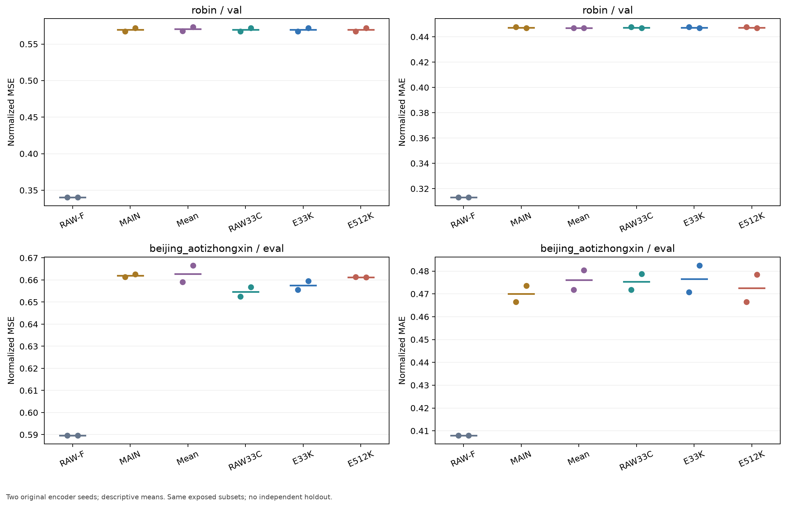
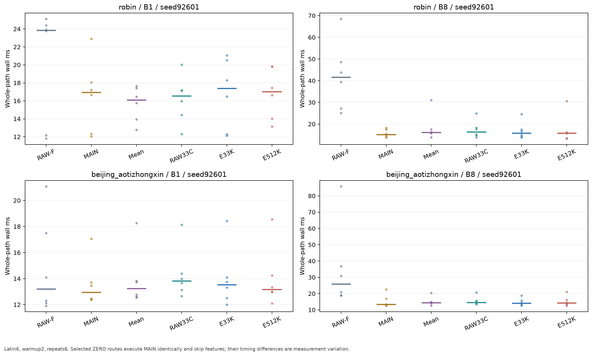

# 2026-10-14까지 완료한 연구 결과

[최신 MAIN 잔차 보정·오차 분해·근거](research/smallk_failure_followup_20261014/publication_main_20261014_v3/README_KO.md) · [이전 matched-readout](research/smallk_failure_followup_20261014/publication_main_20261014_v2/README_KO.md) · [그 이전 전체 결과](research/smallk_failure_followup_20261014/publication_main_20261014_v1/README_KO.md)

작은 K의 정확도 문제는 아직 해결되지 않았습니다. Bi-Hash 미래 정렬, 예측 목적 표현, joint E/D 손실, RF1/RF3 디코더, E/F/D 분리, native ridge, matched-readout와 MAIN 예측을 보존한 잔차 보정을 실제 실행했습니다. 최신 보정은 Robin에서 모두 ZERO를 선택했고, Beijing의 일부 MSE 개선에는 MAE 악화가 함께 나타났습니다. 같은 예측의 채널·구간·오차 크기별 기여도 분해해 보존했습니다. ExoTimer 전체 문장·LLM 시스템을 재현한 것은 아닙니다.

- [최신 MAIN 보정 보고서·6개 그림](research/smallk_failure_followup_20261014/publication_main_20261014_v3/reports/main_residual_REPORT_KO.md)
- [오차 기여 분해·4개 CSV](research/smallk_failure_followup_20261014/publication_main_20261014_v3/reports/error_diagnosis_REPORT_KO.md)
- [현재 판단과 다음 질문](research/smallk_failure_followup_20261014/publication_main_20261014_v3/reports/interpretation_REPORT_KO.md)
- [이전 원 C·K 표현·시간 요약 비교](research/smallk_failure_followup_20261014/publication_main_20261014_v2/reports/matched_REPORT_KO.md)
- [E/F/D 분리 보고서](research/smallk_failure_followup_20261014/publication_main_20261014_v1/reports/stage_REPORT_KO.md)
- [Joint E/D·Appliances 손실](research/smallk_failure_followup_20261014/publication_main_20261014_v1/reports/joint_REPORT_KO.md)
- [RF1/RF3·균형 순서 비용](research/smallk_failure_followup_20261014/publication_main_20261014_v1/reports/sequence_REPORT_KO.md)
- [Bi-Hash 미래 정렬](research/smallk_failure_followup_20261014/publication_main_20261014_v1/reports/bihash_REPORT_KO.md)
- [작은 K 정렬·새 자료 비교](research/smallk_failure_followup_20261014/publication_main_20261014_v1/reports/alignment_REPORT_KO.md)

반복 개발 VAL·이미 노출된 EVAL·두 seed의 제한이 있습니다. Oracle는 실제 미래를 사용하는 진단이고 배포 방법이 아닙니다. 검사 통과는 성능 개선이나 독립 일반화 검증을 뜻하지 않습니다. 보고서의 `.cache`·checkpoint·NPZ 경로는 로컬 재현 자산이며 GitHub에 게시하지 않았습니다.
