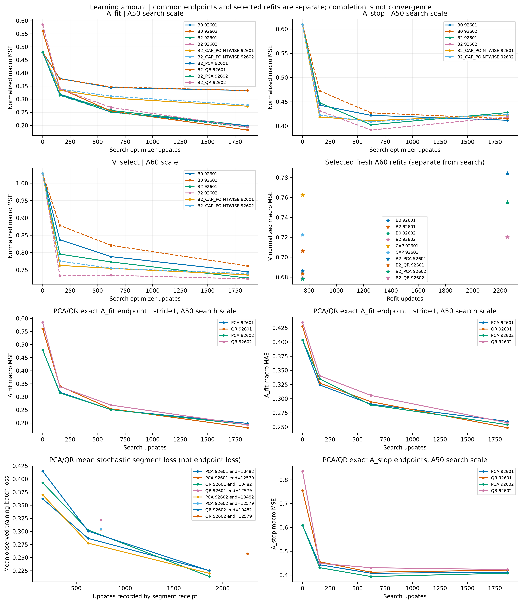
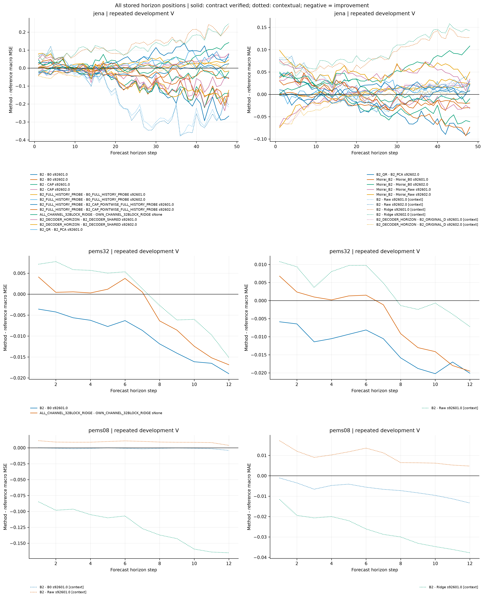
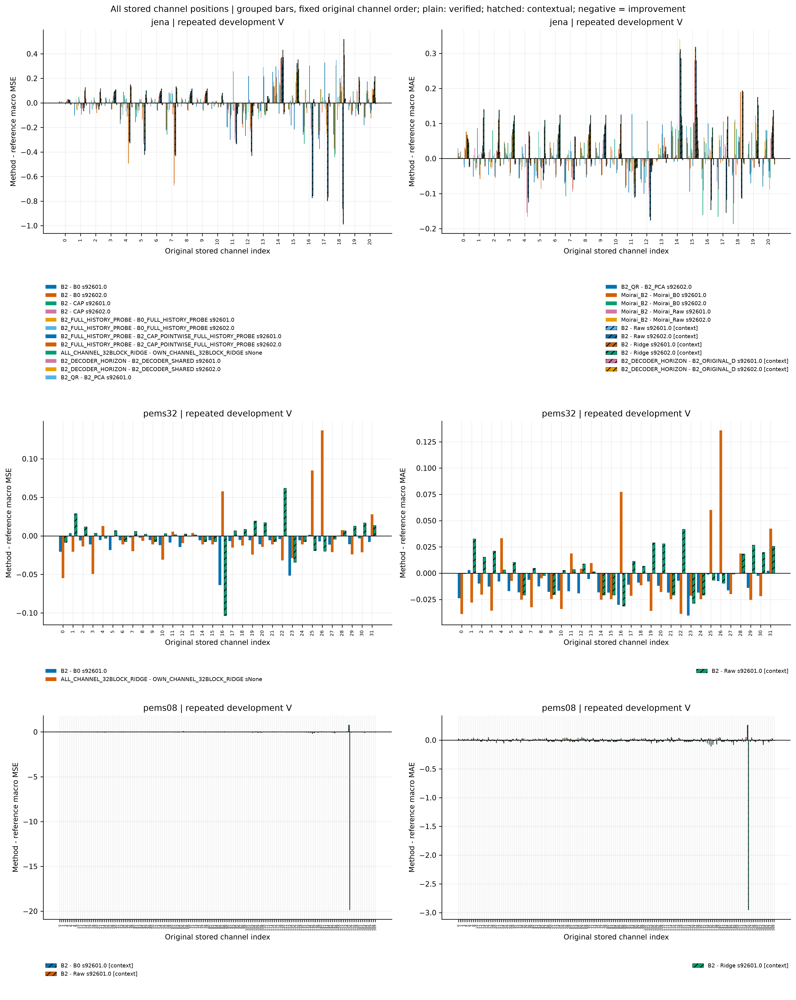
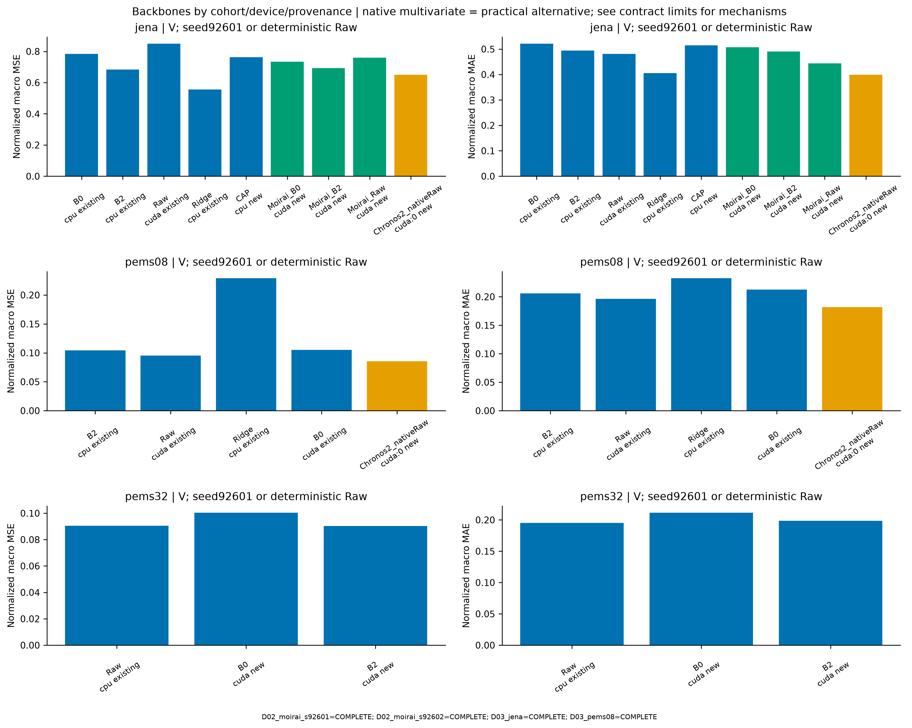
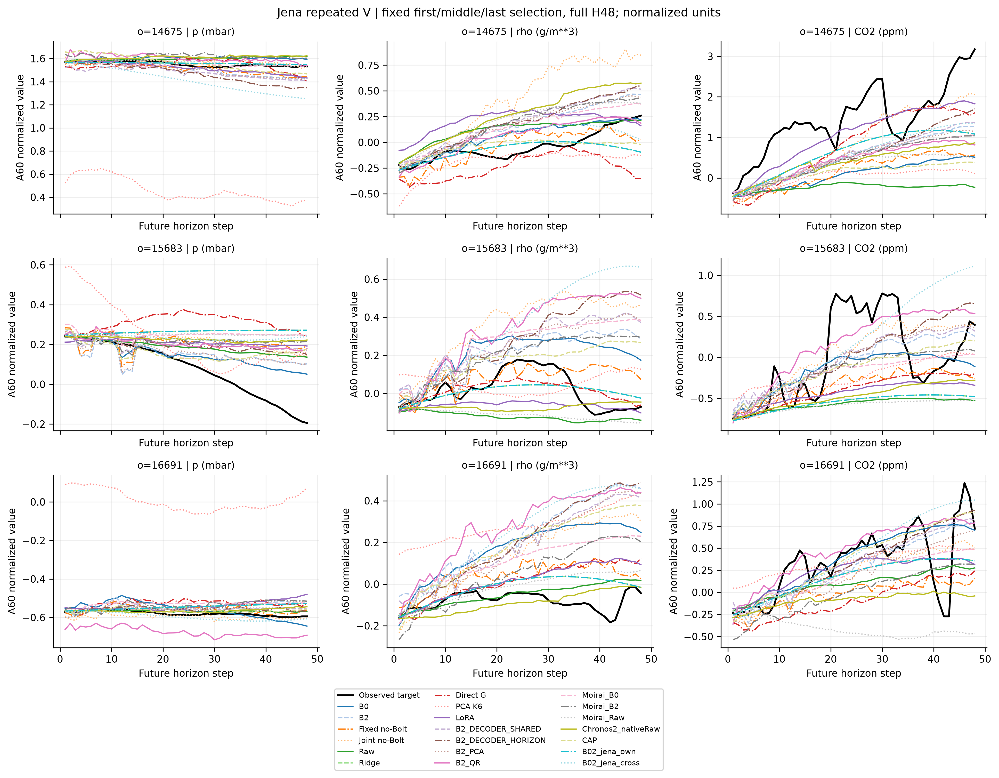

# Adapter 진단 결과

[확인] SCIENTIFIC_PARTIAL. ENGINEERING_COMPLETE는 실제 전체 검증·게시·원격 SHA 확인 이후에만 판정한다.
모든 정확도 결과는 반복 사용한 개발 V다. 기존 결과 재사용과 이번 신규 실행/재채점은 RUNS_FULL_PRECISION의 origin 열로 구분한다.
상태 수: COMPLETE=104, SKIPPED_BUDGET=2.

현재 수집된 Jena 최소 MSE는 Ridge `0.5566463357048567`, MAE `0.40552180175406594`이다. 서로 다른 기능·용량·학습량의 결과를 포함하므로 순수 구조 효과로 읽지 않는다.
정확도 허용폭·실용 속도 목표는 UNREGISTERED다. 2seed는 각각 보이며 범위 이상의 일반화·수렴·계층적 모든 K-prefix를 입증하지 않는다.

[전체 job 상태](JOB_STATUS.csv) · [정확도](RUNS_FULL_PRECISION.csv) · [공통 update](SAME_UPDATE_RESULTS.csv) · [같은 endpoint 대조](SAME_UPDATE_COMPARISONS.csv) · [계약 확인 비교](MATCHED_COMPARISONS.csv) · [제한 있는 맥락 비교](CONTEXTUAL_COMPARISONS.csv) · [비용](COST_FULL_PRECISION.csv) · [질문별 판단](QUESTIONS_AND_DECISIONS_KO.md) · [감사](VALIDATION.json)

