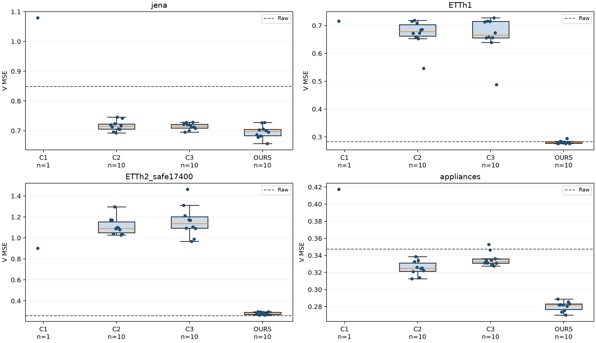
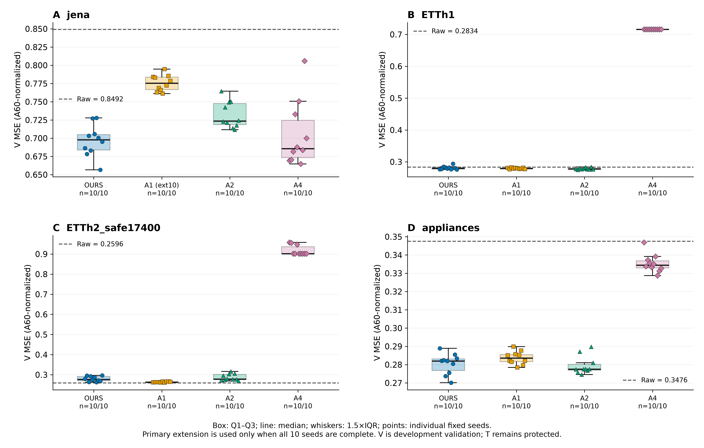

# 논문용 핵심 주장·실험 결과·한계

작성일: 2026-10-27 KST. 근거 결과: `comparative_ablation_20261025_v1`과 `comparative_ablation_followup_20261027_v1`. 실험 결과 기준 커밋은 `b107e9d76bde91bdb89886b55980679341fc77a7`이다. 이 문서는 기존 공개 결과의 논문용 서술이며, 새로운 학습이나 평가를 포함하지 않는다. 아래 수치는 보호 테스트 T가 아닌 개발 검증 V에서 얻었다. [확인]은 기록으로 확인한 결과, [추정]은 결과에 대한 해석을 뜻한다.

제목 후보: **고정 시계열 파운데이션 모델의 다변량 적응에서 입력 전처리와 출력 복원 구조의 역할: 비교 및 절제 실험**

## 1. 논문에서 제시할 핵심 주장

[확인] 본 연구의 첫 번째 주장은 고정 Chronos-Bolt-small과 등록된 학습·선택 조건에서 제안 방법이 일부 데이터의 정규화 평균제곱오차(MSE)를 개선했다는 것이다. 주 평가 데이터인 ETTh1과 Appliances에서 제안 방법의 MSE 중앙값은 데이터별 최선 비교 어댑터보다 각각 58.02%와 13.21% 낮았다. Jena에서는 2.42% 낮았으나 등록 판정은 동률이었다. 비교 어댑터의 미완료 연장이 있으므로 세 데이터의 비교 판정은 모두 잠정적이다. 보조 데이터 ETTh2_safe17400에서도 비교 어댑터보다 69.26% 낮았지만, 기본 모델 Raw보다 6.81% 높았다. 따라서 주장은 특정 비교 설정과 MSE에 한정한다. [비교 근거](COMPARATIVE.csv), [전체 지표](SUMMARY.csv).

[확인] 두 번째 주장은 마지막 관측값·변화량·지연값(lag)을 포함한 출력 복원 구조 D 전체가 ETTh1과 Appliances의 성능 유지에 기여했다는 것이다. D를 단순 선형 디코더로 대체한 A4는 제안 방법보다 MSE가 각각 155.95%와 18.57% 증가했으며, 보조 데이터 ETTh2_safe17400에서도 225.34% 증가했다. 이 비교가 식별하는 것은 등록 조건 아래 D 전체를 대체한 효과다. 마지막 관측값 경로와 lag의 개별 효과를 식별한 결과는 아니다. [절제 근거](ABLATION.csv).

[확인] 세 번째 주장은 입력 전처리 P의 효과가 데이터에 따라 달랐다는 것이다. Jena에서 P를 제거한 A1은 최대 10 epoch까지 탐색한 후에도 제안 방법보다 MSE가 11.12% 높아 등록 기준상 P의 기여가 확인되었다. 다른 데이터에서는 기여가 불명확했다. 파라미터 수를 거의 맞춘 채 시간 MLP를 채널 MLP로 교체한 A2 역시 모든 데이터에서 차이가 불명확했으므로, 시간축 혼합 방식 자체의 고유한 우월성을 주장하지 않는다. [절제 수치](PAPER_ABLATION.csv), [구조 정의](../comparative_ablation_20261025_v1/PREREGISTRATION.md).

## 2. 국문 초록 초안

본 연구는 고정된 시계열 파운데이션 모델에 다변량 입력을 적응시킬 때 입력 전처리와 출력 복원 구조가 예측 오차에 미치는 영향을 분석하였다. Chronos-Bolt-small을 고정하고, 입력 전처리 P, 저차원 채널 매핑 E, 마지막 관측값·변화량·지연값을 활용하는 출력 복원 D를 결합한 방법을 PCA 및 두 종류의 선형 오토인코더 어댑터와 비교하였다. 세 개의 주 평가 데이터와 한 개의 보조 데이터에서 개발 검증 구간의 정규화 MSE를 측정하고, 학습 방법별 10개 seed의 중앙값과 사분위범위를 보고하였다. 제안 방법은 ETTh1과 Appliances에서 최선 비교 어댑터보다 MSE 중앙값이 각각 58.02%와 13.21% 낮았으며, Jena는 등록 기준상 동률이었다. D 전체를 선형 디코더로 대체하면 ETTh1과 Appliances의 MSE가 각각 155.95%와 18.57% 증가하였다. P 제거의 영향은 Jena에서 확인되었으나, 파라미터 수를 맞춘 대조 실험에서는 시간축 혼합의 고유한 우월성이 확인되지 않았다. 출력 공간 하한 분석은 선택된 일부 선형 디코더의 표현 제약과 큰 오차가 함께 나타남을 보였다. 비교 어댑터의 추가 학습이 미완료이고 보호 테스트 구간을 평가하지 않았으므로, 본 결과는 개발 검증 구간에서 관찰한 조건부 효과로 해석한다. 또한 MAE와 MASE는 Raw 대비 개선되지 않아 모든 오차 지표의 일관된 개선을 주장하지 않는다.

## 3. 실험 설정과 판정 방법

백본은 가중치를 고정한 Chronos-Bolt-small이며, 입력 길이는 512, 예측 길이는 48이다. 제안 방법 OURS는 기존 K_τ 캠페인의 10-seed 결과를 재사용했다. 저차원 크기 K는 이전에 정한 값을 유지했다. 모델 학습과 checkpoint 선택은 각각 A_fit과 A_stop에서 수행하고, 선택한 epoch만큼 A60에서 새로 학습한 뒤 V에서 평가했다. 정규화 통계는 해당 학습 구간에서만 산출했다. 최종 V MSE는 A60 통계로 정규화된 관측 타깃에 대한 채널별 제곱오차 평균이다. V는 모델 학습·checkpoint 선택에 사용하지 않았으나, 개발 과정의 결과 해석과 후속 범위 선택에 사용된 구간이다. 보호 테스트 T는 이번 두 캠페인에서 수치로 읽거나 평가하지 않았다. [지표 정의](VMSE_DEFINITION.md), [등록 프로토콜](../comparative_ablation_20261025_v1/PREREGISTRATION.md).

```text
Dataset             Channels C   Latent K   Role
Jena                    21           6      Primary
ETTh1                    7           4      Primary
Appliances              26          10      Primary
ETTh2_safe17400           7           4      Auxiliary
```

표 1. 데이터별 설정. ETTh2_safe17400은 별도 보조 결과이며, 주 평가 세 데이터의 승리 수에 포함하지 않는다. 데이터 식별자와 K는 등록값 그대로 사용했다. 채널 수는 [D0 결과](D0_SUBSPACE_FLOOR.csv)에 기록되어 있다.

Raw는 추가 어댑터가 없는 기본 예측이다. C1은 학습 없는 고정 PCA 어댑터, C2는 선형 인코더와 디코더, C3는 선형 인코더 뒤에 dropout을 적용하고 평가 시 10개 잠재 예측을 평균하는 어댑터다. C1–C3는 동일 백본 조건에 맞춘 AdaPTS식 비교 방법이며, AdaPTS 원 논문의 전체 학습·탐색 절차를 재현한 것은 아니다. A1은 P 제거, A2는 파라미터 수를 거의 맞춘 시간 MLP의 시점 공유 채널 MLP 대체, A4는 D 전체의 선형 디코더 대체다. A3(PCA 초기화 대조)와 A5(lag 제거)는 실행하지 않았다. [비교 구현 차이](../comparative_ablation_20261025_v1/DEVIATIONS_FROM_ADAPTS.md).

학습 방법은 seed 92601–92610을 사용했다. Raw와 C1은 결정적 단일 실행이며, 표의 반복 실험 수 n은 데이터셋 수나 독립적인 현실 표본 수가 아니라 실행 seed 수다. 기본 탐색 checkpoint는 OURS·A1·A2·A4에서 초기 모델과 0.25/1/3 epoch, C2·C3에서 초기 모델과 0.25/1/3/6 epoch다. Jena의 A1 연장은 초기 모델과 0.25/1/3/6/10 epoch에서 선택했다. 이는 모든 모델을 동일 epoch로 학습한 비교가 아니다. 최적화는 AdamW, 학습률 0.001, weight decay 0, gradient clip 1, effective batch 16, microbatch 4, FP32이며 RevIN은 사용하지 않았다. [등록 설정](../comparative_ablation_20261025_v1/PREREGISTRATION.md), [Jena 연장 실행 예](../comparative_ablation_20261025_v1/jobs/CA_A1_jena_K6_s92601_ext10/RESULT.json).

비교 방법의 최선값은 각 데이터에서 C1–C3의 V MSE 중앙값 중 최솟값이다. 이를 V에서 선택했으므로 비교 대상에 유리한 선택이며, 독립적인 모델 선택 평가와 혼동하지 않는다. 등록 판정은 두 대상의 IQR 중 큰 값을 spread로 두고, 중앙값 차이가 spread보다 크면 WIN 또는 CONTRIBUTES로 분류한다. 따라서 이 판정은 통계적 유의성 검정이 아니다. IQR은 seed 간 산포를 나타내며 신뢰구간이 아니다. 기존 보고서의 Mann–Whitney p값도 기술 정보로만 취급하고, 이 문서의 주장 근거를 별도의 유의성 검정으로 확대하지 않는다.

```text
Relative reduction vs baseline (%) = 100 × (median_baseline − median_OURS) / median_baseline
Ablation effect (%)                = 100 × (median_variant − median_OURS) / median_OURS
spread                             = max(IQR_OURS, IQR_comparison_or_variant)
```

첫 번째 비율은 양수일 때 제안 방법의 오차가 낮음을, 두 번째 비율은 양수일 때 구성요소를 제거·대체한 뒤 오차가 높아짐을 뜻한다. 두 비율의 분모가 다르므로 같은 비율로 바꾸어 해석하지 않는다. 등록 규칙상 상한 선택 비율 때문에 연장이 필요하지만 연장이 미완료인 비교에는 PROVISIONAL을 유지했다.

## 4. 비교 실험 결과

```text
Dataset             Raw        C1         C2 median (IQR)      C3 median (IQR)      OURS median (IQR)
Jena                0.849194   1.079489   0.715067 (0.017248)   0.715753 (0.012389)   0.697770 (0.021174)
ETTh1               0.283405   0.715743   0.678325 (0.040459)   0.666153 (0.058611)   0.279643 (0.005426)
Appliances          0.347579   0.417315   0.324931 (0.009727)   0.332662 (0.004946)   0.282019 (0.006378)
ETTh2_safe17400*     0.259555   0.901934   1.091104 (0.102803)   1.137333 (0.109572)   0.277231 (0.021597)
```

표 2. 정규화 V MSE. 낮을수록 좋다. C2·C3·OURS는 각각 n=10의 중앙값(IQR), Raw·C1은 n=1의 단일값이다. Raw·C1의 seed 간 산포는 추정하지 않았다. 별표는 보조 데이터다. [원본 요약표](SUMMARY.csv), [논문용 비교 CSV](PAPER_COMPARISON.csv).

```text
Dataset             Best comparator   Reduction vs best   Reduction vs Raw   Registered decision
Jena                       C2                  2.42%              17.83%     TIE_PROVISIONAL
ETTh1                      C3                 58.02%               1.33%     WIN_PROVISIONAL
Appliances                 C2                 13.21%              18.86%     WIN_PROVISIONAL
ETTh2_safe17400*            C1                 69.26%              -6.81%     WIN_PROVISIONAL
```

표 3. 데이터별 최선 비교 어댑터 및 Raw 대비 상대 MSE 감소율. 음수는 제안 방법의 오차가 더 큼을 뜻한다. 비교방법의 필요한 연장이 끝나지 않았으므로 잠정 표기를 제거하지 않는다. 이 표의 승리 판정은 Raw와의 비교 판정이 아니다.

[확인] ETTh1과 Appliances에서 제안 방법은 최선 비교 어댑터보다 낮은 MSE를 보였고, 차이는 등록 spread 기준을 넘었다. Jena도 수치상 MSE는 낮았지만 차이가 spread보다 작아 동률로 분류되었다. 주 평가 세 데이터에서는 잠정 우세 두 개와 잠정 동률 한 개가 관찰되었다. ETTh2_safe17400의 잠정 우세는 보조 결과로 별도 보고한다.

[확인] Raw와 비교하면 결과의 의미가 달라진다. ETTh1의 Raw 대비 MSE 감소는 1.33%로 작으며, ETTh2_safe17400에서는 제안 방법의 오차가 6.81% 증가하였다. 따라서 ETT에서 관찰된 큰 비교 어댑터 대비 차이를 기본 모델 대비 대폭 개선으로 표현할 수 없다. Jena와 Appliances에서는 Raw 대비 MSE가 각각 17.83%와 18.86% 감소하였다.

[확인] 개선은 모든 오차 지표에 일관되지 않았다. OURS의 MAE 중앙값은 Jena 0.497155 대 Raw 0.481388, ETTh1 0.348453 대 0.324030, Appliances 0.337514 대 0.333530, ETTh2_safe17400 0.357749 대 0.312753으로 네 데이터에서 모두 더 높았다. MASE도 네 데이터에서 Raw보다 높았다. 따라서 본 연구는 MSE 기준 결과를 중심으로 기술하며, 전반적인 정확도 또는 모든 지표의 향상으로 확대하지 않는다. [보조 지표 전체](SUMMARY.csv).



그림 1. 등록된 비교 방법과 OURS의 개발 검증 MSE 비교. 학습 방법의 상자는 Q1–Q3, 내부 선은 중앙값, 점은 개별 실행이며 Raw는 점선이다. C1은 단일 실행이다. ETTh2_safe17400은 보조 분석이다. 그림의 수치상 순위와 잠정 판정은 구분해야 하며, 원 논문 전체의 재현 비교가 아니다. 원본 벡터 파일은 [FIG_COMPARATIVE.svg](FIG_COMPARATIVE.svg), 그림 입력은 [FIG_COMPARATIVE.csv](FIG_COMPARATIVE.csv)다.

## 5. 절제 실험 결과

```text
Dataset             Variant   Median MSE   IQR        Effect vs OURS   Registered decision
Jena                A1*       0.775362     0.017211      +11.12%       CONTRIBUTES
Jena                A2        0.723501     0.028942       +3.69%       UNCLEAR
Jena                A4        0.685574     0.051290       -1.75%       UNCLEAR
ETTh1               A1        0.279226     0.003130       -0.15%       UNCLEAR
ETTh1               A2        0.277454     0.003690       -0.78%       UNCLEAR
ETTh1               A4        0.715743     0.000000     +155.95%       CONTRIBUTES
Appliances          A1        0.283612     0.003923       +0.56%       UNCLEAR
Appliances          A2        0.277510     0.003301       -1.60%       UNCLEAR
Appliances          A4        0.334393     0.003928      +18.57%       CONTRIBUTES
ETTh2_safe17400      A1        0.263365     0.003370       -5.00%       UNCLEAR_PROVISIONAL
ETTh2_safe17400      A2        0.278526     0.026056       +0.47%       UNCLEAR
ETTh2_safe17400      A4        0.901934     0.033964     +225.34%       CONTRIBUTES
```

표 4. 절제 결과. 모든 행은 n=10이며, Effect의 양수는 제거·대체 후 MSE 증가다. A1은 P 제거, A2는 용량을 맞춘 시간 MLP 대체, A4는 D 전체 대체다. 별표의 Jena A1은 연장 탐색 10개를 주 결과로 사용했으며, 원래의 10개와 합쳐 n=20으로 계산하지 않았다. ETTh2_safe17400은 보조 데이터다. [원 판정](ABLATION.csv), [논문용 절제 CSV](PAPER_ABLATION.csv).

[확인] P를 제거한 Jena A1의 MSE 중앙값은 0.775362로 OURS의 0.697770보다 높았다. 연장 탐색에서 선택된 epoch는 3이 두 개, 6이 다섯 개, 10이 세 개였다. 최종 상한 선택은 3/10으로 등록된 undertrained_at_10 조건에 해당하지 않았으며, P의 기여 판정은 CONTRIBUTES였다. 이는 탐색 상한에 대한 등록상의 우려를 줄인 결과이지, A1의 전역 최적점이나 완전한 수렴을 증명한 것은 아니다. 다른 세 데이터에서는 P의 기여가 불명확했으며, ETTh2 A1의 잠정 표기는 유지하였다.

[확인] A2는 파라미터 수를 거의 유지하면서 시간 방향 MLP를 각 시점에 같은 가중치를 적용하는 채널 MLP로 교체한 대조다. 네 데이터 모두 UNCLEAR이므로, 현재 실험은 시간축 혼합의 고유한 이점을 분리해 확인하지 못했다. 이 결과는 두 구조의 동등성을 입증하지 않으며, 개선이 오직 파라미터 수 증가 때문이라는 주장도 뒷받침하지 않는다.

[확인] A4의 MSE 증가는 ETTh1과 Appliances에서 등록 기준상 D 전체의 기여를 지지했고, 보조 ETTh2에서도 같은 판정을 얻었다. Jena에서는 A4 중앙값이 오히려 OURS보다 1.75% 낮았지만 변동폭을 넘는 차이는 아니었다. 따라서 D가 모든 데이터에 반드시 필요하다는 주장은 성립하지 않는다. 주 집계에서 P의 기여는 한 데이터, D 전체의 기여는 두 데이터에서 확인되었다.

[확인] A4의 선택 결과에는 초기 모델이 포함된다. ETTh1은 10/10, ETTh2는 7/10이 epoch 0을 선택했다. 학습 탐색을 생략한 것이 아니라 A_stop 기준으로 초기 상태가 선택된 것이다. 특히 ETTh1 A4의 IQR=0을 학습의 안정성이나 충분한 최적화의 증거로 해석하면 안 된다. [선택 epoch와 해석 범위](A4_SELECTION_INTERPRETATION.md).



그림 2. 데이터별 OURS·A1·A2·A4의 10-seed MSE 분포와 개별 점. 상자는 Q1–Q3, 내부 선은 중앙값, Raw는 점선이다. Jena A1은 연장 탐색 결과를 사용하며 ETTh2_safe17400은 보조 분석이다. 판정과 잠정 여부는 표 4를 따른다. A4는 마지막 관측값·변화량·lag를 포함한 D 전체의 대체이며, 개별 경로의 효과를 분리하지 않는다. 원본은 [FIG_ABLATION_UPDATED.svg](FIG_ABLATION_UPDATED.svg), 입력은 [FIG_ABLATION_UPDATED.csv](FIG_ABLATION_UPDATED.csv)다.

## 6. 출력 공간 하한 분석

D0는 A60에서 얻은 고정 PCA 공간에 대해, V 타깃에서 그 공간으로 표현할 수 없는 성분의 제곱오차를 계산한다. 이는 해당 고정 공간으로 출력하는 C1의 조건부 하한이다. D1은 선택된 C2·C3·A4 디코더의 affine 출력 공간에 대해 같은 방식으로 계산한다. 모든 채널이 관측된 origin×horizon 대상점에 한정했고, 네 데이터의 제외 비율은 모두 0이었다. D1의 비율은 각 seed에서 계산한 하한/실제 MSE의 중앙값이며, 하한 중앙값을 실제 MSE 중앙값으로 나눈 값이 아니다.

```text
Dataset             D0 A60 floor   D0 V floor   C1 MSE*   D1 C2 ratio   D1 C3 ratio   D1 A4 ratio
Jena                    0.091105     0.174734   1.079489      32.72%        33.00%        29.32%
ETTh1                   0.079097     0.461371   0.715743      62.74%        62.96%        64.46%
Appliances              0.089795     0.134636   0.417315      48.50%        47.17%        42.45%
ETTh2_safe17400          0.066848     0.691942   0.901934      70.86%        69.23%        76.72%
```

표 5. 고정 PCA 및 선택된 선형 디코더의 출력 공간 하한. C1 MSE*는 D0와 동일한 대상점에서 다시 계산한 실제 오차다. D1 각 방법·데이터의 n은 10이다. 비율은 선택된 출력 공간의 제약을 나타내며, OURS 개선량에 대한 인과적 기여율이 아니다. [D0 원본](D0_SUBSPACE_FLOOR.csv), [D1 원본](D1_DECODER_FLOOR_SUMMARY.csv), [논문용 하한 CSV](PAPER_SUBSPACE.csv).

[확인] 모든 데이터에서 C1의 실제 MSE는 D0 하한 이상이었다. ETT에서는 선택된 C2·C3·A4의 D1 비율 중앙값이 62.74–76.72% 범위였다. [추정] 이 결과는 특정 저차원 출력 공간의 표현 제약이 ETT의 큰 오차와 관련됨을 뒷받침한다. 그러나 이 비율만으로 수준 이동을 유일한 원인으로 단정하거나, D의 각 경로가 개선량의 몇 퍼센트를 설명한다고 해석할 수 없다. 디코더 공간 자체를 바꾸는 재학습까지 포함한 모든 선형 디코더의 최적 성능 하한도 아니다.

[확인] 후속 계획의 고정 예측 열 개 가운데 아홉 개가 일치했다. ETT의 A4 오차 증가가 50% 이상일 것이라는 예측과 여섯 D1 비율이 0.5 이상일 것이라는 예측은 일치했다. 반면 Appliances의 A4 변화율 절댓값이 10% 미만일 것이라는 예측은 실제 +18.57%로 일치하지 않았다. 이 예측 확인은 등록된 절제 판정을 변경하는 기준으로 사용하지 않았다. [예측 확인](PREDICTION_CHECK.md).

## 7. 논의와 한계

**검증 범위와 일반화.** 모든 주장은 개발 검증 구간 V에 관한 것이다. T는 평가하지 않았으므로 보지 않은 테스트 구간에서의 일반화 성능을 확정할 수 없다. 백본 하나, 고정된 입력·예측 길이, 네 데이터와 등록된 K에 관한 결과이며, 다른 모델·길이·차원으로의 보편적 우월성을 주장하지 않는다. seed 반복은 동일 데이터와 평가 구간에서의 실행 변동을 보여줄 뿐 독립적인 데이터셋 반복을 대체하지 않는다.

**비교의 잠정성과 비용.** C2·C3에서 상한 선택에 따른 연장이 필요한 그룹이 있으나 해당 연장은 완료하지 않았다. 따라서 더 충분히 최적화된 비교 어댑터와의 순위는 달라질 수 있다. Jena A1 연장을 완료한 것은 P 절제의 등록 판정을 갱신한 것이며, C2·C3 비교의 잠정성을 해소하지 않는다. 공통 백본과 데이터·선택 원칙은 유지했지만 학습 파라미터 수, 탐색 일정과 연산량은 동일하지 않다. 이번 결과만으로 파라미터 효율성이나 동일 계산량에서의 우월성을 확정할 수 없다. AdaPTS 원 논문의 백본·학습 일정·탐색 등을 모두 재현하지 않았으므로 원 논문 전체를 능가했다는 주장도 하지 않는다.

**기여의 식별 범위.** A4는 D 전체의 대체 실험으로 마지막 관측값·변화량·lag의 개별 기여를 분리하지 않는다. A5가 없으므로 lag 자체의 효과는 미확인이다. A3도 없으므로 PCA 초기화의 고유한 기여를 주장할 수 없다. P 제거의 Jena 결과와 A2의 불명확한 결과를 함께 고려해야 하며, 시간축 혼합만이 개선 원인이라고 말할 수 없다. A4의 초기 epoch 선택을 포함한 결과는 등록된 최적화·선택 조건에 종속된다.

**사후 범위 선택과 통계적 해석.** 후속 A4 및 Jena A1 연장은 첫 캠페인 결과를 본 뒤 선택했다. 새 학습 전에 범위·seed·판정 규칙을 등록했지만, 어떤 후속 실험을 수행할지에 대한 선택까지 결과 독립적인 것은 아니다. 그러므로 전체 후속 분석을 완전한 사전적 확증 실험으로 표현하지 않는다. WIN·CONTRIBUTES는 사전등록된 중앙값/IQR 기준의 기술적 판정이다. UNCLEAR는 효과 없음이나 동등성의 증명이 아니다. 보호 테스트 확인이나 추가 통계 절차 없이 통계적으로 유의한 우월성을 선언하지 않는다. [범위 선택 공개](PREREGISTRATION_ADDENDUM.md).

**지표에 따른 결론의 차이.** MSE는 큰 오차에 더 큰 가중치를 주므로 MAE·MASE와 순위가 다를 수 있다. 본 결과에서 MAE·MASE는 네 데이터 모두 Raw보다 높았다. 또한 ETTh2에서는 MSE 자체도 Raw보다 높았다. 이를 제외하거나 MSE 개선을 모든 지표의 향상으로 바꾸어 서술하지 않는다. 오차의 어느 부분이 달라졌는지는 별도 [오차 분포 표](ERROR_DISTRIBUTION_SUMMARY.csv)를 사용해야 하며, 이 문서는 MSE 차이만으로 꼬리 오차 감소를 모든 데이터에서 단정하지 않는다.

**메커니즘 해석의 한계.** D0는 고정 PCA 공간, D1은 실제 선택된 디코더 공간에 조건부인 기하학적 하한이다. 높은 하한 비율은 공간 제약의 진단 근거이지, 전체 성능 차이의 인과적 분해가 아니다. 원 D0 표의 V 최적 rank-K 공간 하한은 V로 계산한 사후 기하학적 참조값이며, 학습 데이터만으로 사용할 수 있는 비교 모델의 성능으로 취급하지 않는다. 새로 관찰한 패턴을 사전에 예측한 결과처럼 바꾸어 쓰지 않으며, Appliances에 대한 불일치 예측도 함께 보존한다.

## 8. 결론 문단 초안

본 연구는 고정된 시계열 파운데이션 모델의 다변량 적응에서 입력 전처리와 출력 복원 구조의 영향을 비교 및 절제 실험으로 분석하였다. 개발 검증 MSE 기준으로 제안 방법은 주 평가 데이터 중 ETTh1과 Appliances에서 최선 비교 어댑터보다 낮은 오차를 보였고, Jena는 등록 기준상 동률이었다. 비교 어댑터의 필요한 연장이 미완료여서 비교 판정은 잠정적이다. 절제 실험은 ETTh1과 Appliances에서 D 전체 구조의 기여와 Jena에서 P의 기여를 지지하였다. 반면 시간축 혼합의 고유한 우월성과 D 내부 경로별 기여는 분리해 확인하지 못했다. 출력 공간 하한은 일부 선택된 선형 디코더의 표현 제약을 설명하는 진단 근거를 제공하였다. 이러한 결과는 개발 검증 구간, 제한된 최적화 일정 및 데이터별 차이를 전제로 하며, 보호 테스트 성능이나 모든 지표·데이터에서의 보편적 우월성으로 확대하지 않는다.

## 9. 근거와 재사용 방법

[확인] 후속 학습은 A4 40개와 Jena A1 연장 10개를 모두 완료했다. 첫 새 학습부터 종료 기록까지 약 6시간 34분 30초가 소요됐고, 예산 중단은 없었다. 나머지 350개 후보는 범위 밖으로 기록되었다. 주 결과 집계에서는 Jena A1의 연장 10개만 사용한다. 등록 과학 소스와 기존 결과의 보존, 독립 수치 검산 및 그림 검토는 [FINAL_VALIDATION_INDEX.json](FINAL_VALIDATION_INDEX.json)에 연결되어 있다. 이전 수치 검산 001의 C1 무학습 조건 오탐은 002에서 바로잡았으며, 원 실패 기록도 보존되어 있다.

본문의 수치 재사용에는 [PAPER_COMPARISON.csv](PAPER_COMPARISON.csv), [PAPER_ABLATION.csv](PAPER_ABLATION.csv), [PAPER_SUBSPACE.csv](PAPER_SUBSPACE.csv)를 사용한다. 표의 비율은 기존 CSV의 중앙값에서 계산했으며, 새 판정이나 새로운 실험 결과가 아니다. 문서·파생 표의 검증과 입력 해시는 [PAPER_READY_VALIDATION.json](PAPER_READY_VALIDATION.json)에 기록한다. 원 실험 ZIP은 과학 산출물을 봉인한 기존 파일 그대로 보존하며, 이 논문용 문서와 표는 그 이후 추가한 별도 저장소 산출물이다.

이 문서는 실험 결과와 논의를 논문 본문에 옮기기 위한 초안이다. 관련연구에 대한 체계적 신규성 검증이나 제출 기관의 전체 논문 형식 검토를 수행한 것은 아니다. 기여를 최초성 또는 보편적 SOTA로 표현하지 않는다. 제출용 본문에서는 인용 형식을 기관 양식에 맞추되, 잠정 판정·불명확 결과·평가 범위와 한계는 유지한다.
