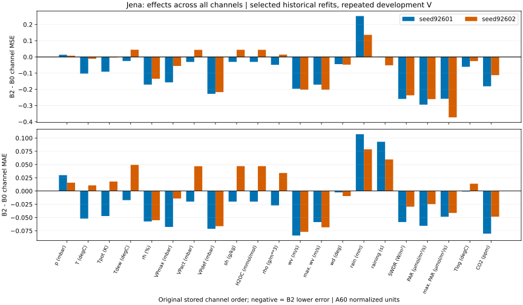
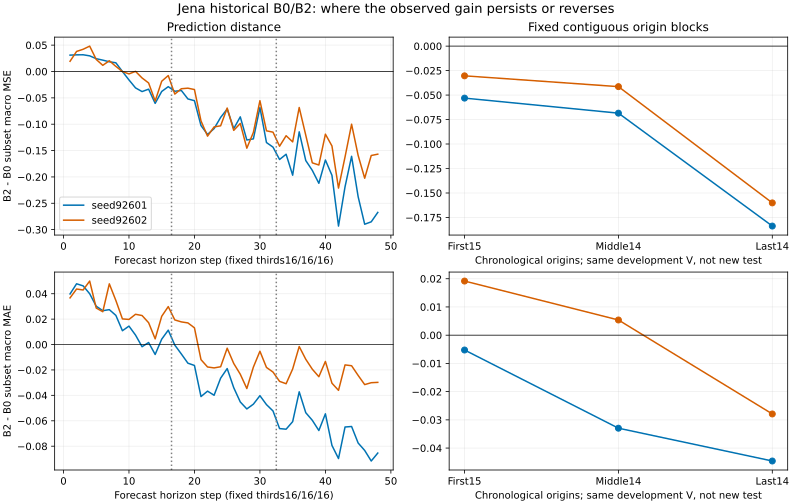

# 기존 Jena B0/B2 오류 분해

[확인] 새 학습·추론 없이 동일한 개발 V의 저장 예측4개를 FP64로 재채점했다. 채널·거리·블록은 오차를 읽기 전에 고정했다.

```text
seed   B0 MSE       B2 MSE       delta MSE     MSE improved/worse   MAE improved/worse
92601  0.784103931  0.683442896  -0.100661035  18/21, 3/21          18/21, 3/21
92602  0.755008778  0.678813925  -0.076194853  14/21, 7/21          10/21, 11/21
```

[확인] 첫/중앙/마지막 origin 블록은 정렬된43개를15/14/14로 나눴고, 예측거리는1–16/17–32/33–48이다. 부분집합 macro 점수와 전체 점수 기여를 CSV에서 분리했다. 전체 관측 수를 분모로 한 기여의 합은 원 전체 B2−B0 차이를1e-12 이내로 복원한다.

[확인] seed92601에서 개선 채널의 총 양의 MSE 이득 중 상위1/3/5개 채널 비중은 12.4%/34.1%/51.9%다. 이 비중의 분모는 악화가 상쇄되기 전의 총 양의 이득이며, 순 전체 이득의 비중과 다르다.
[확인] seed92602에서 개선 채널의 총 양의 MSE 이득 중 상위1/3/5개 채널 비중은 19.3%/45.0%/66.7%다. 이 비중의 분모는 악화가 상쇄되기 전의 총 양의 이득이며, 순 전체 이득의 비중과 다르다.

[추정] 이 분해는 개선이 나타난 위치와 반전을 보여준다. B0 refit3epoch/B2 refit1epoch 및 용량 차이는 그대로 남아 시간 혼합의 인과 효과를 식별하지 못한다.

[미완료] 두 seed와 같은 V의 세 블록은 독립 일반화나 유의성을 입증하지 않는다. 실제 공통 요인·잡음 정답과 상류 보간 계보의 확인도 남아 있다.

- [원수치·검산](ERROR_DECOMPOSITION_SUMMARY.json)
- [채널별 수치](ERROR_DECOMPOSITION_CHANNEL.csv)
- [거리별 수치](ERROR_DECOMPOSITION_HORIZON.csv)
- [시간 블록별 수치](ERROR_DECOMPOSITION_BLOCK.csv)




