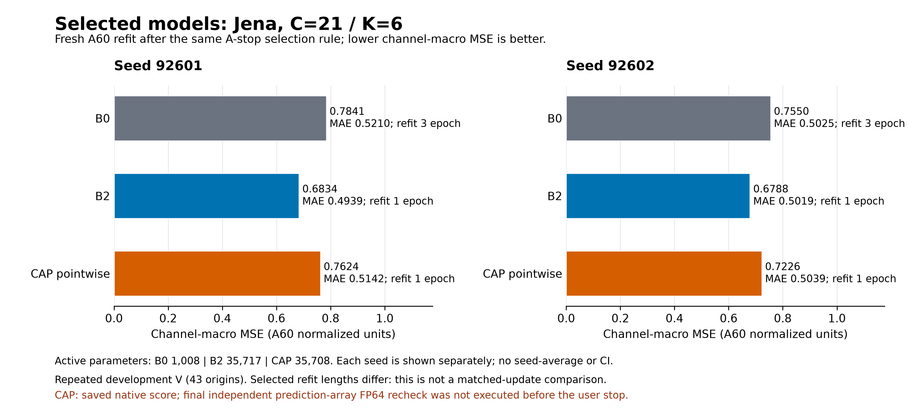
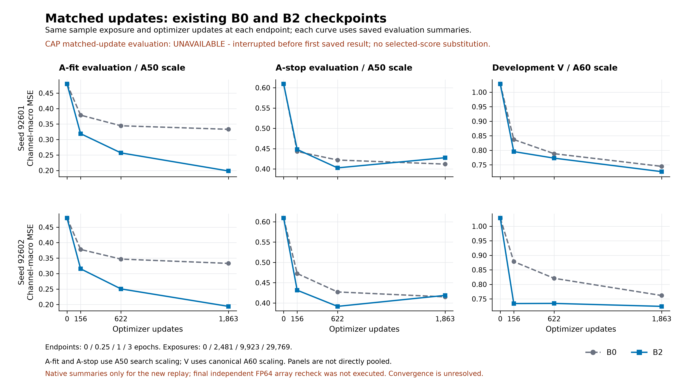
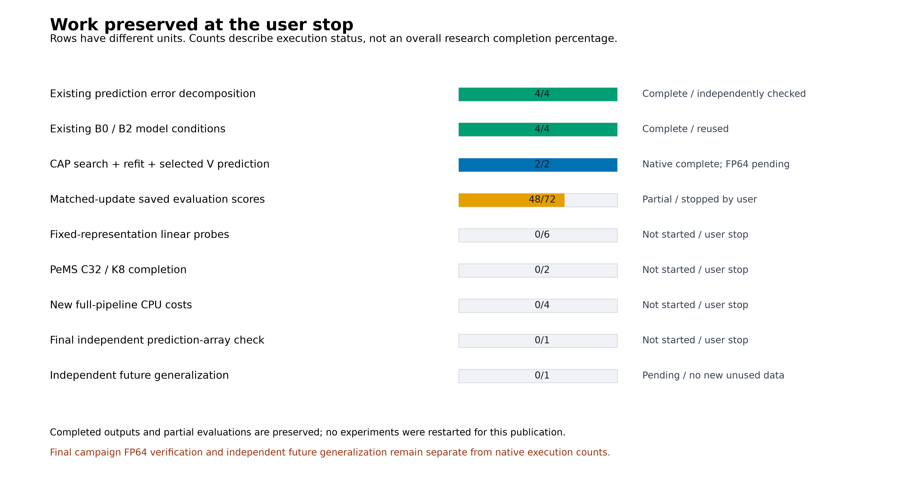

# B2 원인·적용 범위 검증: 사용자 중단 시점 결과

[확인] 이 캠페인은 사용자의 중지 요청으로 종료됐다. 이 중지 요청은 원 PLAN/DATA_SCOPE의 계속 실행 문구보다 우선하며 자동 재개하지 않는다. 학습·추론·비용 측정은 재실행하지 않고, 이미 저장된 공개 JSON/CSV만 모아 이 보고서와 그림을 생성했다. **전체 실험은 미완료이며, 새 결과의 독립 최종 FP64 검산도 미실행이다.** 완료된 오류 분해의 독립 검산과 새 CAP 결과의 native 집계 상태를 구분한다.

## 먼저 말할 수 있는 것

[확인] 기존 선택 모델 비교에서 Jena 두 seed 모두 B2의 MSE가 B0보다 낮다. 근접 용량의 CAP 두 seed는 학습·선택 refit·V 추론을 끝냈다. 아래 CAP 수치는 원 실행의 저장 집계값이며 최종 독립 예측 재채점은 받지 않았다. 공통 학습량 표에는 B0/B2만 있고 CAP의 빈칸은 그대로 남긴다.

[추정] 현재 결과는 명시적 시간 혼합이 도움이 될 가능성과 양립한다. 그러나 CAP 공통 학습량 평가, 동일 probe와 PeMS 검증이 끝나지 않아 시간 처리 자체가 원인이라고 확정할 수 없다. 모수 수가 비슷해도 연산·함수 공간·최적화 난이도가 같지는 않다.

[미완료] 표현의 선형 예측 유용성, PeMS C32의 B2 추가 가치, 새 전체 비용, 새로운 미래 구간의 일반화는 확인되지 않았다. 사용자가 새 자료가 없다고 답했으므로 보호 T를 열지 않았다. 충분 학습·수렴과 공통 요인 식별도 입증하지 않았다.

## 계산 구조와 비교 계약

주 방법은 `B2 시간·채널 P → E(C→K) → 동결 Chronos-Bolt → 잠재 과거·미래를 받는 lag D → 원 C 현재값 anchor`다. P/E/D는 재구성 오차가 아닌 미래 예측 MSE로 이미 학습한다. 따라서 현재 미확정 원인을 재구성 목적 실패로 설명하지 않는다. B0도 Bolt와 D를 통해 전체 과거를 사용한다.

Jena는 L=512, H=48, C=21, K=6, seed=92601/92602, CPU 실행이다. A_fit=[0,10482), A_stop=[10482,12579), fresh A60=[0,12579), 개발 V=[14675,16772)의 43 origin, stride=48, 관측 정답 43,344개다. 주지표는 관측된 각 채널의 SSE/count를 구한 뒤 활성 채널을 균등 평균한 정규화 MSE다. MAE도 같은 집계다. A_fit/A_stop 진단은 검색 A50 정규화, V는 공통 A60 정규화이며 다른 척도를 직접 비교하지 않는다. 학습 중 온라인 손실과 전체 A_fit checkpoint 재평가 손실도 다르다.

B2는 시간 MLP 512→32→512, 채널 MLP 21→32→21을 쓴다. CAP는 앞 시간 MLP를 각 시점에 공유하는 21→774→21로 바꾸고 뒤 채널 MLP·잔차·GELU·E/D·anchor를 유지한다. 활성 모수는 B2=35,717, CAP=35,708이며 더미 모수는 없다. 다만 전체 (L,C) 창의 LayerNorm 통계를 공유하므로 CAP를 완전한 시점 독립 모델이라고 부를 수 없다. 현재 C값 anchor는 압축을 우회해 보존된다.

## 동일 선택 규칙 이후 fresh A60 모델

검색 endpoint 0/.25/1/3epoch의 A_stop MSE로 학습 길이를 선택한 뒤 A60에서 새로 적합했다. 기존 B0/B2 네 조건은 재사용했고 CAP 두 조건만 새로 학습했다. 기존 B0는 3epoch, B2와 CAP는 1epoch를 선택했다. 이 표는 동일 update 비교가 아니다.

```text
seed   model                params  epoch updates exposures MSE          MAE          verification
92601  B0                     1008     3    2254     36060 0.784103931  0.520962210  EXISTING_FP64_AUDITED
92601  B2                    35717     1     752     12020 0.683442896  0.493884924  EXISTING_FP64_AUDITED
92601  B2_CAP_POINTWISE      35708     1     752     12020 0.762402659  0.514225773  NATIVE_NOT_FINAL_FP64
92602  B0                     1008     3    2254     36060 0.755008778  0.502520209  EXISTING_FP64_AUDITED
92602  B2                    35717     1     752     12020 0.678813925  0.501871227  EXISTING_FP64_AUDITED
92602  B2_CAP_POINTWISE      35708     1     752     12020 0.722600250  0.503857534  NATIVE_NOT_FINAL_FP64
```

seed 92601: B2 대비 CAP MSE 차이 +0.078959763, MAE 차이 +0.020340849; B0 대비 CAP MSE 차이 -0.021701272.

seed 92602: B2 대비 CAP MSE 차이 +0.043786325, MAE 차이 +0.001986308; B0 대비 CAP MSE 차이 -0.032408528.



[벡터 원본](figures/STOPPED_SELECTED_MODELS.svg)

## 동일 update·동일 표본 노출량의 검색 checkpoint

아래는 A_fit 검색 가중치를 고정 endpoint에서 읽어 공통 A60 척도로 V를 평가한 값이다. 위 fresh A60 refit 표와 섞지 않는다. 두 seed에서 B0/B2의 4endpoint×3split=48개 JSON이 저장됐다. 등록된 72개 중 CAP 24개는 완료되지 않았다. CAP의 검색 A_stop 점수 8개는 CSV에 별도 `CAP_SEARCH_A_STOP`으로 보존했으며 V 빈칸을 채우지 않는다.

```text
seed   epoch updates exposures B0 MSE      B2 MSE      B2-B0       CAP MSE
92601     0       0         0 1.028122827 1.028122827 +0.000000000 NA
92601  0.25     156      2481 0.837111837 0.795659133 -0.041452704 NA
92601     1     622      9923 0.788409826 0.773055611 -0.015354215 NA
92601     3    1863     29769 0.744759466 0.726604599 -0.018154867 NA
92602     0       0         0 1.028122827 1.028122827 +0.000000000 NA
92602  0.25     156      2481 0.878339241 0.734028084 -0.144311157 NA
92602     1     622      9923 0.820844431 0.734534314 -0.086310117 NA
92602     3    1863     29769 0.761655820 0.724318326 -0.037337494 NA
```

[확인] 같은 학습량의 저장 V 비교에서 B2 MSE가 B0보다 낮은 endpoint는 6/8개다(0epoch 포함). 이는 native 평가 집계이며 새 독립 최종 FP64 재채점은 남아 있다. CAP 비교가 빠져 있으므로 근접 용량까지 통제된 세 구조의 결론은 미완료다.



[벡터 원본](figures/STOPPED_MATCHED_UPDATES.svg)

## 기존 오차 분해에서 확인한 개선 위치

[확인] 선택 B2−B0의 전체 MSE 차이는 seed92601 −0.100661035, seed92602 −0.076194853이다. 개선 채널 수는 각각18/21, 14/21이며 두 seed 공통으로 개선된 채널은13개다. 상위3개 채널이 차지하는 총 양의 이득은34.1%/45.0%로, 순 이득이 아닌 악화 상쇄 전 총 양의 이득을 분모로 쓴다.

[확인] 장거리33–48의 MSE 차이는 −0.207601972/−0.147412831이다. 근거리1–16은 −0.002579452/+0.005703784로 seed에 따라 방향이 갈리고, 근거리 MAE는 두 seed 모두 악화된다. 따라서 모든 거리·채널에서 고르게 좋아졌다는 문장은 맞지 않는다. 개발 V를 첫/중앙/끝15/14/14 origin으로 나눈 분석은 같은 V의 부분 진단이다.

이 단계는 저장 예측4개에 대해 독립 scalar FP64 검산을 완료했다. 150행·1,808개 수치 등식의 최대 오차는1.1991e-14(허용1e-12), 전체 분모의 가산 기여 복원 최대 오차는4.72e-16이다. 이 검산 통과를 새 CAP/공통 update의 최종 검산 통과로 확장하지 않는다.


## 완료·미완료와 중단 보존 상태

중단 확인 시각은 `2026-10-17T22:27:51.8058965+09:00`다. 실제 실행 트리가 종료되고 새 dispatch·자동 재개가 차단된 상태다. CAP 학습은 이미 끝났고, 중단된 것은 공통 update 재평가 두 작업과 제어기다. 학습 optimizer update의 손실은 없으며 저장 전이던 평가 batch만 결과가 남지 않았다. 원 checkpoint·선택 가중치·optimizer/sampler/RNG와 저장 집계는 보존했다. 평가 CLI는 현재 skip-completed 재개 모드가 없어 향후 명시 재개 시 별도 검토가 필요하다.

- 완료: 기존 B0/B2 재사용4조건, CAP 검색·fresh refit·선택 V2조건, 기존 예측 오차 분해와 독립 검산.
- 부분 완료: 공통 update 평가는48/72개 checkpoint×split 집계; 근접 용량 CAP의24개 평가는 미완료.
- 미실행: 동일 선형 probe0/6, PeMS 실제 재개·최종 V0/2, 새 전체 비용0/4, 새 결과 독립 최종 FP64 closeout.
- 선행 감사만 완료: [CAP 초기 공통 상태·활성 모수/gradient 경로](diagnostics/CAP_INITIALIZATION_AUDIT_PUBLIC.json), [PeMS 복사본의 다음 update optimizer/sampler/RNG 동등성](diagnostics/PEMS_RESTORE_AUDIT_RESULT.json). PeMS의 실제 진단 update는 총4회·표본노출64회이며 전체 재개 학습과 별개다. 이들은 새 성능이나 PeMS 전체 학습 완료를 뜻하지 않는다.
- 미완료 일반화: 새 미사용 자료가 없고 보호 T는 잠금 상태다. 동일 개발 V와 두 seed는 독립 시간 일반화의 근거가 아니다.



[벡터 원본](figures/STOPPED_WORK_STATUS.svg)

재개에는 사용자 명시 지시와 유효 자원·시간 창이 필요하다. 현재 보고서는 재개·재추론·재학습을 하지 않는다. 향후 공통 update 평가는 저장된48개를 건너뛰는 경로를 먼저 검토해야 하며, PeMS는 원 C32/K8 partial 저장점을 복사해 복원 검사를 유지해야 한다. C170/K43 결과를 C32의 빈칸에 넣지 않는다. 새 비용은 모델 종료 후 단독 CPU2 조건에서 측정해야 한다. 미실행 경로의 소요 자원은 실측되지 않아 현재 추가 소요 시간을 확정하지 않는다.

## 발표에 사용할 수 있는 문장과 한계

“반복 사용한 Jena 개발 구간의 두 seed에서 B2는 B0보다 낮은 선택 모델 MSE를 보였고, 이득은 장거리에서 컸다. 가까운 거리의 MAE는 오히려 악화됐다.” — 기존 저장 예측 분해와 독립 FP64 감사가 근거다.

“모수 수가 거의 같은 시점별 연산 대조를 실제 학습했으나, 세 구조의 동일 학습량 비교와 동일 probe·PeMS 검증은 사용자 중단으로 완성되지 않았다. 시간 혼합이 개선의 원인이라는 결론은 아직 유보한다.” — CAP2조건의 학습/선택 V 완료 및 common-update 빈칸이 근거다.

“이 결과로 중요한 공통 패턴의 식별, 독립 미래 일반화, Bolt의 필수성 또는 정확도·비용 동시 우위를 주장하지 않는다.” — probe·새 자료·새 비용의 부재와 기존 비교의 구조/용량 차이가 남아 있다. 전체 창 정규화, 현재값 anchor, 제한된3epoch 검색, 상류 보간 계보 UNKNOWN도 명시한다.

## 산출물과 재현 범위

- [모든 저장 비교값 CSV](COMPARISONS_AT_STOP.csv): `SAME_UPDATE`, `SELECTED_A60`, `CAP_SEARCH_A_STOP`을 별도 비교로 표시한다.
- [단계별 상태 CSV](STATUS_AT_STOP.csv), [공개 입력 SHA 결속 및 집계 점검](STOPPED_SOURCE_BINDINGS.json).
- [기존 오류 분해 상세](ERROR_DECOMPOSITION_KO.md), [기존 독립 감사](ERROR_DECOMPOSITION_AUDIT.json), [자료 사용 이력](DATA_SCOPE_KO.md), [등록된 원 계획](PLAN_KO.md).
- [원 실행 코드](code/mechanism_runner.py), [CAP 대조](code/cap_control.py), [선형 probe](code/linear_probe.py), [PeMS 복원](code/pems_resume.py), [비용](code/pems_cost.py), [중단 보고 생성기](code/build_stopped_report.py).

보고 생성기는 표준 라이브러리로 공개 JSON/CSV만 읽고 SHA·스키마·비교 조건·저장 충분통계의 산술 일관성을 확인한다. 원 예측 배열에서 오차를 다시 계산하지 않는다. 가중치 로드·학습·모델 추론·비용 측정·T 접근은 모두0회다. 원본을 덮지 않으려면 새 출력 폴더로 실행한다.

공개 코드는 실행·집계 경로를 보여준다. 원 자산과 전용 감사 harness는 비공개로 보존돼 있으므로 공개 코드·영수증만으로 전체 학습과 선행 감사의 완전한 fresh 재현이 가능하다고 주장하지 않는다.

```powershell
python reports/informs_b2_why_where_20261017/code/build_stopped_report.py --execute --repo . --output-dir reports/informs_b2_why_where_20261017_rebuild
```
