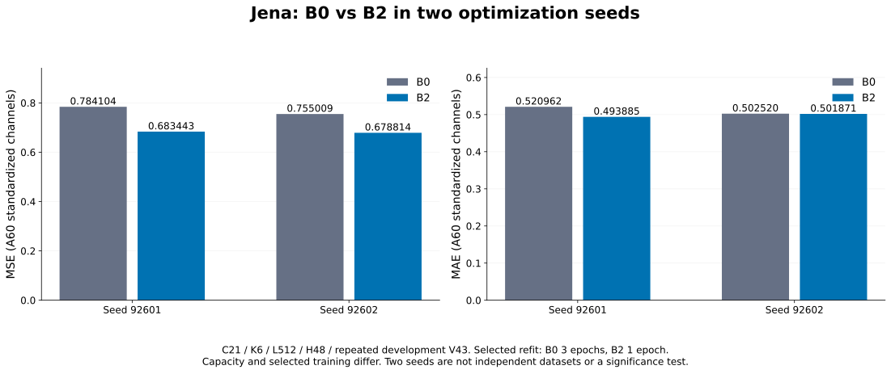
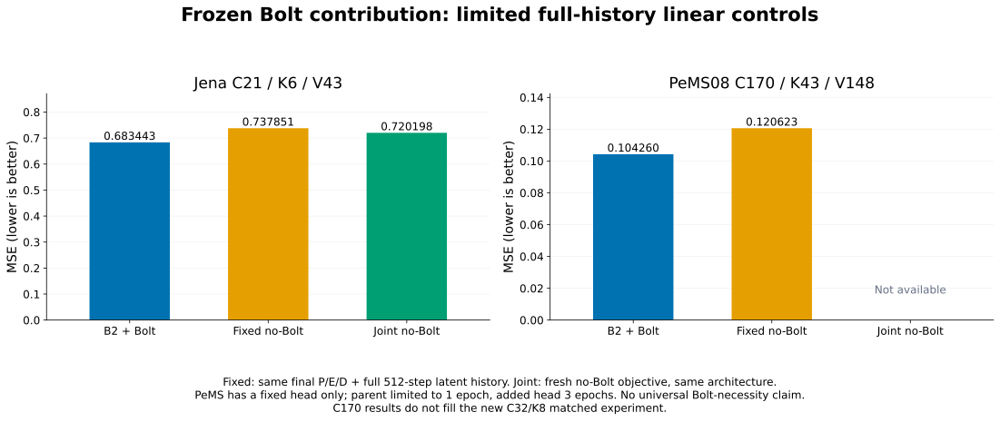
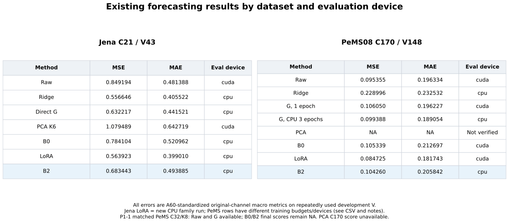
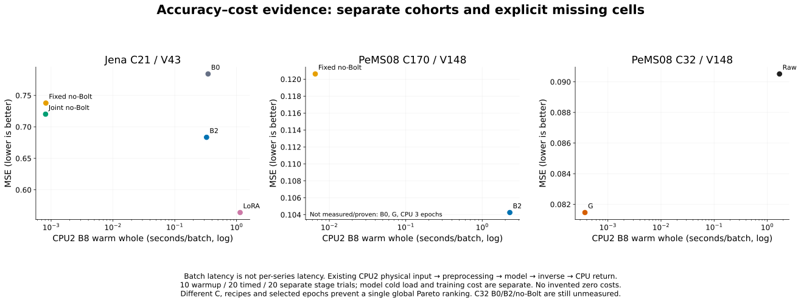
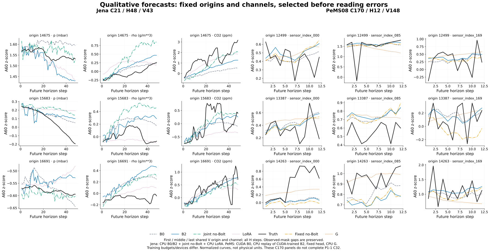

# INFORMS 발표 본문용 결과 패키지

지금 채울 수 있는 자료는 **Jena 두 seed의 B0/B2 비교, 기존 Jena·PeMS C170 Bolt/no-Bolt 대조, 강한 기준선 표, 실제 비용 교환관계, 사전 고정 예측 사례**다. 새 PeMS C32/K8 matched B0/B2의 최종 성능과 joint no-Bolt는 아직 채울 수 없다.

[슬라이드별 결과 지도](PPT_RESULT_MAP_KO.md), [발표자 메모](PPT_SPEAKER_NOTES_KO.md), [주 결과 CSV](PPT_MAIN_TABLES.csv), [보조 결과 CSV](PPT_ABLATION_TABLES.csv), [주장–근거](PPT_CLAIM_EVIDENCE_MATRIX.csv), [미완료 셀](PPT_PENDING_CELLS.csv)을 함께 제공한다. 원정밀도·run ID·장치·학습량·데이터 계약 지문·원 파일 SHA는 CSV와 [SOURCE_BINDINGS](SOURCE_BINDINGS.json)에 있다. 최종 생성·검산 상태는 [PACKAGE_VALIDATION](PACKAGE_VALIDATION.json)을 따른다.

## 결과가 답하는 질문

- **시간·채널 앞단의 효과가 두 데이터에서 유지됐는가?** Jena 두 seed에서는 B2의 MSE가 B0보다 낮았다. 선택 refit은 B0 3epoch/B2 1epoch이고 용량도 달라 순수 시간혼합 효과는 아니다. 새 PeMS C32 matched 비교는 학습 미완료라 두 데이터 재현을 주장할 수 없다.
- **동결 Bolt가 추가 가치를 보였는가?** Jena B2의 MSE `0.6834428963980711`은 fixed no-Bolt `0.7378513781149217`과 joint no-Bolt `0.7201979035862862`보다 낮았다. 기존 PeMS C170 CPU parent도 fixed head보다 낮았지만 같은 PeMS joint 대조는 없다. 모든 직접 예측기에 대한 우위는 미확정이다.
- **강한 기준선 대비 어디에 있는가?** Jena의 Ridge·Direct G·새 CPU LoRA는 B2보다 MSE가 낮다. 전체 결과 표는 장치·학습량 차이를 표시한 기존 결과 모음이다.
- **정확도–비용 교환관계는 무엇인가?** Jena CPU2 B8 warm whole은 B2 `0.32702095014974475`초, 새 LoRA `1.1420140000991523`초다. LoRA의 정확도가 더 좋다. no-Bolt head는 더 저렴하지만 해당 대조의 MSE가 높다. 같은 physical 입력 지문을 확인했어도 측정 시점·학습량·모듈 차이가 남는다. cold load와 학습 비용을 warm batch 시간에 포함해 말하지 않는다.
- **Priority 2로 넘어가는가?** 넘어가지 않는다. 지시문 §7(5)의 충분 학습 미확정에 해당한다. 실패 방향이나 새 모듈의 필요성을 판정한 것이 아니다.

## 이번에 실제 수행한 일과 빈칸

```text
P1-1  기존 C32 B0/B2 partial·저장점·원 계약 대사.
      search 약1.61epoch; fresh refit/final V 없음. 최종 MSE/MAE는 NA.
P1-2  긍정 gate 미충족. 새 joint no-Bolt 미실행.
P1-3  저장 V 예측 8개의 독립 FP64 대사, 고정18패널·2700곡선행 추출,
      정성 SVG 실제 생성. 새 모델 추론 없음.
P1-4  기존 CPU2 B1/B8 비용 영수증·physical/mask 지문·범위 대사.
      새 비용 측정 없음. 미측정은 NA, Raw parity 실패는 FAILED.
P2    미진입. 전체 MASTER는 paused·미완료 유지.
```

새로 채워진 것은 발표용 표·그림·출처·주장 범위다. 새 학습 결과가 생긴 것은 아니다. 미완료 36개 셀은 [PPT_PENDING_CELLS.csv](PPT_PENDING_CELLS.csv)에 이유와 필요한 조건을 남겼다. 새 문서는 원 실행 마감의 연장이나 기존 CP 재개를 명시하지 않았고, 검증된 C32 continuation CLI도 없다. 원 모델 캠페인의 예산·마감·파일을 변경하지 않았다.

Jena C21, PeMS C170, PeMS C32는 서로 다른 코호트다. 기존 C170 예측이나 C32 Raw/G 결과로 C32 B0/B2의 빈칸을 채우지 않는다. 모든 결과는 반복 사용한 개발 V이며 독립 일반화 검증이 아니다.

## 본문에 넣을 그림

### Temporal Context Effect



### Frozen TSFM Contribution



### Overall Forecasting Results



### Accuracy–Cost Tradeoff



### Qualitative Forecasts



정성 그림은 원 A60/refit z-score 단위다. 원단위 복원용 scaler 값을 열지 않았으며 물리 단위로 해석하면 안 된다. 각 자료에서 origin과 채널의 첫·중앙·끝을 값 확인 전에 고정했고, 모든 horizon과 원 관측 mask를 사용했다. Jena는 joint no-Bolt와 새 CPU LoRA, PeMS C170은 fixed head와 CPU 3epoch G를 포함한다. PeMS B0의 저장 예측 장치는 CUDA, B2는 CUDA 학습 parent의 CPU 재추론이다. 모델별 장치·학습량 차이를 같은 조건의 순수 인과 비교로 확대하지 않는다. [선택·원 배열 지문·재채점 근거](QUALITATIVE_SELECTION.json).

## 검산과 실행 기록

- 기존 40개 결과를 V manifest에 연결하고, 본문·보조표의 원수치와 비용 출처를 대사했다. appendix의 세 CSV/manifest 차이 약 `1–3e-16`은 원 값 그대로 보존했다.
- 정성 그림에 쓰인 기존 V archive 8개의 배열·정답·mask·origin·channel·scaler 지문을 검증하고 FP64 채널 매크로 MSE/MAE를 원 manifest의 `1e-12` 공차로 대사했다. checkpoint tensor는 열지 않았다.
- [추출 코드](extract_qualitative_v.py)와 [표·그림 생성 코드](build_ppt_results.py)는 기본 실행에서 입력을 읽거나 파일을 쓰지 않는다. 실제 실행에는 원 private inventory/evidence·봉인된 scope와 정확 SHA가 필요하다. 기존 출력이 있으면 자동 덮어쓰기를 거부한다.
- 원 예측 NPZ·체크포인트·곡선 값 CSV는 private에 보존했다. 이 폴더에는 표·그림과 검산 metadata만 둔다. PPT/PDF·새 학습·새 모델 추론·protected T 평가·자동 commit/push는 수행하지 않았다.

이 패키지는 로컬 산출물이다. 시작 시 원격 main과 작업 HEAD는 `d8fe799e06fd4bb0703163c50861a7214ab2c3e8`이었다.
