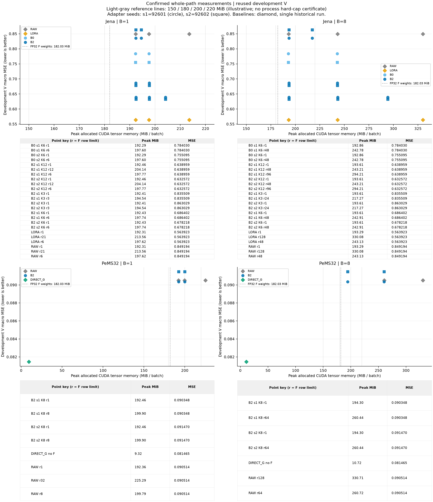
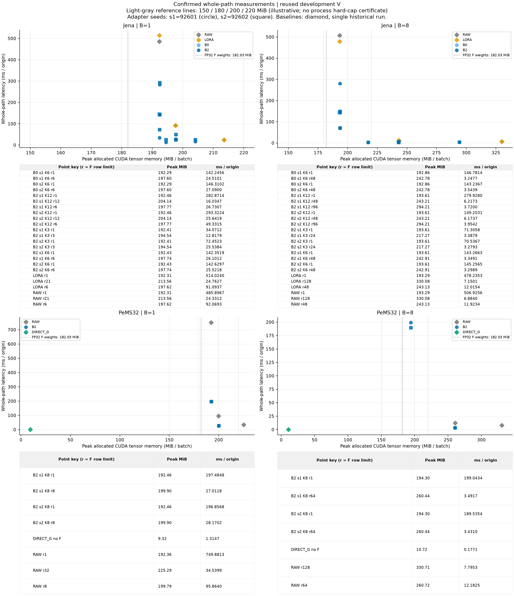
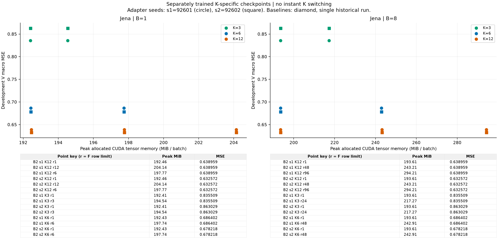

# 동결 TSFM 메모리 예산 실험 결과

[확인] Phase A의 GPU 44개·CPU Ridge 2개 screen과 사전 규칙으로 선택한 confirm이 완료됐다. 전체 단계에서 완료 receipt 131개, INVALID 0개다. 확인된 B2 경계는 TSFM 범위 29개, 전체 GPU 대안 범위 22개다. Phase B 결정은 `PROCEED` / `REGISTERED_GATE_PASSED`다.

경계 개수는 동일 checkpoint의 batch·chunk 비용 선택지를 포함한다. 독립 학습 반복 수가 아니다. 전체 GPU 대안에서는 DirectG를 포함하며 CPU Ridge는 별도 하드웨어 맥락으로 제시한다. 메모리 감소만으로 새로운 방법의 독창성이나 입력별 적응성을 주장하지 않는다.

## 완료 범위와 검증 연결

```text
phase  screens  selected_confirms
A      46       45
B      20       20
```
공개 raw trial 2280행과 facet/stage 131개를 실제 replay로 재생성·대사했다. 비용 median·IQR·p95·throughput·allocated/reserved 피크는 raw CSV에서 독립 재집계했다. 저장 V NPZ의 FP64 관측 macro 정확도, checkpoint/data/scaler/mask/origin 계약 및 전체 V parity는 별도 독립 검증과 실제 worker receipt로 연결된다.

[원시 반복값](MEMORY_COST_TRIALS.csv), [전체 비용 집계](MEMORY_COST_SUMMARY.csv), [정확도 재검산](ACCURACY_RECHECK.csv), [parity](PARITY_AUDIT.json), [실험 검증](EXPERIMENT_VALIDATION.json), [공개 replay 검증](PUBLIC_REPLAY_VALIDATION.json), [통합 테스트](TEST_VALIDATION.json), [실행 목록](RUN_MANIFEST.csv).

## 정확도와 학습 상태

```text
dataset  family     seed   K   MSE          MAE          epoch  cap  params  training
jena     B0         92601  6   0.784029895  0.520931707  3.00   3    1008    TRAINING_CAP_STILL_IMPROVING
jena     B0         92602  6   0.755094559  0.502589107  3.00   3    1008    TRAINING_CAP_STILL_IMPROVING
jena     B2         92601  3   0.835508503  0.520950297  1.00   3    35213   SCREEN_COMPLETE_CONVERGENCE_UNRESOLVED
jena     B2         92602  3   0.863029222  0.529397529  1.00   3    35213   SCREEN_COMPLETE_CONVERGENCE_UNRESOLVED
jena     B2         92601  6   0.686401862  0.491798611  1.00   3    35717   SCREEN_COMPLETE_CONVERGENCE_UNRESOLVED
jena     B2         92602  6   0.678217525  0.498865877  1.00   3    35717   SCREEN_COMPLETE_CONVERGENCE_UNRESOLVED
jena     B2         92601  12  0.638958706  0.482833537  1.00   3    36725   SCREEN_COMPLETE_CONVERGENCE_UNRESOLVED
jena     B2         92602  12  0.632572487  0.481259727  1.00   3    36725   SCREEN_COMPLETE_CONVERGENCE_UNRESOLVED
jena     LORA       92601  21  0.563922949  0.399009935  1.00   0    294912  HISTORICAL_SCOPE
jena     RAW        92601  21  0.849194139  0.481388340  -      0    -       HISTORICAL_SCOPE
jena     RAW_RIDGE  92601  0   0.556646336  0.405521802  -      0    -       HISTORICAL_SCOPE
pems32   B2         92601  8   0.090347662  0.198959942  6.00   6    37472   TRAINING_CAP_STILL_IMPROVING
pems32   B2         92602  8   0.091469785  0.200695310  6.00   6    37472   TRAINING_CAP_STILL_IMPROVING
pems32   DIRECT_G   92601  0   0.081465373  0.185774977  3.00   0    16812   HISTORICAL_SCOPE
pems32   RAW        92601  32  0.090513790  0.195211490  -      0    -       HISTORICAL_SCOPE
```
MSE·MAE는 같은 고정 global A60 정규화 단위의 관측 equal-channel macro 값이다. 표의 정확도는 parent accuracy identity에 묶여 있다. 여러 chunk와 B1/B8은 같은 학습 모델의 반복 비용 측정이며 새로운 정확도 seed가 아니다. 학습 상한과 선택 epoch를 표시했고, 상한 끝에서 개선 중인 arm을 수렴한 것으로 해석하지 않았다.

## T1. 기존 effective-128 경로의 실제 비용

원래 row128 설정을 실제 B×입력 폭으로 clamp한 경로다. Raw·merged LoRA는 원래 C개 채널을 유지한다. B2/B0만 해당 학습 K개 latent stream을 사용한다. 각 method·seed·B의 확인된 원경로를 모두 표시한다. CSV에는 원시 집계의 정밀도와 checkpoint/parent ID, 부가 메모리·로드 시간도 유지한다.

```text
dataset  family     seed   B  K   chunk  MSE       MAE       alloc_MiB  reserved_MiB  whole_ms  origin_s
jena     B0         92601  1  6   6      0.784030  0.520932  197.605    266.000       24.510    40.800
jena     B0         92601  8  6   48     0.784030  0.520932  242.780    262.000       25.982    307.910
jena     B0         92602  1  6   6      0.755095  0.502589  197.605    266.000       27.090    36.914
jena     B0         92602  8  6   48     0.755095  0.502589  242.780    262.000       28.351    282.177
jena     B2         92601  1  12  12     0.638959  0.482834  204.143    276.000       16.035    62.365
jena     B2         92601  1  3   3      0.835509  0.520950  194.538    262.000       12.818    78.016
jena     B2         92601  1  6   6      0.686402  0.491799  197.739    266.000       26.101    38.312
jena     B2         92601  8  12  96     0.638959  0.482834  294.206    310.000       29.760    268.817
jena     B2         92601  8  3   24     0.835509  0.520950  217.270    270.000       27.103    295.170
jena     B2         92601  8  6   48     0.686402  0.491799  242.915    262.000       26.793    298.587
jena     B2         92602  1  12  12     0.632572  0.481260  204.143    276.000       25.642    38.999
jena     B2         92602  1  3   3      0.863029  0.529398  194.538    262.000       25.538    39.157
jena     B2         92602  1  6   6      0.678218  0.498866  197.739    266.000       25.522    39.182
jena     B2         92602  8  12  96     0.632572  0.481260  294.206    310.000       31.633    252.899
jena     B2         92602  8  3   24     0.863029  0.529398  217.270    270.000       26.235    304.940
jena     B2         92602  8  6   48     0.678218  0.498866  242.915    262.000       26.391    303.134
jena     LORA       92601  1  21  21     0.563923  0.399010  213.558    262.000       24.763    40.383
jena     LORA       92601  8  21  128    0.563923  0.399010  330.083    354.000       57.201    139.859
jena     RAW        92601  1  21  21     0.849194  0.481388  213.558    260.000       24.331    41.099
jena     RAW        92601  8  21  128    0.849194  0.481388  330.083    354.000       55.072    145.265
jena     RAW_RIDGE  92601  1  0   NA     0.556646  0.405522  -          -             0.268     3731.343
jena     RAW_RIDGE  92601  8  0   NA     0.556646  0.405522  -          -             0.479     16692.749
pems32   B2         92601  1  8   8      0.090348  0.198960  199.900    270.000       27.012    37.021
pems32   B2         92601  8  8   64     0.090348  0.198960  260.438    262.000       27.933    286.395
pems32   B2         92602  1  8   8      0.091470  0.200695  199.900    270.000       28.170    35.498
pems32   B2         92602  8  8   64     0.091470  0.200695  260.438    262.000       27.448    291.463
pems32   DIRECT_G   92601  1  0   NA     0.081465  0.185775  9.320      22.000        1.315     760.601
pems32   DIRECT_G   92601  8  0   NA     0.081465  0.185775  10.722     24.000        1.417     5645.332
pems32   RAW        92601  1  32  32     0.090514  0.195211  225.290    260.000       34.540    28.952
pems32   RAW        92601  8  32  128    0.090514  0.195211  330.708    354.000       62.362    128.283
```
[T1 전체 정밀도 CSV](T1_ORIGINAL_PATH.csv). B1 whole_ms는 한 origin 요청의 전체 경로 지연이고, B8 origin_s는 여덟 origin 묶음 처리량이다. CPU Ridge의 GPU 메모리는 NA이며 [CPU RSS·지연 표](RIDGE_CPU_CONTEXT.csv)로만 본다.

## T2. 같은 모델의 row chunk 대조

아래 row1 요약은 confirm이 있으면 confirm끼리, 없으면 screen끼리 원경로와 대조한다. SCREENED 값으로 최종 우위를 주장하지 않는다. 전체 후보·두 단계·정확한 row 수·피크 reserved·제외 이유는 [T2 전체 CSV](T2_CHUNK_COMPARISONS.csv)에 보존했다.

```text
dataset  family  seed   B  K   status     original_MiB  row1_MiB  delta_MiB  latency_ratio
jena     B0      92601  1  6   CONFIRMED  197.605       192.294   -5.311     5.804
jena     B0      92601  8  6   CONFIRMED  242.780       192.860   -49.920    45.195
jena     B0      92602  1  6   CONFIRMED  197.605       192.294   -5.311     5.401
jena     B0      92602  8  6   CONFIRMED  242.780       192.860   -49.920    40.418
jena     B2      92601  1  12  CONFIRMED  204.143       192.459   -11.684    17.641
jena     B2      92601  1  3   CONFIRMED  194.538       192.414   -2.124     2.658
jena     B2      92601  1  6   CONFIRMED  197.739       192.429   -5.311     5.454
jena     B2      92601  8  12  CONFIRMED  294.206       193.612   -100.594   75.249
jena     B2      92601  8  3   CONFIRMED  217.270       193.606   -23.663    21.047
jena     B2      92601  8  6   CONFIRMED  242.915       193.608   -49.307    42.777
jena     B2      92602  1  12  CONFIRMED  204.143       192.459   -11.684    11.439
jena     B2      92602  1  3   CONFIRMED  194.538       192.414   -2.124     2.837
jena     B2      92602  1  6   CONFIRMED  197.739       192.429   -5.311     5.589
jena     B2      92602  8  12  CONFIRMED  294.206       193.612   -100.594   37.733
jena     B2      92602  8  3   CONFIRMED  217.270       193.606   -23.663    21.509
jena     B2      92602  8  6   CONFIRMED  242.915       193.608   -49.307    44.032
jena     LORA    92601  1  21  CONFIRMED  213.558       192.315   -21.243    20.758
jena     LORA    92601  8  21  CONFIRMED  330.083       193.289   -136.794   66.885
jena     RAW     92601  1  21  CONFIRMED  213.558       192.315   -21.243    19.970
jena     RAW     92601  8  21  CONFIRMED  330.083       193.289   -136.794   73.639
pems32   B2      92601  1  8   CONFIRMED  199.900       192.465   -7.435     7.311
pems32   B2      92601  8  8   CONFIRMED  260.438       194.301   -66.137    57.005
pems32   B2      92602  1  8   CONFIRMED  199.900       192.465   -7.435     6.988
pems32   B2      92602  8  8   CONFIRMED  260.438       194.301   -66.137    55.243
pems32   RAW     92601  1  32  CONFIRMED  225.290       192.363   -32.926    21.711
pems32   RAW     92601  8  32  SCREENED   330.708       193.848   -136.860   91.905
```
jena B1 확인 경로의 family별 최소 allocated 피크: B2 192.414 MiB, RAW 192.315 MiB, LORA 192.315 MiB. Raw/LoRA row chunk도 B2 최소 피크 이하에 도달한 family: RAW, LORA. 이 최소 메모리 비교만으로 정확도·지연까지의 지배를 결론 내리지 않고 아래 세 축 경계로 판단한다.

jena B8 확인 경로의 family별 최소 allocated 피크: B2 193.606 MiB, RAW 193.289 MiB, LORA 193.289 MiB. Raw/LoRA row chunk도 B2 최소 피크 이하에 도달한 family: RAW, LORA. 이 최소 메모리 비교만으로 정확도·지연까지의 지배를 결론 내리지 않고 아래 세 축 경계로 판단한다.

pems32 B1 확인 경로의 family별 최소 allocated 피크: B2 192.465 MiB, RAW 192.363 MiB. Raw/LoRA row chunk도 B2 최소 피크 이하에 도달한 family: RAW. 이 최소 메모리 비교만으로 정확도·지연까지의 지배를 결론 내리지 않고 아래 세 축 경계로 판단한다.

pems32 B8 확인 경로의 family별 최소 allocated 피크: B2 194.301 MiB, RAW 260.715 MiB. 이 확인 집합에서 Raw/LoRA의 family별 최소 피크가 B2 최소 피크 이하라는 관측은 없었다. 이 최소 메모리 비교만으로 정확도·지연까지의 지배를 결론 내리지 않고 아래 세 축 경계로 판단한다.

## 정확도–메모리–지연 경계

같은 데이터·B·장치·메모리 계층에서 CONFIRMED+parity PASS만 사용했다. MSE·allocated 피크·whole median 세 값이 모두 작거나 같고 하나가 엄격히 작은 경우에만 지배로 표시한다. MAE는 별도 열이며 Pareto 축을 사후 교체하지 않았다. Pareto는 사전등록한 유한 chunk 후보 안의 경계이며, 가능한 모든 chunk에 대한 전역 최적성을 뜻하지 않는다.

### 동결 TSFM 경로

jena, B1: 확인된 경계 18개. B0 4개 / B2 11개 / LORA 3개.

jena, B8: 확인된 경계 17개. B0 3개 / B2 11개 / LORA 3개.

pems32, B1: 확인된 경계 5개. B2 3개 / RAW 2개.

pems32, B8: 확인된 경계 4개. B2 4개.

```text
dataset  B  facet                                   MSE       memory   whole_ms  origin_s
jena     1  B0_jena_REVIN_OFF_s92601_cap3_B1_R1     0.784030  192.294  142.246   7.030
jena     1  B0_jena_REVIN_OFF_s92601_cap3_B1_R6     0.784030  197.605  24.510    40.800
jena     1  B0_jena_REVIN_OFF_s92602_cap3_B1_R1     0.755095  192.294  146.310   6.835
jena     1  B0_jena_REVIN_OFF_s92602_cap3_B1_R6     0.755095  197.605  27.090    36.914
jena     1  B2_jena_K12_OFF_s92601_cap3_B1_R1       0.638959  192.459  282.871   3.535
jena     1  B2_jena_K12_OFF_s92601_cap3_B1_R12      0.638959  204.143  16.035    62.365
jena     1  B2_jena_K12_OFF_s92601_cap3_B1_R6       0.638959  197.768  26.731    37.410
jena     1  B2_jena_K12_OFF_s92602_cap3_B1_R1       0.632572  192.459  293.322   3.409
jena     1  B2_jena_K12_OFF_s92602_cap3_B1_R12      0.632572  204.143  25.642    38.999
jena     1  B2_jena_K12_OFF_s92602_cap3_B1_R6       0.632572  197.768  49.331    20.271
jena     1  B2_jena_K3_OFF_s92601_cap3_B1_R1        0.835509  192.414  34.071    29.350
jena     1  B2_jena_K3_OFF_s92601_cap3_B1_R3        0.835509  194.538  12.818    78.016
jena     1  B2_jena_REVIN_OFF_s92601_cap3_B1_R1     0.686402  192.429  142.352   7.025
jena     1  B2_jena_REVIN_OFF_s92602_cap3_B1_R1     0.678218  192.429  142.630   7.011
jena     1  B2_jena_REVIN_OFF_s92602_cap3_B1_R6     0.678218  197.739  25.522    39.182
jena     1  BASELINE_jena_LoRA_GPU_replica_B1_R1    0.563923  192.315  514.024   1.945
jena     1  BASELINE_jena_LoRA_GPU_replica_B1_R21   0.563923  213.558  24.763    40.383
jena     1  BASELINE_jena_LoRA_GPU_replica_B1_R6    0.563923  197.615  91.094    10.978
jena     8  B0_jena_REVIN_OFF_s92601_cap3_B8_R48    0.784030  242.780  25.982    307.910
jena     8  B0_jena_REVIN_OFF_s92602_cap3_B8_R1     0.755095  192.860  1145.893  6.981
jena     8  B0_jena_REVIN_OFF_s92602_cap3_B8_R48    0.755095  242.780  28.351    282.177
jena     8  B2_jena_K12_OFF_s92601_cap3_B8_R96      0.638959  294.206  29.760    268.817
jena     8  B2_jena_K12_OFF_s92602_cap3_B8_R1       0.632572  193.612  1193.625  6.702
jena     8  B2_jena_K12_OFF_s92602_cap3_B8_R48      0.632572  243.211  49.389    161.978
jena     8  B2_jena_K12_OFF_s92602_cap3_B8_R96      0.632572  294.206  31.633    252.899
jena     8  B2_jena_K3_OFF_s92601_cap3_B8_R1        0.835509  193.606  570.447   14.024
jena     8  B2_jena_K3_OFF_s92601_cap3_B8_R24       0.835509  217.270  27.103    295.170
jena     8  B2_jena_K3_OFF_s92602_cap3_B8_R1        0.863029  193.606  564.294   14.177
jena     8  B2_jena_K3_OFF_s92602_cap3_B8_R24       0.863029  217.270  26.235    304.940
jena     8  B2_jena_REVIN_OFF_s92601_cap3_B8_R1     0.686402  193.608  1146.131  6.980
jena     8  B2_jena_REVIN_OFF_s92602_cap3_B8_R1     0.678218  193.608  1162.052  6.884
jena     8  B2_jena_REVIN_OFF_s92602_cap3_B8_R48    0.678218  242.915  26.391    303.134
jena     8  BASELINE_jena_LoRA_GPU_replica_B8_R1    0.563923  193.289  3825.883  2.091
jena     8  BASELINE_jena_LoRA_GPU_replica_B8_R128  0.563923  330.083  57.201    139.859
jena     8  BASELINE_jena_LoRA_GPU_replica_B8_R48   0.563923  243.127  96.123    83.227
pems32   1  B2_pems32_REVIN_OFF_s92601_cap6_B1_R1   0.090348  192.465  197.485   5.064
pems32   1  B2_pems32_REVIN_OFF_s92601_cap6_B1_R8   0.090348  199.900  27.012    37.021
pems32   1  B2_pems32_REVIN_OFF_s92602_cap6_B1_R1   0.091470  192.465  196.857   5.080
pems32   1  BASELINE_pems32_Raw_B1_R1               0.090514  192.363  749.881   1.334
pems32   1  BASELINE_pems32_Raw_B1_R8               0.090514  199.792  95.864    10.431
pems32   8  B2_pems32_REVIN_OFF_s92601_cap6_B8_R1   0.090348  194.301  1592.347  5.024
pems32   8  B2_pems32_REVIN_OFF_s92601_cap6_B8_R64  0.090348  260.438  27.933    286.395
pems32   8  B2_pems32_REVIN_OFF_s92602_cap6_B8_R1   0.091470  194.301  1516.283  5.276
pems32   8  B2_pems32_REVIN_OFF_s92602_cap6_B8_R64  0.091470  260.438  27.448    291.463
```
### 전체 GPU 대안

jena, B1: 확인된 경계 18개. B0 4개 / B2 11개 / LORA 3개.

jena, B8: 확인된 경계 17개. B0 3개 / B2 11개 / LORA 3개.

pems32, B1: 확인된 경계 1개. DIRECT_G 1개.

pems32, B8: 확인된 경계 1개. DIRECT_G 1개.

```text
dataset  B  facet                                   MSE       memory   whole_ms  origin_s
jena     1  B0_jena_REVIN_OFF_s92601_cap3_B1_R1     0.784030  192.294  142.246   7.030
jena     1  B0_jena_REVIN_OFF_s92601_cap3_B1_R6     0.784030  197.605  24.510    40.800
jena     1  B0_jena_REVIN_OFF_s92602_cap3_B1_R1     0.755095  192.294  146.310   6.835
jena     1  B0_jena_REVIN_OFF_s92602_cap3_B1_R6     0.755095  197.605  27.090    36.914
jena     1  B2_jena_K12_OFF_s92601_cap3_B1_R1       0.638959  192.459  282.871   3.535
jena     1  B2_jena_K12_OFF_s92601_cap3_B1_R12      0.638959  204.143  16.035    62.365
jena     1  B2_jena_K12_OFF_s92601_cap3_B1_R6       0.638959  197.768  26.731    37.410
jena     1  B2_jena_K12_OFF_s92602_cap3_B1_R1       0.632572  192.459  293.322   3.409
jena     1  B2_jena_K12_OFF_s92602_cap3_B1_R12      0.632572  204.143  25.642    38.999
jena     1  B2_jena_K12_OFF_s92602_cap3_B1_R6       0.632572  197.768  49.331    20.271
jena     1  B2_jena_K3_OFF_s92601_cap3_B1_R1        0.835509  192.414  34.071    29.350
jena     1  B2_jena_K3_OFF_s92601_cap3_B1_R3        0.835509  194.538  12.818    78.016
jena     1  B2_jena_REVIN_OFF_s92601_cap3_B1_R1     0.686402  192.429  142.352   7.025
jena     1  B2_jena_REVIN_OFF_s92602_cap3_B1_R1     0.678218  192.429  142.630   7.011
jena     1  B2_jena_REVIN_OFF_s92602_cap3_B1_R6     0.678218  197.739  25.522    39.182
jena     1  BASELINE_jena_LoRA_GPU_replica_B1_R1    0.563923  192.315  514.024   1.945
jena     1  BASELINE_jena_LoRA_GPU_replica_B1_R21   0.563923  213.558  24.763    40.383
jena     1  BASELINE_jena_LoRA_GPU_replica_B1_R6    0.563923  197.615  91.094    10.978
jena     8  B0_jena_REVIN_OFF_s92601_cap3_B8_R48    0.784030  242.780  25.982    307.910
jena     8  B0_jena_REVIN_OFF_s92602_cap3_B8_R1     0.755095  192.860  1145.893  6.981
jena     8  B0_jena_REVIN_OFF_s92602_cap3_B8_R48    0.755095  242.780  28.351    282.177
jena     8  B2_jena_K12_OFF_s92601_cap3_B8_R96      0.638959  294.206  29.760    268.817
jena     8  B2_jena_K12_OFF_s92602_cap3_B8_R1       0.632572  193.612  1193.625  6.702
jena     8  B2_jena_K12_OFF_s92602_cap3_B8_R48      0.632572  243.211  49.389    161.978
jena     8  B2_jena_K12_OFF_s92602_cap3_B8_R96      0.632572  294.206  31.633    252.899
jena     8  B2_jena_K3_OFF_s92601_cap3_B8_R1        0.835509  193.606  570.447   14.024
jena     8  B2_jena_K3_OFF_s92601_cap3_B8_R24       0.835509  217.270  27.103    295.170
jena     8  B2_jena_K3_OFF_s92602_cap3_B8_R1        0.863029  193.606  564.294   14.177
jena     8  B2_jena_K3_OFF_s92602_cap3_B8_R24       0.863029  217.270  26.235    304.940
jena     8  B2_jena_REVIN_OFF_s92601_cap3_B8_R1     0.686402  193.608  1146.131  6.980
jena     8  B2_jena_REVIN_OFF_s92602_cap3_B8_R1     0.678218  193.608  1162.052  6.884
jena     8  B2_jena_REVIN_OFF_s92602_cap3_B8_R48    0.678218  242.915  26.391    303.134
jena     8  BASELINE_jena_LoRA_GPU_replica_B8_R1    0.563923  193.289  3825.883  2.091
jena     8  BASELINE_jena_LoRA_GPU_replica_B8_R128  0.563923  330.083  57.201    139.859
jena     8  BASELINE_jena_LoRA_GPU_replica_B8_R48   0.563923  243.127  96.123    83.227
pems32   1  BASELINE_pems32_DirectG_B1_RNA          0.081465  9.320    1.315     760.601
pems32   8  BASELINE_pems32_DirectG_B8_RNA          0.081465  10.722   1.417     5645.332
```
### CPU Ridge 별도 맥락

jena, B1: 확인된 경계 1개. RAW_RIDGE 1개.

jena, B8: 확인된 경계 1개. RAW_RIDGE 1개.

```text
dataset  B  facet                       MSE       memory   whole_ms  origin_s
jena     1  BASELINE_jena_Ridge_B1_RNA  0.556646  500.066  0.268     3731.343
jena     8  BASELINE_jena_Ridge_B8_RNA  0.556646  501.828  0.479     16692.749
```
CPU_CONTEXT의 memory는 표본 RSS이고 GPU 두 범위의 memory는 PyTorch allocated 텐서 피크다. 서로 같은 메모리 축이나 속도 배수로 환산하지 않았다. 전체 확인된 지배 관계와 지배 facet ID는 [PARETO_TABLE.csv](PARETO_TABLE.csv)에 있다.





동결 F의 47,718,016 FP32 파라미터만 182.029785 MiB다. 그림의 150/180/200/220 MiB 선은 예시 기준선이고 사후 성공 문턱이 아니다. allocated와 reserved를 구분하며, F 상주 상태의 150/180 MiB 전체 프로세스 hard cap 달성을 주장하지 않는다.

## Phase B의 봉인된 판단

결정 `PROCEED`, 이유 `REGISTERED_GATE_PASSED`. Jena B2 TSFM 경계 facet 6개, 반복 피크 범위가 엄격히 분리된 고유 checkpoint/B 비교는 4건이며, 봉인 증거 배열에는 중복을 포함한 6행이 있다. 결정 당시 남은 시간 10858.078초, 신규 네 모델 전체 학습 예상 1765.682초, 전체 신규 측정 예상 2731.706초, 보고·게시 여유 1800.000초, 요구 잔여 시간 6297.388초다. 이는 실제 과거 시간으로 만든 계획 추정치이며 실행 결과나 장치 보장이 아니다.

[원래 결정·입력 근거](PHASE_B_DECISION.json). PeMS만의 경계로 Jena 신규 학습을 정당화하지 않았다.

K3·K12 각각 두 seed의 네 모델을 별도 학습했고, K6 두 모델을 재사용했다. 검색 cap3의 0/.25/1/3 중 A_stop strict minimum을 선택하고 네 search 결정을 모두 봉인한 뒤 fresh A60 refit과 V 평가를 했다. K가 바뀌면 E/D와 전체 학습 파라미터 수도 달라지므로 동일 용량을 고정한 대조가 아니다. K 변경은 독립 학습 모델 간 비교이며 하나의 checkpoint에서 즉시 K를 전환하는 능력을 검증하지 않는다.

반복 개발 V의 MSE에서 K3은 두 seed 모두 K6보다 악화됐다(92601/92602: 0.835509/0.863029 대 0.686402/0.678218). 특히 K3 seed92602는 Raw 0.849194보다도 오차가 컸다. K12는 두 seed 모두 K6보다 개선됐지만(0.638959/0.632572), GPU merged LoRA 0.563923과 CPU Ridge 0.556646의 정확도에는 미치지 못했다. CPU Ridge의 비용은 별도 장치 맥락으로만 비교한다. K별 비용의 선택 가치는 확인된 메모리·지연 및 사전등록한 세 축 경계와 함께 판단한다.



[네 신규 모델 학습 요약](B_TRAINING_SUMMARY.json), [네 검색 선택 봉인](B_SELECTIONS_SEALED.json). K별 두 seed·선택 epoch·cap·학습 파라미터 수는 위 정확도 표와 T1에 모두 표시했다.

## 측정 범위와 해석 한계

타이밍은 같은 물리 단위 창과 관측 mask에서 causal fill → 고정 A60 scaler → P/E/F/D 또는 해당 기준선 → inverse → CPU 출력까지다. 매 반복 전후 CUDA를 동기화했다. 모델 적재·LoRA의 한 번 merge parity·창 추출·전체 V parity는 타이밍 밖이며 `MEMORY_COST_SUMMARY.csv`의 별도 실측 열에 있다. 전체 시작 비용과 반복 추론 지연은 다르다.

screen은 2 warm-up+3 timed, confirm은 10+20이다. 타이밍 입력은 저장 V의 처음 B개 origin 창을 고정해 반복했다. 전체 Jena 43/PeMS 148 origin은 별도의 parity 단계에서 모두 검증했지만 지연 측정은 전체 origin 분포나 실제 서비스 workload를 대표하지 않는다. 20회 p95·IQR은 기술 통계이며 tail latency 보장이 아니다. 작은 지연 차이와 allocator 할당 단위는 과대해석하지 않는다.

CPU RSS와 PID GPU 표본의 측정 범위는 warm-up+timed+중간 검산이며 모델 적재·전체 V parity를 제외한다. loaded RSS는 별도다. 전체 프로세스 생애 최대 RSS라는 뜻이 아니다. PID GPU 상태 집계: NOT_APPLICABLE_CPU 4개, UNAVAILABLE 127개. 이번 고정 Python 환경의 hook은 pynvml 미설치로 PID 값을 얻지 못했다. 실제 실행 중인 CUDA worker를 대상으로 한 [별도 nvidia-smi 질의](PID_GPU_PROBE.json)도 `[N/A]`였으며, 이 드라이버·환경에서 두 방법 모두 per-PID 수치를 확보하지 못했다. UNAVAILABLE은 장치 전체 메모리로 채우지 않았다. 따라서 결과의 GPU 메모리 주장은 allocated 텐서 범위다. NVML이 제공돼도 50 ms 표본 최대는 순간 피크나 전체 프로세스 hard cap 인증이 아니다.

Jena는 16,772행, PeMS는 14,284행 pre-T prefix만 새 숫자 변환에 사용했다. A_fit 학습·A_stop 선택·fresh A60 재적합·반복 V 개발 평가의 역할을 유지했고 M_cal/T를 선택에 사용하지 않았다. 보호 T를 새로 열지 않았다는 사실이 예전 T 노출 이력이나 Jena의 기존 full-TRAIN 정규화 FP32 역변환 ancestry를 없애지는 않는다. V는 독립 테스트가 아니며 각 B2 설정의 두 seed·고정 데이터·정밀도·장치 범위를 넘는 일반화나 사전학습 overlap 부재를 입증하지 않는다.

Jena Raw의 역사적 F tensor-state 정체성은 여전히 미해결이다. 이번에 적재한 F-state SHA와 전체 V parity는 별도로 확인했다. tensor-state SHA와 safetensors 파일 SHA를 같은 식별자로 쓰지 않았다. LoRA는 한 번 unmerged/merged parity 뒤 merged 상태로만 측정했으며, 독립 merge 횟수 하드웨어 계수기를 기록한 것은 아니다.

## 시간·실행 및 재개

보고서 시점 경과 118.42분. GPU 예약 process wall 5667.902초, 측정 worker 내부 wall GPU 3250.967초·CPU 0.736초다. 신규 학습 search 1265.790초·refit 702.579초, 통합 테스트 wall 99.624초, 공개 replay wall 5.323초다.

예약 시간·launcher 수명·worker wall·모델 적재·parity·반복 추론·테스트는 서로 겹치는 범위여서 합산하지 않는다. worker receipt wall은 execute_request 본체이며 초기 Python/module import를 제외한다. parent의 launcher 수명은 Popen 직전부터 child 종료까지여서 초기 import를 포함한다. 예약에는 초기 import·검사·프로세스 사이 간격 및 같은 예약 아래 CPU 맥락 측정도 들어간다. 실제 GPU kernel busy time은 측정하지 않았다. 신규 K의 학습 시간은 각 측정 구간의 실제 과정 시간이며, 모델별 학습 처리량을 별도로 격리해 비교한 벤치마크가 아니다. 보고서 생성 뒤 게시 마감 시간은 최종 publication closure에서 별도로 확인한다. [RUNTIME.json](RUNTIME.json)에 원시 범주·단위·시점을 남겼다.

통합 테스트: `604 passed in 93.01s (0:01:33)`. 공개 replay: `PASS`. 독립 실험 검증: `PASS`.

독립 정적 코드 검토와 알려진 작은 실패 처리 제한은 [CODE_REVIEW_KO.md](CODE_REVIEW_KO.md)에 남겼다. 현재 모든 Phase A 경로가 통과한 캠페인의 결과에는 영향을 주지 않으며, 봉인한 생산 소스는 보존했다.

독립 검산기의 dtype/device 필드 위치를 바로잡은 정정 이력은 [VALIDATOR_AMENDMENT.json](VALIDATOR_AMENDMENT.json)에 있다. 최초 FAIL 원문을 보존하고 실제 네 모델의 설정 대사와 잘못된 설정 20개 거부 검사를 수행한 뒤 전체 검산을 다시 통과했다. 실험값이나 생산 소스는 변경하지 않았다.

[재현·실제 측정·중단 재개 명령](REPRODUCE.md). 완료된 동일 identity의 측정은 재사용하고 INVALID·실패 기록은 보존한다. 최종 보고서는 Phase A 또는 허용된 Phase B가 미완료이면 생성하지 않는다. 기존 발표 MD/PPT/PDF는 이 보고서 생성기가 수정하지 않는다.
