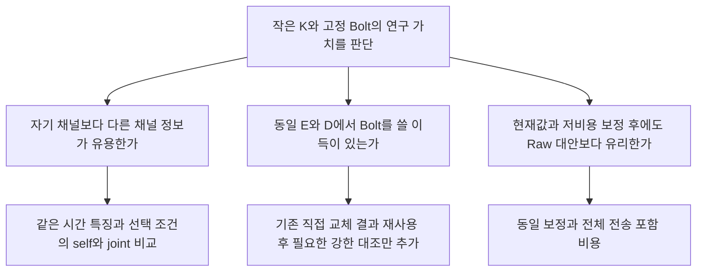

# Phase 0: 고정 Bolt용 작은 K 연구의 원천 감사

상태: **읽기·기존 기록 조사 완료 / Phase 1 미승인 / 새 실험0**. [입력 지시문](INPUT_PLAN_20261014.md), [환경·자산 관찰](ENVIRONMENT_ASSET_MANIFEST_v1.json), [선행연구](LITERATURE_REVIEW_KO.md), [승인할 첫 계획](PHASE1_PLAN_KO.md)을 구분한다. 과거 감사 PASS를 이번 재실행 PASS로 세지 않는다. 기존 파일·프로세스·모델·캐시를 수정하거나 종료하지 않았다.

## 목적과 판별 질문

교수님과 **“작은 K의 공통 표현을 고정 Bolt에 넣을 이유가 있는가, 어느 조건에서 정확도와 전체 비용이 함께 유리한가”**를 유지/조건부 유지/보류/기각 중 하나로 판단한다. 현재 결과를 반드시 좋게 만들거나 새 구조를 성공시키는 목표가 아니다.



예상 결과가 self≥joint이면 현재 선형/표본 조건에서 공통 표현 필요성의 근거가 부족하다. 공동 예측의 이득이 있어도 작은 K가 이를 보존하는지·Bolt가 필요한지는 별도다. 동일 E/D에서 native가 충분하면 더 복잡한 E보다 Bolt 사용 이유를 재검토한다. 전체 조합만 좋아지면 그 효과를 E나 채널 의존성 복구로 돌리지 않는다. 독자의 첫 질문은 “Raw와 강한 단순 대안보다 낫나?”이며 이것이 첫 비교를 결정한다.

## 실제 환경·모델 관찰

[확인] 로컬 HEAD는 `645481253114884227b1022a3cc90b0f4f31b638`, 작업 폴더는 `E:/CODING/proj/hierarchical-tsfm-peft`다. [전체 git status 시작 기록](GIT_STATUS_PHASE0_BEGIN.txt)은902행이다. tracked 변경은 과거 history10/11·10/14이고 다수 untracked 연구 산출물이 있다. 전체를 add하거나 덮지 않는다. 이 감사 전에 진행 중인 관련 Python 작업은 없었다. 다른 프로젝트·프로세스는 조작하지 않았다.

GPU 관찰: RTX4070, 총12,282MiB, 첫 조회 사용1,334/free10,677MiB. 이후 순간 상태는 manifest에 별도 저장했다. RAM 총34,115,280,896bytes·논리 CPU24, 당시 가용 RAM 약10.7GiB, E 드라이브 가용 약373GiB다. 이것은 작은 baseline을 실제 로드한 peak가 아니라 사전 상태 관찰이다.

[확인] 실제 캐시 revision은 `772f3d25d38aec6d914c8949dab4462e2d46f5d8`다. config SHA는 `9ca0ebbe049ccebacb0546361e8aa728f0cf104cd18d1838d78d296aa317bd21`, Chronos 설치 METADATA version2.3.2다. config의 context2048/patch16/stride16/prediction64/quantiles0.1…0.9를 읽었다. wrapper는0.5 index를 선택하고 H48로 자른다. config의 T5 `n_positions=512`를 Bolt context 상한512로 오해하지 않는다.

config/model 파일은 symlink라 link 길이가0으로 보인다. 최종 config target1,121bytes·weight target190,888,824bytes가 실제 존재한다. 빈 모델이라고 판단하지 않았다. weight contents/CP/NPZ를 새로 읽거나 모델을 instantiate하지 않았다. 현재 loaded behavior signature는 미확인이다. local Bolt source SHA는 `93b3af9e4521ea981c4228b1acaa252321f7a190512f956088394426182c8b8c`다.

[SOURCE 확인] [FrozenBolt](../forecast_component_study_20261013/component_experiment.py#L92)는 channels를 batch row로 펼치고 model.forward를 직접 호출한다. 연속값 정규화→patch→모델→동일loc/scale inverse로 예측하며 원 Chronos 값 양자화 경로와 다르다. frozen weights는 E 입력 gradient를 끊지 않는다. 현재 E에는 RF127의 causal temporal codec와 pointwise decoder+hidden32가 있고 current-C anchor가 있어 strict K-only가 아니다.

## 기존 결과와 미검증 증거표

1. **원형 교수님 방법: 실제 완료.** [direct 감사](../professor_compressor_direct_20261011/FINAL_EXECUTION_AUDIT.json)는 canonical E16(GT8/TS2Vec8), TS2 decoder8, 동일D calibration16, native8, forecast76경로·cost88조건을 기록한다. 실패/부분 실행은 별도로 보존했다. 따라서 PCA만 수행한 상태가 아니다.
2. **GTConvAE는 시간 압축.** [방법 차이](../professor_compressor_direct_20261011/GT_METHOD_DELTA.md): `[B,512,C]→[B,128,C,2]`, Bolt 입력2C streams다. 작은 K로 Bolt 행 수를 줄인 증거가 아니다.
3. **TS2Vec의 export와 학습 조건은 다르다.** [방법 차이](../professor_compressor_direct_20261011/TS2_METHOD_DELTA.md): d16/d320, offline fullpast512와 native last201 causal가 달랐고320은C보다 크다. Jena d320 B MSE .514303/.528330 대비 native .439495/.443775지만 input·label/calibration stride·readout이 달라 F만의 비교가 아니다. TRAIN-all 정규화와 VAL 선택을 최신 FIT-only/TUNE 조건과 직접 순위에 섞지 않는다.
4. **예측 목적 E/D는 이미 실제 학습됐다.** [component 보고](../forecast_component_study_20261013/report_v1/REPORT_KO.md), [최근 gradient 원수치](../smallk_failure_followup_20261014/report_joint_followup_v2/tables/joint_gradients.csv): frozenF 입력 gradient 및 E/D update가 확인됐다. 재구성-only나 gradient 단절로 현재 실패를 설명하지 않는다. 과거 상수 rain backward 오류는 별도 수정된 문제다.
5. **학습 origin pool과 재구성 일반화도 영향이 있었다.** component A2는 sparse Jena37/Robin2를 FIT256으로 바꿔 물리 MSE가37.61–59.81% 감소했다. origin 위치·중첩·노출도 함께 바뀌므로 표본 수만의 인과 효과가 아니다. REC 초기→600은4조건 모두 normalized FIT 개선/TUNE 악화였다. 재구성은 안정적이고 미래 적합성만 나쁘다는 가정도 확정되지 않았다.
6. **K/L128·512/RF 비교는 이미 있다.** [G 결과](../forecast_generalization_study_20261013/report_v1/all_methods.csv): Jena K5 L512 1.002280/.984703, L128 1.155769/1.125802; Robin K4 L512 .597512/.602179, L128 .663367/.690060. Jena K10 .881052/.878125, Raw .848632; Robin K8 .483150/.482385, Raw .340402. L 비교는 same origins/targets이며 RF127 그대로다. K=C identity/fullPCA의 더 좋은 숫자는 작은 K 압축 성공이 아니다. L1024/2048 실행 증거는 이 범위에 없다.
7. **learned U·혼합·LoRA·NLinear도 신규가 아니다.** [v11 상태](../tsfm_peft_internal_vs_subspace_v11_20260930/STATUS.md), [주제 판단](../tsfm_peft_internal_vs_subspace_v11_20260930/TOPIC_DECISION.md):40신경망+12Gamma fits,57예측,621GPU+36CPU costs. Jena fixedU .328154→learned .257653지만 fixedU+Gamma .265937→learnedU+Gamma .255666의 추가분은 약3.86%다. Robin learned .288584 vsRaw .229095. 최신 Robin .340402와 계약이 달라 직접 순위 금지. DirectNLinear는 shared 채널별512→48로 joint multivariate가 아니다. 내부LoRA는 backbone-frozen 목표와 달라 과거 대안으로만 참조한다.
8. **원 LEVEL skip/residual은 이미 있다.** [v6 model](../tsfm_peft_level_confirmation_v6_20260928/model_v6.py#L133)는 `D(F(E(X))) + r_last + G(r-r_last)`, G shared512→32→48, 마지막 층zero다. current-C가 있으므로 strictK-only가 아니다. 새 global/local 이름으로 같은 구조를 반복하지 않는다.
9. **동일 E/D에서 F 교체의 근접 비교도 완료됐다.** [D0 요약](../smallk_failure_followup_20261014/report_followup_v3/tables/d0_summary.csv): Robin Bolt MSE/MAE .569546544/.447338898, native .625241591/.489177279; Beijing .661957198/.470010232 vs .765178292/.525670986. native는sameE/D·actualY·600updates·TUNE normalizedMSE의 sharedlinear다. E/D가Bolt용으로최적화됐고 대안이한종류라 일반적Bolt우월성이 아니다. N1 latentteacher와N2 directC는 목표/관측표본이달라 pureFswap로세지않는다.
10. **joint가 강한 self보다 유용하다는 matched 근거가 부족하다.** G self는최근33원값, joint는full512의33요약이어서 시간특징이 다르다. [BiHash](../bihash_future_prediction_20261013/probes.py#L115)의 같은33요약에서는 self가4자료에서joint보다좋았지만 self는채널별α, joint는macroα라 선택기회가 다르다. 이득이있다/공통정보없다 양쪽을 확정하지 않는다. 시간특징·α선택조건을 맞추는 것이 실제 공백이다.
11. **최근 직접 readout·MAIN 보정은 미해결 경계를 남겼다.** [matched](../smallk_failure_followup_20261014/publication_main_20261014_v2/README_KO.md) MSE RAW33C/E33K/E512K: Robin .695789/.924093/.902703, Beijing .745597/.736626/.757321. [MAIN 보정](../smallk_failure_followup_20261014/publication_main_20261014_v3/README_KO.md)은84ridge/108비교/24cost실행, Robin모두ZERO,BeijingE33K .657561/.476598 vsMAIN .661957/.470010. 개선을강제하는다음계획의이유가아니다.
12. **비용은 실제 whole 측정과 범위를 함께 재사용.** G clean cost는472cells·Fhash동일·load/disk제외/causalFF/FITnorm/H2D/EFD/R/inverse/D2H포함이다. JenaK10 B8창당2.400ms vsRaw3.835ms이나 B1 12.741ms vs12.024ms다. 최근 MAIN24cells·Latin6 출력검산은 안정적B1속도일반화가 아니다. 서로 다른 날의Raw절대지연을이득으로합치지않는다.

위 숫자는 각각의 원 계약 안에서만 의미가 있다. 이전검산기록을재실행하지않았고 독립holdout증거도아니다. 공식 원문과 실질적 중복은 [문헌 감사](LITERATURE_REVIEW_KO.md)에 따로 있다.

## 데이터·평가 계약 관찰

```text
자료                  C/K(후속)   FIT/TUNE/개발 평가     FIT 구간      TUNE 구간
Robin                 17/4       256/64/VAL30           [528,2121)   [2121,2520)
Jena                  21/5       256/64/VAL371          [0,20965)    [20965,26207)
Beijing Aotizhongxin  11/2       256/64/EVAL146         [0,21038)    [21038,28051)
Appliances            26/6       256/64/EVAL82          [0,11841)    [11841,15788)
```

[확인: contract/manifest] Jena의 bounded source `.cache/tsfm_peft_practical_controls_v7_20260928/data/jena_trainval.npz`와 Robin의 `.cache/tsfm_peft_level_confirmation_v6_20260928/data/trainval.npz` 파일이 존재한다. Beijing 전체35,064행, Appliances19,735행은 계약의 선언이다. 환경 manifest에 읽은 계약 SHA, origin 값/범위 또는 해시, payload 선언을 저장했다. 실제 배열 contents/weight SHA는 재검산하지 않았다. Beijing 수정 계약은11C이며 과거 잘못 파싱된 stock CSV와 같은 자료가 아니다. Appliances26C는 rv1/rv2를 제외한 조건이다.

[SOURCE 확인] H48/L512, FIT observed mean/std, 창 시작 FIT mean을 사용한 causal forward-fill, 실제 target 관측 mask, normalized channel-macro MSE 주지표를 사용한다. 이전 v11은 TRAIN 전체 통계/표준화0 결측 채움·Robin K5/FIT 구분 없는 TRAIN1945라 다르다. Jena/Robin VAL은 반복 개발, Beijing/Appliances EVAL은 이미 개봉한 노출 평가다. protected TEST 개봉은0이며 과거 노출의 독립성이 회복되지 않는다. mask와 기간별 결측률은 manifest 선언이고 실제 배열 재검증은 Phase1 gate다.

Robin canonicalFIT origin min1040/max2073, FIT구간길이1593이다. 현계약에서history가FIT안에들어가야하면 L2048FIT창은0이다. L1024는oldFITorigin을그대로모두쓸수없다. 긴L은실제원본지원·common origins·start-at-windowFF·새cost를먼저확인하고불가능하면INFEASIBLE로보고한다. config2048지원만으로data2048지원이생기지않는다.

## 판단과 다음 행동

[판단] 첫질문은새compression구조가아니라 **동일시간특징/선택조건에서다른채널과거를쓰는것이추가로유용한가**다. 독립적인미래관련공통정보를확인한증거가없으므로직접회귀·강한self와비교한다. 같은E/D의Bolt-vs-native근접비교와learnedU는재사용한다. 새로운연구기여는예측E/D나global/local발상이아니라작은K·Bolt특수이득·동등보정·whole비용의성립조건/실패경계여야한다.

Phase0은여기까지고새구현/fixture/학습/추론/GPUmodel/TEST/commit/push0이다. [Phase1계획](PHASE1_PLAN_KO.md)에첫최소비교와조건별분기·예산을제시한다. 입력A절의긍정승인gate에따라이계획승인후에만새캠페인을활성화한다. 이전blocked연구의시계나승인을재설정하지않는다.
