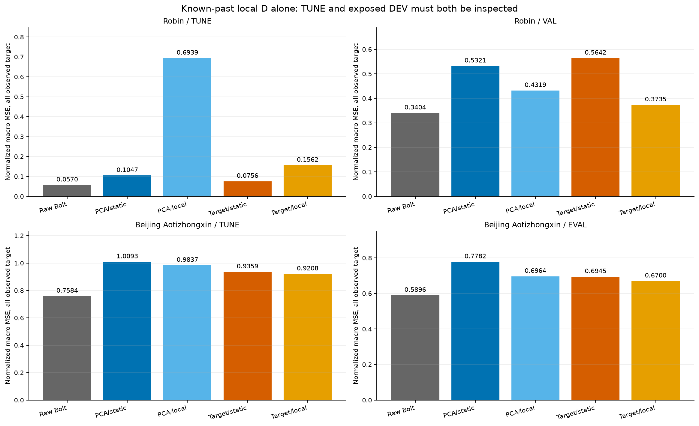
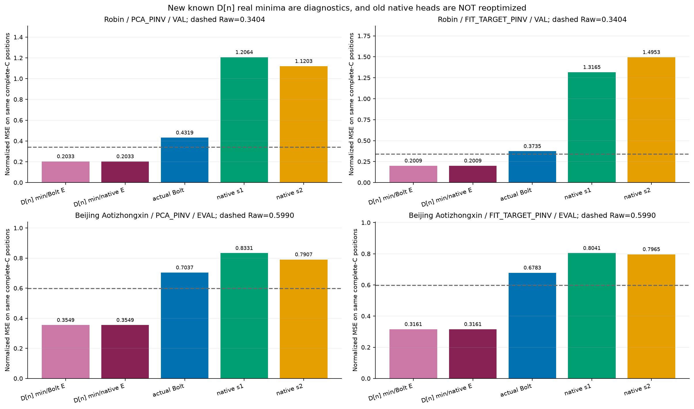
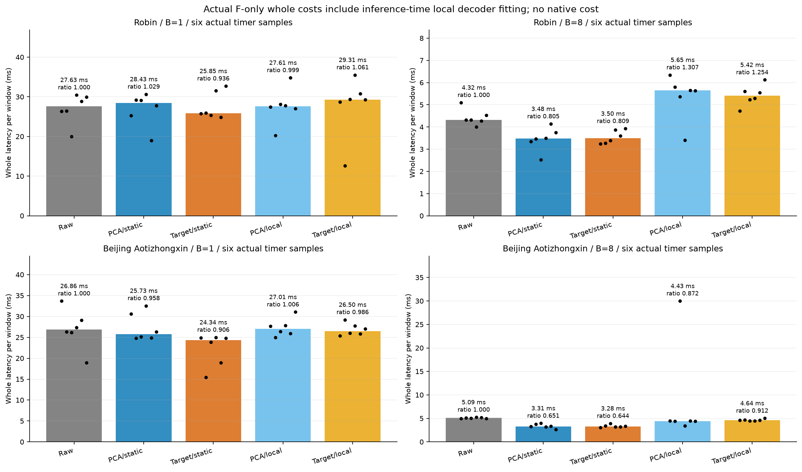

# 상한 해제 후 후속의 실제 상태와 다음 판단

이 문서는 2026-10-15 새벽의 특정 실행 상태 기록이다. 사용자 지시 “상한내수행하지 말고 쭉해줘”를 반영하여 시간·누적 자원 상한으로 중단하지 않는다. **연구 목표는 미해결이다.** 이전 승인·예산·실패·원 결과를 보존한다. 새 결과는 로컬 파일이며 자동 commit/push하지 않았다.

## 지금 확인한 것

[확인] 정적 디코더 공간의 손실, 같은 표현에서 inverse D 교체, FIT 실제 미래 에너지 공간, 과거 상수 채널 규칙, 관측 과거로 적합하는 디코더, 그 디코더의 갱신 제한을 실제 실행했다. 기존 actual-Y 목적의 표현 학습도 이미 있으므로 모든 실패를 재구성 학습만의 문제로 설명할 수 없다. 검사 PASS는 수치·계약의 검증이며 성능 개선이나 독립 일반화 검증이 아니다.

가장 최근의 정규화 MSE는 다음과 같다. Full true-observed 평가이며 Beijing complete-C 출력공간 진단 수치와 섞지 않는다.

```text
자료/표현             Raw Bolt   정적 D Bolt   과거 LS D Bolt   선정 shrinkage Bolt
Robin PCA             0.340402   0.532064      0.431922         0.378742
Robin FIT-target      0.340402   0.564240      0.373467         0.394111
Beijing PCA           0.589575   0.778177      0.696381         0.696671
Beijing FIT-target    0.589575   0.694519      0.669979         0.668548
```

이 표는 이미 노출된 개발 구간(Robin VAL30, Beijing EVAL146 origins)의 탐색 결과다. 각 데이터×표현의 shrinkage rho는 Bolt TUNE만으로 잠근 .1/.1/.1/1이다. Robin FIT-target의 기존 과거 LS가 개발에서 더 좋아도 그 값을 보고 rho를 변경하지 않았다.

```text
Robin TUNE            Raw Bolt   정적 D Bolt   과거 LS D Bolt   선정 shrinkage Bolt
PCA                   0.056951   0.104703      0.693879         0.087648
FIT-target            0.056951   0.075569      0.156193         0.070904
```

[확인] 갱신 제한이 이 TUNE 불안정을 줄였지만 Raw보다 나쁘다. Baseline을 포함한 TUNE 선정의 향상을 독립 검증으로 해석하지 않는다. 방향과 gain이 함께 바뀌므로 decoder amplification만이 유일한 원인이었다고 확정하지 않는다. 양수 ridge의 상대 조건수 제한은 절대 gain·미래 오차의 보장이 아니다.

## 실제 완료·검산·그림

- [이전 단계들을 연결한 기록](README_KO.md)은 그 기록 시점의 상태를 보존한다. 아래 실제 완료가 당시 SOURCE 상태를 대체한다.
- [과거 상수 규칙 보고서](reports/past_constant_gate_v1/REPORT_KO.md): CPU 결과 및 전체 Bolt 비용을 통합한 10CSV·4PNG4SVG, [최종 검산 PASS](audits/PAST_CONSTANT_GATE_REPORT_FINAL_VERIFICATION_v2.json).
- [과거 적합 디코더 보고서](reports/local_past_decoder_v1/REPORT_KO.md): 12CSV·5PNG5SVG. [실제 CPU 결과](runs/local_past_decoder_v1/RESULT.json), [독립 수치 감사 PASS](audits/LOCAL_PAST_DECODER_PROBE_AUDIT_v1.json), [실제 전체 비용](runs/local_past_decoder_cost_v1/RESULT.json), [비용 감사 PASS](audits/LOCAL_PAST_DECODER_COST_AUDIT_v1.json), [보고서 검산 PASS](audits/LOCAL_PAST_DECODER_REPORT_AUDIT_v1.json).
- [갱신 제한의 실제 CPU 결과](runs/local_decoder_shrinkage_v1/RESULT.json), [독립 감사 PASS](audits/LOCAL_DECODER_SHRINKAGE_AUDIT_v1.json): 88 positive-rho backend states, 13,504 window fits, 187,664 channel solves, 132새 예측, 4선정 잠금. 기존 미래 예측을 고정한 디코더 개입이며 새 E/F/head 학습은 없다. 이 시점에 선정 shrinkage의 전체 비용·통합 시각 보고서는 아직 미완료다.







## 비교 조건과 의미

Robin C17/K4, Beijing C11/K2, 과거512·미래48, FIT256·TUNE64, 원 FIT scaler·causal fill·true observed mask·origin·frozen Bolt를 유지한다. 주지표는 관측 채널 macro 정규화 MSE, MAE·원단위 오차는 보조다. 두 seed는 zero-init head의 minibatch 순서를 바꾸며 독립 데이터 일반화 반복이 아니다.

정적 E/D 경로도 current-C anchor를 쓴다. 과거 LS/shrinkage 경로는 원 C의 관측 과거에서 만든 origin별 K×C 계수를 추가 사용하므로 strict K-only나 같은 decoder-side information 비교가 아니다. FIT-target E는 FIT 미래 정답으로 학습했으며, TUNE 미래 정답은 rho 선택에 썼다. 실제 D 적합·배포 forward에는 해당 origin 이후 정답을 넣지 않는다.

관측 과거 LS의 실제 전체 비용은 preprocessing→E→매번 적합·구현된 진단/input hash→실제 F→D→physical CPU return·sync를 포함했다. 원 static 대조와 같은 측정 시행의 B8 median latency 비율은 Robin PCA/target 1.3074/1.2539, Beijing .8718/.9123이다. Native 비용이 아니다. 공유 RSS/VRAM과 짧은 반복 기술통계이며, source fixture와 초기 과정의 중첩 가능성을 기록했다. Production 최소 비용이나 단독 환경 벤치마크라고 쓰지 않는다.

새 D[n]의 미래를 아는 실수 출력공간 minimum은 해당 origin의 저장 D32[n]를 FP64로 올린 선형 공간의 정규화 MSE 진단이다. 기존 static D/global rank-K 하한을 재사용하지 않는다. 미래 oracle의 낮은 오차는 과거에서 그 잠재 미래를 예측할 수 있다는 증거가 아니다.

## 계속 진행 중인 다음 실행

1. [선정 shrinkage의 전체 Bolt 비용 계획](PLAN_SELECTED_SHRINKAGE_COST_KO_v1.md): 기존4 lock만 사용하고 매 callback에서 과거 ridge를 실제 적합한다. SOURCE·합성 검산을 준비했으며 이 상태 기록에는 실제 비용 결과를 넣지 않았다.
2. [같은 D로 새 native head를 학습하는 비교](PLAN_MATCHED_SHRUNK_NATIVE_KO_v1.md): 같은 E/rho/current-C와 backend별 D[n], 600updates·같은 손실·batch·CP 선정. 기존 정적 D에서 학습한 head의 실패만으로 Bolt 필요성을 판단하지 않기 위한 제한된 대조다. Pure module의 16 synthetic tests는 PASS지만 actual 8head 학습은 아직 미실행이다.
3. 선정된 D[n]만의 새로운 complete-C 출력공간 진단을 준비한다. 미래 정답은 이 원인 진단에만 쓰며 rho·branch·winner를 바꾸지 않는다.

이후 실제 종료코드·파일·독립 검산·보고서로 완료를 확인한 다음 다음 판단을 기록한다. 적합/검산 실패는 해당 경로의 이유와 원 결과를 보존하며 가능한 다른 경로를 계속한다. 보호 TEST·설치·큰 백본 학습·기존 작업 종료/재개·자동 Git 게시를 하지 않는다.

[상한 변경 원문](AUTHORIZATION_SCOPE_v1.json)·[원 기록 보존 manifest](CONTINUATION_MANIFEST_v1.json)·[새 자원 관측 기록](audits/RESOURCE_SNAPSHOT_20261015_v2.json)을 함께 확인할 수 있다. 새 scope의 개별 exact-human 승인이 있었다고 주장하지 않고, 원 목적과 지속 수행 지시 내 후속이라는 판단을 구분한다.
