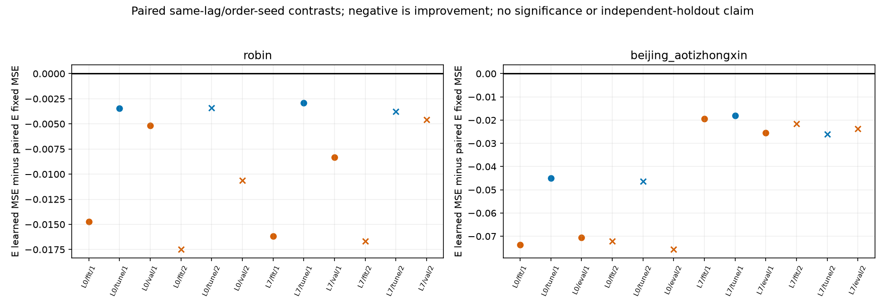
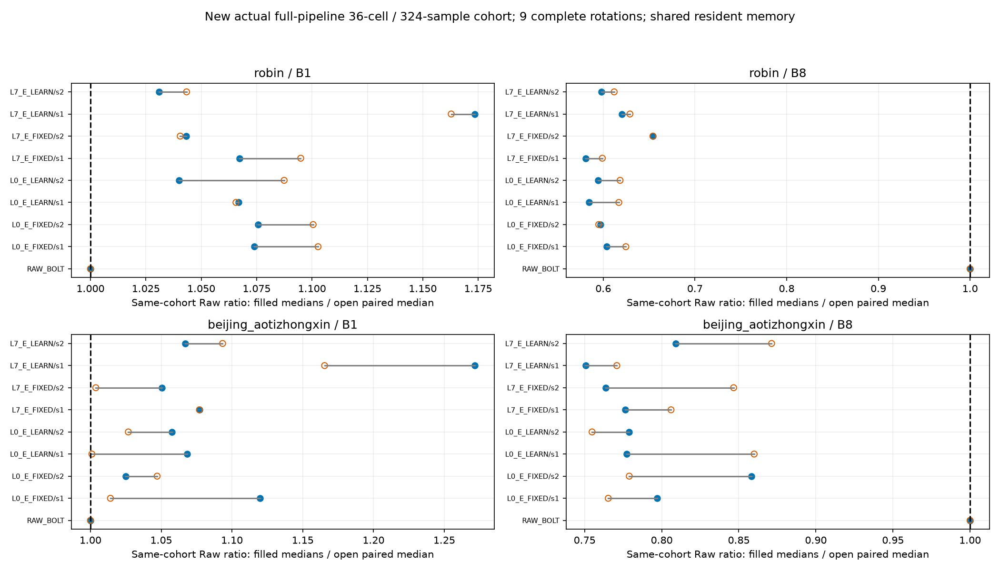

# 계속 실행 현황 v6 — 선형 표현 적응의 이득과 남은 정확도 격차

[확인] 같은 초기값에서 표현 E를 갱신하면 고정할 때보다 TUNE·기노출 DEV MSE가 줄어든 비교는 각각8/8이었다. 그러나 선정16조건 모두 Raw Bolt보다 DEV MSE가 컸다. **표현 학습이 전혀 작동하지 않는 상태는 아니지만, 정확도·비용 목표는 해결되지 않았다.** 실제 학습·추론·전체 비용·독립 검산·한국어 보고서와 그림까지 완료했다. 다음 F 입력 gradient 분리 실험은 이 문서를 쓴 시점에 SOURCE 준비 중이며 새 실제 학습은0이다.

## 결과와 판단

Robin C17/K4, Beijing C11/K2, L512/H48, FIT256/TUNE64와 노출된 VAL30/EVAL146을 유지했다. 선형 PCA E와 FORECAST-LS D의 동일 초기값에서 L0/L7×E고정/갱신×2자료×2 minibatch-order seed의16fit을 비교했다. 각600update, 전체9,600update/80CP이며 기술 probe의 추가4update는 별도다. seed는 초기화를 바꾸지 않는다. 전체 FIT의 채널별 관측수로 가중한 정규화 MSE로 학습하고, 전체 TUNE MSE 최소·이른 CP로 선정했다. 16잠금과 registry 이후 DEV를 열었다.

```text
자료       lag  seed    DEV E고정    DEV E갱신    DEV Raw
Robin      L0   92601   .590266666   .585106428   .340401887
Robin      L0   92602   .593404504   .582798885   .340401887
Robin      L7   92601   .594129886   .585823376   .340401887
Robin      L7   92602   .594049756   .589452844   .340401887
Beijing    L0   92601   .724655020   .654038940   .589575414
Beijing    L0   92602   .725922467   .650313815   .589575414
Beijing    L7   92601   .686653748   .661183648   .589575414
Beijing    L7   92602   .694394519   .670734263   .589575414
```

E 갱신은 실제 저장 계수를 바꿨고 선정 E의 수치 rank도 K를 유지했다. E의 초기→선정 L2 거리는 .248421~.463860이다. 단순히 nonzero gradient가 나왔다는 이유로 예측 표현이 적합하다고 판단하지 않는다. 학습8조건 중6조건이 CP600을 골랐지만 Robin seed92601은 CP400 이후 TUNE가 악화됐다. 공통 수렴 미달이나 더 오래 학습하면 해결된다는 결론은 아직 없다.



비용도 배포 batch에 따라 달랐다. 새 TUNE cohort의 실제 physical 전처리→GPU E/F/D→물리 단위 CPU 반환/sync를 측정한36조건324표본에서 B1은16/16이 Raw보다 느렸고 B8은16/16이 빨랐다. B8 Raw의 ms/window는 Robin5.8151875, Beijing4.430225다. 작은 K의 ratio-of-medians는 Robin.580742~.654151, Beijing.750608~.858122였다. 두 비용 비율과 모든 반복은 보존했다. 반복은 독립 자료가 아니며 공유 process RSS/VRAM은 방법별 독점 메모리가 아니다. 정확도와 비용의 이전 참고 기준을 함께 만족한 조건은0/16이다. 비용 계획은 첫4조건 TUNE 노출 뒤 작성됐으므로 이번 학습의 사전등록 gate라고 부르지 않는다.



## 확인 근거와 한계

- [한국어 보고서·14CSV·6PNG6SVG](reports/linear_e_adaptation_v2/REPORT_KO.md)·[manifest](reports/linear_e_adaptation_v2/MANIFEST.json)
- [실제 기술 probe](runs/linear_e_probe_v1/RESULT.json)·[실제16fit](runs/linear_e_train_v1/RESULT.json)·[독립 학습 감사 PASS](audits/LINEAR_E_ADAPTATION_AUDIT_v1.json)
- [실제 전체 비용](runs/linear_e_cost_v1/RESULT.json)·[독립 비용 감사 PASS](audits/LINEAR_E_COST_AUDIT_v1.json)
- [독립 보고 감사 PASS](audits/LINEAR_E_REPORT_AUDIT_v1.json): 27파일·14CSV 핵심 원필드·상대링크·6PNG6SVG 형식을 검산했다. 모든 provenance metadata를 검산했다고 주장하지 않는다. ROOT가 PNG6개를 직접 확인했다.
- [첫 보고서 보존](reports/linear_e_adaptation_v1/REPORT_KO.md): v2는 범례·주석 배치를 보완했다. 14CSV는 첫 버전과 byte 동일하며 과학 결과·공차를 바꾸지 않았다.
- [이전 시간 구조·목적 대조와 보존된 실패](CONTINUATION_STATUS_KO_v5.md)

FIT 미래 정답은 정상 감독 target으로 사용했다. 배포는 과거 E와 실제 동결 F 예측, K 과거 buffer·현재 C anchor만 쓰므로 strict K-only는 아니다. 이번 감사는 저장된 F 미래와 E/D의 산술·점수·선정·로그를 검산했다. 매 update F/backward/optimizer 또는 모든 손실값을 독립 replay한 것은 아니다. 네 실제 VJP probe는 F 경유 E gradient와 직접 과거 경로를 분리했지만, 그 gradient가 이득에 필요한지는 아직 검증하지 않았다. 두 자료의 DEV는 이미 노출된 적응적 탐색이며 TEST나 독립 일반화 검증이 아니다. 기존 joint-Y와 RF3의 예측 목적·F gradient 학습 사실을 지우지 않는다.

## 바로 다음 실험

[F 입력 gradient 분리 계획](PLAN_F_INPUT_GRADIENT_ABLATION_KO_v1.md)은 L0의 두 자료×두 seed에4fit을 추가한다. 이전 full-gradient4조건은 재사용한다. 초기값·batch 순서·600update·손실·CP선정은 같게 두고 F 출력만 detach한다. 매 batch F forward와 E의 직접 과거 경로는 유지한다. 따라서 F 예측값의 유용성이나 Bolt 자체의 필요성과는 다른 질문이다. probe에서 동일 CP0 forward와 D/E gradient 분해를 확인한 뒤 실제 학습·잠금·DEV·검산·동일 cohort 비용·보고까지 진행한다. 이 문서 시점에는 새 probe/train/cost가 아직0이다.

[자원 snapshot v6](audits/RESOURCE_SNAPSHOT_20261015_v6.json)는99terminal receipts/당시RUNNING0·서로 다른99process group·CPU user+system1,876.15625초·GPU process meterwall1,062.309519초·폴더2,246,885,937bytes다. legacy32/보호18 SHA를 확인했고 중복 process receipt0이다. GPU meterwall은 kernel 시간이 아니며 SOURCE·일부 합성/metadata 작업은 미계측이다. [최신 상한 해제 권한](AUTHORIZATION_SCOPE_v1.json) 안에서 계속 실행한다. TEST·설치/다운로드·큰 백본 파라미터 학습·기존 작업 종료·중단 학습 재개·자동 commit/push·논문/PPT는 진행하지 않았다. HEAD da1114945f90b32017b3caf39b81538557af6fd1 그대로이며 새 결과는 로컬이다.
