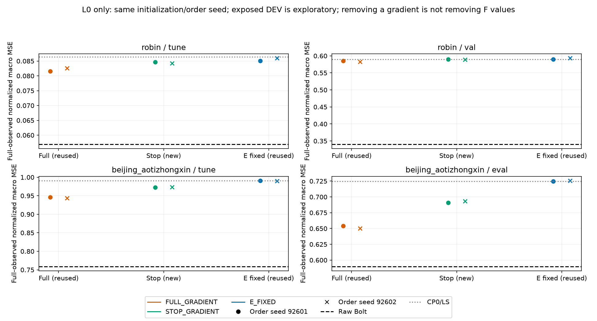

# 계속 실행 현황 v7 — F gradient의 조건부 이득, 자료별로 다른 남은 문제

[확인] 이전 상한을 종료 기준으로 삼지 않고 실행을 계속했다. L0 stop-gradient4조건의 실제2,400update·추론·전체 비용·독립 과학/비용/보고 검산을 완료했다. 이어서 학습된12개 E/D의 TUNE/DEV24개 출력 공간 진단을 실제 계산했다. **정확도·비용 연구 목표는 아직 미해결이다.** 후자의 별도 독립 감사와 보고서는 이 문서 시점에 진행 중이다.

## 이번에 검산까지 완료한 것

같은 초기 PCA/FORECAST-LS, 과거 입력, 고정 center, L0, 두 자료×두 minibatch-order seed에서 F 출력만 detach한4fit을 새로 실행했다. 기존 full-gradient4fit은 재사용했다. 두 방식 모두 매 batch 갱신된 E의 과거를 실제 Bolt에 넣었다. 600update·고정 FIT 관측수 가중 MSE·AdamW.001/WD0/clip1·CP0/100/200/400/600·전체 TUNE MSE 선정은 같았다. 네 CP0 probe는 optimizer update0이며, 모든 잠금·registry 이후 DEV를 추론했다.

```text
자료       seed    TUNE full    TUNE stop    DEV full     DEV stop
Robin      92601   .081605417   .084656466   .585106428   .590139326
Robin      92602   .082566925   .084247868   .582798885   .588827988
Beijing    92601   .946152209   .973002851   .654038940   .690746663
Beijing    92602   .943447728   .973074997   .650313815   .693139920
```

이는 all-observed 채널 macro 정규화 MSE다. stop이 full보다 나쁜 비교는 TUNE/기노출 DEV 각각4/4였다. 그러나 두 방식의8조건 모두 Raw DEV Robin.340401887/Beijing.589575414보다 높았다. 현재 학습 절차에서는 F 입력 gradient가 도움이 됐다는 조건부 근거다. F 예측값은 양쪽 모두 쓰므로 TSFM 값 자체의 필요성을 증명하지 않는다. global clipping과 이후 E 변화가 D 변화에도 영향을 주며 선정 CP도 다르다. D의 실제 per-step AdamW 변화량은 미측정이다.



새 동일 TUNE cohort의 Raw+full2+stop2 ×2자료×B1/B8,20셀100표본 비용도 검산했다. B8 Raw ms/window는 Robin4.31755/Beijing4.5170125, 작은 K의 ratio-of-medians는 .828233~.854967/.768384~.783870이었다. B1은 이 비율 기준8/8이 Raw보다 느렸다. 다른 cohort의 Raw 분모를 가져오지 않았다. 역전파 차단이 배포 수식이나 속도 이득을 만든다는 뜻은 아니다. 반복100개는 독립 자료가 아니며 공유 RSS/VRAM은 독점 메모리가 아니다.

- [한국어 보고서·11CSV·4PNG4SVG](reports/f_input_gradient_ablation_v1/REPORT_KO.md)·[manifest](reports/f_input_gradient_ablation_v1/MANIFEST.json)
- [실제4fit](runs/f_input_gradient_ablation_v1/RESULT.json)·[독립 과학 PASS](audits/F_INPUT_GRADIENT_ABLATION_AUDIT_v1.json)
- [실제 전체 비용](runs/f_input_gradient_cost_v1/RESULT.json)·[독립 비용 PASS](audits/F_INPUT_GRADIENT_COST_AUDIT_v1.json)
- [독립 보고 PASS](audits/F_INPUT_GRADIENT_REPORT_AUDIT_v1.json): 20파일·44상대링크·핵심 CSV 원필드·4PNG4SVG 형식·MD 수치를 검산했다. ROOT가 PNG4개를 직접 확인했다.
- [직전 선형 E 고정/갱신16조건과 한계](CONTINUATION_STATUS_KO_v6.md)

## 이어서 실제 계산한 공간 진단 — 별도 독립 감사 진행 중

[계획](PLAN_LEARNED_OUTPUT_SPACE_DIAGNOSTIC_KO_v1.md)에 따라 full-gradient E갱신 L0/L7의8상태와 stop-gradient L0의4상태를 고정했다. 선정 상태별 TUNE/DEV24조건에서 현재 D32의 joint HC×HK 공간 minimum, actual F·E(Y)·latent persistence를 계산했다. 새 F forward·model object·E/D fit·optimizer update·CP 재선정은0이다. 24개 모두 계산이 끝났고 producer 안의 기존 SVD/독립 reduced-LS 수학 경로 교차검사도24개 통과했다. 이 내부 교차검사를 별도 외부 감사 PASS로 부르지 않는다.

다음은 **같은 complete-C mask**의 DEV 진단 예시다. Beijing의 Raw .598972295는 위 all-observed Raw .589575414와 평가 위치가 다르다.

```text
자료       상태                 actual F     E(Y)         numeric min  같은 mask Raw
Robin      FULL L0 seed92601    .585106428   .493148813   .433986105   .340401887
Robin      FULL L7 seed92601    .585823376   .494439364   .426193909   .340401887
Beijing    FULL L0 seed92601    .662370234   .410796693   .392870582   .598972295
Beijing    FULL L7 seed92601    .669179873   .485046684   .385097128   .598972295
```

[잠정 판단] Robin에서는 현재 D의 retained 수치 공간 minimum도 DEV Raw보다 높았다. 반면 TUNE minimum .038496~.045504는 Raw .056951보다 낮았다. 현재 계수의 공간 제약과 구간 차이가 남아 있어 F 미래 예측만 개선하면 해결된다고 말할 수 없다. Beijing에서는 같은 complete-C 공간의 minimum과 E(Y)가 Raw보다 낮았지만 실제 F는 높아 잠재 미래 예측·정렬 문제가 남는다. E(Y)는 미래 정답을 쓴 진단이므로 과거만으로 그 미래를 예측할 수 있다는 증거가 아니다. 이 해석은 새 별도 감사 후 확정한다.

[실제 진단 결과](runs/learned_output_space_v1/RESULT.json)는 COMPLETE24/24, 실패0이다. [SOURCE](run_learned_output_space_diagnostic_v1.py)와 저장 배열을 별도로 검산하고 한국어 보고·그림을 준비 중이다. minimum은 원 cutoff1e-15의 retained numeric left-singular 공간에 대한 값이며 모든 실수/FP32 예측의 보편적 하한이 아니다. EY는 incomplete-C 미래 벡터 전체를 current-C로 대체해 선정 E의 NumPy FP32 GEMM으로 계산했다. 이 대체는 L7의 이후 complete 출력에도 영향을 줄 수 있고 Torch encoding rounding과 같다고 주장하지 않는다. latent persistence도 L7에서는 current-C persistence와 다르다.

## 보존과 계속 실행

두 자료·고정 K·이미 노출된 DEV의 적응적 탐색이다. 독립 일반화 검증이 아니며 strict K-only도 아니다. FIT 미래 정답을 학습 target으로 쓴 사실과 배포가 과거 전용인 사실을 구분한다. 기존 joint-Y/RF3 등 예측 목적 학습도 보존했다. TEST·설치/다운로드·큰 백본 파라미터 학습·기존 작업 종료/중단 학습 재개·자동 commit/push·논문/PPT는 하지 않았다. HEAD da1114945f90b32017b3caf39b81538557af6fd1을 다시 확인했으며 새 결과는 로컬이다.

[자원 snapshot v7](audits/RESOURCE_SNAPSHOT_20261015_v7.json)은106terminal receipts/당시RUNNING0·106개 서로 다른 process group·CPU user+system2,064.5초·GPU process meterwall1,207.514950초·폴더2,360,282,575bytes다. 이 continuation 기록의 snapshot이며 전체 대화의 총 실험 자원은 아니다. legacy32/보호18 SHA 보존, 중복 process receipt0이다. GPU meterwall은 kernel 시간이 아니며 SOURCE·일부 합성/metadata 작업은 미계측이다. [상한 해제 권한](AUTHORIZATION_SCOPE_v1.json)에 따라 반복 승인 없이 검산과 다음 원인별 대조를 이어간다.
