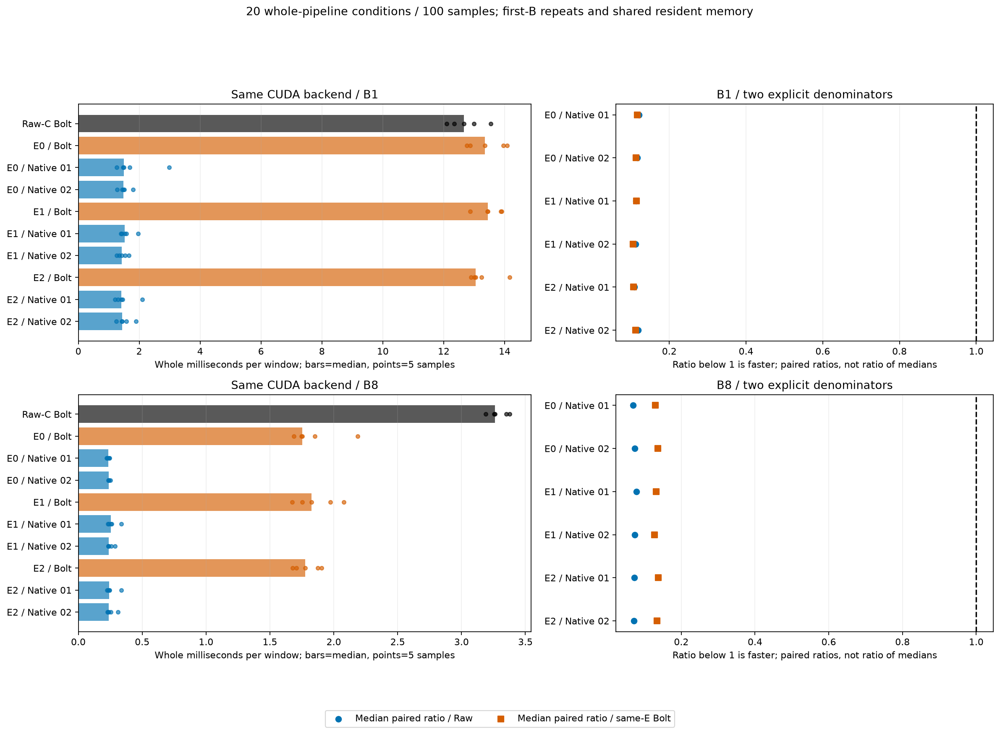

# 계속 실행 현황 v9 — 같은 E/D의 native 비교·전체 비용·보고 검산 완료

[확인] 종전 시간·자원 상한을 종료 기준으로 쓰지 않고 계속 실행했다. 같은 L7 E/D에서 native6fit/3,600update, 저장 결과 검산과 새 출력 공간12cell, 실제 전체 추론 비용20조건100표본, MD·13CSV·4PNG4SVG와 독립 보고 검산을 완료했다. **Raw 정확도와 비용을 함께 유지하려는 연구 목표는 아직 미해결이다.** 다음 작은 잠재값 보정은 SOURCE/합성 준비 중이며 이 문서 시점 실제 적합·새 추론·비용은0이다.

## 이번 비교가 답한 것

Robin C17/K4·L512/H48·FIT256/TUNE64/이미 노출된 VAL30·원 scaler/origin/mask·현재 C anchor·lag0/1/2/4/8/16/32를 같게 두었다. 고정 E/D는 원 PCA E/RECON D인 E0와 이전 E-only 선정 E1/E2의 세 상태다. 같은 상태에서 실제 frozen Bolt와 K별 독립 affine512→48 native head를 비교했다. Native 두 seed는 zero-init의 minibatch 순서 차이다.

```text
고정 상태 / head 순서       TUNE native    같은 E/D Bolt    DEV native     같은 E/D Bolt
E0 / 92601                 .184653839     .102808327       .668503409     .488093013
E0 / 92602                 .187744649     .102808327       .648906082     .488093013
E1 / 92601                 .162411046     .100779781       .671559879     .492266798
E1 / 92602                 .157760811     .100779781       .653993027     .492266798
E2 / 92601                 .164674747     .100926120       .687721473     .505250004
E2 / 92602                 .160720123     .100926120       .676164218     .505250004
Raw-C Bolt 참고            .056951091                     .340401887
```

원 관측 위치의 채널 macro 정규화 MSE이며 낮을수록 좋다. Native는 TUNE·DEV 모두6/6에서 같은 E/D의 Bolt보다 나빴고 DEV에서 Raw를 이긴 경우는0/6이다. 같은 표현을 쓴 이 단순 head의 대체 근거를 얻지 못했다. E1/E2는 Bolt를 통해 앞서 최적화한 이력이 있어 모든 predictor의 학습 이력·전체 학습 비용을 같게 한 대조도 아니다. 이 결과로 Bolt의 보편적 필수성이나 모든 native의 불가능성을 주장하지 않는다.


Head만 AdamW.001/WD0/clip1/B4·600update·고정 full-FIT 관측수 가중 actual-C MSE로 학습했다. 모든6조건이 TUNE CP100을 골랐고 CP200/400/600의 TUNE는 더 높았다. Clip 빈도는 .776667~.861667이다. 이는 현재 절차의 관측이며 충분 수렴·학습 부족·과적합 중 하나를 확정하지 않는다. 학습 E GEMM은 B4, checkpoint/최종 평가는 CUDA FP32 canonical32다. 모든6잠금과 registry 뒤 DEV를 열었다.

CP0의 latent future는 latent-last와 byte-exact지만 최종 C persistence는 아니다. L7의 known-past prefix와 lag별 기준 z_past[-1-l] 때문에 prefix가 끝난 뒤에도 C_current+sum_l(z_last-z_past[-1-l])D_l plateau가 남을 수 있다.

## 공간 제약과 예측 격차는 같이 남는다

새 공간12cell은 세 E/D×두 split을 두 head에 반복한 진단으로12개 독립 자료가 아니다. 같은 complete-C TUNE의 retained numeric minimum은 E0 .0609840323/E1 .0597340174/E2 .0595795763으로 Raw .0569510909보다 모두 높다. DEV minimum은 .3068850413/.3069056211/.3111773358로 Raw .3404018870보다 모두 낮지만 실제 Bolt와 native는 Raw보다 나쁘다. 한쪽 구간의 여지만으로 구조·학습 문제가 해결됐다고 쓰지 않는다.

Minimum은 D32·known-past offset·complete-C 출력 행·모든 HK 미래좌표·rcond1e-15 retained numeric space에 조건부인 MSE 해다. 모든 실수/FP32 미래의 보편 하한이나 과거 예측 가능성의 증명이 아니다. E(Y)도 실제 미래를 쓰는 비배포 진단이며 fit/선정에는 넣지 않았다. 두 동결 수학 경로의 교차 검산을 제3 외부 재생이라고 부르지 않는다.

## 빠르지만 정확도 격차는 남았다

아래는 같은 물리 TUNE 첫B를 반복한 batch latency 중앙값이다. B8의 per-window 비용은 아래 값을8로 나눈다.

```text
경로                       B1 batch ms         B8 batch ms
Raw-C Bolt                 12.6679             26.0837
같은 E/D Bolt3경로          13.0499~13.4508     14.0141~14.6001
같은 E/D native6경로         1.4092~1.5277       1.8778~2.0273
```

전처리 causal CPU fill/FIT 정규화→H2D→실제 E/F 또는 head/L7 D→물리 CPU 반환과 sync를 포함했다. Native는 CUDA backend이며 최적 CPU native 비용을 주장하지 않는다. 비용 측정은 캐시 F 반환이 아닌 실제 predictor 실행이다. 명시적 warm2 외 reference/precheck도 비측정으로 실행됐고5순환은10개 위치의 완전 균형이 아니다. 내부 finite/shape 검사는 timer 안, 외부 meter/hash/save/메모리 수집은 밖이다. 공유 resident 메모리와 반복 첫B를 독점 메모리·독립 자료로 바꾸지 않는다. Raw와 같은 E의 Bolt를 각각 분모로 paired median ratio와 ratio-of-medians를 별도로 보존했다. 빠른 native나 B8의 압축 Bolt를 정확도 성공이라고 하지 않는다.



## 실제 산출물과 검증 범위

- [전체 한국어 보고서·13CSV·4PNG4SVG](reports/matched_l7_native_v2/REPORT_KO.md)·[manifest](reports/matched_l7_native_v2/MANIFEST.json)
- [실제6fit/3600update/30CP](runs/matched_l7_native_v1/RESULT.json)·[저장 결과 검산/새 공간12cell](audits/MATCHED_L7_NATIVE_AUDIT_v1.json)
- [실제 전체 비용20조건100표본](runs/matched_l7_native_cost_v1/RESULT.json)·[독립 비용 검산 PASS](audits/MATCHED_L7_NATIVE_COST_AUDIT_v1.json)
- [독립 보고 검산 PASS](audits/MATCHED_L7_NATIVE_REPORT_AUDIT_v1.json):22파일·41상대링크·466 artifact 상대경로·13CSV nested 원필드와 MD 수치를 검산했다. ROOT가4PNG를 직접 확인했다.
- [보존된 실패 보고 generator v1](make_matched_l7_native_report_v1.py)·[실패 receipt](resources/38748_1792020224450821800_generate_matched_L7_native_report_v1.json): CP의 state artifact가 같은 이름의 조건 label을 덮어 그림 생성이 중단됐다. SOURCE·13CSV·첫PNG/SVG를 보존했고 새 v2에서 state/checkpoint_state를 분리했다. 다른12개 표는 합성 exact 비교,4그림 전체 합성 렌더 회귀를 추가했다. 과학 수치·학습·비용 변경0이다.
- [앞선 E-only/공동 E/D 및 초기화·학습 후 공간 진단](CONTINUATION_STATUS_KO_v8.md)

과학 감사는30CP/선정 FITDEV12·3600로그·90frozen member CP 비교·42history bytes·1404score fields·6locks·1784원파일hash를 확인했다. 과학 실행의 새 F model/forward는0이며 기존 실제 Torch context9개를 현 D로 decode한 것이다. E0의 옛 FORECAST-D C 예측은 가져오지 않았고 새 matched RECON C3개와 E-only C bytes6개를 구분했다. 비용 감사는9fullstate/6head/6locks·72물리윈도·독립 NumPy head6·100저장timer의 ns/두분모와 산술을 검산했다. F/optimizer/타이머나 매update loss/bytes를 감사자가 독립 재실행한 것은 아니다. 보고 감사는 metadata와 이미지 형식 검사이며 과학 배열·모델을 다시 실행하지 않았다.

## 다음은 작은 F 출력 보정

[사전 계획](PLAN_FIXED_L7_LATENT_CALIBRATION_KO_v1.md)에 따라 같은 세 E/D를 고정하고 F 미래 u를 u+a_k(u-z_last)+b_k로 보정한다. Scale-only4계수/scale+bias8계수의6SVD·42ridge후보와6identity 비교를 분리한다. FIT 관측 채널 macro weighted-mean SVD/FIT-only RMS·별도 C intercept 없음·TUNE 자체 평가분모/actualFP32 선택·identity 우선 tie/6잠금 뒤 DEV를 유지한다. E/D/F 재학습은 없고 학습 미래는 정상 회귀 response로만 쓴다. FP64 surrogate와 실제 FP32 계산의 차이도 남긴다. 이 문서 시점 SOURCE/합성만 준비했고 실제fit/추론/비용은0이다. 실패하더라도 다른 E/D/K의 가능성까지 기각하지 않는다.

## 보존·자원·게시

[Snapshot v9](audits/RESOURCE_SNAPSHOT_20261015_v9.json)은126terminal receipts/당시RUNNING0/중복process0, CPU user+system2,330.484375초·GPU process meterwall1,426.523633초·폴더2,535,175,638bytes다. legacy32·보호18SHA와 종전118receipt의 SHA를 보존했다. 이 continuation의 시점별 기록이며 SOURCE/일부 합성·metadata는 미계측이다. 전체 대화 자원 합계나 CUDA kernel 시간이 아니다.

[상한 해제 권한](AUTHORIZATION_SCOPE_v1.json)에 따라 같은 목적의 하위 실행은 매번 재승인 없이 이어간다. 보호된 TEST·설치/다운로드·큰 백본 학습·기존 작업 종료/중단 학습 재개·자동 commit/push·논문/PPT는 하지 않았다. HEAD da1114945f90b32017b3caf39b81538557af6fd1과 기존 tracked 변경을 보존했다. 이 추가 결과는 로컬·미게시다. K streams+K 과거buffer+현재 C anchor이므로 strict K-only가 아니며, 이미 노출된 DEV의 적응적 탐색이다.
