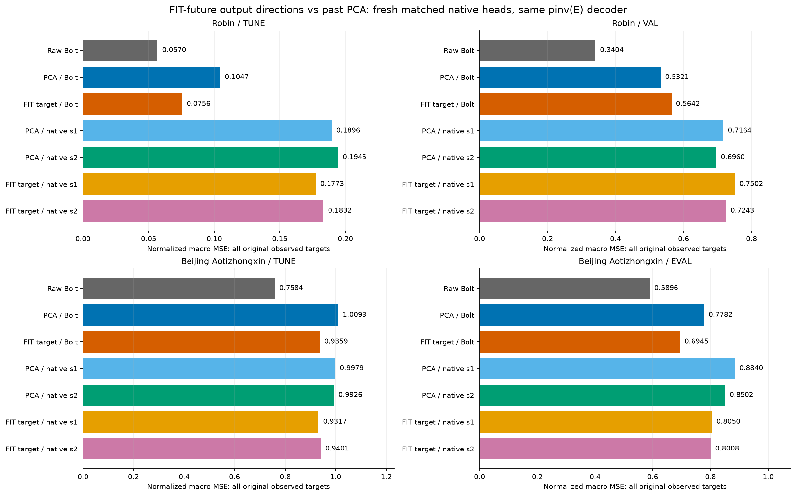
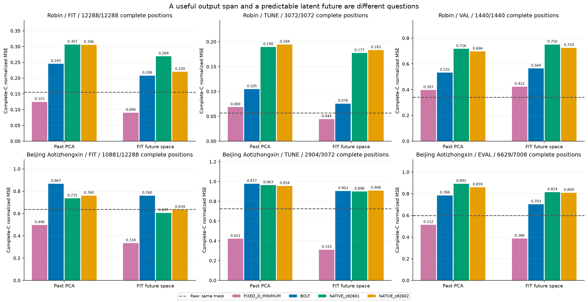
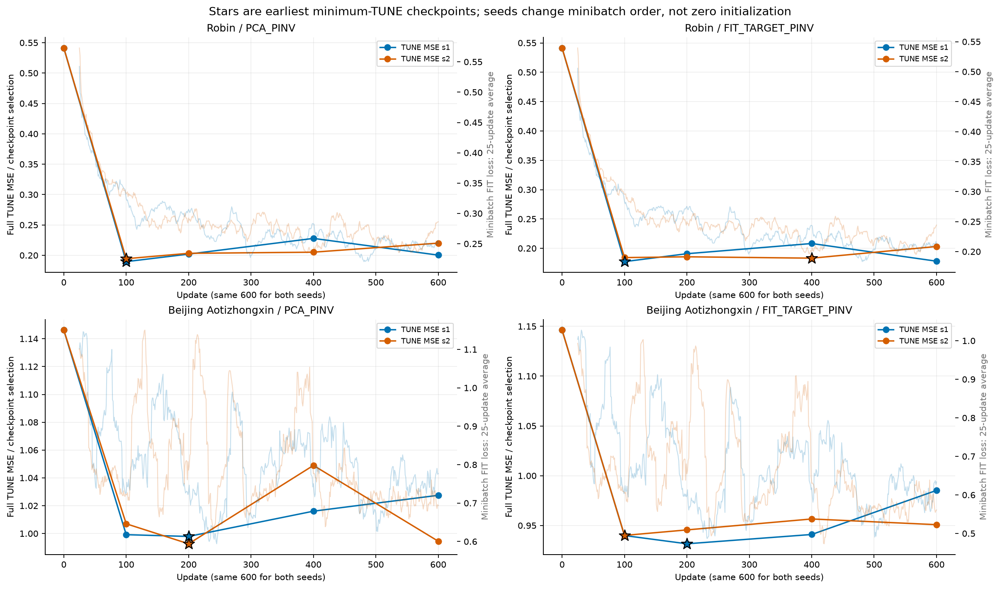
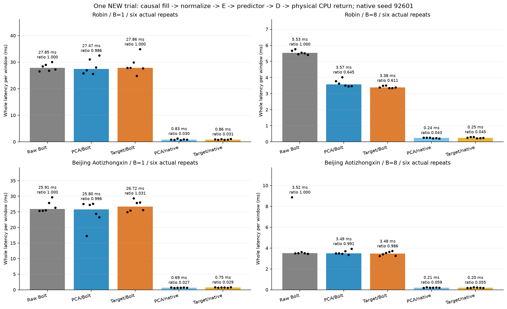
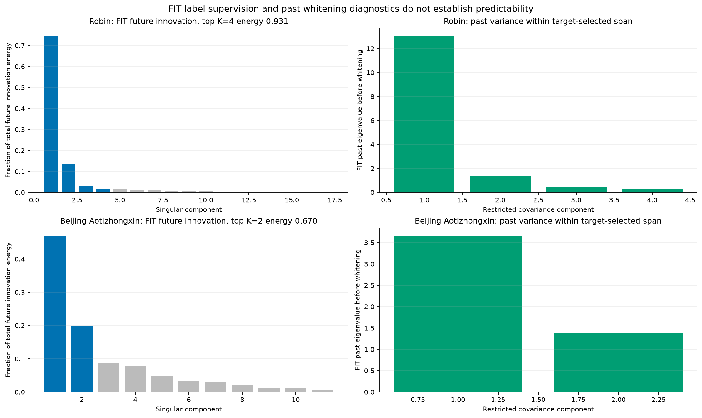

# FIT 미래에 맞춘 출력 공간은 과거 PCA보다 예측에 도움이 되는가

[확인] Robin VAL에서 FIT-target 공간의 고정 D 정규화 MSE 최소값은 0.422495770, PCA의 최소값은 0.396551217이다. 실제 Bolt 연결 MSE는 각각 0.564240397, 0.532063803이다. 출력 공간과 실제 예측의 방향은 이 두 비교를 따로 읽어 판단한다.
[확인] Beijing Aotizhongxin EVAL에서 FIT-target 공간의 고정 D 정규화 MSE 최소값은 0.386059363, PCA의 최소값은 0.512486320이다. 실제 Bolt 연결 MSE는 각각 0.694519401, 0.778177077이다. 출력 공간과 실제 예측의 방향은 이 두 비교를 따로 읽어 판단한다.

## 이번에 직접 시험한 것

작은 K에서 고정 Bolt를 쓰면서 C 예측 정확도와 비용을 유지하려는 목적을 유지한다. 이번 대조는 압축을 못 하는 이유를 reconstruction 학습 하나로 설명하는 실험이 아니다. 기존 POINTWISE/MAIN과 native 경로에도 actual-Y 목적 학습이 있었다. 새롭게 시험한 좁은 질문은 ‘FIT 미래 변화가 많이 놓이는 출력 방향을 먼저 정하면, 과거 PCA 방향보다 같은 예측기가 잘 동작하는가’다. 상관된 채널이 많고 선형 readout 이득이 작다는 사실만으로 저차원 압축을 배제하지도 않는다.

PCA_PINV는 기존 FIT 과거 PCA encoder/center를 그대로 재사용하고 D만 같은 pinv(E) 규칙으로 만든 control이다. FIT_TARGET_PINV는 완전히 관측된 C의 FIT 미래 위치에서 `Y - current-C anchor`의 비중심 rank-K SVD 방향을 선택한다. 선택한 공간 안에서 같은 FIT 과거의 covariance로 whitening한 encoder와 그 FP32 배포 encoder의 pseudoinverse decoder를 고정한다. 미래 평균이나 intercept는 맞추지 않는다. cutoff는 고정된 수치 계약이며 이번 실행의 결과를 보고 바꾸지 않았다. 이는 **supervised FIT-future 표현 학습**이고 비지도 학습이나 ‘학습에도 과거만 사용’한 표현이라고 부를 수 없다. D의 pinv 연산에 label을 직접 넣지는 않아도 supervised E에서 D를 만들므로 D 역시 FIT 미래의 간접 감독을 받는다. 학습 후 배포 encoder와 predictor의 입력은 과거만 사용한다. per-split 미래로 방향까지 고르는 이전 rank oracle와도 다르다.

두 공간 모두 D = pinv(E32를 FP64로 해석, rcond=1e-15)을 FP32로 cast하는 규칙이다. past normalization·L512/H48·K·raw-current-C anchor·FIT/TUNE/개발 origins·원 mask·고정 Bolt를 맞췄다. C anchor 때문에 엄격한 K-only 압축은 아니다. 예측식은 FP32 `raw_last + (latent_future - encoded_history_last) @ D`이며 decoder bias는 innovation에서 제외한다. 이전 original-LS D로 학습한 head를 새 inverse-D의 최적화된 control로 재사용하지 않았다. PCA_PINV와 FIT_TARGET_PINV 모두 같은 구조의 native head 두 minibatch-order seed를 새로 600 updates 학습했다. zero initialization이므로 두 seed가 다른 초기 가중치의 독립 ensemble인 것도 아니다.

## 같은 비교와 감독 신호의 경계

Robin C17/K4와 Beijing C11/K2, FIT256·TUNE64·이미 노출된 개발 구간을 유지했다. target 방향은 complete-C FIT 미래 위치만으로 학습한다. 반면 head 손실은 원 관측된 미래 target 전체에 대해 채널별 관측 수로 나눈 정규화 macro MSE다. 따라서 complete-mask 공간 에너지 목적과 head의 full observed 채널 가중치가 정확히 같은 목적은 아니다. 데이터가 결측이면 이 차이가 결과 해석에 남는다. 겹치는 FIT 창의 반복 위치도 새로운 독립 표본처럼 세지 않는다. 과거 whitening에는 causal forward-filled FIT 과거가 들어가고 결측의 원 관측 여부는 따로 보존한다.

future-label perturbation 검사는 실제 추출된 두 창에서 고정된 E/D/F/head forward가 target과 미래 mask 변경에 반응하지 않는지 확인한 범위다. 전체 원자료 미래 변경 후 학습부터 재실행한 누수 검사나 성능 개선 증명으로 바꾸지 않는다. TUNE은 정해진 checkpoint의 정규화 MSE 선택에만 쓰며 exact tie는 더 이른 update를 선택한다. 이번 실행의 개발 구간 및 실제 미래를 쓰는 oracle는 그 선택 이후에 계산했다. 그러나 이 후속 방법의 설계 동기는 이미 노출된 DEV·공간 최소값·rank oracle를 본 뒤 정했다. 따라서 탐색적·적응적 대조이며, FIT-only 행렬 학습이나 이번 checkpoint gate에 oracle를 사용하지 않은 사실을 ‘전체 방법 선정 동기에도 DEV/oracle 영향이 없었다’는 주장으로 바꾸지 않는다. 보호된 TEST는 읽지 않았고, 노출된 개발 결과는 독립 holdout 일반화 검증이 아니다. 출력 공간의 방향을 원래 사용자의 문장 그대로 승인받았다고 주장하는 대신 기록된 continuation 범위와 계획을 provenance로 연결한다.

## 실제 full observed 예측 원수치

```text
Dataset / Split / Space / Predictor / Seed     normalized MSE      normalized MAE
robin/tune/NA/RAW_BOLT/None  0.056951091  0.097401173
robin/val/NA/RAW_BOLT/None  0.340401887  0.313192123
robin/tune/PCA_PINV/BOLT/None  0.104702758  0.197064284
robin/val/PCA_PINV/BOLT/None  0.532063803  0.449501068
robin/tune/PCA_PINV/NATIVE/92601  0.189618083  0.299810516
robin/val/PCA_PINV/NATIVE/92601  0.716446483  0.546090233
robin/tune/PCA_PINV/NATIVE/92602  0.194451689  0.299460805
robin/val/PCA_PINV/NATIVE/92602  0.695962886  0.541053063
robin/tune/FIT_TARGET_PINV/BOLT/None  0.075569448  0.148392375
robin/val/FIT_TARGET_PINV/BOLT/None  0.564240397  0.447400638
robin/tune/FIT_TARGET_PINV/NATIVE/92601  0.177315411  0.281302579
robin/val/FIT_TARGET_PINV/NATIVE/92601  0.750195855  0.548200401
robin/tune/FIT_TARGET_PINV/NATIVE/92602  0.183244582  0.288834111
robin/val/FIT_TARGET_PINV/NATIVE/92602  0.724317194  0.544971569
beijing_aotizhongxin/tune/NA/RAW_BOLT/None  0.758435638  0.499495790
beijing_aotizhongxin/eval/NA/RAW_BOLT/None  0.589575414  0.407916509
beijing_aotizhongxin/tune/PCA_PINV/BOLT/None  1.009348491  0.607601978
beijing_aotizhongxin/eval/PCA_PINV/BOLT/None  0.778177077  0.526187311
beijing_aotizhongxin/tune/PCA_PINV/NATIVE/92601  0.997916783  0.639214042
beijing_aotizhongxin/eval/PCA_PINV/NATIVE/92601  0.884034466  0.582385361
beijing_aotizhongxin/tune/PCA_PINV/NATIVE/92602  0.992632704  0.623216774
beijing_aotizhongxin/eval/PCA_PINV/NATIVE/92602  0.850232996  0.566962278
beijing_aotizhongxin/tune/FIT_TARGET_PINV/BOLT/None  0.935872434  0.573377598
beijing_aotizhongxin/eval/FIT_TARGET_PINV/BOLT/None  0.694519401  0.483299836
beijing_aotizhongxin/tune/FIT_TARGET_PINV/NATIVE/92601  0.931653198  0.610176663
beijing_aotizhongxin/eval/FIT_TARGET_PINV/NATIVE/92601  0.805008090  0.538173325
beijing_aotizhongxin/tune/FIT_TARGET_PINV/NATIVE/92602  0.940064649  0.611672073
beijing_aotizhongxin/eval/FIT_TARGET_PINV/NATIVE/92602  0.800811046  0.540376862
```



[확인] 위 표의 native는 새 D·E 조건에서 새로 학습한 비교다. 두 seed를 모두 표시했으며 DEV를 보고 좋은 seed만 채택하지 않았다. 전체 FIT/TUNE/DEV와 물리 단위 채널별 오차·관측 수는 COMPARISON CSV에 보존했다. 채널마다 단위가 다르므로 물리 단위 macro 평균은 보조 진단이고 공통 물리 효용의 최솟값이라고 할 수 없다. 고정된 단순 per-latent affine 512→48 head의 실패라면 모든 비선형·다변량·다른 시간 모델의 실패로 일반화할 수 없다.

## 공간 일반화와 잠재 미래 예측 문제 분리

고정 D 진단은 FIT/TUNE/DEV 각각의 알려진 `Y-currentC`를 배포 D32의 행공간에 실수 연산으로 최소제곱 투영한다. 같은 complete-C target 위치에서 나온 정규화 MSE만 해당 공간의 수학적 최소값이다. MAE나 물리 단위 MSE는 그 최소해의 점수일 뿐 각각의 최솟값이 아니다. FP32 roundoff 차이는 별도로 기록하고, Raw는 고정 D 공간에 갇힌 예측기가 아니므로 Raw에 하한 부등식을 적용하지 않는다. E(Y)는 알려진 실제 미래를 E로 인코딩한 비배포 진단이며 일반적인 최적 잠재 미래와 같은 것으로 가정하지 않는다.

FIT-target 공간은 FIT의 미래 energy를 많이 보존하도록 골랐으므로 FIT에서의 좋은 공간 최소값은 학습 목적과 직접 연결된다. 그것만으로 TUNE/DEV 공간 일반화나 과거에서 잠재 미래를 알아낼 수 있다는 결론은 나오지 않는다. DEV의 고정 D 최소값 자체가 나쁘면 출력 공간 전이가 남은 문제이고, 최소값은 좋아도 실제 F/native가 크게 나쁘면 과거 정보·잠재 미래 예측·해당 predictor 학습 또는 표현 연결 문제를 더 분리해야 한다. 동일 mask에서 계산한 두 단계를 비교한다. 낮은 공간 최소값이 성능 개선의 달성값도 아니며, 모든 경우의 절대적인 오차 lower bound도 아니다.



[반례·추정] 큰 미래 변화 방향은 반드시 예측 가능한 방향이 아니다. 예를 들어 큰 독립 잡음이 한 채널에 놓이면 target SVD는 그 방향을 보존하지만 과거에는 그 잡음의 미래값을 알아낼 단서가 없다. 그러므로 이 supervised energy control이 실패하더라도 예측 목적 학습의 모든 형태를 부정할 수 없고, 성공하더라도 미래 에너지 자체가 인과적인 예측 정보임을 증명한 것은 아니다. 현재 출력 방향 선택은 과거로부터 예측 가능한 변화량을 직접 최적화한 학습이 아니며 dynamic graph나 contrastive 정렬도 없다.

## 같은 학습량과 checkpoint 선택

각 새 head는 batch4·AdamW 0.001·weight decay0·clip1·600 updates, CP0/100/200/400/600의 TUNE MSE 선택을 맞췄다. CP0는 zero latent innovation이므로 current-C persistence와 동일하다. 그림의 별은 TUNE 전체 평가의 선택 checkpoint이고 흐린 선은 25-update 평균의 minibatch FIT loss다. minibatch active-channel macro 손실과 전체 FIT loss를 같은 양으로 표시하지 않는다. E/D와 Bolt는 head 학습 중 고정되어 있다. 이 일정에서 안정적으로 학습됐는지와 목적에 맞는 표현인지는 별개다. seed별 학습 시간·parameter 수·gradient 원기록은 별도 CSV에 보존했다.



## 실제 전체 배포 비용과 채택 조건

비용은 두 데이터 × B1/B8 × Raw/PCA Bolt/target Bolt/PCA native/target native의 20조건, 각 6회로 총120개 actual timer sample이다. native 비용은 seed92601 하나이며 seed92602의 비용으로 대신 말하지 않는다. causal fill·FIT normalize·E·실제 predictor forward·D·물리 단위 CPU return과 synchronization을 포함한다. 데이터·모델·state 로딩, 공간 SVD/whitening fitting, warmup·저장·hash·타이머 밖 검사는 제외한다. 학습 비용은 따로 표시한다. 단계별 profile이나 per-method 독점 memory를 측정하지 않았으며 F와 head가 공유된 프로세스의 RSS/VRAM 관측이다.

첫 다섯 순서는 회전으로 방법별 위치를 균등하게 하고 여섯 번째는 seeded 추가 순서다. 여섯 순서 전체가 완벽하게 balanced인 것은 아니다. 같은 첫 B개의 개발 origins를 반복하므로 120번 측정은 독립 데이터 일반화 표본120개가 아니다. latency는 이번 새 시행 내부에서만 Raw와 비교한다. 이전 D-only 시행의 절대 시간과 연결해 개선을 주장하지 않는다. 사전 채택 조건은 같은 TUNE MSE·MAE 각각 Raw의1.01배 이하와 B8 중앙 latency 비율0.90 이하의 동시 충족이다. paired ratio의 중앙값도 CSV에 남기지만 ratio of medians 대신 gate에 쓰지 않는다.

```text
Dataset / Route / B     median ms/window     ratio of medians    paired median ratio
robin/RAW_BOLT/B1 27.849450 1.000000 1.000000
robin/PCA_PINV_BOLT/B1 27.473350 0.986495 0.962190
robin/FIT_TARGET_PINV_BOLT/B1 27.860150 1.000384 1.022398
robin/PCA_PINV_NATIVE/B1 0.825650 0.029647 0.030126
robin/FIT_TARGET_PINV_NATIVE/B1 0.855150 0.030706 0.030427
robin/RAW_BOLT/B8 5.531038 1.000000 1.000000
robin/PCA_PINV_BOLT/B8 3.568338 0.645148 0.635327
robin/FIT_TARGET_PINV_BOLT/B8 3.380225 0.611138 0.605826
robin/PCA_PINV_NATIVE/B8 0.239825 0.043360 0.042852
robin/FIT_TARGET_PINV_NATIVE/B8 0.248444 0.044918 0.044784
beijing_aotizhongxin/RAW_BOLT/B1 25.912850 1.000000 1.000000
beijing_aotizhongxin/PCA_PINV_BOLT/B1 25.796850 0.995523 0.937570
beijing_aotizhongxin/FIT_TARGET_PINV_BOLT/B1 26.716450 1.031012 0.994295
beijing_aotizhongxin/PCA_PINV_NATIVE/B1 0.688500 0.026570 0.025580
beijing_aotizhongxin/FIT_TARGET_PINV_NATIVE/B1 0.746200 0.028797 0.028792
beijing_aotizhongxin/RAW_BOLT/B8 3.523581 1.000000 1.000000
beijing_aotizhongxin/PCA_PINV_BOLT/B8 3.490537 0.990622 0.989248
beijing_aotizhongxin/FIT_TARGET_PINV_BOLT/B8 3.475244 0.986282 0.991004
beijing_aotizhongxin/PCA_PINV_NATIVE/B8 0.208381 0.059139 0.059723
beijing_aotizhongxin/FIT_TARGET_PINV_NATIVE/B8 0.195488 0.055480 0.055982
```



[확인] 이 기록에서 사전 세 조건을 모두 충족하는 후보는 0/8개다. 이 숫자는 정해진 기준 재검산이고 DEV를 본 뒤 새 method 선택을 했다는 뜻이 아니다. 속도 또는 일부 metric 하나의 개선만으로 전체 목적이 해결됐다고 기록하지 않는다. 여섯 반복에서의 기술통계이고 배포 환경 전체의 유의한 속도 일반화를 입증한 것도 아니다.

## FIT 공간의 수치적 진단

FIT innovation spectrum의 top-K retained energy는 supervised 출력 방향이 어떤 에너지를 남기는지 보여준다. 해당 fraction은 예측 가능성 점수가 아니다. target-selected 공간의 FIT-past restricted covariance eigenvalue는 whitening이 가능한 past variance를 확인하는 다른 양이다. 두 spectrum은 미래 innovation과 과거 variance로 분모와 목적이 다르다. whitening 후 unit covariance가 성립하는 것도 구성된 수치 계약의 확인이고 시간 패턴 학습이나 미래 일반화 성공이 아니다. 방향 경계의 작은 singular gap과 overlap·결측의 선택 범위는 FIT metadata에 그대로 남긴다.



## 지금 확인된 것과 미확정인 것

[확인] 지정한 supervised FIT 공간을 만들고 과거 전용 E를 통해 고정 Bolt 및 같은 새 native head에 연결하는 비교를 구현·실제 추론·비용·검산까지 실행했다. 학습 label 사용은 명시적으로 구분했다. 부정적인 결과가 있어도 이 비교 조건을 비용 단계에서 생략하지 않았으며 기존 결과·모델·선택 lock을 덮어쓰지 않았다. 이번 완료 범위는 출력 방향 선택 대조와 정해진 predictor의 진단이다.

[추정·다음 판단] FIT 방향이 DEV에도 충분한 공간을 주는지와 그 공간의 미래를 과거로 예측할 수 있는지를 먼저 나누어 봐야 한다. 조건이 유리한 공간이더라도 native와 Bolt 모두 gap이 남으면 단순 energy supervision에서 predictive supervision으로 바꾸는 대조, matched 출력 목적과 predictor의 표현 결합, 더 단순한 conditional baseline을 판단할 근거가 된다. 단, 이 다음 방법을 이미 실행했다거나 대조학습·동적 그래프·ExoTimer가 필요하다고 입증한 것은 아니다. 고정 Bolt를 유지할 근거는 같은 공간에서의 정확도·비용 비교로 평가하며 추가 방법 전체의 연구 해결을 선언하지 않는다. 논문 기여점은 가능한 주장과 실험 범위를 좁혀야 하며, 기존 실제 actual-Y 학습의 실패를 지워 새 방법만으로 해결됐다고 쓰지 않는다.

## 원수치·검산·이전 결과

- [actual producer](../../runs/actual_fit_target_v1/RESULT.json) — SHA256 `5d213da750bc6eb3b43dcb9d25fa08c3313f4c2662148cc2bad45adcc2cf6f98`
- [independent audit](../../audits/FIT_TARGET_COMPARISON_AUDIT_v2.json) — SHA256 `14399051dc1614f785f4548daa139d92c8769e59fcbee9f38a98126914aedab6`
- [matched projection report](../matched_projection_v1/REPORT_KO.md) — SHA256 `4ad724017706b690e2d19ce4e8bdc326e6663f8ca6b0bf6f157ca4641ef0d3e2`
- [rank oracle v2 report](../oracle_rank_addendum_v2/REPORT_KO.md) — SHA256 `a75784106b241b7228bd09c6b930b94c2a15097c6fd9c9cde466b12cdcc1d4fe`
- [decoder intervention v2 report](../decoder_metric_intervention_v2/REPORT_KO.md) — SHA256 `1958073281ea0a9c7cd14bacab2b97b8b4a95063f1015a8c94b25bafe85b5fe5`
- [report generator](../../make_fit_target_report_v1.py) — SHA256 `2bc0c4d1760003838fb9a7616a419ebbb43ff925589f9e4432e36ba2ac1a13f0`
- [COMPARISON: 84 rows](tables/COMPARISON.csv)
- [MATCHED_COMPLETE_DIAGNOSTIC: 144 rows](tables/MATCHED_COMPLETE_DIAGNOSTIC.csv)
- [OUTPUT_SPACE_GEOMETRY: 12 rows](tables/OUTPUT_SPACE_GEOMETRY.csv)
- [CHECKPOINTS: 40 rows](tables/CHECKPOINTS.csv)
- [LEARNING_CURVE: 4800 rows](tables/LEARNING_CURVE.csv)
- [TRAINING_COST: 8 rows](tables/TRAINING_COST.csv)
- [FIT_SPACE_METADATA: 4 rows](tables/FIT_SPACE_METADATA.csv)
- [FIT_TARGET_SPECTRUM: 28 rows](tables/FIT_TARGET_SPECTRUM.csv)
- [RESTRICTED_PAST_VARIANCE: 6 rows](tables/RESTRICTED_PAST_VARIANCE.csv)
- [WHOLE_COST: 20 rows](tables/WHOLE_COST.csv)
- [WHOLE_COST_SAMPLES: 120 rows](tables/WHOLE_COST_SAMPLES.csv)
- [REGISTERED_ADOPTION: 8 rows](tables/REGISTERED_ADOPTION.csv)

보고서 생성기는 JSON metadata만 읽는다. NPZ·checkpoint·모델을 로딩하거나 학습·F forward를 실행하지 않는다. 보고서 완료를 독립 일반화 검증 또는 전체 연구 목표 달성으로 바꾸지 않았고, TEST 및 자동 commit/push는 수행하지 않았다.
