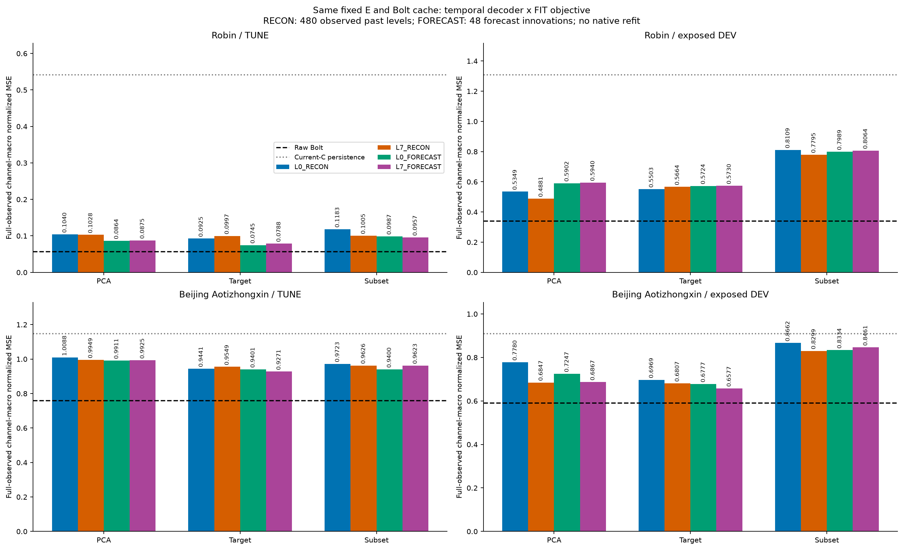
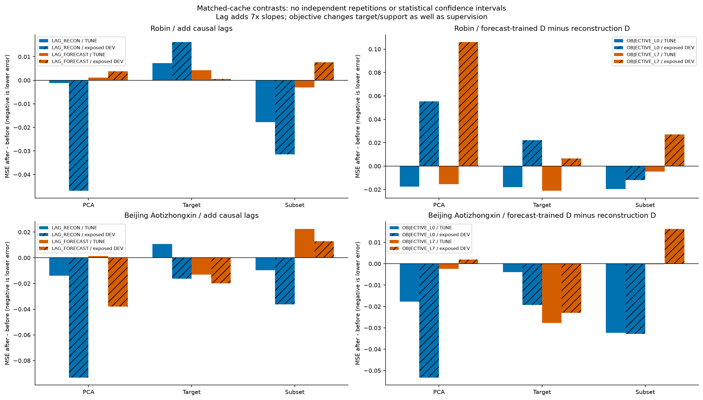
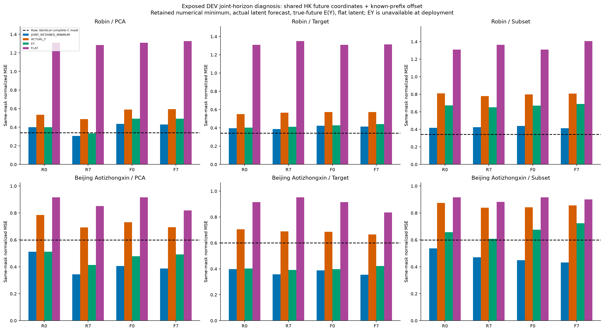
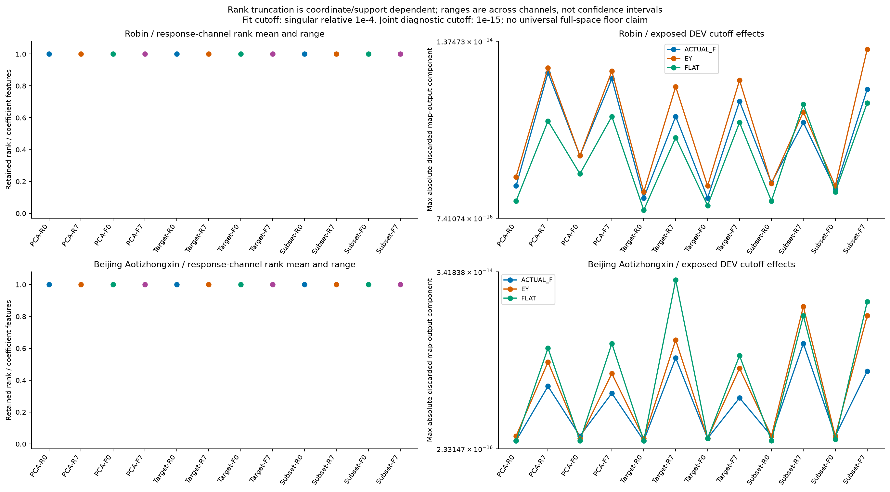
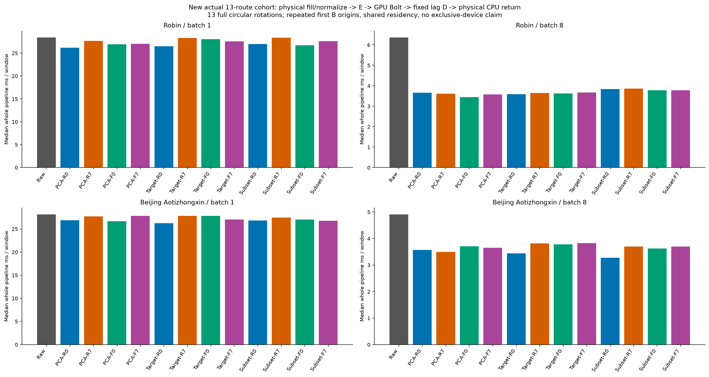
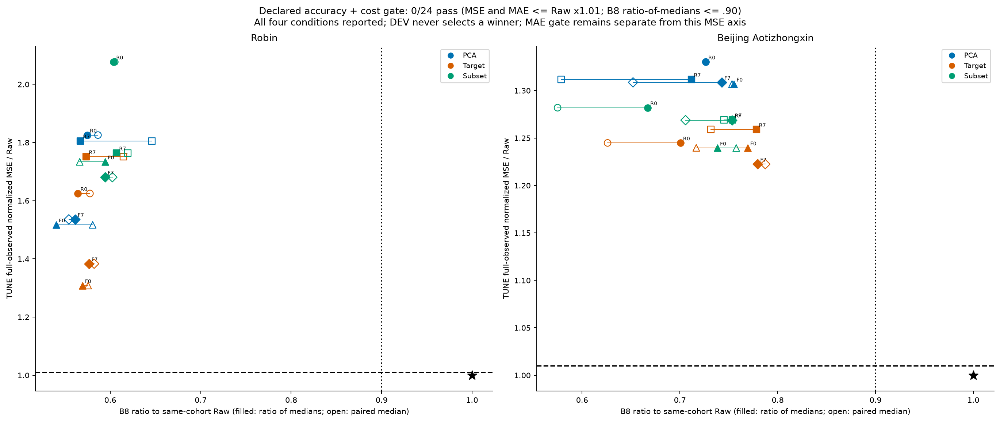

# 고정 Bolt·표현에서 lag와 디코더 학습 목적을 나눈 결과

이번 2×2 대조는 **시간별 독립 복원만 바꾸면 전체 문제가 해결된다는 결과를 주지 않았다.** 기노출 DEV의 24조건 중 Raw보다 full-observed 정규화 MSE가 작은 조건은 0/24이며, 사전 정확도·비용 동시 기준을 통과한 조건은 0/24다. 예측 목적 D가 같은 lag의 재구성 D보다 MSE를 줄인 비교는 TUNE 12/12, 기노출 DEV 5/12다. 이것은 현재 세 E·작은 K·고정 Bolt와 새 선형 D 안의 결과이며 다른 표현·예측기의 불가능성을 뜻하지 않는다.

**현재 확인한 것은 표현을 새로 학습한 성공이 아니라 디코더의 구조·학습 목적 개입이다.** 같은 E와 실제 Bolt 잠재 미래를 고정하고 lag0/lag7 및 과거 재구성/FIT 미래 예측 목적을 교차했다. E 자체, F, native head를 새로 학습하지 않았다. 과거의 관계를 시간적으로 복원하는 여지는 일부 있었으나, 출력 공간에 여지가 생기는 것과 실제 잠재 미래가 그 공간의 적절한 좌표에 도달하는 것은 별개다.

**미래 누출과 정상 감독을 구분했다.** FORECAST D는 FIT의 실제 미래 Y를 학습 target으로 쓰는 지도학습이다. 배포용 특징은 origin에서 알려진 과거와 동결 Bolt 예측뿐이다. 24 D의 성공·실패 잠금 및 registry를 만든 뒤 TUNE·DEV NPZ를 열었고, 그 값으로 D를 재적합하거나 네 조건을 고르지 않았다. 72개의 좁은 perturbation 검사는 고정 E/F 캐시·D에서 scoring target/mask를 바꿔도 ACTUAL_F 예측이 같음을 확인한 것이다. E/F 전체를 독립 재실행한 누출 검사나 독립 일반화 검증으로 확대하지 않는다. FIT_TARGET E는 이전부터 FIT 미래 감독을 사용했다.

**2×2의 비교 조건.** Robin C17/K4와 Beijing C11/K2, L512/H48, FIT256/TUNE64와 이미 노출된 VAL30/EVAL146, 원 scaler·origin·observed mask를 유지했다. L0와 L7 RECON은 모두 공통 과거32:512의 480시점에서 채널별 관측 level을 centered LS로 학습한다. FORECAST는 48개 실제 F 예측의 배포 delta-Z에서 Y−currentC를 비중심·무절편 LS로 적합한다. 두 목적은 같은 lag에서 배포 계수 수와 입력이 같지만 target support·분포·감독 정보가 다르다. lag7은 slope 수가 7배다. 두 비교 모두 singular 상대 cutoff 1e−4를 고정했지만 유효 rank·좌표별 정규화가 같다는 뜻은 아니다. 중첩된 행을 독립 표본 수로 세지 않는다.

배포식은 `currentC + Σ_l (z_combined(h−l)−z_past(−l)) B_l`이다. `z_past(−l)`의 실제 index는 `-1-l`이며, 상대시점≤0은 알려진 과거, >0은 예측이다. lag의 단위는 원 자료의 sampling step이며 채널 간 인과 그래프를 학습하거나 인과성을 증명하는 실험이 아니다. 입력은 K streams·K 과거 buffer·현재 C anchor이며 strict K-only가 아니다. origin별 C 과거로 D를 새로 적합하지 않는다. flat 미래 latent도 알려진 lag prefix와 기준값 때문에 current-C persistence와 다를 수 있어 별도 진단했다. RECON의 재구성 잔차 r_t는 anchored 예측에서 r_0−r_h로 들어가므로 level 재구성 목적이 미래 innovation 오차를 직접 최소화하지는 않는다.

아래 값은 모두 full-observed channel-macro 정규화 MSE다. 마스크가 다른 공간 진단과 섞지 않는다.

```text
dataset  E       condition       TUNE           exposed_DEV
Robin     PCA     L0_RECON      0.103955141   0.534928482
Robin     PCA     L7_RECON      0.102808326   0.488093014
Robin     PCA     L0_FORECAST   0.086375610   0.590244433
Robin     PCA     L7_FORECAST   0.087457541   0.594049759
Robin     Target  L0_RECON      0.092520335   0.550256985
Robin     Target  L7_RECON      0.099738105   0.566435878
Robin     Target  L0_FORECAST   0.074493146   0.572416418
Robin     Target  L7_FORECAST   0.078771484   0.573009412
Robin     Subset  L0_RECON      0.118276931   0.810862922
Robin     Subset  L7_RECON      0.100455669   0.779459794
Robin     Subset  L0_FORECAST   0.098707847   0.798858239
Robin     Subset  L7_FORECAST   0.095706440   0.806424918
Robin Raw exposed_DEV MSE=0.340401887
Beijing   PCA     L0_RECON      1.008844518   0.777964435
Beijing   PCA     L7_RECON      0.994903204   0.684693557
Beijing   PCA     L0_FORECAST   0.991115018   0.724655019
Beijing   PCA     L7_FORECAST   0.992518115   0.686653749
Beijing   Target  L0_RECON      0.944091015   0.696910321
Beijing   Target  L7_RECON      0.954854275   0.680696178
Beijing   Target  L0_FORECAST   0.940149438   0.677673165
Beijing   Target  L7_FORECAST   0.927140783   0.657737024
Beijing   Subset  L0_RECON      0.972263425   0.866181694
Beijing   Subset  L7_RECON      0.962604731   0.829944669
Beijing   Subset  L0_FORECAST   0.939981113   0.833380983
Beijing   Subset  L7_FORECAST   0.962296811   0.846133441
Beijing Aotizhongxin Raw exposed_DEV MSE=0.589575414
```


[SVG](figures/01_actual_accuracy.svg)


[SVG](figures/02_factorial_contrasts.svg)

**시간 구조의 효과는 조건부다.** 사전 비교인 Robin/PCA/RECON에서는 L0→L7에 따라 DEV MSE가 0.534928482→0.488093014, 동일 complete-C mask의 수치 유지 공간 minimum은 0.400907405→0.306885041다. 시간적 D가 일부 공간 제약을 완화할 수 있다는 단서지만, 더 큰 계수 수·과거 buffer·변경된 offset을 함께 사용한 비교다. 실제 F 결과가 Raw보다 좋은지와 분리해야 한다. FORECAST가 TUNE에서 좋아도 DEV에서 같은 방향으로 바뀌는지는 네 조건 전체 원수치로 판단한다.

**공동 미래 진단은 배포 성능이나 보편적 하한이 아니다.** 미래 latent 자유변수는 horizon마다 K개인 HK이며 H×7K개의 독립 lag 특징이 아니다. HC×HK block causal map와 origin별 알려진 offset을 구성하고, complete-C horizon에 해당하는 출력 행만 선택했다. 관측이 없는 horizon의 잠재 미지수도 남겼다. 출력값의 SSE/(complete위치수×C)를 합산하며 창 평균을 다시 평균하지 않았다. 실제 미래 E(Y)는 불완전 C horizon 전체를 currentC로 채운 후 고정 E를 적용한 진단이며, lag를 통해 뒤 horizon에도 영향을 줄 수 있다. 최적 latent·배포 입력·선정 근거가 아니다.

minimum은 masked map의 singular 상대 cutoff1e−15로 등록한 **유지된 수치 공간**의 정규화 MSE 최소다. 아주 작은 실제 방향을 버릴 수 있으므로 원 실제 trace/FP32(+실측 rounding allowance)와의 부등식은 참·거짓을 그대로 저장하고, 유지 공간으로 투영한 trace에만 최소 부등식을 필수 검산한다. MAE·물리 단위 오차는 그 해의 값이며 각각의 최소가 아니다. 이전 pointwise/global-rank-K floor는 재사용하지 않았다.

최초 독립 감사는 일부 L7 masked map에서 LS와 SVD의 수치 rank가 달라 통과하지 못했다. 저장 A/관측 mask에 대한 별도 진단에서는 불일치 LS rank가 exact nonzero-column rank 상한을 초과하는 문제가 확인됐다. 새 감사는 정확한 zero 열만 LS 계산에서 제외하고 전체 HK 좌표로 복원하는 대수적으로 동등한 검산 경로를 사용한다. 선택된 관측 출력에 기여하지 않는 exact-null 열의 내부 처리이며, 해당 horizon의 Y가 결측이라는 이유만으로 미래 변수를 삭제한 것이 아니다. 원 D·예측·조건·cutoff·공차를 바꾼 개선이 아니다. 실패한 최초 감사와 원 source, 별도 진단 및 repair 문서는 모두 보존한다. 이를 학습 실패나 미래 누출로 단정하지 않는다.

Robin: 원 real-trace 부등식 거짓 0/108, FP32+allowance 부등식 거짓 0/108. 이 수치는 cutoff 정의와 함께 읽으며 버린 성분을 공차 확대나 PASS로 숨기지 않는다.
Beijing Aotizhongxin: 원 real-trace 부등식 거짓 0/108, FP32+allowance 부등식 거짓 0/108. 이 수치는 cutoff 정의와 함께 읽으며 버린 성분을 공차 확대나 PASS로 숨기지 않는다.


[SVG](figures/03_joint_future_diagnosis.svg)


[SVG](figures/04_rank_and_discarded_components.svg)

**비용은 새 전체 실행으로 확인했다.** 과학 단계는 이미 실제로 실행된 F 캐시18개를 재사용한 CPU D 적합·추론·진단이며 새 F 호출0이다. 이를 F latency로 세지 않았다. 별도 비용은 13경로×2자료×B1/B8의52조건, warmup2회·13완전순환의676타이머 표본에서 실제 E→GPU F→새 D를 다시 실행했다. physical causal fill/FIT normalize부터 물리 단위 FP32 CPU 반환·최종 sync까지 포함하고, 고정 E/D 준비·FIT 적합·source/file/state SHA·guard·warmup·저장·memory snapshot은 제외한다. callback에 포함된 pure 배포 연산과 검증 비용은 포함된다. 같은 첫 B origins의 반복이므로676개의 독립 데이터가 아니다.

아래는 B8 ms/window와 같은 cohort Raw 분모의 두 비율이다. ratio-of-medians와 반복별 paired ratio의 중앙값은 서로 다른 통계다. B1과 전체 ns timestamp·표본·parity·메모리는 CSV에 모두 보존한다. 공유 process에 F와 여러 E/D가 resident이므로 RSS/VRAM을 방법별 독점 메모리나 장비 독점으로 해석하지 않는다.

```text
dataset  route                         B8_ms/window  ratio_medians  median_paired
Robin     RAW_BOLT                        6.366162   1.000000   1.000000
Robin     PCA_L0_RECON_BOLT               3.657487   0.574520   0.586386
Robin     PCA_L7_RECON_BOLT               3.609387   0.566964   0.645903
Robin     PCA_L0_FORECAST_BOLT            3.439575   0.540290   0.580521
Robin     PCA_L7_FORECAST_BOLT            3.572562   0.561180   0.554182
Robin     FIT_TARGET_L0_RECON_BOLT        3.591387   0.564137   0.577487
Robin     FIT_TARGET_L7_RECON_BOLT        3.651050   0.573509   0.614627
Robin     FIT_TARGET_L0_FORECAST_BOLT     3.623638   0.569203   0.575537
Robin     FIT_TARGET_L7_FORECAST_BOLT     3.669500   0.576407   0.582155
Robin     RAW_SUBSET_L0_RECON_BOLT        3.843513   0.603741   0.604951
Robin     RAW_SUBSET_L7_RECON_BOLT        3.863938   0.606949   0.619459
Robin     RAW_SUBSET_L0_FORECAST_BOLT     3.784638   0.594493   0.566199
Robin     RAW_SUBSET_L7_FORECAST_BOLT     3.783175   0.594263   0.602279
Beijing   RAW_BOLT                        4.910637   1.000000   1.000000
Beijing   PCA_L0_RECON_BOLT               3.567563   0.726497   0.726497
Beijing   PCA_L7_RECON_BOLT               3.494938   0.711707   0.578483
Beijing   PCA_L0_FORECAST_BOLT            3.708887   0.755276   0.753298
Beijing   PCA_L7_FORECAST_BOLT            3.647588   0.742793   0.652099
Beijing   FIT_TARGET_L0_RECON_BOLT        3.440450   0.700612   0.626068
Beijing   FIT_TARGET_L7_RECON_BOLT        3.821487   0.778206   0.731591
Beijing   FIT_TARGET_L0_FORECAST_BOLT     3.777737   0.769297   0.716750
Beijing   FIT_TARGET_L7_FORECAST_BOLT     3.827950   0.779522   0.787318
Beijing   RAW_SUBSET_L0_RECON_BOLT        3.275987   0.667121   0.574947
Beijing   RAW_SUBSET_L7_RECON_BOLT        3.700937   0.753657   0.745217
Beijing   RAW_SUBSET_L0_FORECAST_BOLT     3.625987   0.738394   0.757631
Beijing   RAW_SUBSET_L7_FORECAST_BOLT     3.699338   0.753331   0.705766
```


[SVG](figures/05_whole_pipeline_cost.svg)

사전 동시 기준은 각 자료·12경로의 TUNE full-observed normalized MSE와 MAE가 각각 Raw×1.01 이하이고 B8 ratio-of-medians≤.90인지다. 통과 0/24이며 DEV 최저 조건을 채택하거나 원수치를 선택적으로 제외하지 않았다. 일부 accuracy 또는 cost 개선을 동시 성공으로 바꾸지 않는다.


[SVG](figures/06_accuracy_cost_gate.svg)

**남는 판단.** 현재 비교는 decoder-only 통제이며 새 표현·동적 그래프·대조학습의 필요성을 입증하지 않는다. 큰 모델을 쓰면 해결된다는 증거도 없다. 기존 native는 이전 D에 맞춘 모델이어서 주비교에서 제외했으며 이를 새 D에서 최적화된 native 비교라고 부르지 않는다. 향후 새 D에 맞춘 predictor 검토가 필요하더라도 실제 F와 출력공간 minimum의 gap만으로 F 자체의 유일한 원인을 확정하면 안 된다. 이미 노출된 두 자료와 제한된 K에 대한 적응적 탐색이며 독립 일반화 검증은 남아 있다.

**기존 결과와 방법의 위치.** 고정 E/F/GELU hidden의 outgoing D를 실제-Y innovation에 맞춘 이전 D2도 이미 실행됐고 독립 검산28,365/실패0이었다. 이번은 최초 predictive D가 아니라 같은 세 선형 E·cache·lag별 용량에서 학습 목적을 교차한 통제다. 잠재 성분의 lag로 선형 복원하고 성분별 예측을 복원식에 넣는 구조는 [ODPC §2·§2.2](https://arxiv.org/html/1708.04705v1)에 있다. 이번을 ODPC 전체 구현이나 새로운 lag 구조의 발견으로 주장하지 않는다.

기존 joint-Y 4조건도 frozen F를 통과한 actual-C 예측 손실로 E/D를 600 update 학습했고, F 입력까지의 nonzero gradient 검사와 F 동결 hash를 기록했다. 따라서 이전 연구를 재구성만 학습한 것으로 설명하거나, F를 통한 E 업데이트 자체를 아직 시도하지 않은 해결책이라고 쓰지 않는다. 이번은 현재 세 선형 E와 캐시를 고정한 D-only 대조이며 그 기존 공동 학습과 다른 조건이다.

[기존 D2 source](../../../../smallk_failure_followup_20261014/frozen_decoder_refit.py), [기존 D2 검산](../../../../smallk_failure_followup_20261014/validation_v1/D2_ARRAY_AUDIT_v1.json), [기존 joint-Y source](../../../../smallk_failure_followup_20261014/run_joint_objectives_v2.py), [기존 joint-Y 검산](../../../../smallk_failure_followup_20261014/validation_v1/JOINT_ARRAY_AUDIT_v1.json), [직전 raw-subset 보고서](../raw_subset_comparison_v1/REPORT_KO.md)를 보존한다.

원수치·재개 근거는 다음 파일에 있다.

- [COMPARISON.csv](tables/COMPARISON.csv): 336행
- [DELTA_COMPARISONS.csv](tables/DELTA_COMPARISONS.csv): 72행
- [FACTORIAL_CONTRASTS.csv](tables/FACTORIAL_CONTRASTS.csv): 72행
- [DECODER_STATES.csv](tables/DECODER_STATES.csv): 24행
- [DECODER_CHANNELS.csv](tables/DECODER_CHANNELS.csv): 336행
- [DECODER_SINGULARVALUES.csv](tables/DECODER_SINGULARVALUES.csv): 4320행
- [FIT_LOCKS.csv](tables/FIT_LOCKS.csv): 24행
- [F_CACHE_LINEAGE.csv](tables/F_CACHE_LINEAGE.csv): 18행
- [JOINT_GEOMETRY.csv](tables/JOINT_GEOMETRY.csv): 72행
- [JOINT_MASK_CERTIFICATES.csv](tables/JOINT_MASK_CERTIFICATES.csv): 2964행
- [FUTURE_DIAGNOSTIC_SCORES.csv](tables/FUTURE_DIAGNOSTIC_SCORES.csv): 1872행
- [RETAINED_DISCARDED.csv](tables/RETAINED_DISCARDED.csv): 216행
- [FORECAST_LABEL_PROBES.csv](tables/FORECAST_LABEL_PROBES.csv): 72행
- [WHOLE_COST.csv](tables/WHOLE_COST.csv): 52행
- [WHOLE_COST_SAMPLES.csv](tables/WHOLE_COST_SAMPLES.csv): 676행
- [REGISTERED_ADOPTION.csv](tables/REGISTERED_ADOPTION.csv): 24행
- [EXECUTION_RESOURCES.csv](tables/EXECUTION_RESOURCES.csv): 4행
- [PRESERVED_FAILURES.csv](tables/PRESERVED_FAILURES.csv): 1행

- [science](../../runs/actual_causal_lag_objective_v1/RESULT.json): `4168cd05962e479130a722919310f4c192c1bab03d9b78cb7983754f2e502c17`
- [audit](../../audits/CAUSAL_LAG_OBJECTIVE_AUDIT_v2.json): `d395a82e76a31e38520db1dd4d56642963ca4e362f358a6d86480049d402a31d`
- [cost](../../runs/actual_causal_lag_cost_v1/RESULT.json): `8bdf4cdf05e2be8dfef56406d9b8f7cee46a98571b864707afe83d77431966f4`
- [cost_audit](../../audits/CAUSAL_LAG_COST_AUDIT_v1.json): `d770b9561263bb99507e1cfe323b3c5785b6806fb3bd80a8c66109c1f5df41a6`
- [audit_source](../../audit_causal_lag_objective_v2.py): `022e9506fe0dbaa593f069e48972cb878a6a2f5cb2f0d062feb0cdde5cbeae30`
- [cost_audit_source](../../audit_causal_lag_cost_v1.py): `4f0fa97ef682df37d3717812170d8bf8811bd5bb20b6f1f129da482fa74f9f9b`
- [science_audit_v1](../../audits/CAUSAL_LAG_OBJECTIVE_AUDIT_v1.json): `7d4999aed252e343dba18c2f009bb3dc20498af5ab2b90c6ac01c0d8c6c8df7a`
- [joint_zero_column_rank_diagnostic](../../audits/CAUSAL_LAG_RANK_BOUNDARY_DIAGNOSTIC_ROOT_v1.json): `9280c189a503b13ccef65c0a259c52958e280f2203458c829f07f9bd6c6b50c6`
- [joint_auditor_repair_addendum](../../CAUSAL_LAG_JOINT_AUDITOR_ZERO_COLUMN_REPAIR_KO_v2.md): `89474245c07e7e1d07a24079862ce71dc605cbcf59b76b0f000f4eb800a33286`
- [plan](../../PLAN_CAUSAL_LAG_OBJECTIVE_KO_v1.md): `9a82f261ecb8058d73c9b4ae195b203f410c08f4d7a9017da9e32aa9b22ec3ea`
- [raw_subset_diagnostic](../../runs/raw_subset_comparison_v2/RESULT.json): `2b271ba9aa6ae359033444b282ddc1becc5d1f60ef063451171e9c93f70db4ff`
- [raw_subset_audit](../../audits/RAW_SUBSET_COMPARISON_AUDIT_v3.json): `e177652ac34414bccfbfc564da820fca0bde5a462922ceb0edaf04c47081e95d`
- [parent_report](../raw_subset_comparison_v1/REPORT_KO.md): `49130355afe1d89e43d130b416a536c6f683f36a76ab0d4e844afe11ec1a652b`
- [parent_report_manifest](../raw_subset_comparison_v1/MANIFEST.json): `a6d8a837a543712402224d742fcc7c5e08b9eba1333968f6e53baa56a8c45e36`
- [parent_report_audit](../../audits/RAW_SUBSET_REPORT_AUDIT_v1.json): `a184351bcbc503c5308cd3cb74232fb470136f7cdcc8711cc3ac20972c86cb00`
- [cost_plan](../../PLAN_CAUSAL_LAG_WHOLE_COST_KO_v1.md): `40ebbc58160ee5d56647f81637e583a398b8459b51f20a13e1b38e54cfd84f24`
- [D2_prior_audit](../../../../smallk_failure_followup_20261014/validation_v1/D2_ARRAY_AUDIT_v1.json): `639be8b3eee038b76bf33936879174dd64176073aeb0c62c8c2dc1b74e646d8a`
- [D2_prior_source](../../../../smallk_failure_followup_20261014/frozen_decoder_refit.py): `b361d7f1c66764a32dce86f4473e734d1e1c9d0e44bc49f9b6dd556d826b3638`
- [joint_Y_prior_source](../../../../smallk_failure_followup_20261014/run_joint_objectives_v2.py): `352cb68c499a84ce9e5e32b95f4adfb2af96c89b226da28eec44630a3b26d21f`
- [joint_Y_prior_audit](../../../../smallk_failure_followup_20261014/validation_v1/JOINT_ARRAY_AUDIT_v1.json): `4b82681356169ac8a7192dcc6af9c144ae71dec9b0076e59984e6e79b7b56454`
- [report_source](../../make_causal_lag_report_v1.py): `be3ac864a53beb8e1149c7500bf1d14532373e643866a75fbf95492b0973edf2`

계수 원값과 예측 배열은 원 scientific artifact에 있으며 보고서 생성기는 NPZ·모델을 열지 않는다. 상태 shape/dtype/SHA·관측수/rank/SVD 및 모든 정규화·물리 단위 점수는 metadata 그대로 CSV에 보존했다. 이 보고서는 논문/PPT 작성이나 Git 게시 완료를 뜻하지 않는다.
