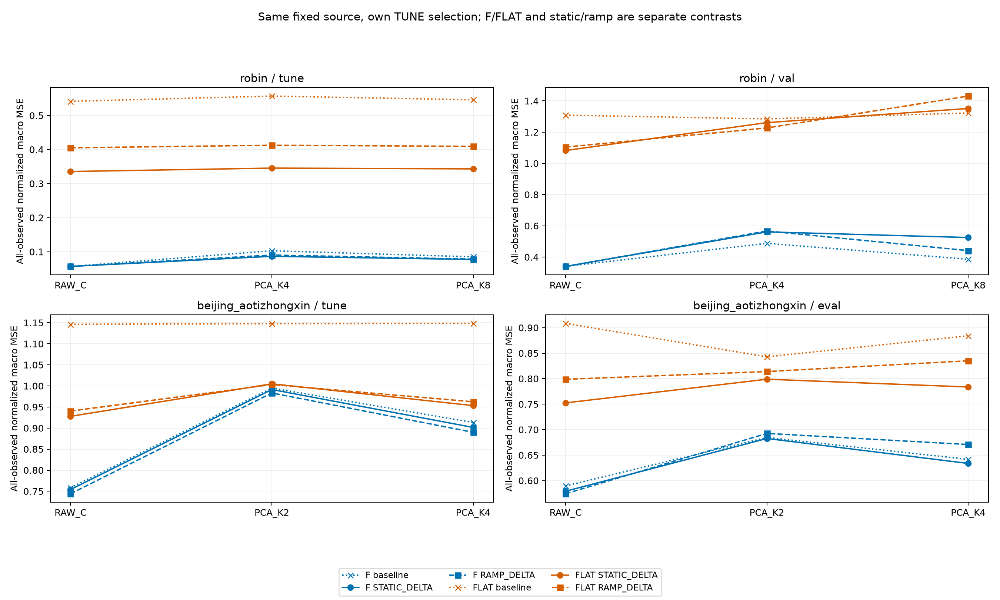
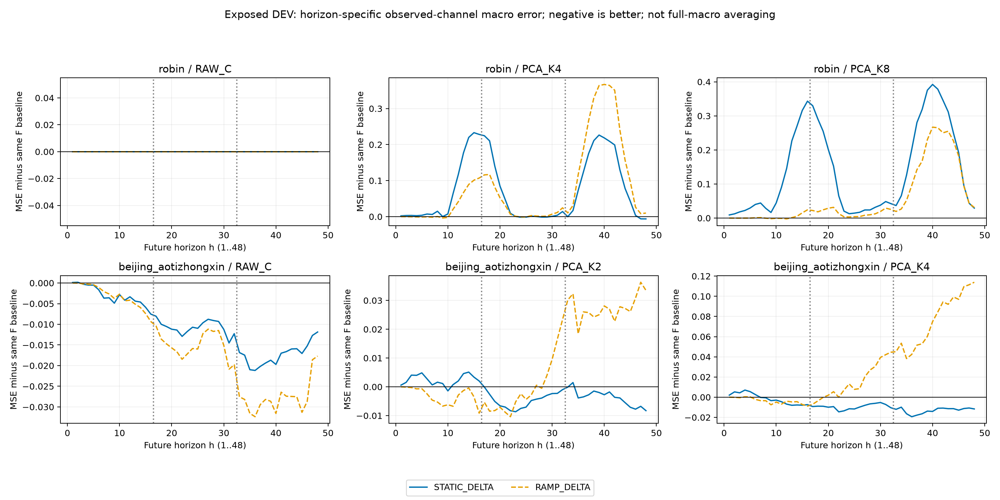
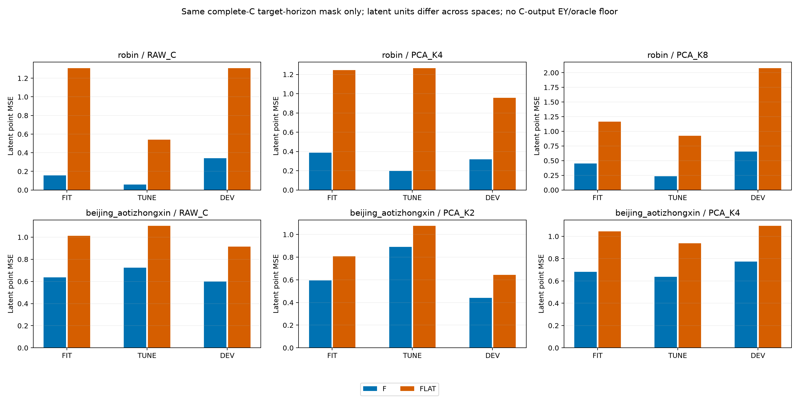
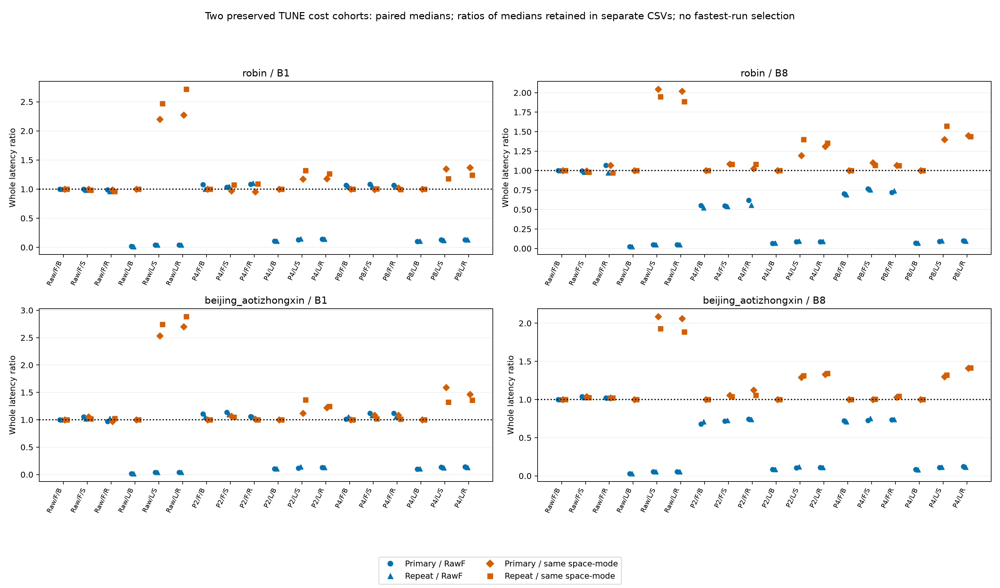

# 공통·horizon ramp 디코더 보정: 무엇이 개선됐고 무엇이 남았나

[확인] 같은 dataset·입력 공간·보정 arm에서 실제 F 미래를 쓴 선정 예측은 FLAT 미래보다 DEV MSE가 낮은 조건이 12/12다. 그러나 PCA의 F+RAMP는 원 F baseline보다 DEV가 나빠진 조건이 4/4다. 같은 추가 계수 수의 한 번의 고정 ramp가 압축 문제를 해결했다고 볼 수 없다. ZERO_DELTA를 고른 조건은 2/24이며 실제 실행 성공과 성능 개선을 구분한다.

- robin: 원 Raw F DEV MSE 0.340401887028; STATIC_DELTA 0.340401887028 (ZERO_DELTA); RAMP_DELTA 0.340401887028 (ZERO_DELTA).
- robin PCA_K4: 같은 F baseline DEV 0.488093007682, STATIC 0.561335160116, RAMP 0.567132240568; TUNE는 0.0865738252786/0.0903058896211다.
- robin PCA_K8: 같은 F baseline DEV 0.386399234182, STATIC 0.525296183101, RAMP 0.441553844997; TUNE는 0.0773171172092/0.0783669670464다.
- beijing_aotizhongxin: 원 Raw F DEV MSE 0.589575413763; STATIC_DELTA 0.579185180261 (ALPHA_10); RAMP_DELTA 0.574256190887 (ALPHA_1).
- beijing_aotizhongxin PCA_K2: 같은 F baseline DEV 0.684693555102, STATIC 0.682673637318, RAMP 0.69260393118; TUNE는 0.991399434678/0.983272303633다.
- beijing_aotizhongxin PCA_K4: 같은 F baseline DEV 0.641731213457, STATIC 0.633718108951, RAMP 0.670855508267; TUNE는 0.901479481487/0.889871808098다.

**질문과 방법.** PCA 기본K/2K의 E·center·원 RECON L7 D 및 실제 F cache를 고정했다. 추가 slope ΔD 하나의 크기는 7K×C이고, STATIC은 모든 미래에1, RAMP는 저장 index i=0..47에서 i/47을 곱한다. 첫 미래 h=1의 ramp 보정은0, h=48은1이다. 이것은 origin h=0이나48개 독립 D_h가 아니다. 두 arm의 free slope 수는 같지만 effective rank·shrinkage·함수집합까지 일치하지 않는다. F와 FLAT 네 arm은 같은 실제 F ungated FIT 특징의 uncentered RMS를 공유한다.

FIT의 true-observed 원 C residual(Y32_as64−원 baseline32_as64)을 C별 SSE/N_c+α||표준화 slope||²로 적합했다. 절편·feature centering·시간 bias는 없다. alpha0는 design singular cutoff1e-8 최소노름, 양수α는 모든 singular 방향을 쓰며 fused ΔD64를FP32로 저장한다. 배포는 원 baseline32+FP32(g·phi)@ΔD32이고 D_old+ΔD를 먼저 합성한 산술로 바꾸지 않았다. ZERO는 원 baseline 배열을 그대로 복사한다. Raw F도 원 raw_forecast byte를 쓰며 currentC+(rawF−currentC)의 재조합은 FP32 cancellation 때문에 보조 진단이다.

두 자료×Raw/PCA기본K/PCA2K×F/FLAT×STATIC/RAMP의24경로에서 alpha0 포함240후보와 ZERO24, 총264후보·528 FIT/TUNE 비교·선정 DEV24를 실행했다. 선택은 각 arm의 실제 FP32 TUNE all-observed normalized channel-macro MSE이며 정확 동률은 등록α 순서 뒤 ZERO다. 모든24개 성공/실패 잠금 뒤 DEV를 열었다. 과학 단계는 원 F cache를 재사용했고 새 F forward·E/D/native 학습·optimizer update는0이다. 실제 미래 residual로 ΔD를 적합한 감독학습이며, 재구성 목적만 학습했다고 설명하지 않는다.

**무엇을 분리했나.** L7의 lag별 origin 참조와 알려진 과거 prefix 때문에 latent-last FLAT은 원 current-C persistence와 일반적으로 다르다. F가 FLAT보다 좋다는 관측은 이 보정 class 안의 미래 정보 기여 단서다. 모든 native나 채널 혼합 예측기보다 F가 반드시 필요하다는 증거는 아니다. Raw에도 같은 static/ramp 기회를 줬으며 Raw7C² 대 PCA7KC로 용량과 보존 정보가 다르다. Beijing의 Raw 보정 이득은 압축 고유 정확도 이득으로 세지 않는다.

TEMPORAL은48개 h와 사전1–16/17–32/33–48 구간의 true-observed C macro 오차, 같은 mode baseline, signed MSE/MAE 차이를 보존한다. 각 h의 관측 채널 분모가 달라 h별 평균이 전체 all-observed macro와 같지 않다. 전체·complete-C·물리 단위 per-C 진단은 SCORES/BASELINE_SCORES에 구분했다. 시간 구간과 겹치는 창을 독립 dataset 또는 반복으로 세지 않았다.

**표현 공간의 미래 오차.** point latent MSE에서 F가 FLAT보다 낮은 context는 18/18다. 이는 각 공간 고유 단위이며 C normalized MSE와 직접 같은 척도로 비교하지 않는다. 원 C 전체가 관측된 target h만 E(Y)로 변환했고, 미관측 C vector를 안전한 latent 정답으로 취급하지 않았다. 이 단계는 C-output E(Y)나 새 joint output-space minimum을 계산하지 않았다. 옛 고정 D floor를 새 시간 보정 모델의 하한으로 재사용하지 않는다.

**새 전체 비용.** 다음 수치는 이24개 선정 correction의 별도 cohort다. 원 physical CPU TUNE 첫 B1/B8에서 causal fill/FIT scaler→필요한 실제 CUDA E/F/old D→CPU static/ramp correction 및 필요한 latent 전송/lag 특징→physical CPU 반환·sync를 측정한다. FLAT은 F를 호출하지 않고, ZERO도 새 실제 baseline을 구한 뒤 복사한다. cached F를 반환한 과학 CPU 시간을 F 배포 비용으로 쓰지 않았다. 세팅·계수 적합·reference·추가 precheck·warmup·저장·외부 meter/hash·memory snapshot은 밖이고 내부 finite/shape 검사는 안이다.

18routes×2자료×B1/B8의 72/72셀, 360/360 integer-ns 표본을 보존했다. warm2/실측5는18위치 전체 균형이 아닌5회전이며 같은 첫B창을 반복했다. Raw F 및 같은 space/mode baseline 각각에 대한 median paired ratio와 ratio of medians를 구분했다. matching FLAT baseline을 Bolt라고 부르지 않는다. 공유 F/4개 PCA E-D/24개 CPU correction의 RSS·VRAM은 방법별 독점 메모리가 아니다.

- robin B1: Raw F 원 실행 12.485, 반복 12.8544 ms/window; 각각의 Raw F보다 median latency가 낮은 선정 보정 route 6/12, 8/12. 정확도와 독립된 속도 비교다.
- robin B8: Raw F 원 실행 3.331025, 반복 3.2556375 ms/window; 각각의 Raw F보다 median latency가 낮은 선정 보정 route 10/12, 12/12. 정확도와 독립된 속도 비교다.
- beijing_aotizhongxin B1: Raw F 원 실행 12.2308, 반복 12.3664 ms/window; 각각의 Raw F보다 median latency가 낮은 선정 보정 route 7/12, 6/12. 정확도와 독립된 속도 비교다.
- beijing_aotizhongxin B8: Raw F 원 실행 2.3405875, 반복 2.3427375 ms/window; 각각의 Raw F보다 median latency가 낮은 선정 보정 route 10/12, 10/12. 정확도와 독립된 속도 비교다.

원 실행과 같은 source/선정 상태의 반복 실행도 별도 72/72셀·360/360표본으로 보존했다. 그림은 두 실행의 paired medians를 비교하며 두 분모의 ratio-of-medians도 각각의 CSV에 그대로 있다. 빠른 실행을 골라 원값을 대체하지 않았고 세 번째 반복이나 새로운 계수 선정을 하지 않았다. 이전76셀 cohort와 Raw 시간이 달랐던 원인은 미확정이며 callback 차이나 방법 개선으로 확정하지 않는다. 다른 cohort의 유리한 Raw 절대시간을 분모로 차용하지 않았다.

[판단] TUNE 이득이 이미 노출된 DEV로 모두 옮겨지지 않았고, PCA RAMP의 원 F 대비 일관된 해결은 관측되지 않았다. 한 번의 고정 ramp 결과로 full D_h·비선형 D·추가 학습 가능성을 모두 기각하지 않는다. 이번 진단 후 실패를 이유로 spline/bin/고차 함수를 자동 늘리지 않는다. adaptive 설계와 제한된2개 dataset·두 K의 결과이며 독립 일반화/분포 변화 원인 확정이 아니다. 보호 TEST0, strict K-only0이다. current C anchor와 K 과거 buffer를 포함하며, 과거 기반 배포와 FIT 미래 target 감독을 구분한다. 기존24D 결과·원 v1 76셀 비용·history ridge 규제 확장·그 실패 기록은 보존하고 이 묶음으로 대체하지 않는다.

검산은 저장 산술·선정 계수·마스크·점수·source/SHA/영수증과 실제 비용 기록의 확인이다. F GPU·optimizer를 독립 재현한 실험이나 별도 holdout 검증이 아니다. 이 생성기는 JSON metadata만 읽으며 NPZ·모델·F·GPU·학습을 열거나 실행하지 않는다. RESOURCES의 science/audit/원cost와감사/반복cost와감사 CPU·process wall은 각 범위로 보존하며 학습시간 speedup으로 쓰지 않는다.

원·반복 비용의 첫 v1 감사는 metadata 함수와 지역 변수의 이름 충돌(UnboundLocalError)로 실패했고, 원 source와 두 실패 영수증을 보존했다. 새 v2 감사는 지역 식별자 두 곳만 바꿔 원·반복 모두 PASS했다. 과학 예측·계수·비용 표본·수식·공차는 바꾸지 않았으며, 이 감사 수정 때문에 과학 실행이나 비용 측정을 다시 하지 않았다. 아래 failed_cost_audit_v1·failed_repeat_cost_audit_v1·failed_cost_auditor_v1_source 링크에 원 실패를 남긴다.

- [SELECTED.csv](tables/SELECTED.csv): 24행
- [CANDIDATES.csv](tables/CANDIDATES.csv): 264행
- [SCORES.csv](tables/SCORES.csv): 72행
- [BASELINE_SCORES.csv](tables/BASELINE_SCORES.csv): 54행
- [TEMPORAL.csv](tables/TEMPORAL.csv): 3672행
- [LATENT.csv](tables/LATENT.csv): 36행
- [SOLVERS.csv](tables/SOLVERS.csv): 24행
- [WHOLE_COST.csv](tables/WHOLE_COST.csv): 72행
- [WHOLE_COST_SAMPLES.csv](tables/WHOLE_COST_SAMPLES.csv): 360행
- [WHOLE_COST_REPEAT.csv](tables/WHOLE_COST_REPEAT.csv): 72행
- [WHOLE_COST_REPEAT_SAMPLES.csv](tables/WHOLE_COST_REPEAT_SAMPLES.csv): 360행
- [RESOURCES.csv](tables/RESOURCES.csv): 6행

- [science](../../runs/horizon_decoder_diagnostic_v1/RESULT.json): `5f158382640dac74ec63cc3d1005b385c898821d3c032d51b543f2c9b27d7dac`
- [science_audit](../../audits/HORIZON_DECODER_DIAGNOSTIC_AUDIT_v1.json): `0f65053536403a3b7b8f53fca3b9f8274fb1a406eaf6dfdcb73bb0467fffe698`
- [cost](../../runs/horizon_decoder_cost_v1/RESULT.json): `1bbdacf6326b7111828a4f73cb54009580ba6fb021cc200e8a0a7b60cb6cbb59`
- [cost_audit](../../audits/HORIZON_DECODER_COST_AUDIT_v2.json): `84e32f1f937733990140e7e70c1dcfd389aec807d116e600e3e91a4a52aa2f37`
- [repeat_cost](../../runs/horizon_decoder_cost_repeat_v1/RESULT.json): `71391a967f264e578f469ed2b0f1eceb86830954e34ebe86d7d51999f094f713`
- [repeat_cost_audit](../../audits/HORIZON_DECODER_COST_REPEAT_AUDIT_v2.json): `27d721c6f248caf521bf11dd045af2eb61151629bdb64fbda76750d4b056566c`
- [science_audit_source](../../audit_horizon_decoder_diagnostic_v1.py): `accb6fb775d9b12ca6e39c0be7e062545b98d429089ee32e0ac46ed65edae613`
- [cost_audit_source](../../audit_horizon_decoder_cost_v2.py): `dada7b486966b3c9374c504aa001a8287c5c45b6b51a218bc2f7cbeae3185a3e`
- [repeat_cost_audit_source](../../audit_horizon_decoder_cost_v2.py): `dada7b486966b3c9374c504aa001a8287c5c45b6b51a218bc2f7cbeae3185a3e`
- [cost_cost_plan](../../PLAN_HORIZON_DECODER_WHOLE_COST_KO_v1.md): `e0528e20b2a4a423e4037668a3cf74332176a17b3bcef4952d66c285d66c8f17`
- [cost_whole_cost_source](../../whole_horizon_decoder_cost_v1.py): `dc6f1f5a227cf31c8ed58a6d3ac789f5a8bbc7eda311a48d40b5acfbf0a9606a`
- [cost_controller_source](../../run_horizon_decoder_cost_v1.py): `11f0a97e8ad711d35126a4528c34984ddc60174b756813d6d8236c69e3777e5a`
- [repeat_cost_cost_plan](../../PLAN_HORIZON_DECODER_WHOLE_COST_KO_v1.md): `e0528e20b2a4a423e4037668a3cf74332176a17b3bcef4952d66c285d66c8f17`
- [repeat_cost_whole_cost_source](../../whole_horizon_decoder_cost_v1.py): `dc6f1f5a227cf31c8ed58a6d3ac789f5a8bbc7eda311a48d40b5acfbf0a9606a`
- [repeat_cost_controller_source](../../run_horizon_decoder_cost_v1.py): `11f0a97e8ad711d35126a4528c34984ddc60174b756813d6d8236c69e3777e5a`
- [cross_moment_diagnostic](../../runs/predictive_cross_moment_v1/RESULT.json): `99bffd5831143ca35947099fef9567f89dd209d83451661decee0682b2b8e13c`
- [cross_moment_audit](../../audits/PREDICTIVE_CROSS_MOMENT_AUDIT_v1.json): `90c68a9057909fb5b6c23284e5a45523cdf126da178a5ba0d9d9e96a50dede30`
- [selection_registry](../../runs/horizon_decoder_diagnostic_v1/HORIZON_SELECTION_REGISTRY.json): `bcb544e1c07a20519265fe25138b39afd3bf9112e6fe4e0c55c8d4a6fe999702`
- [plan](../../PLAN_HORIZON_DECODER_DIAGNOSTIC_KO_v1.md): `4e4396c15199e35e8b523e7cd62664b4d6629a39a8b2aba524435bbeea189319`
- [cost_repeat_reason](../../COST_REPEAT_REASON_KO_v1.md): `d505a0d4192ee85d5d95a41ebd3be90618e43c349beddb8575b4a4ac4dffa02b`
- [failed_cost_audit_v1](../../audits/HORIZON_DECODER_COST_AUDIT_v1.json): `ee838121d9da22a9b1706f544978c8dccd514c31501f91fea1b66e039d23d92b`
- [failed_repeat_cost_audit_v1](../../audits/HORIZON_DECODER_COST_REPEAT_AUDIT_v1.json): `62f2c6939e7595c70b3daae6e7561dc4f8541b57540e54565be3d7f2de874e59`
- [failed_cost_auditor_v1_source](../../audit_horizon_decoder_cost_v1.py): `2169c11b3a423c50fbcff86443286462324c231ba0e11fef3715cf50df6dc4a8`
- [science_controller_source](../../run_horizon_decoder_diagnostic_v1.py): `151da5b0b4cc4cacdb9d7a547d12e7837dcdcb5ee4c5047a1d6e3993afe525c6`
- [module_source](../../horizon_decoder_delta_v1.py): `406252e940ae676e7a78f69e067f5b3fa70456bdb1ea27d57169b8964ceabe0e`
- [report_utility](../../make_linear_e_adaptation_report_v2.py): `32e2460ea4724144067f264ab1ceb0332cd04c5fce2296838024c119c9572466`
- [report_source](../../make_horizon_decoder_report_v1.py): `8deeea1c1b4039e9cec520d6dad5395819b2f08ee936409a578fad733ce45e78`
