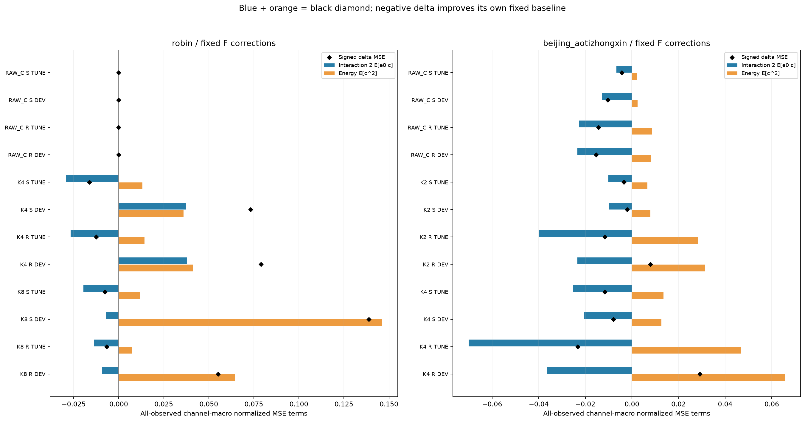
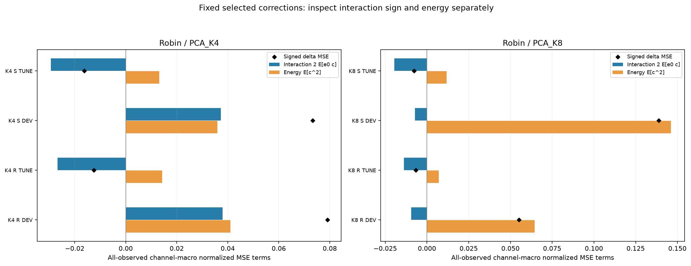
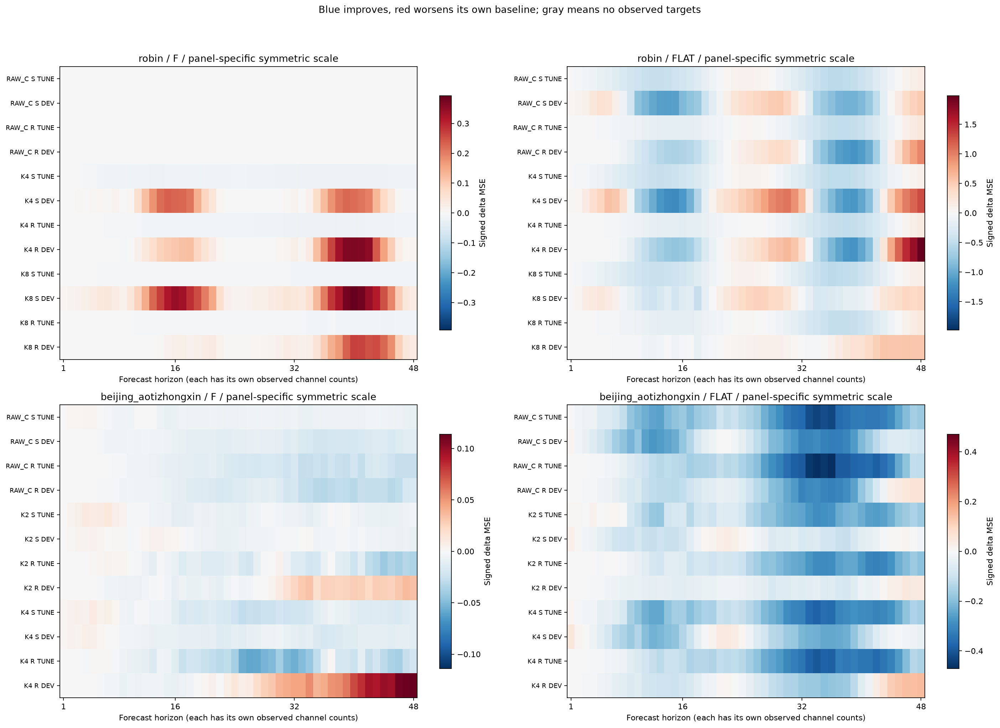
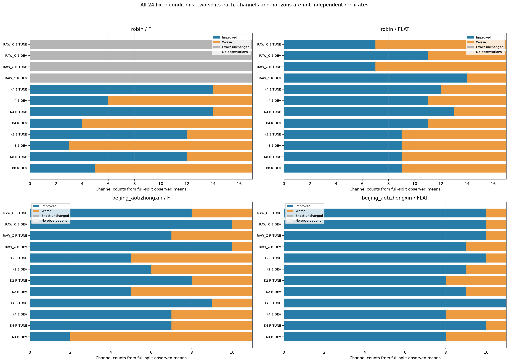

# 선정 보정이 바꾼 오차: 상호작용과 보정 에너지

[확인] 이미 선정된24조건 중 8/24는 TUNE에서 자기 baseline보다 MSE를 낮췄지만 노출 DEV에서는 높였다. 새 fit/F/모델/optimizer/선정/DEV winner는 모두0이며, 원24개 잠금과 선정 계수를 유지했다. 이 문서는 저장 출력의 진단 재계산이다. 외부 독립 감사나 새 방법의 일반화 성공을 뜻하지 않는다.

실제로 반환된 FP32 baseline b, 선정 예측 p, 관측 정답 y를 각각 FP64로 올리고 e0=b−y, c=p−b로 계산했다. c는 이상적인 feature×계수 대신 반올림이 끝난 실제 출력의 변화량이다. 같은 관측 집합에서 ΔMSE=2 macro E[e0c]+macro E[c²]이며 음수 Δ는 그 조건의 자기 baseline 대비 개선이다. 상호작용이 음수면 기존 오차를 줄이는 방향으로 작용하고, 보정 에너지는 비음수다. 이 두 항을 합한 부호와 크기로 결과를 해석한다.

각 채널의 true-observed 평균을 먼저 내고 active 채널에 같은 가중치를 준다. 전체·각 h·사전1–16/17–32/33–48 구간은 각각 자기 관측 분모를 쓴다. h별 macro의 단순평균으로 전체 macro를 만들지 않았고 미관측 채널·구간은 NA다. F/FLAT·STATIC/RAMP·Raw/PCA K를 모두 유지한다. Raw는 원 median F 또는 현재C baseline이며 새 분위 요약 Raw로 교체하지 않았다.

robin PCA_K4 STATIC_DELTA: TUNE 상호작용 -0.0293414237132 + 에너지 0.0131069213286 = Δ -0.0162345023845; DEV 0.0372698915775 + 0.0359722608567 = Δ 0.0732421524342. 상호작용이 TUNE의 음수에서 DEV의 양수로 바뀌었다.

robin PCA_K8 STATIC_DELTA: TUNE 상호작용 -0.0195072866046 + 에너지 0.011762262944 = Δ -0.00774502366056; DEV -0.0071809085412 + 0.14607785746 = Δ 0.138896948919. DEV 상호작용은 음수지만 보정 에너지가 그 절댓값보다 커서 Δ가 양수다.

robin PCA_K8 RAMP_DELTA: TUNE 상호작용 -0.0138459154911 + 에너지 0.00715074166776 = Δ -0.00669517382331; DEV -0.00939052668376 + 0.0645451374984 = Δ 0.0551546108146. DEV 상호작용은 음수지만 보정 에너지가 그 절댓값보다 커서 Δ가 양수다.

beijing_aotizhongxin RAW_C RAMP_DELTA: TUNE 상호작용 -0.0228198616414 + 에너지 0.00850150656184 = Δ -0.0143183550796; DEV -0.0234785104287 + 0.00815928755185 = Δ -0.0153192228769. 두 split에서 자기 baseline 대비 개선이 유지됐다.

상호작용의 부호와 보정 에너지의 크기를 각각 읽어야 한다. 항의 변화는 관찰된 오차 증가·감소의 분해이며 과적합·공변량 변화·학습량 부족의 유일한 인과 증명이 아니다. 특정 DEV 결과로 새 arm·alpha·공간을 고르지 않는다.

h 그림은 각 h의 원 true-observed mask를 그대로 쓴 자기 baseline 대비 Δ다. 각 패널의 색 범위는 따로 대칭 설정했으므로 서로 다른 패널의 색 강도를 같은 절댓값으로 비교하지 않는다. 채널 그림은 전체 split의 각 채널 MSE 부호를 센 것으로 독립 반복 표본·유의성·신뢰구간이 아니다.

전체72·h3456·구간216·per-C52416 cell을 CSV에 보존했다. 원 진단의 최대 closure 절댓값은 9.70057367766e-15이며 원 점수 연결 공차는 사전 atol=rtol=1e-12다. ZERO는 원 baseline bytes를 유지했다. 자원 표의 세 행은 원 hD fit·원 과학 감사·저장 오차항 진단의 CPU 영수증이다. 이 보고서 그림 생성 시간이나 전체 배포 latency로 쓰지 않는다. 새 비용 측정은 하지 않았고 DEV는 이미 노출된 적응적 분석 자료이며 보호 TEST 접근0이다.

- [FULL 72행](tables/FULL.csv)
- [HORIZONS 3456행](tables/HORIZONS.csv)
- [INTERVALS 216행](tables/INTERVALS.csv)
- [PER_CHANNEL 52416행](tables/PER_CHANNEL.csv)
- [CONDITIONS 24행](tables/CONDITIONS.csv)
- [CHANNEL_BALANCE 48행](tables/CHANNEL_BALANCE.csv)
- [RESOURCES 3행](tables/RESOURCES.csv)

- [diagnostic](../../runs/horizon_correction_error_terms_v1/RESULT.json): `605a2dec55f9d7a48bea3df99d177b5c54706d06cf14268de4f8c6fcc32204eb`
- [controller_source](../../run_horizon_correction_error_terms_v1.py): `d6c93aae038b584d8ca927254c3e1d3fc7a16bf47f79cd97d6286a4239df1172`
- [module_source](../../horizon_correction_error_terms_v1.py): `806a66415834394d1b5efb07bc95fdbd7d103e6167c15abaf7be03f64026a187`
- [plan](../../PLAN_HORIZON_CORRECTION_ERROR_TERMS_KO_v1.md): `229ca907b8faec81be772c9b054a316aa4bf0bc4cc83e1081bf5c8f6f4ceab88`
- [horizon_diagnostic](../../runs/horizon_decoder_diagnostic_v1/RESULT.json): `5f158382640dac74ec63cc3d1005b385c898821d3c032d51b543f2c9b27d7dac`
- [horizon_audit](../../audits/HORIZON_DECODER_DIAGNOSTIC_AUDIT_v1.json): `0f65053536403a3b7b8f53fca3b9f8274fb1a406eaf6dfdcb73bb0467fffe698`
- [cross_moment_diagnostic](../../runs/predictive_cross_moment_v1/RESULT.json): `99bffd5831143ca35947099fef9567f89dd209d83451661decee0682b2b8e13c`
- [cross_moment_audit](../../audits/PREDICTIVE_CROSS_MOMENT_AUDIT_v1.json): `90c68a9057909fb5b6c23284e5a45523cdf126da178a5ba0d9d9e96a50dede30`
- [original_selection_registry](../../runs/horizon_decoder_diagnostic_v1/HORIZON_SELECTION_REGISTRY.json): `bcb544e1c07a20519265fe25138b39afd3bf9112e6fe4e0c55c8d4a6fe999702`
- [parent_auditor_source](../../audit_horizon_decoder_diagnostic_v1.py): `accb6fb775d9b12ca6e39c0be7e062545b98d429089ee32e0ac46ed65edae613`
- [diagnostic_receipt](../../resources/67220_1792028381121427800_horizon_error_terms_horizon_correction_error_terms_v1.json): `406a7a8466e77dfbe2d5217962a9833adadd37be168a3ef86345aea09de4b772`
- [horizon_diagnostic_receipt](../../resources/67064_1792027575331750500_horizon_decoder_horizon_decoder_diagnostic_v1.json): `b91df45492f1d2f076f62191315151bbb793340d96ced809fea2193e6075c90f`
- [horizon_audit_receipt](../../resources/66676_1792027802262464800_audit_horizon_decoder_HORIZON_DECODER_DIAGNOSTIC_AUDIT_v1.json): `2b3b51d37be67592fdb535c4a66134662282f5b96cb50c7bac8cf06206436d7d`
