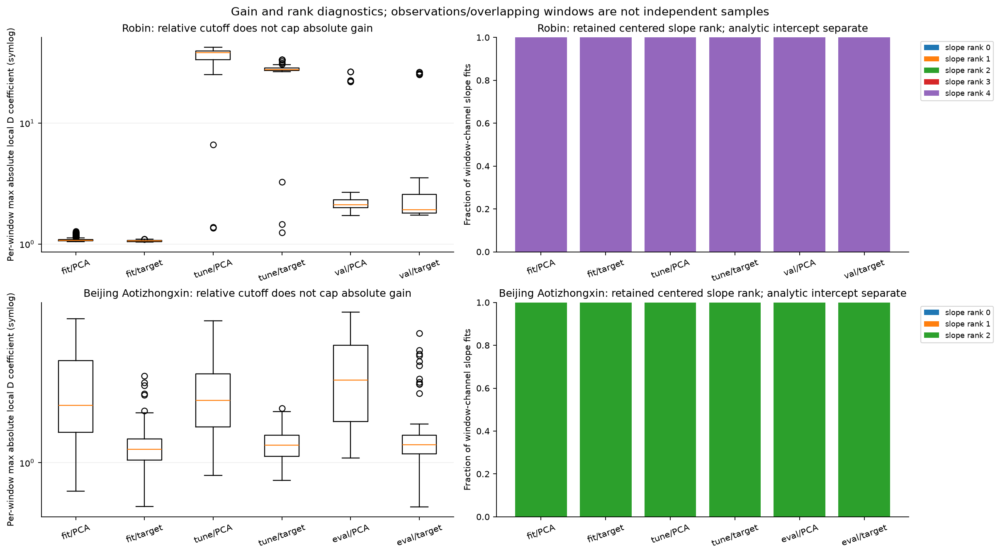
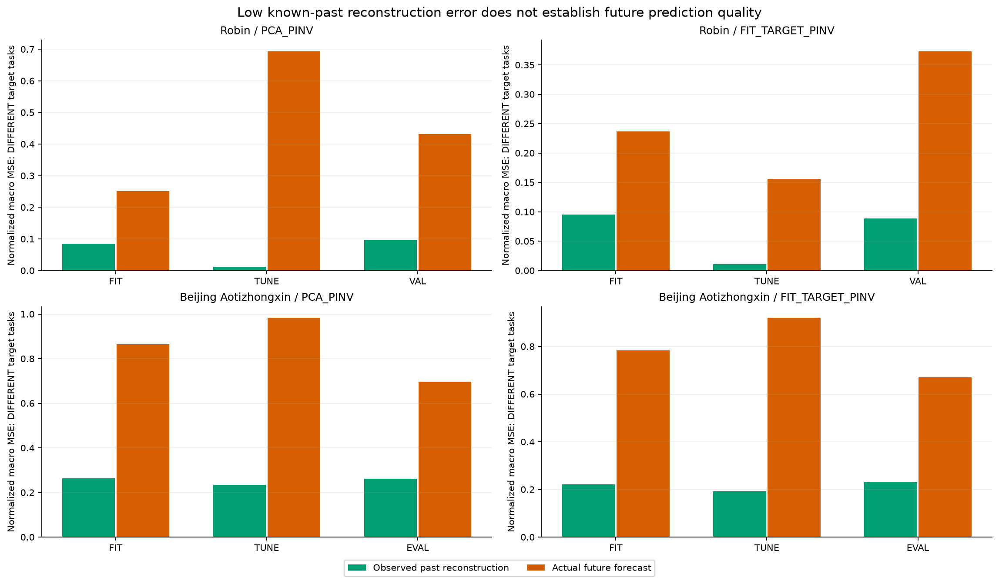

# 과거만으로 각 창의 디코더를 다시 맞추면 해결되는가

이번 대조는 고정된 E와 저장된 잠재 미래를 유지하고, 각 예측 시점의 알려진 과거에서 D[n]을 다시 맞춘 것이다. 일부 개발 구간에서 Bolt 오차가 줄더라도, 같은 TUNE·Raw 비교·전체 비용을 충족해야 작은 K 문제의 해결로 볼 수 있다. 아래는 실제 원수치와 비교 조건의 답부터 제시한다.

[확인] Robin FIT-target/Bolt의 정규화 MSE는 TUNE: static 0.075569448 → local 0.156193050, Raw 0.056951091; VAL: static 0.564240397 → local 0.373466779, Raw 0.340401887. 개발 오차의 감소와 Raw 정확도 보존 여부, TUNE의 방향은 별개다.
[확인] Beijing Aotizhongxin FIT-target/Bolt의 정규화 MSE는 TUNE: static 0.935872434 → local 0.920843409, Raw 0.758435638; EVAL: static 0.694519401 → local 0.669978818, Raw 0.589575414. 개발 오차의 감소와 Raw 정확도 보존 여부, TUNE의 방향은 별개다.

## 과거 입력과 새로운 decoder 정보

각 origin에서 512개 정규화 과거의 cached E(X)와 원 관측 C 과거만으로 채널별 affine decoder를 fitting한다. observed subset의 latent·C 평균을 먼저 제거하고 centered slope에 고정 상대 singular cutoff1e-4를 적용한 truncated minimum-norm least squares다. intercept는 관측된 평균으로 계산하고 cutoff의 대상이 아니다. 이는 uncentered [Z,1] 전체 coefficient의 minimum norm이나 unrestricted full-design least squares라는 주장이 아니다. residual의 retained singular 방향 검산도 버린 nonzero 방향의 전체 gradient가0이라는 검산으로 바꾸지 않는다.

TUNE/DEV에서 이미 알려진 과거를 사용하는 inference-time adaptation이며 미래 target으로 D를 맞추지 않는다. 원 FIT-target E 자체는 이전 단계에서 FIT 미래 supervision을 받은 E다. 지금의 과거 전용 local fitting을 ‘전체 표현학습 과정에도 미래 label이 없었다’고 부를 수 없다. raw 과거 입력은 같아도 decoder는 K future streams·current C 외에 각 창의 K×C coefficients를 받으므로 정적 decoder와 side information이 같지 않다. 엄격한 K-only 압축이나 표현학습 개선이라고 주장하지 않는다. 계수·bias는 FP64로 fitting한 뒤 FP32 배포하며 전송 bit packing 비용을 측정하지 않았다.

예측은 FP32 `currentC + einsum(futureK-lastK,D[n],optimize=False)`이며 bias는 innovation에서 제외한다. old static D를 같은 einsum 순서로 replay한 산술 대조도 따로 기록했다. 원 static 예측 비트를 유지한 데이터와 새 산술 replay 차이를 구분한다. zero latent delta는 currentC의 정확한 FP32 수치값을 내지만 addition이 signed-zero 비트까지 보존한다는 주장은 아니다. no-observation 채널의 명시 규칙은 D column0·reconstruction bias=currentC·forecast=currentC이다. 이것은 전역 static D fallback이나 미래 최적성의 보장이 아니다.

[확인] CPU 완료 범위는 36 method pairs, 24 backend batches, 3264 window matrices, 44304 channel solver calls다. no-observation fallback 기록은 0건이다. 새 E/F/head forward와 backbone/head 학습은0이다. Bolt NumPy와 native Torch32의 cached 과거를 각각 사용했다. native 두 seed의 과거가 byte-identical인 경우 D를 공유하며 같은 local fit을 두 개의 독립 fitting으로 세지 않았다. native head는 원 static D에 맞춘 기존 head이므로 새 D를 위한 최적화된 학습 benchmark가 아니다.

## 실제 예측과 비교의 한계

```text
Dataset / Split / Space / Backend / Method    static MSE       local MSE      local-minus-static
robin/tune/PCA_PINV/BOLT_NUMPY/BOLT 0.104702758 0.693878798 +5.891760e-01
robin/tune/PCA_PINV/NATIVE_TORCH32/NATIVE_s92601 0.189618083 7.023132296 +6.833514e+00
robin/tune/PCA_PINV/NATIVE_TORCH32/NATIVE_s92602 0.194451689 6.421263663 +6.226812e+00
robin/tune/FIT_TARGET_PINV/BOLT_NUMPY/BOLT 0.075569448 0.156193050 +8.062360e-02
robin/tune/FIT_TARGET_PINV/NATIVE_TORCH32/NATIVE_s92601 0.177315411 6.124259088 +5.946944e+00
robin/tune/FIT_TARGET_PINV/NATIVE_TORCH32/NATIVE_s92602 0.183244582 6.931212650 +6.747968e+00
robin/val/PCA_PINV/BOLT_NUMPY/BOLT 0.532063803 0.431921567 -1.001422e-01
robin/val/PCA_PINV/NATIVE_TORCH32/NATIVE_s92601 0.716446483 1.206381538 +4.899351e-01
robin/val/PCA_PINV/NATIVE_TORCH32/NATIVE_s92602 0.695962886 1.120317520 +4.243546e-01
robin/val/FIT_TARGET_PINV/BOLT_NUMPY/BOLT 0.564240397 0.373466779 -1.907736e-01
robin/val/FIT_TARGET_PINV/NATIVE_TORCH32/NATIVE_s92601 0.750195855 1.316491108 +5.662953e-01
robin/val/FIT_TARGET_PINV/NATIVE_TORCH32/NATIVE_s92602 0.724317194 1.495295682 +7.709785e-01
beijing_aotizhongxin/tune/PCA_PINV/BOLT_NUMPY/BOLT 1.009348491 0.983708633 -2.563986e-02
beijing_aotizhongxin/tune/PCA_PINV/NATIVE_TORCH32/NATIVE_s92601 0.997916783 0.970246229 -2.767055e-02
beijing_aotizhongxin/tune/PCA_PINV/NATIVE_TORCH32/NATIVE_s92602 0.992632704 0.966254131 -2.637857e-02
beijing_aotizhongxin/tune/FIT_TARGET_PINV/BOLT_NUMPY/BOLT 0.935872434 0.920843409 -1.502902e-02
beijing_aotizhongxin/tune/FIT_TARGET_PINV/NATIVE_TORCH32/NATIVE_s92601 0.931653198 0.916326306 -1.532689e-02
beijing_aotizhongxin/tune/FIT_TARGET_PINV/NATIVE_TORCH32/NATIVE_s92602 0.940064649 0.921906254 -1.815839e-02
beijing_aotizhongxin/eval/PCA_PINV/BOLT_NUMPY/BOLT 0.778177077 0.696380597 -8.179648e-02
beijing_aotizhongxin/eval/PCA_PINV/NATIVE_TORCH32/NATIVE_s92601 0.884034466 0.824701059 -5.933341e-02
beijing_aotizhongxin/eval/PCA_PINV/NATIVE_TORCH32/NATIVE_s92602 0.850232996 0.780885148 -6.934785e-02
beijing_aotizhongxin/eval/FIT_TARGET_PINV/BOLT_NUMPY/BOLT 0.694519401 0.669978818 -2.454058e-02
beijing_aotizhongxin/eval/FIT_TARGET_PINV/NATIVE_TORCH32/NATIVE_s92601 0.805008090 0.794741808 -1.026628e-02
beijing_aotizhongxin/eval/FIT_TARGET_PINV/NATIVE_TORCH32/NATIVE_s92602 0.800811046 0.788741810 -1.206924e-02
```


full observed 정규화 macro MSE·MAE를 주 비교로 보고하고 complete-C 및 물리 단위 채널별 진단은 별도로 남겼다. 서로 다른 단위의 물리 macro 평균은 보조값이며 정규화 목적의 수학적 최소값과 혼합하지 않는다. 모든 native seed와 조건의 나쁜 결과도 표에 포함한다. 개발 구간에서 좋아진 특정 숫자를 TUNE의 불안정성이나 native 폭증을 지운 성공으로 설명하지 않는다. 이전 POINTWISE/MAIN과 native에도 actual-Y 목적 학습이 있었으므로 기존 실패를 reconstruction-only 학습이라는 하나의 원인으로 정리하지 않는다.

## 새 per-origin 출력 공간과 forecast gap

D가 origin마다 달라져 이전 static fixed-D 최소값이나 per-split global rank-K oracle를 이 예측기의 하한으로 재사용할 수 없다. 독립 감사는 각 이미 fitting된 D32[n]을 실수 연산으로 해석하고, 같은 complete-C 미래 `Y-currentC`를 해당 행공간에 직접 투영한 새 진단을 계산했다. 실제 미래를 쓰는 진단이며 배포·D fitting·threshold/checkpoint 선택에 넣지 않았다. 같은 알려진 D[n]에서의 정규화 MSE 최소값만 의미한다. MAE와 물리 단위 MSE는 이 최소해의 점수이고 각각의 최소값이 아니다. Raw에는 그 공간의 부등식을 적용하지 않는다. FP32 rounding allowance와 actual-vs-real 차이도 따로 기록했다.

```text
Dataset / Split / Space / Backend     new D[n] minimum MSE    actual local predictor MSE
robin/fit/PCA_PINV/BOLT_NUMPY/BOLT 0.121597747 0.251397297
robin/fit/PCA_PINV/NATIVE_TORCH32/NATIVE_s92601 0.121597747 0.316517890
robin/fit/PCA_PINV/NATIVE_TORCH32/NATIVE_s92602 0.121597747 0.328565903
robin/fit/FIT_TARGET_PINV/BOLT_NUMPY/BOLT 0.113525408 0.236719239
robin/fit/FIT_TARGET_PINV/NATIVE_TORCH32/NATIVE_s92601 0.113525408 0.294342265
robin/fit/FIT_TARGET_PINV/NATIVE_TORCH32/NATIVE_s92602 0.113525408 0.250093509
robin/tune/PCA_PINV/BOLT_NUMPY/BOLT 0.016053118 0.693878798
robin/tune/PCA_PINV/NATIVE_TORCH32/NATIVE_s92601 0.016053118 7.023132296
robin/tune/PCA_PINV/NATIVE_TORCH32/NATIVE_s92602 0.016053118 6.421263663
robin/tune/FIT_TARGET_PINV/BOLT_NUMPY/BOLT 0.012775085 0.156193050
robin/tune/FIT_TARGET_PINV/NATIVE_TORCH32/NATIVE_s92601 0.012775087 6.124259088
robin/tune/FIT_TARGET_PINV/NATIVE_TORCH32/NATIVE_s92602 0.012775087 6.931212650
robin/val/PCA_PINV/BOLT_NUMPY/BOLT 0.203251731 0.431921567
robin/val/PCA_PINV/NATIVE_TORCH32/NATIVE_s92601 0.203251730 1.206381538
robin/val/PCA_PINV/NATIVE_TORCH32/NATIVE_s92602 0.203251730 1.120317520
robin/val/FIT_TARGET_PINV/BOLT_NUMPY/BOLT 0.200862892 0.373466779
robin/val/FIT_TARGET_PINV/NATIVE_TORCH32/NATIVE_s92601 0.200862891 1.316491108
robin/val/FIT_TARGET_PINV/NATIVE_TORCH32/NATIVE_s92602 0.200862891 1.495295682
beijing_aotizhongxin/fit/PCA_PINV/BOLT_NUMPY/BOLT 0.363091556 0.824832745
beijing_aotizhongxin/fit/PCA_PINV/NATIVE_TORCH32/NATIVE_s92601 0.363091558 0.666522110
beijing_aotizhongxin/fit/PCA_PINV/NATIVE_TORCH32/NATIVE_s92602 0.363091558 0.695574775
beijing_aotizhongxin/fit/FIT_TARGET_PINV/BOLT_NUMPY/BOLT 0.295491930 0.743627916
beijing_aotizhongxin/fit/FIT_TARGET_PINV/NATIVE_TORCH32/NATIVE_s92601 0.295491930 0.586977998
beijing_aotizhongxin/fit/FIT_TARGET_PINV/NATIVE_TORCH32/NATIVE_s92602 0.295491930 0.617878710
beijing_aotizhongxin/tune/PCA_PINV/BOLT_NUMPY/BOLT 0.297703036 0.949822648
beijing_aotizhongxin/tune/PCA_PINV/NATIVE_TORCH32/NATIVE_s92601 0.297703036 0.934001861
beijing_aotizhongxin/tune/PCA_PINV/NATIVE_TORCH32/NATIVE_s92602 0.297703036 0.927092539
beijing_aotizhongxin/tune/FIT_TARGET_PINV/BOLT_NUMPY/BOLT 0.222417774 0.887137970
beijing_aotizhongxin/tune/FIT_TARGET_PINV/NATIVE_TORCH32/NATIVE_s92601 0.222417776 0.883486990
beijing_aotizhongxin/tune/FIT_TARGET_PINV/NATIVE_TORCH32/NATIVE_s92602 0.222417776 0.890170032
beijing_aotizhongxin/eval/PCA_PINV/BOLT_NUMPY/BOLT 0.354867871 0.703717251
beijing_aotizhongxin/eval/PCA_PINV/NATIVE_TORCH32/NATIVE_s92601 0.354867871 0.833089538
beijing_aotizhongxin/eval/PCA_PINV/NATIVE_TORCH32/NATIVE_s92602 0.354867871 0.790674584
beijing_aotizhongxin/eval/FIT_TARGET_PINV/BOLT_NUMPY/BOLT 0.316059913 0.678325912
beijing_aotizhongxin/eval/FIT_TARGET_PINV/NATIVE_TORCH32/NATIVE_s92601 0.316059913 0.804147309
beijing_aotizhongxin/eval/FIT_TARGET_PINV/NATIVE_TORCH32/NATIVE_s92602 0.316059913 0.796542904
```


[추정·다음 판단] 이 최소값이 낮아도 실제 F/native가 크게 나쁘면 해당 과거 표현에서의 잠재 미래 예측·오차 크기·D의 증폭 또는 기존 predictor와의 결합이 남는다. 새 최소값 자체가 높으면 local past로 고른 출력 공간도 그 미래를 잘 담지 못한 것이다. 두 단계를 분리해 판단하며 알려진 미래의 최소값을 이미 얻은 예측 성능이나 과거 정보의 충분성 증명으로 바꾸지 않는다.

## gain·rank·과거 재구성은 서로 다른 확인

상대 cutoff는 retained latent singular 방향 사이의 condition을 제어하지만, 작은 절대 singular scale이나 C response 크기에 따른 절대 D norm을 cap하지 않는다. 높은 max-abs coefficient, Frobenius/operator norm과 미래 innovation이 만나면 출력 오차를 크게 만들 수 있다. metadata는 centered slope rank, analytic intercept를 포함한 rank, true observed count, no-observation 규칙, per-window D norm을 모두 보존한다. 큰 D와 큰 오차가 같이 나타난다고 하나만의 인과 원인으로 확정하지 않고, metric·rank·reconstruction·future gap을 함께 본다.



과거 reconstruction 점수는 D를 fitting한 각 관측 과거에서의 별도 과제다. 미래 forecast 점수와 target 집합·표본 수가 다르다. 과거를 낮은 오차로 복원해도 미래 innovation을 그 D에 통과시킬 때 좋은 예측이 된다는 보장은 없다. 이 관찰을 전체 표현학습이나 예측 목적 학습이 불가능하다는 주장으로 확대하지 않는다. 원수치가 없는 static past reconstruction 개선을 추정해서 덧붙이지도 않는다.



## 실제 whole deployment 비용

새 비용은 두 데이터 × B1/B8 × Raw/static PCA/static FIT-target/local PCA/local FIT-target의20조건, 각6회로120시간 표본이다. native 비용은 없다. local route는 실제 물리 과거 causal fill·FIT normalization·E·관측 mask로 local D fitting·고정 Bolt forward·D 복원·물리 CPU return을 실행했다. 매번 D를 다시 계산하며 계수를 cache하지 않는다. `fit_local_past_decoder` 안의 input-array byte hash와 solver·rank·norm·reconstruction 진단 생성도 callback과 타이머 안에 포함하므로 이를 최적화된 최소 production fitting 비용이라고 주장하지 않는다. `LocalPastDecoder.metadata()`의 state-array hash, NPZ/source/artifact 파일 hash·저장, 모델·입력·state loading, warmup·참조 및 타이머 밖 guard와 memory snapshot은 제외했다. saved future만 넣는 decoder proxy 비용이 아니다. 같은 첫 B개 개발 origins의 반복, 공유 프로세스 RSS/VRAM, 짧은6회 기술통계이며 quiet/exclusive benchmark를 확인하지 않았다. worker fixture 실행의 정확한 timer overlap을 확정할 수 없어 timing 차이를 decoder만의 인과 효과나 환경 전체의 유의한 속도 일반화로 주장하지 않는다. 독점 memory 절감도 측정하지 않았다.

```text
Dataset / Route / B     median ms/window    ratio of Raw medians    median paired ratio
robin/RAW_BOLT/B1 27.626550 1.000000 1.000000
robin/PCA_PINV_BOLT/B1 28.430700 1.029108 0.981884
robin/FIT_TARGET_PINV_BOLT/B1 25.849400 0.935672 1.008400
robin/PCA_LOCAL_BOLT/B1 27.606350 0.999269 0.975479
robin/FIT_TARGET_LOCAL_BOLT/B1 29.310400 1.060950 1.077312
robin/RAW_BOLT/B8 4.320319 1.000000 1.000000
robin/PCA_PINV_BOLT/B8 3.478581 0.805168 0.815317
robin/FIT_TARGET_PINV_BOLT/B8 3.496950 0.809419 0.814488
robin/PCA_LOCAL_BOLT/B8 5.648400 1.307404 1.245989
robin/FIT_TARGET_LOCAL_BOLT/B8 5.417013 1.253846 1.297061
beijing_aotizhongxin/RAW_BOLT/B1 26.860650 1.000000 1.000000
beijing_aotizhongxin/PCA_PINV_BOLT/B1 25.733950 0.958054 0.950851
beijing_aotizhongxin/FIT_TARGET_PINV_BOLT/B1 24.335150 0.905978 0.824721
beijing_aotizhongxin/PCA_LOCAL_BOLT/B1 27.015000 1.005746 0.978274
beijing_aotizhongxin/FIT_TARGET_LOCAL_BOLT/B1 26.495200 0.986395 1.003734
beijing_aotizhongxin/RAW_BOLT/B8 5.085912 1.000000 1.000000
beijing_aotizhongxin/PCA_PINV_BOLT/B8 3.310556 0.650927 0.649310
beijing_aotizhongxin/FIT_TARGET_PINV_BOLT/B8 3.275137 0.643963 0.644806
beijing_aotizhongxin/PCA_LOCAL_BOLT/B8 4.433850 0.871790 0.874673
beijing_aotizhongxin/FIT_TARGET_LOCAL_BOLT/B8 4.639894 0.912303 0.909597
```


사전 기준은 같은 ungated Raw TUNE MSE·MAE의1.01배 이하 및 B8 중앙 latency 비율0.90 이하를 함께 요구한다. 해당 기준 동시 충족은 0/8개다. paired ratio 중앙값은 별도 기술통계이고 gate에는 ratio of medians를 쓴다. 이 숫자는 기준 검산이고 결과를 보고 새 모델을 고른 것은 아니다. 이전 시행의 절대 latency와 연결해 local fitting 가속 효과를 주장하지 않는다. 과거 정보를 fitting하는 계산 비용과 extra coefficients 정보를 정확도 개선과 같이 평가해야 한다.

## 완료한 질문과 미해결인 질문

[확인] 각 origin의 과거 관측만으로 실행 가능한 local affine decoder, backend별 cached E arithmetic 대응, finite solver·retained-direction 검산, 실제 future output과 새 D[n] 공간 진단, 비용을 완료했다. 이 개입은 알려진 C 과거의 조건 정보를 추가한 causal decoding 대조이고 새로운 backbone/표현 학습은 아니다. 이미 노출된 DEV와 이전 oracle를 보고 고른 탐색적 후속이며 독립 holdout 일반화 검증이 아니다. TEST는 읽지 않았고 기존 source·cache·checkpoint·selection lock을 덮어쓰지 않았다.

[추정·다음 판단] 유리한 개발 구간 감소가 있어도 TUNE·Raw·비용과 잘못된 native 연결이 함께 남으면 해결이라고 쓰지 않는다. gain을 제한한 대조나 미래 innovation에 맞춘 decoder 목적, 기존 latent predictor와의 공동 적합은 별도 조건에서 시험해야 한다. 이 다음 방향을 이미 실행했다거나, 대조학습·동적 graph·ExoTimer 또는 고정 Bolt의 필요를 입증했다고 말하지 않는다. 원 목적은 작은 K와 고정 Bolt에서 정확도·비용을 유지하는 것이며 이 진단의 수행 자체가 그 목적의 달성은 아니다.

## 원수치·소스·이전 보고서

- [LocalD CPU producer](../../runs/local_past_decoder_v1/RESULT.json) — SHA256 `86f894c72ea091c3a7d2b068a901fa59ec9229868acd6437a53c8709203084dc`
- [LocalD independent audit](../../audits/LOCAL_PAST_DECODER_PROBE_AUDIT_v1.json) — SHA256 `96f37ff913ec4e8169b145a6bd67a3880b9e99f632f9d1fbbd96850183963bde`
- [actual LocalD wholecost](../../runs/local_past_decoder_cost_v1/RESULT.json) — SHA256 `c71cdaff3033c03426ded087d82eff64c8ccc065450c150d90612c79f5703770`
- [LocalD wholecost independent audit](../../audits/LOCAL_PAST_DECODER_COST_AUDIT_v1.json) — SHA256 `88f40ad2adc96b847a42d1964d3c97b8999825dd94c172459023418b7bee7b71`
- [matched report](../matched_projection_v1/REPORT_KO.md) — SHA256 `4ad724017706b690e2d19ce4e8bdc326e6663f8ca6b0bf6f157ca4641ef0d3e2`
- [rank oracle v2](../oracle_rank_addendum_v2/REPORT_KO.md) — SHA256 `a75784106b241b7228bd09c6b930b94c2a15097c6fd9c9cde466b12cdcc1d4fe`
- [D metric v2](../decoder_metric_intervention_v2/REPORT_KO.md) — SHA256 `1958073281ea0a9c7cd14bacab2b97b8b4a95063f1015a8c94b25bafe85b5fe5`
- [FIT target report](../FIT_target_comparison_v1/REPORT_KO.md) — SHA256 `fc89475c76f43f0c30d6a0029d96c138c1997dd510c35600664af4fb5337f77c`
- [past-constant gate report](../past_constant_gate_v1/REPORT_KO.md) — SHA256 `4d53cb0b42f882bc636f4f8e57e5d2c42620382274b7268a2f4345ee4a581fd9`
- [report generator](../../make_local_past_decoder_report_v1.py) — SHA256 `046df8b883d4fade0aa0b1dd24c53399e647eda28090ce5e2a5f0ba6d6ebdf6d`
- [COMPARISON: 312 rows](tables/COMPARISON.csv)
- [SIGNED_EFFECT: 144 rows](tables/SIGNED_EFFECT.csv)
- [STATIC_EINSUM_CONTROL: 36 rows](tables/STATIC_EINSUM_CONTROL.csv)
- [PAST_RECONSTRUCTION: 48 rows](tables/PAST_RECONSTRUCTION.csv)
- [LOCAL_BACKEND_METADATA: 24 rows](tables/LOCAL_BACKEND_METADATA.csv)
- [LOCAL_WINDOW_GEOMETRY: 3264 rows](tables/LOCAL_WINDOW_GEOMETRY.csv)
- [LOCAL_CHANNEL_SOLVERS: 44304 rows](tables/LOCAL_CHANNEL_SOLVERS.csv)
- [NEW_PER_ORIGIN_DIAGNOSTIC: 168 rows](tables/NEW_PER_ORIGIN_DIAGNOSTIC.csv)
- [NEW_PER_ORIGIN_GEOMETRY: 24 rows](tables/NEW_PER_ORIGIN_GEOMETRY.csv)
- [WHOLE_COST: 20 rows](tables/WHOLE_COST.csv)
- [WHOLE_COST_SAMPLES: 120 rows](tables/WHOLE_COST_SAMPLES.csv)
- [REGISTERED_ADOPTION: 8 rows](tables/REGISTERED_ADOPTION.csv)

이 보고서 생성기는 JSON metadata만 읽으며 NPZ·model·checkpoint나 scientific runtime을 호출하지 않는다. 보고서·실험 source를 보존했고 자동 commit/push나 기존 작업 종료를 수행하지 않았다.
