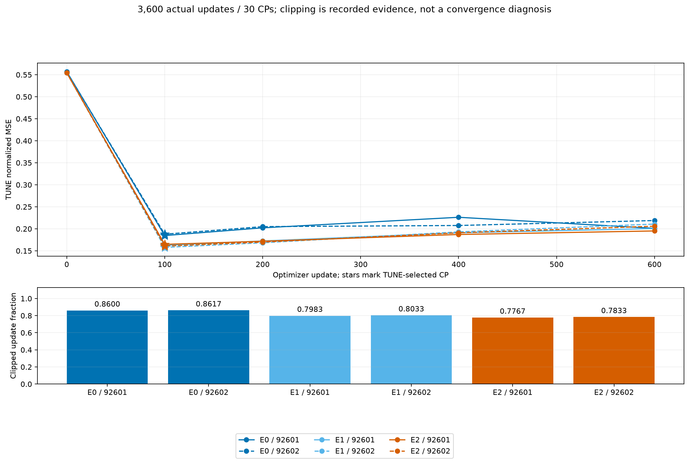
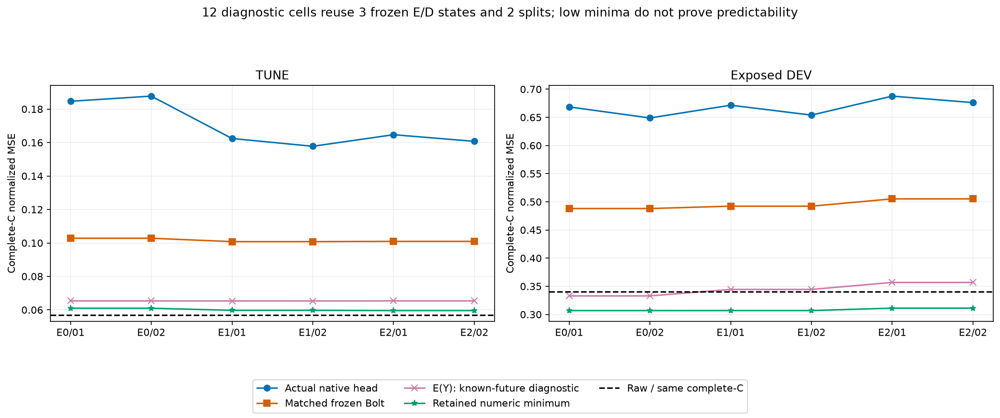

# 고정 L7 E/D에서 Bolt와 단순 잠재 예측기 비교

[확인] 같은 세 E/D에서 새 native head는 frozen Bolt보다 TUNE 6/6, 기노출 DEV 6/6 조건에서 정규화 MSE가 높았다. Raw보다 DEV MSE가 낮은 native는 0/6이다. 현재 비교는 Raw gap을 해결하지 못했고, 이 K별 독립 affine512→48 head가 Bolt를 대체한다는 근거도 얻지 못했다.

세 상태는 원 PCA E/과거 RECON D인 E0, 이전 E-only 선정 E1(seed92601/CP400), E2(seed92602/CP600)다. 같은 D·center·C17/K4·L512/H48·lag [0,1,2,4,8,16,32]·현재 C anchor·FIT256/TUNE64/기노출 VAL30·scaler/origin/mask를 썼다. E1/E2는 FIT 미래 actual-C 감독과 Bolt를 통한 최적화, TUNE 선정 이력이 있고 E0는 이 E 학습이 없다. D는 모두 FIT 과거 재구성으로 고정됐다. native는 각 상태에서 fresh head 두 개를 FIT 미래 actual-C loss로 학습했다. 선정 head 감독 이력과 고정 E/D 감독 이력을 나눠 기록한다.

- RECON_CP0 / 92601: CP100; TUNE native 0.1846538388, Bolt 0.1028083269; DEV native 0.6685034094, Bolt 0.4880930134, Raw 0.3404018870.
- RECON_CP0 / 92602: CP100; TUNE native 0.1877446488, Bolt 0.1028083269; DEV native 0.6489060816, Bolt 0.4880930134, Raw 0.3404018870.
- E_ONLY_s92601 / 92601: CP100; TUNE native 0.1624110459, Bolt 0.1007797811; DEV native 0.6715598794, Bolt 0.4922667978, Raw 0.3404018870.
- E_ONLY_s92601 / 92602: CP100; TUNE native 0.1577608107, Bolt 0.1007797811; DEV native 0.6539930269, Bolt 0.4922667978, Raw 0.3404018870.
- E_ONLY_s92602 / 92601: CP100; TUNE native 0.1646747465, Bolt 0.1009261198; DEV native 0.6877214733, Bolt 0.5052500039, Raw 0.3404018870.
- E_ONLY_s92602 / 92602: CP100; TUNE native 0.1607201233, Bolt 0.1009261198; DEV native 0.6761642177, Bolt 0.5052500039, Raw 0.3404018870.

**무엇을 새로 했는가.** 새 6fit×600=3,600 update·30CP·선정 FIT/DEV12예측이고 E/D/F 학습은0이다. E-only 두 상태를 만들었던 이전 학습을 새 6fit에 합산하거나 새 독립 조건으로 세지 않는다. 두 seed는 zero-init의 다른 minibatch 순서이지 독립 가중치 초기화가 아니다. NativeHead는 K별 독립 affine512→48만 표현하므로 모든 native 예측기의 대표가 아니다. E1/E2는 Bolt로 이미 최적화돼 있어 같은 학습 이력이나 같은 전체 학습 계산량 대조도 아니다.

head만 AdamW lr.001/WD0/clip1/B4로 학습했고 고정 전체 FIT 채널 관측수 가중 actual-C macro 정규화 MSE를 사용했다. 과거 native의 minibatch 관측수 분모와 같은 손실이라고 쓰지 않는다. E encoding은 학습 B4, CP/최종 평가 CUDA FP32 canonical32다. 같은 seed의600×4 순서를 이전 E-only와 대조했고 CP0/100/200/400/600 전체 TUNE MSE 최소·이른 tie를 사용했다. 모든6개 성공/실패 잠금·registry 뒤 DEV를 읽었다.

[확인] 선정 CP100은 6/6이고 clipping fraction은 0.776667~0.861667다. 후기 checkpoint의 TUNE 악화와 높은 clipping은 현재 최적화 경로의 관측이며 수렴 완료, 학습 부족, 모든 예측기 불가능성 중 하나를 확정하지 않는다. CP0 잠재 미래는 latent-last와 byte-exact지만 최종 C는 현재 C persistence와 같지 않다. L7의 알려진 과거 prefix뿐 아니라 각 lag에서 빼는 기준 z_past[-1-l]이 서로 다르기 때문이다. prefix가 모두 끝난 뒤에도 C_current + sum_l (z_last - z_past[-1-l]) D_l의 plateau가 남을 수 있다.

**비교 입력과 실제 F 계보.** 기존 실제 Torch F context9개를 재사용했고 과학 실행의 새 F forward는0이다. E0 FIT/DEV는 기존 FORECAST-D 실험의 latent_history/future만 가져와 현 RECON D로 새 C decode를 했다. 그 이전 C 예측을 주 비교로 가져오지 않았다. E0 TUNE까지 새 matched RECON C decode3개, E-only C byte 보존6개를 구분한다. 원 NumPy RECON과 새 Torch 문맥 비교는 별도 보존하며 실패를 주 gate로 바꾸거나 공차를 늘리지 않는다.

NumPy 문맥 검사 3개, 기록된 문맥 실패 0개다. 새 head의 모든 CP·선정 FIT/DEV의 latent history는 같은 고정 E에 대한 원 Bolt 캐시와 byte-exact로 대조됐다. zero head 미래·독립 NumPy affine 미래·lag D 산술·원수치/마스크 점수를 검산했다. 기록 per-step frozen flag와 CP/final E/D/center bytes 검사를 구분하며 매 update bytes·loss·backward·optimizer를 독립 재현한 검사는 아니다.

**출력 공간과 남은 예측 격차.** 새 공간12cell은 감사 중 새 계산이며 3개 E/D×2split을 두 head에 반복한 것이므로 12개 독립 자료가 아니다. actual native·같은 E의 Bolt·E(Y)·FLAT·현재 C persistence·minimum을 같은 complete-C로 비교한다. E(Y)/minimum은 미래 정답을 쓰는 진단이며 fit/CP/배포에 들어가지 않았다. 두 동결 SVD/LS 수학 경로 교차이지 세 번째 외부 재현은 아니다.

[확인] 같은 complete-C에서 TUNE retained numeric minimum이 Raw보다 높은 고정 E/D는 3/3이고, DEV minimum이 Raw보다 낮은 고정 E/D는 3/3이다. 현재 TUNE의 등록 retained 공간 자체가 Raw에 못 미치는 조건과 DEV 공간에 여지가 있는 조건을 구분해야 한다. 이는 모든 실수/FP32 미래의 보편 하한이나 과거 예측 가능성의 증명이 아니다.

- RECON_CP0 / 92601 / tune: native 0.1846538388, Bolt 0.1028083269, E(Y) 0.0653549622, minimum 0.0609840323, Raw 0.0569510909; complete 3072/3072.
- RECON_CP0 / 92601 / val: native 0.6685034094, Bolt 0.4880930134, E(Y) 0.3329447285, minimum 0.3068850413, Raw 0.3404018870; complete 1440/1440.
- RECON_CP0 / 92602 / tune: native 0.1877446488, Bolt 0.1028083269, E(Y) 0.0653549622, minimum 0.0609840323, Raw 0.0569510909; complete 3072/3072.
- RECON_CP0 / 92602 / val: native 0.6489060816, Bolt 0.4880930134, E(Y) 0.3329447285, minimum 0.3068850413, Raw 0.3404018870; complete 1440/1440.
- E_ONLY_s92601 / 92601 / tune: native 0.1624110459, Bolt 0.1007797811, E(Y) 0.0653314024, minimum 0.0597340174, Raw 0.0569510909; complete 3072/3072.
- E_ONLY_s92601 / 92601 / val: native 0.6715598794, Bolt 0.4922667978, E(Y) 0.3444583145, minimum 0.3069056211, Raw 0.3404018870; complete 1440/1440.
- E_ONLY_s92601 / 92602 / tune: native 0.1577608107, Bolt 0.1007797811, E(Y) 0.0653314024, minimum 0.0597340174, Raw 0.0569510909; complete 3072/3072.
- E_ONLY_s92601 / 92602 / val: native 0.6539930269, Bolt 0.4922667978, E(Y) 0.3444583145, minimum 0.3069056211, Raw 0.3404018870; complete 1440/1440.
- E_ONLY_s92602 / 92601 / tune: native 0.1646747465, Bolt 0.1009261198, E(Y) 0.0653594391, minimum 0.0595795763, Raw 0.0569510909; complete 3072/3072.
- E_ONLY_s92602 / 92601 / val: native 0.6877214733, Bolt 0.5052500039, E(Y) 0.3568081284, minimum 0.3111773358, Raw 0.3404018870; complete 1440/1440.
- E_ONLY_s92602 / 92602 / tune: native 0.1607201233, Bolt 0.1009261198, E(Y) 0.0653594391, minimum 0.0595795763, Raw 0.0569510909; complete 3072/3072.
- E_ONLY_s92602 / 92602 / val: native 0.6761642177, Bolt 0.5052500039, E(Y) 0.3568081284, minimum 0.3111773358, Raw 0.3404018870; complete 1440/1440.

minimum은 D32·known-past offset·complete-C 출력 행·모든 HK 미래 좌표·rcond1e-15 retained numeric space에 조건부인 정규화 MSE 해다. 모든 실수/FP32 latent나 모든 예측기의 보편 하한이 아니며 낮은 minimum이 과거 예측 가능성을 보장하지 않는다. MAE·물리 단위 값은 그 MSE 해의 점수이지 각 지표의 minimum이 아니다. real/FP32 false-bound flags를 그대로 보존한다. E(Y)의 불완전 C horizon은 현재 C로 채우며 L7의 뒤 출력에도 영향을 줄 수 있다. FLAT latent와 현재 C persistence를 같은 방법으로 세지 않는다.

**실제 전체 비용.** 과학 캐시 재사용과 달리 이번 비용은 실제 frozen Bolt 또는 선정 native head를 실행한다. 같은 CUDA backend에서 원 물리 TUNE 첫B의 causal fill/FIT 정규화→GPU E→actual predictor→Torch lag D/current C anchor→물리 CPU 반환/sync를 포함했다. Robin B1/B8×10경로=20셀, 명시적 warmup2 뒤5순환100표본이다. 명시적 warmup2는 모든 비측정 forward가2회라는 뜻이 아니다. 5순환은 10개 위치의 완전 균형이 아니다. 고정 D는 준비 단계이며 per-origin fit은 없다. setup/학습/선정·reference·외부 meter/hash/guard·warmup·저장·memory snapshot은 timer 밖이고 whole_predict와 LinearLagAdapter 내부 finite/shape 검사·sync는 timer 안에 남아 있다. CPU 최적 native나 가능한 모든 backend의 최솟값을 측정하지 않았다.

Raw와 같은 E의 Bolt를 각각 분모로 median of paired ratios와 ratio of medians를 따로 제시한다. 같은 첫B 반복·5개 timing 표본·모든 모델 공유 resident 메모리를 독립 자료나 독점 peak로 바꾸지 않는다. 다른 cohort의 절대 timing을 섞거나 빠른 실행만 고르지 않는다. 지연이 낮아져도 정확도 실패를 해결한 것으로 해석하지 않는다.

- B1 RAW_BOLT: 12.667900 ms/window; Raw paired 1.000000, medians 1.000000; same-E Bolt paired 1.000000, medians 1.000000.
- B1 RECON_CP0_BOLT: 13.349200 ms/window; Raw paired 1.033116, medians 1.053782; same-E Bolt paired 1.000000, medians 1.000000.
- B1 RECON_CP0_NATIVE_s92601: 1.491100 ms/window; Raw paired 0.120730, medians 0.117707; same-E Bolt paired 0.116860, medians 0.111700.
- B1 RECON_CP0_NATIVE_s92602: 1.478100 ms/window; Raw paired 0.117022, medians 0.116681; same-E Bolt paired 0.113271, medians 0.110726.
- B1 E_ONLY_s92601_BOLT: 13.450800 ms/window; Raw paired 1.060523, medians 1.061802; same-E Bolt paired 1.000000, medians 1.000000.
- B1 E_ONLY_s92601_NATIVE_s92601: 1.527700 ms/window; Raw paired 0.112771, medians 0.120596; same-E Bolt paired 0.113886, medians 0.113577.
- B1 E_ONLY_s92601_NATIVE_s92602: 1.421900 ms/window; Raw paired 0.112244, medians 0.112244; same-E Bolt paired 0.105839, medians 0.105711.
- B1 E_ONLY_s92602_BOLT: 13.049900 ms/window; Raw paired 1.026374, medians 1.030155; same-E Bolt paired 1.000000, medians 1.000000.
- B1 E_ONLY_s92602_NATIVE_s92601: 1.409200 ms/window; Raw paired 0.108503, medians 0.111242; same-E Bolt paired 0.106386, medians 0.107986.
- B1 E_ONLY_s92602_NATIVE_s92602: 1.441100 ms/window; Raw paired 0.119130, medians 0.113760; same-E Bolt paired 0.111780, medians 0.110430.
- B8 RAW_BOLT: 3.260463 ms/window; Raw paired 1.000000, medians 1.000000; same-E Bolt paired 1.000000, medians 1.000000.
- B8 RECON_CP0_BOLT: 1.751762 ms/window; Raw paired 0.538238, medians 0.537274; same-E Bolt paired 1.000000, medians 1.000000.
- B8 RECON_CP0_NATIVE_s92601: 0.234725 ms/window; Raw paired 0.069529, medians 0.071991; same-E Bolt paired 0.129921, medians 0.133994.
- B8 RECON_CP0_NATIVE_s92602: 0.239125 ms/window; Raw paired 0.073776, medians 0.073341; same-E Bolt paired 0.136957, medians 0.136505.
- B8 E_ONLY_s92601_BOLT: 1.825012 ms/window; Raw paired 0.560744, medians 0.559740; same-E Bolt paired 1.000000, medians 1.000000.
- B8 E_ONLY_s92601_NATIVE_s92601: 0.253413 ms/window; Raw paired 0.077847, medians 0.077723; same-E Bolt paired 0.131567, medians 0.138855.
- B8 E_ONLY_s92601_NATIVE_s92602: 0.239300 ms/window; Raw paired 0.073394, medians 0.073394; same-E Bolt paired 0.127787, medians 0.131122.
- B8 E_ONLY_s92602_BOLT: 1.776500 ms/window; Raw paired 0.556807, medians 0.544861; same-E Bolt paired 1.000000, medians 1.000000.
- B8 E_ONLY_s92602_NATIVE_s92601: 0.241813 ms/window; Raw paired 0.072148, medians 0.074165; same-E Bolt paired 0.137060, medians 0.136117.
- B8 E_ONLY_s92602_NATIVE_s92602: 0.238300 ms/window; Raw paired 0.071629, medians 0.073088; same-E Bolt paired 0.134252, medians 0.134140.

[판단] 이번 근거는 이 고정 E/D와 이 독립 affine head에서 Bolt가 더 낮은 오차였다는 범위다. native가 나빠도 Bolt가 필수이거나 단순 예측기가 모두 불가능하다는 뜻은 아니다. 양쪽 모두 Raw gap이 남는다. 이 head/손실/최적화 조건의 TUNE 곡선과 예측 격차를 함께 보고 다음 원인을 좁혀야 한다. 기존 native·joint-Y/RF3·잠재 미래 회귀를 처음 한 실험처럼 쓰지 않는다. 이미 노출된 DEV와 기존 결과를 보고 고른 적응적 탐색이며 독립 일반화 검증이 아니다. K streams+K 과거 buffer+현재 C anchor여서 strict K-only도 아니다. TEST·설치·큰 모델 파라미터 학습·원 작업 중단·Git은 이번 보고 생성에서 실행하지 않았다.

FAILURES/CONTEXT_PARITY와 원 scientific/cost JSON은 실패·문맥 기록을 보존한다. RESOURCE는 새 head 학습/독립 저장 결과 검산·새 공간 계산/실제 비용/비용 검산을 구분한다. 이 생성기는 JSON/JSONL metadata만 읽고 과학 NPZ/model/F/학습을 재실행하지 않는다.

- [SCORES.csv](tables/SCORES.csv): 120행
- [PAIRED.csv](tables/PAIRED.csv): 72행
- [CHECKPOINTS.csv](tables/CHECKPOINTS.csv): 30행
- [UPDATES.csv](tables/UPDATES.csv): 3600행
- [CONDITIONS.csv](tables/CONDITIONS.csv): 6행
- [PROBES.csv](tables/PROBES.csv): 6행
- [SPACE_CELLS.csv](tables/SPACE_CELLS.csv): 12행
- [SPACE_METHODS.csv](tables/SPACE_METHODS.csv): 36행
- [CONTEXT_PARITY.csv](tables/CONTEXT_PARITY.csv): 3행
- [FAILURES.csv](tables/FAILURES.csv): 0행
- [WHOLE_COST.csv](tables/WHOLE_COST.csv): 20행
- [WHOLE_COST_SAMPLES.csv](tables/WHOLE_COST_SAMPLES.csv): 100행
- [RESOURCES.csv](tables/RESOURCES.csv): 4행

- [train](../../runs/matched_l7_native_v1/RESULT.json): `4a6f2d3601c27bf000659aa99a586a2f04d72371766f7558cc78cc16028caa2e`
- [audit](../../audits/MATCHED_L7_NATIVE_AUDIT_v1.json): `429296ac7346189953813292291584d0c5ceb0a60028b4c9b955a2a429a1db87`
- [cost](../../runs/matched_l7_native_cost_v1/RESULT.json): `6fce6c6a462cb0b45f6cc3932f94c615ad02b17892c6aade642bc2ad39a6b51c`
- [cost_audit](../../audits/MATCHED_L7_NATIVE_COST_AUDIT_v1.json): `cd8716119609ad5a3148d7f9c620fb08b938f9a5d36f61ba7f111dc3ca880983`
- [audit_source](../../audit_matched_l7_native_v1.py): `4930f1525fbcff3fad80d0358a017f02cbb22a97796a2841c2137b80e8a6b059`
- [cost_audit_source](../../audit_matched_l7_native_cost_v1.py): `dc6c136f9122ec882e6fbf5b24946f847057709f1c613874cfee1b23b51577fe`
- [E_only_diagnostic](../../runs/fixed_recon_d_e_adaptation_v1/RESULT.json): `4b1559216ea99937ca8e7e0f6cdac9885abc29479a6050d82336dcfa0305bb2b`
- [E_only_audit](../../audits/FIXED_RECON_D_E_ADAPTATION_AUDIT_v1.json): `f79324dc9452192601ac16b483e4b19c296f3c252f5814062c7c05f7d4f9e85b`
- [joint_recon_diagnostic](../../runs/recon_init_sensitivity_v1/RESULT.json): `f0fc3f95f1e1a61eff4ffc99b7bb7d62affd34afa064f6e29113bb0c37f52ec8`
- [joint_recon_audit](../../audits/RECON_INIT_SENSITIVITY_AUDIT_v2.json): `b1d28415ade18db8ddc0c987a14e879268413efdd5d1c62ad93e27b24becd52e`
- [full_gradient_parent](../../runs/linear_e_train_v1/RESULT.json): `3f0cbd9176f2e7882778452e537564aab7445e1b88c1534fd48b1bce7ef639a4`
- [full_gradient_parent_audit](../../audits/LINEAR_E_ADAPTATION_AUDIT_v1.json): `9796b4ed53f74186bc2513db56fe321c2d450cdd9bffbb7c5f341766e73ee36d`
- [causal_lag_diagnostic](../../runs/actual_causal_lag_objective_v1/RESULT.json): `4168cd05962e479130a722919310f4c192c1bab03d9b78cb7983754f2e502c17`
- [causal_lag_audit](../../audits/CAUSAL_LAG_OBJECTIVE_AUDIT_v2.json): `d395a82e76a31e38520db1dd4d56642963ca4e362f358a6d86480049d402a31d`
- [parent_report](../fixed_recon_d_e_adaptation_v1/REPORT_KO.md): `8c38be2568a1b06c2272a4fc231e1fdf63e41ff4e16373a22381f400c4cac29d`
- [parent_report_manifest](../fixed_recon_d_e_adaptation_v1/MANIFEST.json): `ef507cdf9dbda5dccb0165ce2be4428b0fc847732f38b0cfb9abd850ae380f6d`
- [parent_report_audit](../../audits/FIXED_RECON_D_E_REPORT_AUDIT_v1.json): `b9f6873eecaad4bc5cd2cae0a81be4d5f7dfc41a0343d13df0cecb5351a36e21`
- [selection_registry](../../runs/matched_l7_native_v1/SELECTION_REGISTRY.json): `d0178a347ca0615071721cb4cfcb65e69c5c82dd67a1f5734b1b7f9564843401`
- [plan](../../PLAN_MATCHED_L7_NATIVE_KO_v1.md): `cd66fef0f7e9ffe723d6128cfa85dfd6f481c5061ecc6f6e793be217329dca2a`
- [cost_plan](../../PLAN_MATCHED_L7_NATIVE_KO_v1.md): `cd66fef0f7e9ffe723d6128cfa85dfd6f481c5061ecc6f6e793be217329dca2a`
- [controller_source](../../run_matched_l7_native_v1.py): `8eafb31307ade30f66d32d18a2c6d62da18a156b0c307cede8ee4bfe72567d43`
- [native_source](../../lagged_native_head_v1.py): `cfd2438be26dd7cec0bfd53552ef17f545cb7da0f7716d4185ee557ab249a534`
- [report_utility](../../make_linear_e_adaptation_report_v2.py): `32e2460ea4724144067f264ab1ceb0332cd04c5fce2296838024c119c9572466`
- [report_source](../../make_matched_l7_native_report_v2.py): `b401543919ada3d1633df67d909a7ad4152bae5567d479ea6b440ee30033bc20`
