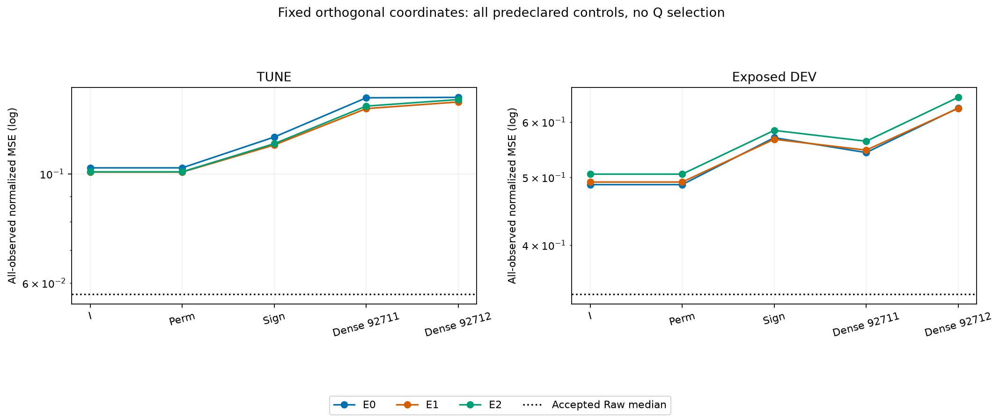
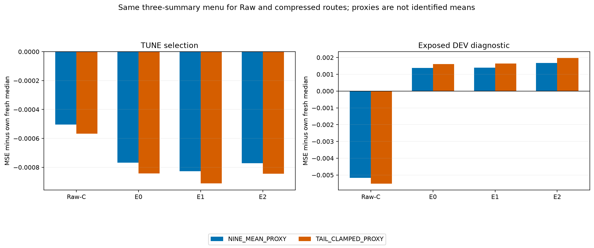
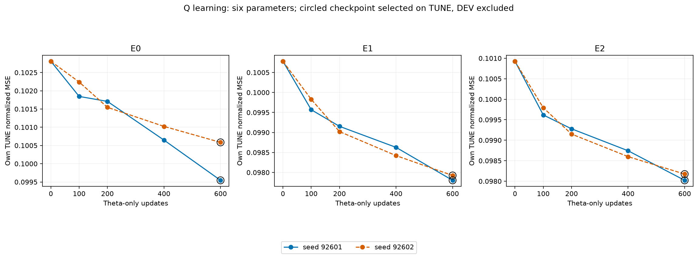
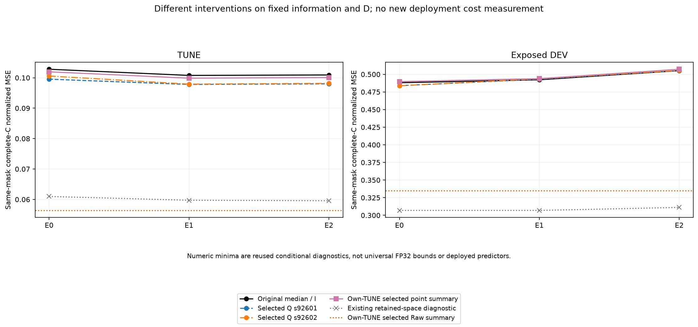

# 같은 정보에서의 좌표·점요약 진단

고정 sign/dense Q의 DEV 9/9개는 원 median 경로보다 나빴다. 좌표를 바꾸면 같은 정보·같은 D에서도 F 출력이 달라지지만, 이것만으로 성능 개선을 뜻하지 않는다.

θ 6개만 학습한 Q는 TUNE 6/6개, DEV 2/6개에서 자기 원 baseline보다 낮은 MSE였다. 원 Raw median보다 좋은 DEV 조건은 0/6개다. 선정 CP0 0/6개는 비갱신 기준이며, 마지막 CP600 선정 6/6개이므로 수렴이나 충분한 학습을 단정하지 않는다.

같은 세 점요약 메뉴에서 선정한 Raw는 DEV fresh median 0.340401882291 → 0.33488291134 (상대 감소 1.621310%)였다. 압축 세 경로 중 3/3개는 자기 fresh median보다 DEV가 악화됐다. Raw의 같은 메뉴를 제외하고 압축 이득을 주장하지 않는다.

## 목적·수식·학습 범위

`z=(X-center)E`, `u_Q=F(zQ)Qᵀ`, `Yhat=old_lag_decoder(current_C,z,u_Q;D)`를 사용했다. E/D/center/F와 K4, L512/H48, FIT256/TUNE64/기노출 DEV30, scaler·origin·관측 mask는 유지했다. old past와 lag별 origin reference를 회전된 값으로 바꾸지 않았다. 고정 I는 불필요한 Q 연산을 생략하고, 학습 θ=0은 matrix_exp(skew(θ))를 통과하여 gradient를 유지했다.

Q 학습은 θ6만 AdamW lr.001/weight_decay0, B4, clip1, 600 update×6조건이었다. seed는 같은 초기 θ에서 minibatch order만 바꾼다. 전 FIT 고정 채널 관측수로 정규화한 actual-C macro MSE를 학습하고 CP0/100/200/400/600의 자기 TUNE MSE로 선정했다. 여섯 lock 후 DEV를 평가했다. gradient probe는 첫 학습 forward를 재사용한 0추가-update 검사이며 F입력 경로와 역회전 경로의 저장 gradient 합을 확인한다. 이것은 F 필요성이나 전체 backward/optimizer의 독립 재현이 아니다.

분위 요약은 같은 frozen F의 실제 9×64 출력을 새로 저장하고 첫48만 사용했다. MEDIAN은 .5, NINE_MEAN_PROXY는 균등9가중합, TAIL_CLAMPED_PROXY는 [.15,.1,.1,.1,.1,.1,.1,.1,.15]다. 두 proxy는 식별된 조건부 평균이 아니다. crossing을 정렬로 없애지 않았으며, decoded C 분위구간·CRPS를 주장하지 않는다. 네 경로 모두 자기 TUNE에서 같은 메뉴를 고르고 네 lock 후 DEV를 평가했다. 비선정 DEV 8행은 진단용이다.

## 원수치와 남은 문제

기존 Raw cache DEV MSE 0.340401887028와 이번 새 full-quantile median 0.340401882291는 작은 수치 차이가 있어 같은 값으로 대체하지 않았다. 고정/학습 Q는 자신의 accepted median baseline, 점요약은 자신의 fresh median과 비교했다.

```text
상태·seed       Q TUNE / 원 TUNE          Q DEV / 원 DEV             CP
E0/92601       0.099544629 / 0.102808327    0.483862457 / 0.488093013   600
E0/92602       0.100585433 / 0.102808327    0.483780320 / 0.488093013   600
E1/92601       0.097802740 / 0.100779781    0.493130573 / 0.492266798   600
E1/92602       0.097924076 / 0.100779781    0.493757022 / 0.492266798   600
E2/92601       0.098021416 / 0.100926120    0.505426189 / 0.505250004   600
E2/92602       0.098173430 / 0.100926120    0.505499754 / 0.505250004   600
```

```text
경로       선정 요약               fresh median DEV / 선정 DEV
Raw        TAIL_CLAMPED_PROXY       0.340401882291 / 0.33488291134
E0         TAIL_CLAMPED_PROXY       0.488093013449 / 0.489709040506
E1         TAIL_CLAMPED_PROXY       0.492266797849 / 0.493907516875
E2         TAIL_CLAMPED_PROXY       0.505250003864 / 0.507222069101
```

기존 matched-L7 감사의 retained numeric minimum을 아래에 재사용했다. complete-C 같은 마스크이며 이번 Q/점요약에서 새 geometry를 계산한 결과가 아니다. 이 값은 알려진 미래를 사용한 해당 수치 공간의 진단으로, 모든 FP32 출력의 보편 하한·과거 예측 가능성·방법 성공을 뜻하지 않는다.

```text
상태     TUNE minimum / Raw       DEV minimum / Raw
E0       0.060984032 / 0.056951091    0.306885041 / 0.340401887
E1       0.059734017 / 0.056951091    0.306905621 / 0.340401887
E2       0.059579576 / 0.056951091    0.311177336 / 0.340401887
```

현재 근거는 같은 정보에서의 좌표 민감도, 제한된 θ 최적화 효과, 점요약의 목표 차이를 분리한다. 작은 K와 복원 공간의 한계 및 실제 latent 미래 예측의 차이는 남아 있다. 새 표현·큰 K·더 긴 최적화·다른 TSFM에서의 결과로 확대하지 않는다. 이전 E/D 공동 예측 학습도 이미 시행됐으므로 재구성 목적만이 유일 원인이었다고 쓰지 않는다.

## 검증·비용·제한

실제 학습·추론과 저장값 검산은 각각 구분했다. fixed I/permutation null, analytic transport, NumPy 역회전/old lag D, 관측 채널 macro MSE/MAE·원단위 per-C와 complete-C를 검산했다. F 자체의 독립 재추론은 감사 범위가 아니다. gradient 존재는 현재 절차의 작동 증거이며 TSFM 필요성 증명은 아니다.

세 진단의 새 whole-deployment 비용은 미측정이다. RESOURCES는 학습/과학 추론/CPU 감사 process 자원이며 기존 q 비용을 새 Q/점요약의 latency로 차용하지 않는다. 배포 입력은 과거뿐이지만 K streams + K past buffer + current C anchor를 사용하므로 strict K-only가 아니다. FIT 미래는 Q 학습 응답으로만 썼다. DEV는 이미 노출된 적응적 탐색이며 독립 일반화·보호 TEST 결과가 아니다. 교수님께는 작은 E0 이득과 Raw 격차, 다른 상태의 악화, 비용 미측정까지 함께 제시해야 한다.

## 그림과 재현 자료









- [FIXED_CONTROLS.csv](tables/FIXED_CONTROLS.csv): 45행
- [QUANTILE_SUMMARIES.csv](tables/QUANTILE_SUMMARIES.csv): 36행
- [Q_CHECKPOINTS.csv](tables/Q_CHECKPOINTS.csv): 30행
- [Q_SELECTED.csv](tables/Q_SELECTED.csv): 18행
- [GRADIENTS.csv](tables/GRADIENTS.csv): 6행
- [RESOURCES.csv](tables/RESOURCES.csv): 6행

- [controls](../../runs/orthogonal_basis_controls_v1/RESULT.json) · SHA256 `67661b1468384aed58d57c8f3c84e3a04d8f6e806cbfb4dbdb92d0f6c34cf42b`
- [controls_audit](../../audits/ORTHOGONAL_BASIS_CONTROLS_AUDIT_v1.json) · SHA256 `156e7513b200215f574b511828428c3e11c5b8a79ab2f79c85448a0eb87b4977`
- [quantile](../../runs/quantile_point_summary_v1/RESULT.json) · SHA256 `70d09544210602d3566d2d1f2405d06087499c496d6691dbade6dea64762d780`
- [quantile_audit](../../audits/QUANTILE_POINT_SUMMARY_AUDIT_v1.json) · SHA256 `02e6a1df4a6297c71faf97345394e483f43f2d15a59ee2ee16f4776b4385783f`
- [learning](../../runs/orthogonal_q_learning_v1/RESULT.json) · SHA256 `e1067bce2ef20381477c5345d5dd5566528a4340b69ba0b19bbcdd717d141fcc`
- [learning_audit](../../audits/ORTHOGONAL_Q_LEARNING_AUDIT_v1.json) · SHA256 `eb0f264c1cf3985481c20e7abe0a49c8a043c0aa036a1f620849fc276bb35bfe`
- [controls_auditor_source](../../audit_orthogonal_basis_controls_v1.py) · SHA256 `4d16612c65b9b1ee3e33a95639b87992b73ce6aa3991dea4c922f58ae17d9f43`
- [quantile_auditor_source](../../audit_quantile_point_summary_v1.py) · SHA256 `eaaa08be6ca2c9c9db27231de08eeb0157d33546f59a7718f3f6b9d906b94a5e`
- [learning_auditor_source](../../audit_orthogonal_q_learning_v1.py) · SHA256 `a3730599a881e2963b5bf7205d0792104a21d3bad9ae4daa9e8c3ba466a04d60`
- [controls_controller_source](../../run_orthogonal_basis_controls_v1.py) · SHA256 `1c0676b75b2baaa1d937bade5e1893d06ba46c01f7c73d48953144e9d09d6daa`
- [controls_module_source](../../orthogonal_latent_basis_v1.py) · SHA256 `ac515b9cb064e80d89c30a252f7bed4186c81eceb0c1c9d6db1fdbe5cab41491`
- [controls_plan](../../PLAN_METHODOLOGY_COMPLETION_KO_v1.md) · SHA256 `2355a4d4c746826fc735208f4208a62661b2d73430d29d143fcbf22c3bfefe32`
- [controls_registry](../../runs/orthogonal_basis_controls_v1/CONTROL_REGISTRY.json) · SHA256 `5314cd3cabce46e08353533143ec2e51e048918dc7d3058c98b14a97a16e7369`
- [quantile_controller_source](../../run_quantile_point_summary_v1.py) · SHA256 `57678bc90025a60b8d3ae50cc0bf5cac8cc5829cb108bc72168a4560770fb7b1`
- [quantile_module_source](../../quantile_point_summary_v1.py) · SHA256 `8af5ee93375a9ab7e2e937682cfbabad6e31e8a038bf6f6cca9c993ca3b87a28`
- [quantile_plan](../../PLAN_QUANTILE_POINT_SUMMARY_KO_v1.md) · SHA256 `98d6b512658fe862f5106c855c09f13927f30223b60a627f6084a53822d53e81`
- [quantile_registry](../../runs/quantile_point_summary_v1/SUMMARY_SELECTION_REGISTRY.json) · SHA256 `3b93c4b6bc20d07537b82b51b7c0be408869fdd114193141ad407ef0bc1e5376`
- [learning_controller_source](../../run_orthogonal_q_learning_v1.py) · SHA256 `b5d8e7f6649ef5ee6c23eb6ad92e49b4d1f00a59bec6fd9811fe5a724b460e41`
- [learning_module_source](../../orthogonal_latent_basis_v1.py) · SHA256 `ac515b9cb064e80d89c30a252f7bed4186c81eceb0c1c9d6db1fdbe5cab41491`
- [learning_plan](../../PLAN_Q_LEARNING_KO_v1.md) · SHA256 `ff2b9b681d1e8de662c98ccf61ee20105a19469551622c3a648906e9df9254e0`
- [learning_registry](../../runs/orthogonal_q_learning_v1/SELECTION_REGISTRY.json) · SHA256 `80511279819b59e14669048a7864d306d485626d8f669f6a4e719d280d25c3af`
- [existing_space_audit](../../audits/MATCHED_L7_NATIVE_AUDIT_v1.json) · SHA256 `429296ac7346189953813292291584d0c5ceb0a60028b4c9b955a2a429a1db87`
- [report_source](../../make_methodology_diagnostics_report_v1.py) · SHA256 `92fef0dd4f05f94fff865d8061af48c3e4c757a4e95b06c4997caf37d457e0bd`
- [report_utility](../../make_linear_e_adaptation_report_v2.py) · SHA256 `32e2460ea4724144067f264ab1ceb0332cd04c5fce2296838024c119c9572466`
