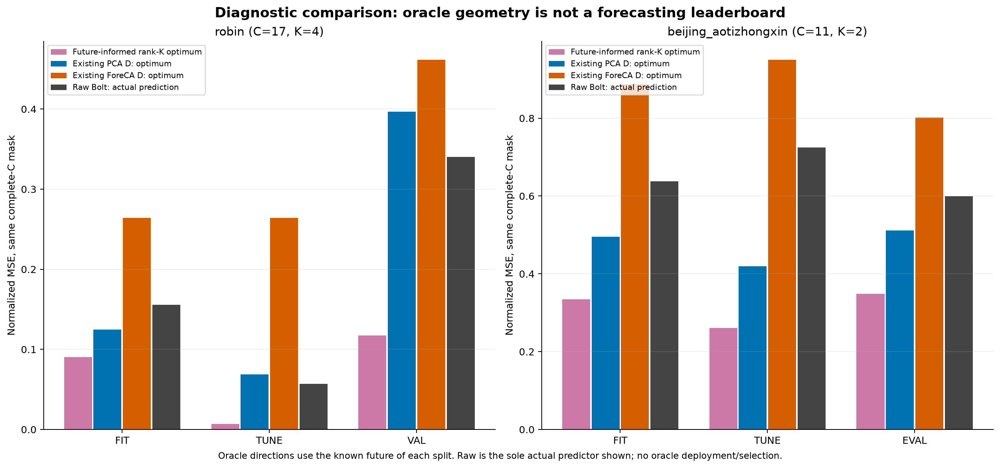
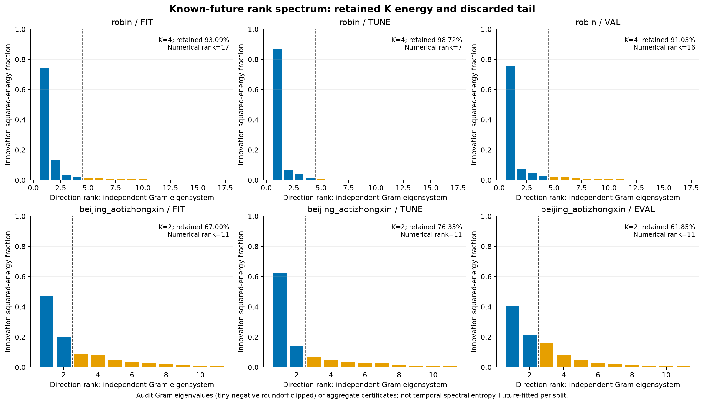

# 알려진 미래로 방향까지 최적화한 rank-K 진단: 고정 D 한계의 범위

[확인] 이 보충 보고서는 새 배포 예측 방법의 성능 보고가 아니다. 이미 알려진 각 FIT/TUNE/개발 미래에서 방향까지 별도로 최적화한 강한 rank-K oracle를 검산했다. 실제 작은-K/Bolt·native 결과와 checkpoint 선택은 바꾸지 않았고, 보호 TEST나 새로운 독립 평가 자료도 사용하지 않았다.

## 먼저 답할 질문

**고정 D의 실패가 K차원 선형 출력 전체의 불가능성을 의미하는가?** [확인] 같은 complete-target mask의6조건 중 6조건에서 미래를 이미 아는 rank-K 최소 normalized MSE가 실제 Raw Bolt 오차보다 낮았다. 반면 원 고정 D의 개발 최소는 Robin PCA/ForeCA와 Beijing ForeCA에서 Raw보다 높았다. 따라서 선택한 D의 제한을 모든 K차원 선형 공간의 불가능성으로 확대할 근거는 없다. 이는 어떤 배포 가능한 압축기가 Raw를 이겼다는 결과가 아니다.

**그러면 작은 K 아이디어가 해결되었는가?** [확인] 해결되지 않았다. 이번 oracle는 방향과 각 시점의 좌표를 해당 구간의 실제 미래로 맞췄다. 특히 TUNE·VAL/EVAL에도 각자의 미래를 사용했고, FIT에서 정한 하나의 D를 이후 구간에 고정한 실험이 아니다. 과거만 받는 E가 그 좌표를 만들어 낼 수 있는지, 고정 Bolt가 필요한 미래 좌표를 예측할 수 있는지, 동일 정확도에서 전체 비용을 줄일지는 여전히 미확정이다.

**어떤 문제가 분리되었는가?** [확인] 세 층을 구분할 근거가 생겼다. 첫째 실제 선택한 과거 재구성 D의 도달 가능한 부분공간, 둘째 미래를 이미 아는 경우 가능한 최선의 K차원 선형 부분공간, 셋째 실제 과거에서 예측되는 latent와 F의 오차다. 첫째와 둘째의 차이가 있어도 둘째를 셋째가 달성할 수 있다는 뜻은 아니다. [추정] 방향 선택·과거에서의 표현 구성·예측기 호환성·기간별 일반화가 서로 다른 병목일 수 있다.

## 같은 mask의 실제 원수치

Robin C17/K4·Beijing C11/K2, L512/H48와 원 FIT 통계는 기존 실험과 같다. all-C target이 관측된 위치만 쓰므로 같은 위치에서 모든 방법의 normalized macro MSE를 비교했다. Beijing의 complete-mask Raw는 full-mask Raw와 다르며 서로 바꾸어 쓰지 않는다. 중첩 창과 같은 자료의 FIT/TUNE/개발을 독립 데이터셋이나 반복 실험으로 세지 않는다.

```text
dataset                split complete/total  rank-K oracle   PCA D minimum   ForeCA D minimum  Raw same-mask
robin                  fit   12288/12288     0.090265790     0.124761960     0.263919765       0.155467495
robin                  tune  3072/3072       0.006954994     0.068559639     0.263990294       0.056951091
robin                  val   1440/1440       0.117363274     0.396541619     0.461340297       0.340401887
beijing_aotizhongxin   fit   10881/12288     0.334280409     0.495237674     0.887579359       0.637629605
beijing_aotizhongxin   tune  2904/3072       0.260393684     0.419391781     0.949857179       0.724321448
beijing_aotizhongxin   eval  6629/7008       0.349213093     0.511797660     0.801825480       0.598972295
```

[6조건 비교 CSV](tables/COMPARISON.csv). 이 표는 진단의 제한 범위를 비교하며 oracle를 배포 모델 순위에 넣지 않는다. Raw는 고정 D의 rank-K 부분공간에 속해야 하는 모델이 아니므로 Raw에 하한 부등식을 적용하지 않는다. oracle가 Raw보다 작은 것은 이 자료에서의 실제 관찰이지 Raw가 항상 더 나빠야 한다는 수학적 정리가 아니다.



## 어떤 수학 문제를 풀었는가

완전 관측된 미래 위치들을 M×C 행렬로 모으고, 각 행은 FIT로 정규화한 `실제 미래 C − 그 창의 현재 C` innovation으로 둔다. 미래 평균을 새로 빼거나 미래 intercept를 추가하지 않는다. 이 알려진 미래 행렬의 rank-K 선형 근사를 구하며 방향은 해당 split 안 모든 실제 미래 위치에 공통이다. 다른 split에는 다른 방향을 적합한다.

실수 산술에서 상위 K singular 방향을 남기면 버린 squared singular-value 에너지가 최소 재구성 오차이고, 이를 M×C로 나누면 같은 complete-mask normalized channel-macro MSE다. 이때 시점별 latent 좌표와 출력 방향 모두 이미 알려진 미래를 활용한다. 어느 미래 시점의 좌표가 과거만으로 예측 가능한지 제한하지 않으므로 실제 방법보다 훨씬 강한 진단이다. 이를 causal representation learning, forecasting improvement 또는 future-free inference라고 쓰면 안 된다.

[에너지·직교성·SVD/Gram 인증 CSV](tables/ENERGY_CERTIFICATE.csv)는 total/retained/discarded 에너지와 residual 에너지, Gram trace/tail, M×C 분모, 사전 수치 허용 오차를 남긴다. [독립 Gram 고유값 원수치](tables/INDEPENDENT_RANK_SPECTRUM.csv)가 제공된 경우에만 방향별 에너지 spectrum을 그린다. 그 값은 별도 감사의 JSON metadata이며 보고서 생성기는 NPZ를 열지 않았다. 허용 범위 안 작은 음수 반올림은 원값과0으로 clip한 표시값을 모두 저장한다. 수열이 없으면 retained/discarded aggregate만 표시한다. 시간 주파수의 spectral entropy와 rank singular spectrum도 구분한다.



**최소화한 것은 normalized MSE뿐이다.** [oracle 해의 모든 지표](tables/ORACLE_SCORE_VALUES.csv)에 MAE와 원단위 오차도 저장했지만 이는 그 MSE 최소해의 점수다. MAE의 최솟값이나 서로 다른 물리 단위 MSE의 최솟값으로 표현하지 않는다. 또한 이는 현재 C anchor를 허용한 static rank-K 선형 출력의 진단이며 모든 비선형/가변 decoder의 최적 하한이 아니다.

## 고정 D 진단과 결론이 달라진 이유

원 고정-D 진단은 실제 배포 D32를 그대로 놓고 미래 좌표만 자유롭게 정했다. 그래서 그 D를 유지한 F/head의 실수 산술 normalized MSE에는 도달 가능한 부분공간의 제한을 적용할 수 있었다. 이번 진단은 출력 방향 자체까지 실제 미래에서 최적화한다. 따라서 두 숫자의 차이는 다른 질문을 풀어서 생긴 것이며 기존 감사·Raw 예측·선택을 뒤집거나 오류로 바꾸는 결과가 아니다.

[확인] Robin 개발에서 PCA D 최소는 .396541619, ForeCA D 최소는 .461340297이며 Raw는 .340401887이다. 그런데 같은 미래로 방향까지 맞춘 K4 oracle는 .117363274다. Beijing 개발의 PCA D 최소는 .511797660, ForeCA D 최소는 .801825480, 같은 complete-mask Raw는 .598972295이고 K2 oracle는 .349213093이다. 이 결과는 선택된 D의 방향과 자유로운 미래 방향을 구분해야 함을 보여 준다. 미래를 알고 얻은 격차를 실제 가능한 예측 개선량으로 약속할 수 없다.

[추정] 과거 입력 재구성의 중요한 방향과 미래 innovation의 중요한 방향이 다를 수 있다. 하지만 이것이 이전 모든 실패를 재구성 loss 하나로 설명한다는 뜻은 아니다. 기존 ANCHOR_POINTWISE와 MAIN 계열에는 실제-Y 예측 목적 학습·보정도 있었다. 이번 static PCA/ForeCA의 방향 제한과 그 기존 결과는 조건·초기화·head·우회 경로가 달라 구분해서 읽어야 한다.

## 다음 판단과 가능한 기여의 범위

[판단] 다음 최소 질문은 미래에 맞춘 방향이 FIT의 허용된 label과 과거만으로 학습되어 이후 구간에도 유지되는지다. 목표를 Raw보다 낮은 oracle 수치로 바꾸거나 DEV의 방향을 실제 encoder/decoder에 그대로 넣어서는 안 된다. 하나의 학습된 출력 공간을 고정하고 동일 E/D·예측기 대조·실제 전처리와 반환 비용으로 검증해야 한다. 잘 나온 split을 골라 대표 성능으로 발표하는 것도 독립적인 일반화 근거를 만들지 못한다.

[추정·기여 후보] 연구 문제를 ‘작은 K가 존재하는가’와 ‘과거에서 구축한 K표현이 그 미래 정보를 보존하고 고정 Bolt로 예측 가능한가’를 구분하는 진단 구조로 좁힐 수 있다. 고정 D의 실패 경계를 직접 검산하고, 미래-informed 공간의 가능성과 실제 과거-only 예측 사이의 간극을 수치로 남긴 것이 현재의 근거다. SVD 최소화 자체는 표준 선형대수이며 새로운 방법론이나 논문 기여가 확보되었다고 선언하지 않는다. 새로운 압축 방법의 이득·신규성·독립 평가가 추가로 필요하다.

현재 과거-only PCA/ForeCA/Bolt/native의 정확도·비용 판정은 그대로다. 이 추가 진단은 classifier/graph/contrastive/대형 backbone을 새로 학습하지 않았고, 모델·checkpoint·방법·분기 선택·원 예측·비용 순위를 바꾸지 않았다. 실제 미래를 이용한 행렬 분해6개를 ‘배포 학습 성공6회’로 세지 않는다. 자원 사용과 보호 자산 상태는 각 source/receipt에 별도로 남는다.

## 검산과 파일 계보

[실제 rank-K diagnostic](../../runs/oracle_rank_ceiling_v1/RESULT.json) · [독립 Gram/eigensystem 감사](../../audits/ORACLE_RANK_CEILING_AUDIT_v1.json) · [앞선 실제 예측·고정 D 보고서](../matched_projection_v1/REPORT_KO.md) · [source와 SHA](PROVENANCE.json) · [그림·CSV SHA](MANIFEST.json).

[확인] 이 보고서는 COMPLETE diagnostic과 독립 PASS audit의 exact SHA, 원 producer·projection audit·fixed-span diagnostic·fixed-span audit의 현재 JSON SHA를 모두 확인했다. 독립 수학 검산의 PASS를 실제 forecaster 재학습이나 새로운 독립 TEST 성능으로 확대하지 않는다. 이 생성기는 terminal JSON metadata만 읽었고 원 NPZ·실제 모델 가중치·checkpoint·TEST를 열지 않았다. 기존 보고서·generator·source·선택·그림을 수정하지 않고 별도 보충 산출물로 저장했다.
