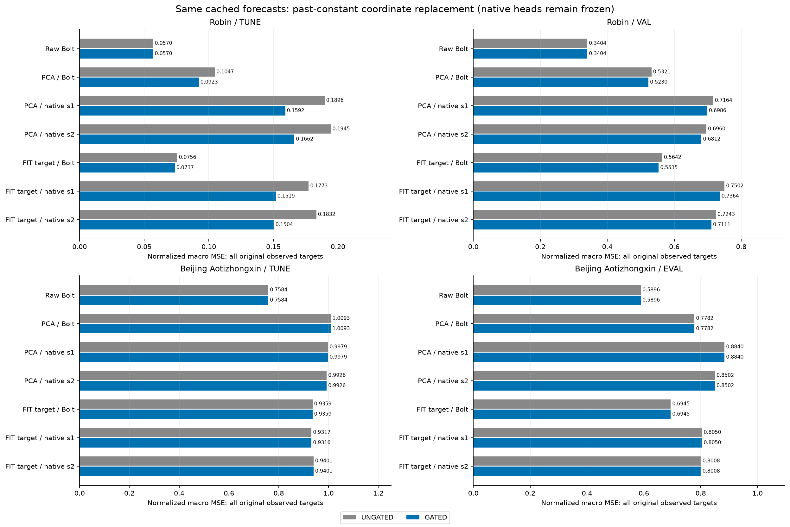
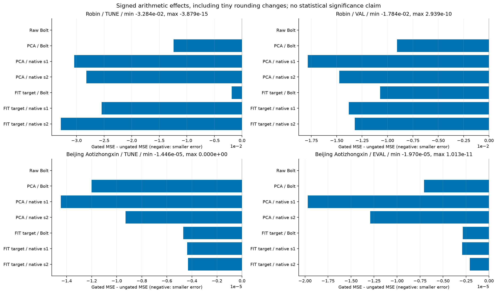
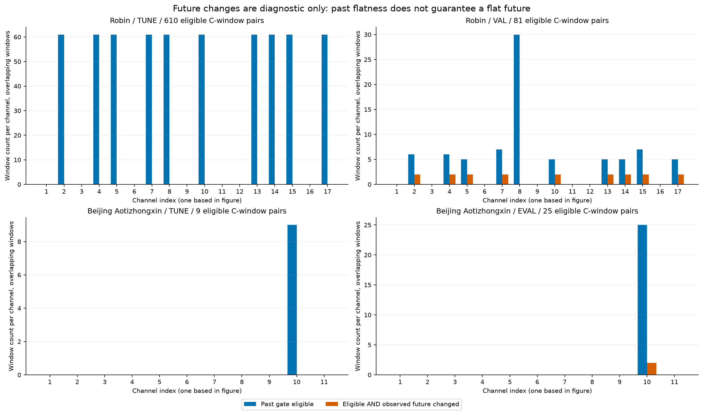
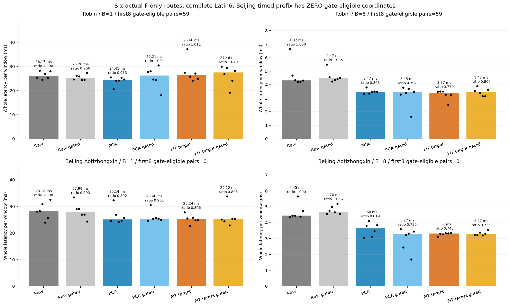

# 과거 상수 조건으로 출력을 고정하면 무엇이 바뀌는가

[확인] 과거만으로 계산한 조건을 기존 예측 출력에 적용하는 대조와 별도의 실제 전체 추론 비용을 완료했다. 이 gate는 표현학습 개선이나 작은 K의 정보 보존 성공이 아니다. 같은 원 과거 입력에서 C별 조건 정보를 새 decoder에 추가하는 출력 개입이다. 성능 변화, 적용된 좌표 수, gate 자체의 비용 효과를 구분해 읽어야 한다.

## gate의 입력과 이번 비교의 경계

512개의 causal-filled 정규화 FP32 과거값이 현재값과 모두 정확히 같고 원 관측 과거가 두 개 이상인 C 좌표만, 예측 horizon48 전체를 현재 C값으로 바꾼다. 그 밖의 좌표는 저장된 예측의 비트를 그대로 보존한다. gate의 판단에는 실제 미래값·미래 mask·미래 flatness를 쓰지 않는다. threshold는 근사 tolerance가 아니라 exact equality이고 MIN_OBSERVED=2를 고정했다. FIT, TUNE, 개발 결과를 보고 threshold를 fitting하거나 method checkpoint를 새로 선택하지 않았다. 원 정규화 과정이 작은 물리 변화를 반올림할 수 있으므로 normalized FP32에서의 flat은 원 물리 값의 완벽한 상수성과 같다고 단정할 수 없다.

raw 과거 입력 전체는 같아도 decoder 정보 interface는 달라졌다. 기존 K streams와 current-C anchor에 과거 C별 flag가 추가된다. 논리적으로 C개의 binary 판단 정보이지만 실제 bit-packed 전송을 측정한 것이 아니다. NumPy bool은 flag 하나당 byte로 저장되고, exact_flat의 bool 배열과 true_observed_counts의 int64 배열도 별도로 존재한다. 네트워크 전송이나 C-bit packet 비용은 측정하지 않았다. 전체 원자료 입력이 같다는 사실을 ‘decoder가 받는 side information도 같다’고 바꾸지 않는다. 이 경로는 엄격한 K-only 압축이 아니며, 그 추가 과거 정보를 원 표현학습의 개선분으로 기록하지 않는다.

기존 FIT-target 실험에서 새로 학습한 eight native heads, E/D, Bolt와 checkpoint를 유지했다. CPU probe는 Raw와 두 표현의 Bolt/native 두 seed를 합쳐 7방법 × 두 데이터 × FIT/TUNE/노출 DEV의42쌍을 cached 출력으로 계산했다. 새로운 E/F/head forward는0이고 native는 고정 head의 출력 개입이다. gated native를 다시 학습한 최적화된 benchmark가 아니다. 별도의 GPU 비용은 Raw·gated Raw·PCA Bolt·gated PCA Bolt·FIT-target Bolt·gated FIT-target Bolt의 여섯 실제 forward다. native inference 비용을 이번 새 gate 비용에 포함하지 않는다.

## 절대 점수와 signed 효과

```text
Dataset / Split / Method        ungated MSE       gated MSE          gated-minus-ungated
robin/tune/RAW_BOLT 0.0569510909335 0.0569510909335 -3.878842e-15
robin/tune/PCA_PINV_BOLT 0.104702758312 0.0922909916828 -1.241177e-02
robin/tune/PCA_PINV_NATIVE_s92601 0.189618082671 0.159198007233 -3.042008e-02
robin/tune/PCA_PINV_NATIVE_s92602 0.194451688551 0.166231347274 -2.822034e-02
robin/tune/FIT_TARGET_PINV_BOLT 0.0755694484948 0.0736860277095 -1.883421e-03
robin/tune/FIT_TARGET_PINV_NATIVE_s92601 0.177315410833 0.151850919337 -2.546449e-02
robin/tune/FIT_TARGET_PINV_NATIVE_s92602 0.183244581603 0.150404183621 -3.284040e-02
robin/val/RAW_BOLT 0.340401887028 0.340401887322 +2.938605e-10
robin/val/PCA_PINV_BOLT 0.532063802561 0.522997964324 -9.065838e-03
robin/val/PCA_PINV_NATIVE_s92601 0.716446483077 0.698603804997 -1.784268e-02
robin/val/PCA_PINV_NATIVE_s92602 0.695962886126 0.68122618656 -1.473670e-02
robin/val/FIT_TARGET_PINV_BOLT 0.564240396844 0.55351849696 -1.072190e-02
robin/val/FIT_TARGET_PINV_NATIVE_s92601 0.750195855373 0.736382436501 -1.381342e-02
robin/val/FIT_TARGET_PINV_NATIVE_s92602 0.724317193624 0.711104328922 -1.321286e-02
beijing_aotizhongxin/tune/RAW_BOLT 0.758435638141 0.758435638141 +0.000000e+00
beijing_aotizhongxin/tune/PCA_PINV_BOLT 1.00934849119 1.00933648078 -1.201041e-05
beijing_aotizhongxin/tune/PCA_PINV_NATIVE_s92601 0.997916783271 0.997902322899 -1.446037e-05
beijing_aotizhongxin/tune/PCA_PINV_NATIVE_s92602 0.992632703745 0.992623407026 -9.296719e-06
beijing_aotizhongxin/tune/FIT_TARGET_PINV_BOLT 0.935872433702 0.935867740111 -4.693592e-06
beijing_aotizhongxin/tune/FIT_TARGET_PINV_NATIVE_s92601 0.931653198434 0.93164882737 -4.371064e-06
beijing_aotizhongxin/tune/FIT_TARGET_PINV_NATIVE_s92602 0.940064649234 0.940060340586 -4.308648e-06
beijing_aotizhongxin/eval/RAW_BOLT 0.589575413763 0.589575413774 +1.013256e-11
beijing_aotizhongxin/eval/PCA_PINV_BOLT 0.778177076906 0.778170006115 -7.070791e-06
beijing_aotizhongxin/eval/PCA_PINV_NATIVE_s92601 0.884034465719 0.884014770666 -1.969505e-05
beijing_aotizhongxin/eval/PCA_PINV_NATIVE_s92602 0.850232995728 0.850220088886 -1.290684e-05
beijing_aotizhongxin/eval/FIT_TARGET_PINV_BOLT 0.694519401046 0.694516539488 -2.861558e-06
beijing_aotizhongxin/eval/FIT_TARGET_PINV_NATIVE_s92601 0.805008089963 0.805005172917 -2.917046e-06
beijing_aotizhongxin/eval/FIT_TARGET_PINV_NATIVE_s92602 0.800811046489 0.800808962476 -2.084013e-06
```





정규화 MSE·MAE는 원 관측 target의 채널 균등 macro로 계산했고, 같은 complete-C mask 비교와 물리 단위 채널별 진단을 CSV에 따로 남겼다. full observed와 complete-C 표본 집합을 섞지 않는다. 작은 음수 delta도 산술 변화로 표시하지만 통계적 개선이라고 주장하지 않는다. 특히 Raw 출력의 매우 작은 잔차, signed zero·FP32 rounding에 따른 변화는 큰 예측 문제 해결의 증거가 아니다. equality에서는 -0과+0이 같게 판정돼도 np.where는 선택한 anchor의 비트를 보존한다. 성능과 비트 단위 parity는 서로 다른 확인 항목이다.

## 과거 상수성과 미래 변화

```text
Dataset / Split       eligible C-window pairs    eligible with observed future change
robin/fit 0 0
robin/tune 610 0
robin/val 81 18
beijing_aotizhongxin/fit 46 4
beijing_aotizhongxin/tune 9 0
beijing_aotizhongxin/eval 25 2
```



[확인] 표의 미래 변화는 gate가 적용된 과거 조건에서 나중에 관측된 target이 currentC와 달랐는지 확인하는 진단이다. 미래 변화 여부로 gate를 고르지 않았다. 여러 채널과 겹치는 창의 C-window pair는 독립 사례 수가 아니다. 일부 미래가 결측이면 관측된 부분의 변화만 세며, 변화가 없다는 카운트를 전체 미래가 상수였다는 증명으로 해석하지 않는다. 과거가 flat해도 미래에 움직일 수 있으므로 이 대조가 범용적인 persistence 보장을 주지 않는다.

이 gate는 C 조건에 따라 기존 D 출력의 일부 좌표를 유지하거나 anchor로 고정하는 conditional decoder다. 출력이 항상 원 고정 D의 동일 행공간에 속한다는 계약이 사라진다. 따라서 이전 static fixed-D 공간 최소값을 새 gated 예측기의 일반 하한으로 가져오지 않는다. 현재 개입을 현재-K 출력 공간의 수학적 불가능성을 해결한 것으로도 말하지 않는다. 동일한 추가 정보 처리를 Raw에도 적용한 gated Raw 대조가 있기 때문에, 압축기를 쓰는 경로의 이득만 따로 부풀리지 않는다.

## 실제 전체 추론 비용과 정확한 gate preflight

두 데이터 × B1/B8 × 여섯 F-only 방법의24조건을 각6회 측정해144개 시간 표본을 얻었다. six circular rotations에서 여섯 방법은 각 위치를 정확히 한 번 차지한다. warmup은각2회이며 같은 첫 B개 origins를 반복했다. 숫자144는 새 독립 데이터 표본144개가 아니다. 타이머는 실제 물리 과거 causal fill·FIT normalize·E·고정 Bolt와 전송·D·과거 flag/count 계산·출력 gate·물리 단위 CPU return과 synchronization을 포함한다. 입력·모델·행렬 로딩, 참조·warmup·저장·hash·타이머 밖 검사 및 memory snapshot은 제외했다. 공유 F와 행렬이 있는 프로세스 RSS/VRAM 관측이며 방법별 독점 memory 또는 bit-packed 통신을 측정하지 않았다.

[확인] 타이머 전에 실제 물리 과거의 FP32 전처리 first8에서 keep_forecast·exact_flat·true_observed_counts를 다시 계산하고 accepted CPU first8과 byte-exact로 대조했다. 일반 normalized output tolerance parity로 gate의 동등성을 대신 확인하지 않았다. 한 ULP 차이가 출력 tolerance를 통과해도 exact-flat 결정을 바꿀 수 있다는 반례를 포함한다. B1/B8에 쓰는 동일 origins·전처리·원 관측 mask·flag array SHA와 paired 출력 parity가 독립 감사에서 확인됐다.

```text
Dataset       actual timed first8 gate-eligible C-window pairs
robin 59
beijing_aotizhongxin 0
```



[확인] Beijing의 실제 B1/B8 timed prefix에서는 gate-eligible 좌표가0개다. 따라서 gated와 ungated timing 차이를 변경된 예측 출력에 의한 가속 효과로 돌릴 수 없다. 동일 forward·게이트 연산을 실행하는 새 시행의 짧은 시간 변동을 함께 보아야 한다. Robin에 gate 좌표가 있어도 여섯 반복만으로 gate가 인과적으로 가속했다고 입증한 것은 아니다. 이 시행 내부의 latency 기술통계를 보고하며 이전 시행의 절대 시간과 연결해 추세 개선을 주장하지 않는다.

```text
Dataset / Route / B      median ms/window    ratio of RAW medians   median paired ratio
robin/RAW_BOLT/B1 26.173250 1.000000 1.000000
robin/RAW_BOLT_GATED/B1 25.281800 0.965940 0.969358
robin/PCA_PINV_BOLT/B1 24.411600 0.932693 0.942538
robin/PCA_PINV_BOLT_GATED/B1 26.207650 1.001314 0.999077
robin/FIT_TARGET_PINV_BOLT/B1 26.460250 1.010965 1.064872
robin/FIT_TARGET_PINV_BOLT_GATED/B1 27.462050 1.049241 0.978463
robin/RAW_BOLT/B8 4.321706 1.000000 1.000000
robin/RAW_BOLT_GATED/B8 4.471894 1.034752 1.007652
robin/PCA_PINV_BOLT/B8 3.468512 0.802579 0.810122
robin/PCA_PINV_BOLT_GATED/B8 3.446063 0.797385 0.797394
robin/FIT_TARGET_PINV_BOLT/B8 3.368288 0.779388 0.751202
robin/FIT_TARGET_PINV_BOLT_GATED/B8 3.466813 0.802186 0.764318
beijing_aotizhongxin/RAW_BOLT/B1 28.180650 1.000000 1.000000
beijing_aotizhongxin/RAW_BOLT_GATED/B1 27.991750 0.993297 1.038844
beijing_aotizhongxin/PCA_PINV_BOLT/B1 25.137150 0.892000 0.914854
beijing_aotizhongxin/PCA_PINV_BOLT_GATED/B1 25.396850 0.901216 0.934193
beijing_aotizhongxin/FIT_TARGET_PINV_BOLT/B1 25.243550 0.895776 0.935217
beijing_aotizhongxin/FIT_TARGET_PINV_BOLT_GATED/B1 25.224550 0.895102 0.923910
beijing_aotizhongxin/RAW_BOLT/B8 4.447463 1.000000 1.000000
beijing_aotizhongxin/RAW_BOLT_GATED/B8 4.698031 1.056340 1.054007
beijing_aotizhongxin/PCA_PINV_BOLT/B8 3.640463 0.818548 0.800953
beijing_aotizhongxin/PCA_PINV_BOLT_GATED/B8 3.268387 0.734888 0.655481
beijing_aotizhongxin/FIT_TARGET_PINV_BOLT/B8 3.313544 0.745041 0.722414
beijing_aotizhongxin/FIT_TARGET_PINV_BOLT_GATED/B8 3.268406 0.734892 0.746032
```

사전 비교 기준은 ungated Raw의 같은 TUNE MSE·MAE 각각1.01배 이하와 B8 중앙 latency 비율0.90 이하의 동시 충족이다. gated Raw를 포함한10후보 중 동시 통과는 0/10이다. ratio of medians와 paired ratio의 중앙값을 따로 보고하며 gate에는 전자를 사용했다. 이 기준 확인은 TUNE·DEV를 보고 모델을 새로 선택한 작업이 아니다. 압축 경로의 일부 오차 감소만으로 정확도·비용 목적을 전체 달성했다고 기록하지 않는다.

## 감사 실패의 실제 원인과 보존

첫 wholecost 독립 감사 v1은 cardinality 문자열 교체 중 seed guard가 24261015로 오염되어 실패했다. 실제 producer의 seed는 20261015였고 기록된 Latin6 schedule이 정상인 것이 identity receipt에서 확인됐다. 새 v2 감사는 seed literal 하나만 복원했다. producer의 시간·예측·허용오차는 그대로이고 비용 실험 재실행이나 모델 재학습은0회였다. 실패한 감사 source·JSON·resource receipt를 지우거나 완료 결과로 덮어쓰지 않았다. 보고서의 완료 근거는 v2 PASS이며 v1 실패를 성능 실패로 해석하지 않는다.

## 해결한 범위와 남은 판단

[확인] 지정한 과거 조건의 출력 개입, 원 출력의 유지·현재 anchor의 byte parity, 실제 whole inference 안에서의 조건 계산 및 비용 측정, Raw에 같은 처리를 적용하는 control을 완료했다. 이는 과거 정보로 실행 가능한 간단한 보호 규칙의 진단이다. 새로운 representation 학습·dynamic graph·contrastive alignment·ExoTimer 연결을 구현했다고 쓰지 않는다. 이 후속은 이미 노출된 DEV·oracle 결과를 본 뒤 정한 탐색적 설계이며 보호된 TEST는 읽지 않았다. 검사 통과를 독립 일반화 또는 성능 개선의 증명으로 바꾸지 않는다.

[추정·다음 판단] 특정 과거 상태의 잘못된 잠재 변화가 C로 번지는 문제를 살피는 데는 근거가 되지만, 미래 변화가 있는 gate 사례와 미적용 사례의 오차가 함께 남는다. 조건 정보를 주면 해결되는 부분과 고정 K 표현·미래 예측에서 계속 부족한 부분을 나누어 판단해야 한다. 더 넓은 conditional decoder나 gate를 학습하는 경로는 이번 완료 범위에 포함하지 않았다. 현재 단계에서 전체 작은-K 연구, 고정 Bolt의 필요성 또는 대조학습·동적 graph의 필요를 확정하지 않는다.

## 원수치·소스·이전 보고서

- [CPU producer](../../runs/past_constant_gate_v1/RESULT.json) — SHA256 `2c69a82644c1ee94bf743cedd640bdc07535dce13032f48f144dd642ffb5b917`
- [CPU independent audit](../../audits/PAST_CONSTANT_GATE_AUDIT_v1.json) — SHA256 `4538d235d81280e7ddad2b632f8861ed37a25ffd841e5f704d3bb1a9cd9ca1a8`
- [wholecost producer](../../runs/past_constant_gate_cost_v1/RESULT.json) — SHA256 `37ccbf82b9e1df426aa28fd354eb04093325e9df570eccf6bdfaa5891c4a1537`
- [wholecost independent v2 audit](../../audits/PAST_CONSTANT_GATE_COST_AUDIT_v2.json) — SHA256 `88df2ac3e4b51b0618179a665baadd9b373b87f2b3773eca2114aa038c6da597`
- [auditor seed-failure identity](../../audits/PAST_CONSTANT_COST_SEED_FAILURE_IDENTITY_v1.json) — SHA256 `e0b042490cd4c61b88b13af940696d9c6385800dc98f7ad55488fd6bfbe1f1cb`
- [matched projection report](../matched_projection_v1/REPORT_KO.md) — SHA256 `4ad724017706b690e2d19ce4e8bdc326e6663f8ca6b0bf6f157ca4641ef0d3e2`
- [rank oracle v2 report](../oracle_rank_addendum_v2/REPORT_KO.md) — SHA256 `a75784106b241b7228bd09c6b930b94c2a15097c6fd9c9cde466b12cdcc1d4fe`
- [D metric v2 report](../decoder_metric_intervention_v2/REPORT_KO.md) — SHA256 `1958073281ea0a9c7cd14bacab2b97b8b4a95063f1015a8c94b25bafe85b5fe5`
- [FIT target report](../FIT_target_comparison_v1/REPORT_KO.md) — SHA256 `fc89475c76f43f0c30d6a0029d96c138c1997dd510c35600664af4fb5337f77c`
- [report generator](../../make_past_constant_gate_report_v1.py) — SHA256 `b1bb8d29122ea05cc240b46d04f518be5bad982be65ce4f35c413e653fc57f96`
- [SCORES: 336 rows](tables/SCORES.csv)
- [SIGNED_EFFECT: 168 rows](tables/SIGNED_EFFECT.csv)
- [GATE_CHANNELS: 84 rows](tables/GATE_CHANNELS.csv)
- [GATE_CASES: 6 rows](tables/GATE_CASES.csv)
- [GATE_METHODS: 42 rows](tables/GATE_METHODS.csv)
- [WHOLE_COST: 24 rows](tables/WHOLE_COST.csv)
- [WHOLE_COST_SAMPLES: 144 rows](tables/WHOLE_COST_SAMPLES.csv)
- [PHYSICAL_PREFLIGHT: 2 rows](tables/PHYSICAL_PREFLIGHT.csv)
- [REGISTERED_ADOPTION: 10 rows](tables/REGISTERED_ADOPTION.csv)
- [AUDIT_REPAIR_PROVENANCE: 1 rows](tables/AUDIT_REPAIR_PROVENANCE.csv)

이 보고서 생성기는 JSON metadata를 읽어 표·그림을 만들며 NPZ·모델·checkpoint를 열거나 학습·F forward를 실행하지 않는다. 기존 결과·실행 소스·보고서를 덮어쓰지 않았고, 보호된 TEST·기존 작업 종료·자동 commit/push는 수행하지 않았다.
