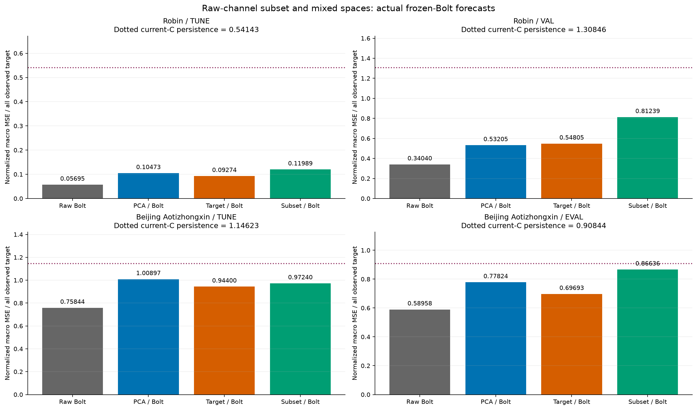
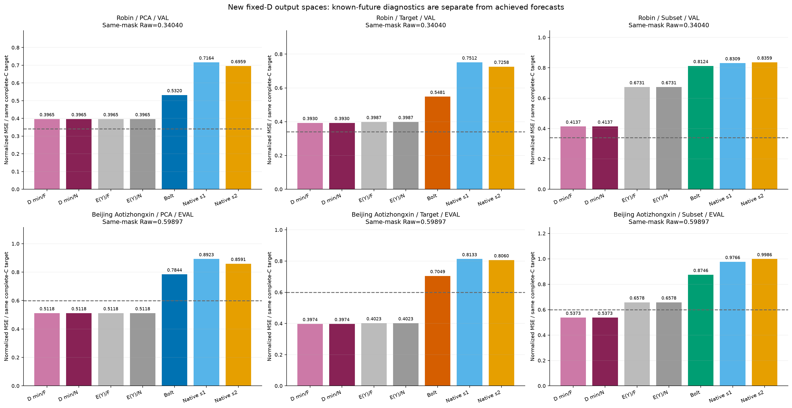
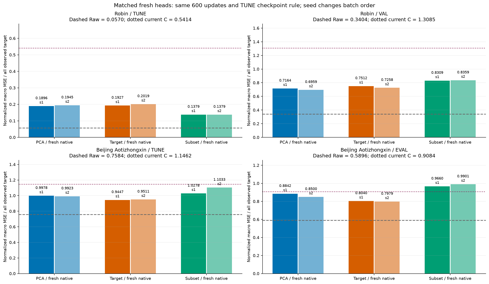
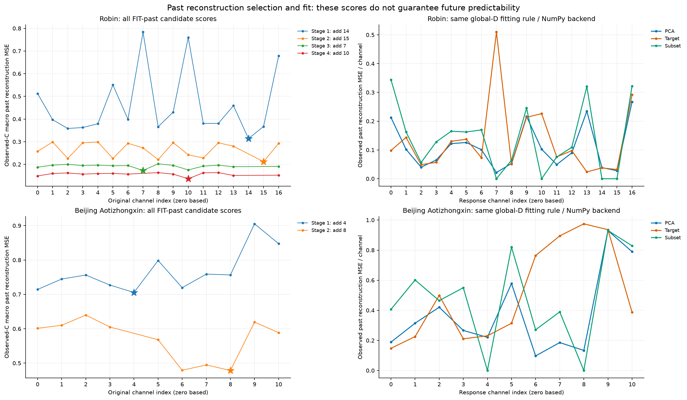
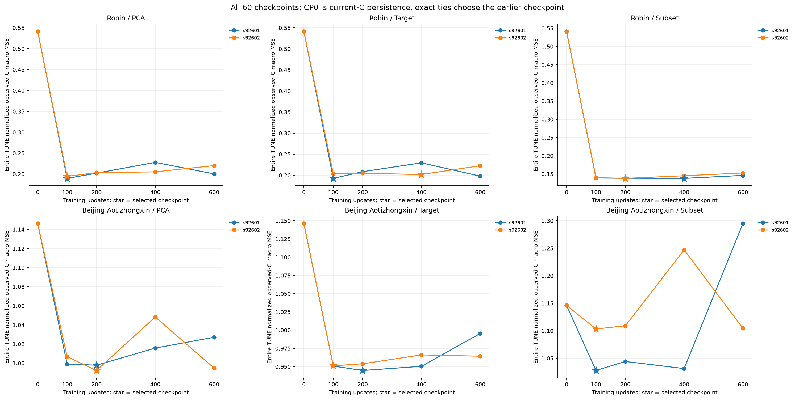
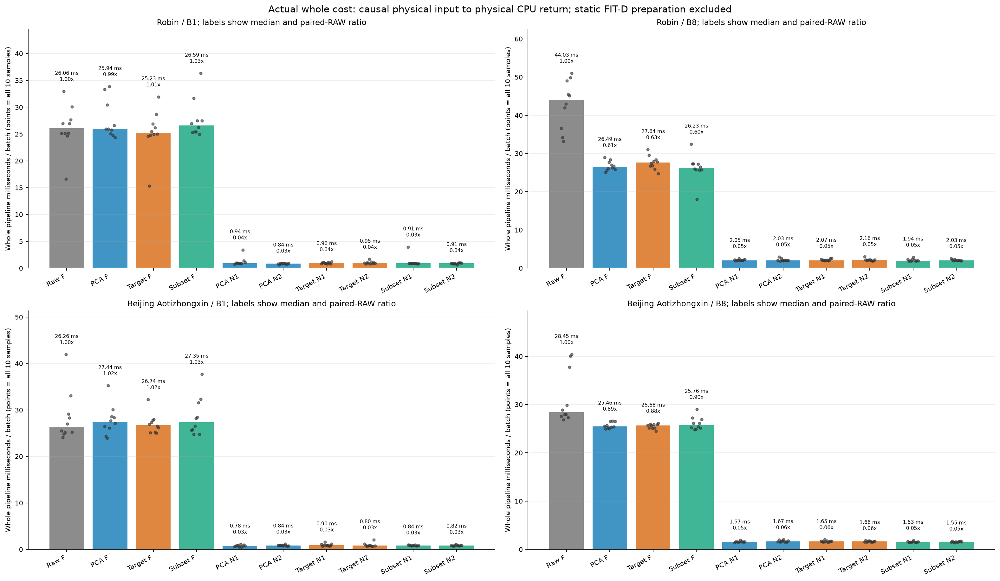

# 원 채널 subset과 혼합 표현: 같은 고정 FIT 디코더 규칙의 실제 비교

[확인] 원 채널을 섞지 않고 작은 K개만 사용하는 대조까지 실제로 수행했다. 아래 답은 두 자료의 기노출 개발 구간과 고정된 K·학습기·손실·선정 규칙에 한정한다. 원자료 보호 TEST를 사용하지 않았고, 독립 일반화나 전체 연구의 해결을 주장하지 않는다.

## 먼저 답할 연구 질문

### 1. 원 채널 혼합과 frozen Bolt의 호환성이 주원인이었는가?

[확인] 다음 원수치는 모두 같은 FIT mean/std·관측 mask·origin·과거512/미래48·current-C anchor와 같은 FIT 관측 과거 global-D 적합 규칙을 사용한다. Raw는 원 C-channel frozen Bolt다. 세 공간의 E와 D 수치가 같다는 뜻은 아니다.

```text
자료/구간                       Raw Bolt       PCA/Bolt       Target/Bolt    Subset/Bolt    Current-C persistence
Robin/TUNE                       0.056951091    0.104733021    0.092736221    0.119887102    0.541433527
Robin/VAL                        0.340401887    0.532048935    0.548051499    0.812393864    1.308464073
Beijing Aotizhongxin/TUNE        0.758435638    1.008971309    0.943997477    0.972401442    1.146234706
Beijing Aotizhongxin/EVAL        0.589575414    0.778238706    0.696929506    0.866360117    0.908441877
```

[확인] Robin VAL의 subset/Bolt 정규화 MSE는 0.812393864, Raw는 0.340401887로 2.386573배다. 이 값은 같은 full-observed mask의 비교다.
[확인] Beijing Aotizhongxin EVAL의 subset/Bolt 정규화 MSE는 0.866360117, Raw는 0.589575414로 1.469464배다. 이 값은 같은 full-observed mask의 비교다.
[확인] 실제 새 K-channel F와 기존 full-C Raw의 선택 채널 forecast slice의 최대 절대 차이는 6개 split에서 8.34465027e-07–2.38418579e-06였다. 선택된 원 시계열의 F 출력과 C 전체 복원 오차를 구분해야 한다. 이 가까운 수치 일치가 모든 K·batch·채널에서의 byte 동일성을 증명하지는 않는다.



[판단] 이 대조로 혼합 좌표가 실패의 유일 원인이라는 결론을 내릴 수 없다. Subset은 채널 혼합을 없애는 동시에 보존하는 정보와 출력 D 공간도 바꾼다. 선정 기준은 과거 복원이며 미래 예측성이 아니다. 따라서 subset의 성적이 나쁘면 이번 단순 대안의 유용성은 약해지지만, 모든 원 채널 선택·혼합 표현·예측기의 가능성까지 부정할 근거가 되지는 않는다. 동일 K에서 혼합 여부만 바꾼 완전한 단일 인과 개입도 아니다.

### 2. 고정 복원 공간과 예측기 중 어디에 문제가 남았는가?

[확인] 이번에 새로 적합한 backend별 D32의 실제 수치 rowspace를 각각 사용해 미래를 이미 아는 경우의 최적 정규화 MSE를 다시 계산했다. 기존 static·per-origin·global rank-K oracle를 가져오지 않았다. 다음 표는 같은 complete-C 관측 위치끼리 비교하므로 Beijing의 full-observed Raw 숫자와 섞으면 안 된다.

```text
자료/공간                   같은mask Raw    D 최소/F       실제 Bolt       Bolt-최소      E(Y)/F
Robin/PCA                    0.340401887   0.396541617   0.532048935   0.135507318   0.396541632
Robin/Target                 0.340401887   0.392970126   0.548051499   0.155081373   0.398658534
Robin/Subset                 0.340401887   0.413679231   0.812393864   0.398714633   0.673077220
Beijing Aotizhongxin/PCA     0.598972295   0.511797659   0.784438860   0.272641201   0.511811808
Beijing Aotizhongxin/Target   0.598972295   0.397358393   0.704856392   0.307497999   0.402273426
Beijing Aotizhongxin/Subset   0.598972295   0.537346126   0.874551390   0.337205264   0.657764618
```

[확인] Robin VAL의 세 NumPy 고정 D 중 3/3개는 미래 잠재값을 자유롭게 고르는 실수 minimum 자체가 같은 mask Raw(0.340401887)보다 높다. Subset의 E(Y) 진단은 0.673077220다.
[판단] 이 자료의 현재 세 고정 출력 공간은 그 조건 아래 Raw 수준 도달을 막는 제약이 있다. 실제 예측 오차는 해당 minimum보다도 커서 남은 predictor gap 역시 함께 확인해야 한다.
[확인] Beijing Aotizhongxin EVAL의 세 NumPy 고정 D 중 0/3개는 미래 잠재값을 자유롭게 고르는 실수 minimum 자체가 같은 mask Raw(0.598972295)보다 높다. Subset의 E(Y) 진단은 0.657764618다.
[판단] 이 자료에서는 세 고정 출력 공간의 minimum만으로 Raw보다 큰 실제 오차를 설명할 수 없다. 낮은 오차의 잠재값이 공간에 존재하는 것과 과거로 예측 가능한 것은 별개다.



[판단] 최소 오차가 Raw보다 크면 이 특정 D 공간은 미래 잠재값을 완벽히 고르더라도 그 Raw 수준에 도달하기 어렵다는 수학적 제약을 드러낸다. 최소 오차가 낮아도 실제 예측기의 gap이 크면 낮은 공간 오차만으로 예측 성공을 보장하지 않는다. 이 차이는 정해진 실수 수치 rowspace의 진단이며, FP32의 모든 가능한 출력에 대한 엄밀 하한이나 단계별 실패 원인의 인과 비율은 아니다. 실제 FP32/real-trace 점수와 측정된 rounding allowance를 CSV에 함께 보존했다.

[확인] 최소라는 말은 정규화 C macro MSE에만 해당한다. 그 해의 MAE·이질적 원단위 MSE를 각 목적의 최소라고 부르지 않는다. E(Y)는 이미 알려진 실제 미래를 encoder에 넣는 별도 진단이며 최적 잠재값과 같다는 보장이 없다. 배포·E/D/head fitting·선정에 사용하지 않았다. 공간에 낮은 오차의 해가 있다는 사실은 과거만으로 그 해를 예측할 수 있다는 증명이 아니다.

### 3. 새 matched native와 전체 비용까지 보면 작은 K의 효용이 남는가?

[확인] 새 native는 각 E/backend의 고정 FIT D32에 맞춰 actual-C 미래 관측 macro MSE로 새로 학습했다. 과거 복원만 학습한 head를 그대로 비교한 결과가 아니다. 원 POINTWISE/MAIN 계열에도 actual-Y 학습이 있었으므로 지금까지의 모든 실패를 ‘재구성 학습만 해서’로 바꾸어 설명할 수 없다. 다음 두 seed는 모두 zero-init이며 minibatch 순서만 다르다.

```text
자료/공간/seed                 선택CP      TUNE MSE      DEV MSE       DEV/Raw
Robin/PCA/92601                    100   0.189630762   0.716427989    2.104653
Robin/PCA/92602                    100   0.194456750   0.695939638    2.044465
Robin/Target/92601                 100   0.192730030   0.751231692    2.206896
Robin/Target/92602                 400   0.201912131   0.725840886    2.132306
Robin/Subset/92601                 400   0.137866236   0.830853248    2.440801
Robin/Subset/92602                 200   0.137865010   0.835874888    2.455553
Beijing Aotizhongxin/PCA/92601     200   0.997847325   0.884212433    1.499744
Beijing Aotizhongxin/PCA/92602     200   0.992298623   0.849968801    1.441663
Beijing Aotizhongxin/Target/92601    200   0.944707523   0.803979854    1.363659
Beijing Aotizhongxin/Target/92602    100   0.951142898   0.797859504    1.353278
Beijing Aotizhongxin/Subset/92601    100   1.027833067   0.966001724    1.638470
Beijing Aotizhongxin/Subset/92602    100   1.103349584   0.990083613    1.679316
```



[확인] 원 동시 기준(TUNE MSE/MAE 각각 Raw×1.01 이하, 같은 시행 B8 ratio-of-medians≤0.90)을 통과한 자료·경로는 0/18개다. seed나 DEV 최저값으로 채택 규칙을 바꾸지 않았다. 기준 통과 자체도 독립 일반화 검증은 아니다.

[판단] 이 대조는 작은 K에서 고정 Bolt의 정확도와 전체 비용을 함께 유지하려는 목적을 평가한다. 단순 ridge의 이득 유무로 목적을 줄이지 않는다. 같은 affine native class와 600update에서 실패하더라도 모든 native·과거 정보의 예측 불가능성이나 frozen Bolt의 필수성을 증명하지 않는다. Transformer/대조학습/그래프를 추가해야 한다는 결론도 아직 자동으로 따라오지 않는다.

## 실제 데이터·학습·선정 계약

Robin C17/K4, Beijing Aotizhongxin C11/K2, FIT256/TUNE64, 기노출 Robin VAL30·Beijing EVAL146을 유지했다. causal-filled 정규화 과거는 predictor로 쓰되, 과거 복원 D와 subset score의 response에는 채널별 true-observed 위치만 썼다. 중복 FIT window의 펼친 행을 독립 표본으로 세지 않는다.

PCA/FIT-target E는 원 SHA 상태를 재사용했다. FIT-target E는 원 FIT 실제 미래로 감독받은 공간이다. 이것은 정상적인 FIT supervision이며 평가 origin의 미래를 배포 입력으로 준 것과 다르다. 세 E의 감독 정보가 동일하다고 주장하지 않는다. 이번 subset 선정과 새 global D는 FIT 관측 과거만 사용하고, E의 배포식은 시점별 현재까지의 값만 사용한다.

Subset은 response별 중심화한 직접 lstsq(rcond1e-4)의 잔차 제곱 평균을 관측 C에 균등 평균해 greedy하게 추가한다. exact FP64 tie만 작은 원 index로 정리한다. 최적 K-subset이나 예측 목적 선정을 보장하지 않는다. 최종 E 열은 원 채널 오름차순이며 실제 값은 직접 FP32 slice로 유지한다. dense one-hot matmul의 signedzero byte 동일성은 주장하지 않는다.

```text
자료                     최종 원 index / 채널명                    greedy 추가 순서
Robin                   [7, 10, 14, 15] / Robin_office_Lindsay, Robin_office_Saul, Robin_office_Victor, Robin_office_Wai    [14, 15, 7, 10]
Beijing Aotizhongxin    [4, 8] / CO, DEWP    [4, 8]
```



세 공간의 global D는 같은 중심화·관측 mask·rcond1e-4·분석적 절편 규칙이지만 각 E의 실제 FP32 과거 latent에 따로 적합했다. NumPy Bolt와 Torch CPU2/canonical32 native의 실제 Z를 구분해 D12개를 보존했다. 상수 response의 full-rank zero-slope는 정상 적합이며, 무관측·관측1개·rank-deficient slope와 구분했다.

배포식은 `currentC + (predictedZfuture - lastZ) @ D32`다. 복원 절편은 innovation에서 상쇄된다. 평가 origin마다 D를 새로 적합하거나 C 과거 회귀계수를 추가하지 않지만 current-C anchor는 여전히 읽으므로 strict K-only가 아니다. 기존 pinv D나 shrinkage D와 동일한 디코더라는 주장도 하지 않는다.

12 native 조건은 zero-init K별 affine512→48, AdamW lr0.001/WD0/clip1/batch4·600update·seed92601/92602·CP0/100/200/400/600을 유지했다. 전체 TUNE 정규화 관측 C macro MSE로 checkpoint를 고르고 exact tie는 빠른 CP다. 12개 선정 잠금과 registry를 모두 저장한 다음 이번 DEV 입력/예측을 열었다. 다만 전체 후속 설계 자체는 이전 DEV·oracle를 본 뒤 진행한 탐색적 대조이므로 독립 holdout으로 바뀌지 않는다.



CP0는 현재 C 반복 baseline이며 독립 감사에서 같은 mask로 검산했다. 이 baseline의 실제 전체 배포 비용은 이번 열 경로에 포함하지 않았다. checkpoint 예측은 canonical batch32의 실제 scored array를 저장했다. cached past를 고정하고 미래 target/mask를 바꾸는 12검사는 그 경로의 forward가 label을 읽지 않는 좁은 검사다. raw upstream 재생·E/D 재학습이나 독립 일반화의 증명으로 확대하지 않는다.

## 실제 추론과 전체 비용

기존 mixed F latent cache12개는 실제 새 E 과거/origin byte lineage가 맞는 경우만 재사용했다. Subset K-channel F는 FIT/TUNE/DEV 총6개 split을 실제 새로 추론했으며 model batch103회를 기록했다. Full-C Raw forecast에서 잘라낸 것을 신규 추론으로 세지 않았다. 그 slice와 새 K-F 결과의 차이는 별도 수치 진단으로 보존했다.

비용은 같은 시행에서 자료2×batch1/8×10경로=40셀, warmup2·반복10=400개 실제 타이머 표본이다. 10개 circular rotation으로 위치를 균등하게 사용했다. 같은 첫 B개 DEV origin을 반복하므로 400개의 독립 데이터가 아니다. raw ns start/end·순서·outlier·예측 출력 검산을 보존했다.

타이머는 physical window의 causal fill/FIT normalize부터 실제 E→frozen F 또는 선택 native CPU2 head→고정 D/currentC anchor→원단위 CPU return 및 동기화까지다. 고정 FIT D/E/head 로드·FIT 학습·model/state/file hash·setup·warmup·저장·guard·memory snapshot은 밖이다. 이 경로에는 per-origin D fit가 없다. 별도의 global-D fitting 시간은 단독 구간으로 측정하지 않았으므로 만들어내지 않고 캠페인 receipt 및 head 학습 시간만 분리해 제공한다.



```text
자료/경로                              B1 batch ms   B8 batch ms   B8 ms/window   B8/Raw median비   B8 paired비 median
Robin/RAW_BOLT                                     26.06080     44.03330      5.5041625       1.0000000          1.0000000
Robin/PCA_BOLT                                     25.94010     26.48725      3.3109062       0.6015277          0.6078930
Robin/FIT_TARGET_BOLT                              25.22660     27.63505      3.4543812       0.6275943          0.6273090
Robin/RAW_SUBSET_BOLT                              26.58600     26.23285      3.2791063       0.5957503          0.5990409
Robin/PCA_NATIVE_s92601                             0.93885      2.04725      0.2559063       0.0464932          0.0465296
Robin/PCA_NATIVE_s92602                             0.84340      2.03180      0.2539750       0.0461424          0.0466360
Robin/FIT_TARGET_NATIVE_s92601                      0.95750      2.06670      0.2583375       0.0469349          0.0490671
Robin/FIT_TARGET_NATIVE_s92602                      0.95345      2.16165      0.2702063       0.0490913          0.0479068
Robin/RAW_SUBSET_NATIVE_s92601                      0.90620      1.94165      0.2427063       0.0440950          0.0499912
Robin/RAW_SUBSET_NATIVE_s92602                      0.90565      2.03430      0.2542875       0.0461991          0.0463960
Beijing Aotizhongxin/RAW_BOLT                      26.25735     28.45345      3.5566812       1.0000000          1.0000000
Beijing Aotizhongxin/PCA_BOLT                      27.44495     25.46240      3.1828000       0.8948792          0.8916510
Beijing Aotizhongxin/FIT_TARGET_BOLT               26.73645     25.68235      3.2102937       0.9026093          0.8829437
Beijing Aotizhongxin/RAW_SUBSET_BOLT               27.35040     25.76460      3.2205750       0.9055000          0.9020634
Beijing Aotizhongxin/PCA_NATIVE_s92601              0.78325      1.57130      0.1964125       0.0552235          0.0543637
Beijing Aotizhongxin/PCA_NATIVE_s92602              0.84255      1.66670      0.2083375       0.0585764          0.0574641
Beijing Aotizhongxin/FIT_TARGET_NATIVE_s92601       0.89650      1.65120      0.2064000       0.0580316          0.0564942
Beijing Aotizhongxin/FIT_TARGET_NATIVE_s92602       0.79940      1.65810      0.2072625       0.0582741          0.0563215
Beijing Aotizhongxin/RAW_SUBSET_NATIVE_s92601       0.83615      1.53000      0.1912500       0.0537720          0.0537019
Beijing Aotizhongxin/RAW_SUBSET_NATIVE_s92602       0.82275      1.54835      0.1935437       0.0544170          0.0532819
```

ratio-of-medians와 같은 반복끼리의 paired ratio 중앙값은 서로 다른 통계량이다. 별도 CSV로 모두 보존하며 원 채택 기준은 앞의 통계량이다. B1/B8 실제 native와 canonical32 score의 수치 차이는 등록 precheck 공차(정규화 atol1e-5/rtol2e-6, 원단위 atol2e-3/rtol2e-5)로 검산했다. 혼합 E와 subset direct slice의 계약·원 mask/scaler/origin을 함께 확인했다.

[불확실성] 절대 시간은 장비 상태와 순서에 민감하며 전체 시스템 독점이나 완전히 조용한 환경을 보장하지 않는다. 모든 E/D/12head/F가 resident인 공유 process의 RSS/VRAM을 방법 고유 메모리 절감으로 해석하지 않는다. 이전 shrinkage나 다른 cohort의 Raw 시간을 가져와 속도비를 만들지 않았다. 학습 비용·배포 latency·저장량·논리적 정보량은 서로 다른 측정이다.

## 실패 기록과 수치 복구

[확인] 최초 v1은 PARTIAL_COMPLETED였다. 두 자료 모두 subset 선정 전 Gram/cross/response variance의 상쇄식이 약1e-12 음수 MSE를 만들었다. 원 tolerance를 넘었고 subset 선정0·신규 subset F0이었지만 독립 가능한 mixed8fit/4800update/40CP·24native/12Bolt split은 완료했다. 실패를 subset forecasting 성적이나 방법의 구조적 한계로 부르지 않는다.

```text
자료       Gram MSE             원 negative tolerance    직접 centered 잔차 MSE
Robin                -1.090239010182e-12  1.313206261481e-13  2.155544720076e-25
Beijing Aotizhongxin -7.549516567451e-13  1.148428221140e-13  2.065453622367e-26
```

v2는 원 source를 보존하고 새 파일에서 동일 FIT-past LS 목적/rcond/exact tie 규칙에 직접 centered lstsq 계수와 residual² 평균을 사용했다. 음수 clipping이나 공차 확대를 하지 않았다. finite 계산 경로가 달라 근접 후보 점수/순서가 bit-identical하다고 주장하지 않는다. v1에서는 subset 승자가 없었다.

v2에서 원 12-lock-before-DEV 계약을 단순하게 유지하려고 12조건을 새로 학습했다. 그중8mixed는 v1의 반복이며 E/D·40CP·TUNE/DEV 예측·학습곡선·선정update가 공차 없이 동일함을 검산했다. 두 시도의 실제 native 학습은20회/12000update/100CP지만 distinct 등록 조건은12개다. 이 중복을 추가 독립 실험이나 일반화 증거로 세지 않았다. 시간/누적 상한 해제는 기록 초기화가 아니며 원 실패와 모든 receipt를 보존했다.

[확인] 독립 auditor v2와 같은 source의 traceback 재호출은 FAILED_PRESERVED로 남았다. producer의 complete bool을 E(Y) 계산의 complete-C mask ndarray가 덮어 최종 if에서 ambiguous truth-value 예외가 났다. 이 두 파일을 PASS로 세지 않는다. ROOT exception trace를 보존했고 새 auditor에서는 변수명만 분리했다. 모델·예측·학습·수식·공차를 바꾼 복구가 아니며, 최종 채택 근거는 별도로 결속된 새 PASS다.

[확인] 비용 실험 자체는40셀/400표본 COMPLETE였지만 최초 비용 auditor는 복구 addendum Markdown을 JSON으로 해석해 JSONDecodeError로 FAILED_PRESERVED가 됐다. 새 auditor는 그 파일을 원 path/SHA로 검증한다. Markdown 본문·예측·timer sample·수치/공차를 바꾼 것이 아니다. 이 실패와 최종 비용 PASS를 분리해 원 기록을 링크했다.

## 무엇이 남았는가

[판단] 보고서의 수치와 새 complete-C 진단을 함께 보면 이번 단순 subset·고정 과거 D·선형 native/F 조합이 어느 기준에서 실패했는지 구분할 수 있다. 좋은 과거 복원이 좋은 미래 표현을 보장하지 않는다는 반론은 여전히 유효하다. 그러나 actual-Y 학습도 이미 수행했으므로 원인을 재구성 목적 하나나 최적화 문제 하나로 확정하지 않는다. 특정 D 공간·예측기의 gap·subset 정보손실·좌표 적합성·학습 class의 표현력이라는 남은 가능성을 구분해야 한다.

다음 판단은 K와 비용 목적을 유지하면서 새로운 목적이나 모델을 도입할 때 그 비교가 무엇을 반증하는지 먼저 고정하는 것이다. 이 보고서만으로 graph/contrastive가 필요하다거나 불필요하다거나, 모든 저차원 복원이 불가능하다거나, Chronos-Bolt를 반드시 유지해야 한다고 결론 내리지 않는다. 새로운 독립 평가 자료와 통계 검증도 아직 없다.

## 원수치·실행 소스·검산 링크

- [science](../../runs/raw_subset_comparison_v2/RESULT.json) — SHA256 `2b271ba9aa6ae359033444b282ddc1becc5d1f60ef063451171e9c93f70db4ff`
- [audit](../../audits/RAW_SUBSET_COMPARISON_AUDIT_v3.json) — SHA256 `e177652ac34414bccfbfc564da820fca0bde5a462922ceb0edaf04c47081e95d`
- [cost](../../runs/raw_subset_cost_v1/RESULT.json) — SHA256 `60eb05ebdd1a7f24d82fa58d4dcab192c5c4684552882d1f61f175fc0585a23c`
- [cost_audit](../../audits/RAW_SUBSET_COST_AUDIT_v2.json) — SHA256 `e419db2ff01e133a698eec169e546f0ade17f9ae8983c2b5c99d56534259be10`
- [audit_source](../../audit_raw_subset_comparison_v3.py) — SHA256 `0782c7d8d66bae5bd124c5c778eadde08786e2da2246882233eb4489b3410b20`
- [cost_audit_source](../../audit_raw_subset_cost_v2.py) — SHA256 `62a1176485457ec21ebd60560e5cf401136d7b82ee3ba1e4b157e7edaeb56811`
- [prior_partial](../../runs/raw_subset_comparison_v1/RESULT.json) — SHA256 `4240cedea826e052b227ef2fba4e16ff52cdcd6db69281844485eca6c0b0bd6b`
- [Gram_failure_diagnostic](../../audits/RAW_SUBSET_GRAM_FAILURE_DIAGNOSTIC_ROOT_v1.json) — SHA256 `ae7b2ce66651cc367cdf99e801283a1a80d3f4e838fc8f97c0b2b7e8c4063f66`
- [numeric_repair_addendum](../../RAW_SUBSET_GRAM_NUMERIC_REPAIR_KO_v2.md) — SHA256 `3574de31b66a647cb53b397354255364591b5a18ca165477ebad15068185b827`
- [RAW_SUBSET_COMPARISON_AUDIT_v2](../../audits/RAW_SUBSET_COMPARISON_AUDIT_v2.json) — SHA256 `9697c162c30c108dbcc9f73ef51d28ec37537e56126abc063b29ba1482b28589`
- [RAW_SUBSET_AUDIT_FAILURE_TRACE_REEXECUTION_v1](../../audits/RAW_SUBSET_AUDIT_FAILURE_TRACE_REEXECUTION_v1.json) — SHA256 `d6f49796b94fe0ed38f7be00701aa77308856aaddc199ff06ef467e04a6690ea`
- [RAW_SUBSET_AUDIT_EXCEPTION_TRACE_v1](../../audits/RAW_SUBSET_AUDIT_EXCEPTION_TRACE_v1.json) — SHA256 `c5d40dfa520087107ff7ffb13e10eb606b6303dd55b57c3e82873303f44ffd1e`
- [RAW_SUBSET_COST_AUDIT_v1](../../audits/RAW_SUBSET_COST_AUDIT_v1.json) — SHA256 `42081d93049e78aaa8b313a00dd28f68e292129f9ac3b036832889137c6fb6c2`
- [cost_auditor_format_repair](../../RAW_SUBSET_COST_AUDITOR_FORMAT_REPAIR_KO_v2.md) — SHA256 `8f2bada1aea0da5467763d0d86c19431fdb88083a5c46d7a5e9bd063e0d381b2`
- [report_source](../../make_raw_subset_report_v1.py) — SHA256 `1044944e04807200978dbf3a828652b33a85b6b7ec85ca1332b57b0ffa074beb`

원 보고서는 각 시점의 불확실성과 결과를 유지한다.

- [matched_projection_v1](../matched_projection_v1/REPORT_KO.md) — SHA256 `4ad724017706b690e2d19ce4e8bdc326e6663f8ca6b0bf6f157ca4641ef0d3e2`
- [oracle_rank_addendum_v2](../oracle_rank_addendum_v2/REPORT_KO.md) — SHA256 `a75784106b241b7228bd09c6b930b94c2a15097c6fd9c9cde466b12cdcc1d4fe`
- [decoder_metric_intervention_v2](../decoder_metric_intervention_v2/REPORT_KO.md) — SHA256 `1958073281ea0a9c7cd14bacab2b97b8b4a95063f1015a8c94b25bafe85b5fe5`
- [FIT_target_comparison_v1](../FIT_target_comparison_v1/REPORT_KO.md) — SHA256 `fc89475c76f43f0c30d6a0029d96c138c1997dd510c35600664af4fb5337f77c`
- [past_constant_gate_v1](../past_constant_gate_v1/REPORT_KO.md) — SHA256 `4d53cb0b42f882bc636f4f8e57e5d2c42620382274b7268a2f4345ee4a581fd9`
- [local_past_decoder_v1](../local_past_decoder_v1/REPORT_KO.md) — SHA256 `cd15f1e0fb4614870713141b631b929696f6d46f92a2cccd76556ced2d1bd74b`
- [shrinkage_matched_native_v1](../shrinkage_matched_native_v1/REPORT_KO.md) — SHA256 `c48f0b8d36b882f935e5090f1034406a859df581a43b042357b0b2c043c94e0a`

전체 CSV는 nested metric·관측수·source binding을 JSON cell에 보존한다.

- [COMPARISON](tables/COMPARISON.csv) — 264 rows
- [RELATIVE_TO_RAW](tables/RELATIVE_TO_RAW.csv) — 54 rows
- [GREEDY_SELECTION](tables/GREEDY_SELECTION.csv) — 6 rows
- [GREEDY_CANDIDATES](tables/GREEDY_CANDIDATES.csv) — 83 rows
- [GREEDY_RESPONSE_SCORES](tables/GREEDY_RESPONSE_SCORES.csv) — 1285 rows
- [GLOBAL_DECODER_STATES](tables/GLOBAL_DECODER_STATES.csv) — 12 rows
- [GLOBAL_DECODER_CHANNELS](tables/GLOBAL_DECODER_CHANNELS.csv) — 168 rows
- [CHECKPOINTS](tables/CHECKPOINTS.csv) — 60 rows
- [LEARNING_CURVE](tables/LEARNING_CURVE.csv) — 7200 rows
- [NATIVE_SELECTION](tables/NATIVE_SELECTION.csv) — 12 rows
- [F_CACHE_AND_SUBSET_INFERENCE](tables/F_CACHE_AND_SUBSET_INFERENCE.csv) — 18 rows
- [NEW_FIXED_D_DIAGNOSTIC](tables/NEW_FIXED_D_DIAGNOSTIC.csv) — 324 rows
- [NEW_FIXED_D_GEOMETRY](tables/NEW_FIXED_D_GEOMETRY.csv) — 36 rows
- [WHOLE_COST](tables/WHOLE_COST.csv) — 40 rows
- [WHOLE_COST_SAMPLES](tables/WHOLE_COST_SAMPLES.csv) — 400 rows
- [REGISTERED_ADOPTION](tables/REGISTERED_ADOPTION.csv) — 18 rows
- [EXECUTION_COST_AND_COUNTS](tables/EXECUTION_COST_AND_COUNTS.csv) — 5 rows
- [FAILURE_AND_REPAIR](tables/FAILURE_AND_REPAIR.csv) — 2 rows
- [AUDIT_FAILURE_PRESERVATION](tables/AUDIT_FAILURE_PRESERVATION.csv) — 4 rows

PNG와 같은 figure의 SVG 원본도 `figures/`에 함께 저장했다. 실행·독립 검산·보고/시각화의 완료와 연구 전체 해결을 구분한다.
