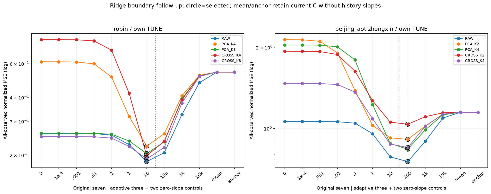
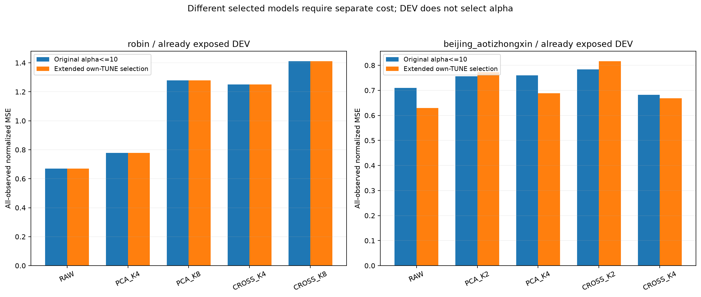

# ridge 탐색 경계의 후속 확인

[확인] 원 history10경로가 모두 alpha10 상단을 골라 alpha100/1000/10000과 mean/현재C 제어를 추가했다. 5/10조건이 새 후보를 골랐고 새 alpha10000 상단 선택은 0/10, zero-slope 선택은 0/10이다. 정규화를 늘리면 모든 실패가 해결된다는 설명은 지지되지 않는다.

Robin5경로는 원 alpha10을 유지하고 Beijing5경로는100을 골랐다. Bay5의 선정 변화는 alpha≤10의 결론을 더 넓은 규제 범위로 확대할 수 없음을 확인한다. 유한한 메뉴의 내부 선택을 전역 최적 규제로 확대하지 않는다. 같은 노출 DEV를 사용한 적응적 후속이며 독립 일반화 증거가 아니다.

- robin RAW_HISTORY512: 선정 ALPHA_10, TUNE 0.185026142208 → 0.185026142208, DEV 0.670413487082 → 0.670413487082.
- robin PCA_K4_HISTORY512: 선정 ALPHA_10, TUNE 0.222868100952 → 0.222868100952, DEV 0.778306021422 → 0.778306021422.
- robin PCA_K8_HISTORY512: 선정 ALPHA_10, TUNE 0.203618145454 → 0.203618145454, DEV 1.27810496197 → 1.27810496197.
- robin CROSS_MOMENT_K4_HISTORY512: 선정 ALPHA_10, TUNE 0.198435486574 → 0.198435486574, DEV 1.25024464824 → 1.25024464824.
- robin CROSS_MOMENT_K8_HISTORY512: 선정 ALPHA_10, TUNE 0.191184106376 → 0.191184106376, DEV 1.41030860502 → 1.41030860502.
- beijing_aotizhongxin RAW_HISTORY512: 선정 ALPHA_100, TUNE 0.784519870908 → 0.753475193328, DEV 0.709532103736 → 0.630001184564.
- beijing_aotizhongxin PCA_K2_HISTORY512: 선정 ALPHA_100, TUNE 0.923165431877 → 0.911133538592, DEV 0.756555435826 → 0.772503337861.
- beijing_aotizhongxin PCA_K4_HISTORY512: 선정 ALPHA_100, TUNE 0.879421662077 → 0.837683856849, DEV 0.759497019661 → 0.68818327052.
- beijing_aotizhongxin CROSS_MOMENT_K2_HISTORY512: 선정 ALPHA_100, TUNE 1.05549113766 → 1.03671411543, DEV 0.784032965893 → 0.815919267134.
- beijing_aotizhongxin CROSS_MOMENT_K4_HISTORY512: 선정 ALPHA_100, TUNE 0.87569590817 → 0.849506451843, DEV 0.682434732801 → 0.668111170007.

새10fit·30양수ridge·20zero-slope·100 FIT/TUNE 평가를 실제 수행했다. 원70후보·140 FIT/TUNE는 immutable binding으로 재사용했고, 모든10잠금 뒤 새 DEV5회와 원 DEV5개 exact 재사용을 구분했다. 원 두 Raw current-C fit은 참고만 재사용했다. 각 경로는 같은 원 과거/E·true-observed mask·전FIT RMS·비벌점 intercept·FP32 feature subtraction·current-C anchor와 CPU canonical32 fused readout을 쓴다.

mean은 각(h,c)의 관측 FIT innovation 평균만 더하고 anchor는 현재C를 반환한다. 이 두 제어는 원 current-C anchor를 유지하지만 전체512과거에 대한 학습 slope와 E/F는 필요 없어 압축 효과로 세지 않는다. 새 F/model/optimizer/GPU 학습0, 보호 TEST 접근0이다. 선정되지 않은 새 계수의 값이 저장되지 않은 경우 모든 후보 fit을 독립 재현했다고 주장하지 않는다.

**비용은 미측정이다.** 기존76셀은 원 v1 선정 계수의 실제 비용으로 유지한다. 변경된 Beijing5계수에 그 비용을 대입하지 않는다. PCA/native/F 대조는 [원 비교 보고](../new_direction_comparison_v1/REPORT_KO.md)에서 확인할 수 있다.

- [후보120행](tables/CANDIDATES.csv)
- [선정10행](tables/SELECTED.csv)

- [result](../../runs/ridge_regularization_extension_v1/RESULT.json): `8fcd2e19fcfdf9f9a0b261553cf8179de129b813a3fef92039c86de415c689b3`
- [audit](../../audits/RIDGE_REGULARIZATION_EXTENSION_AUDIT_v1.json): `80e12795739ff022b9cb02c2f762747d4b208bca3cf0068f38c13acc3afe3c15`
- [original](../../runs/new_direction_direct_ridge_v1/RESULT.json): `b8d7eae62ce5bb52b3d46ffc543f916f8b81857028098370a5b2f8398510f1ed`
- [original_audit](../../audits/NEW_DIRECTION_DIRECT_RIDGE_AUDIT_v1.json): `8bfeb29cc6836d2ff5528c30ee13a4300b79cc4c250a452b9c5c81fdfc9bac90`
