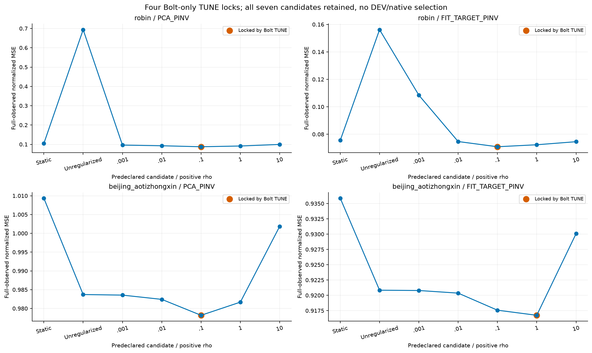
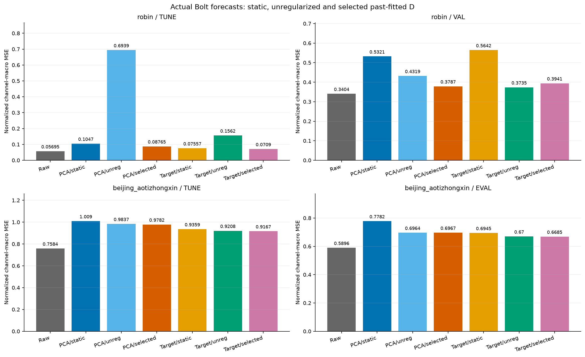
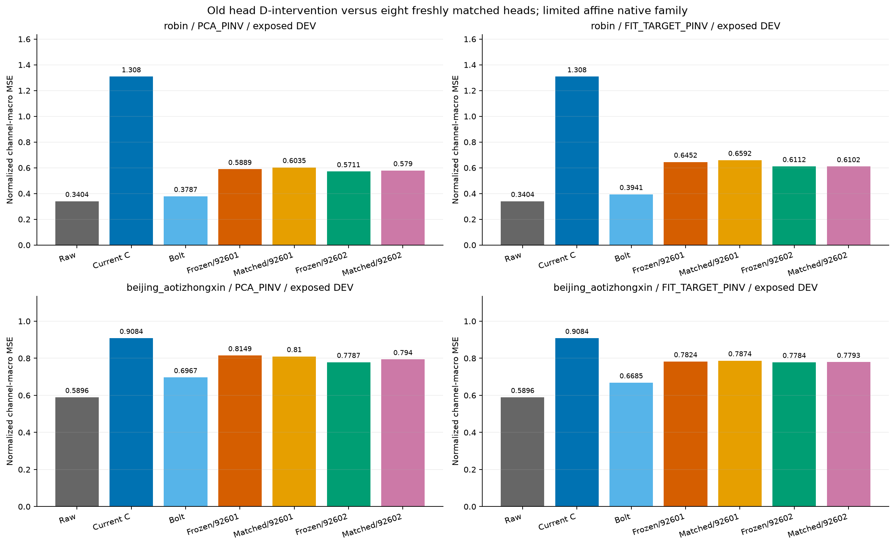
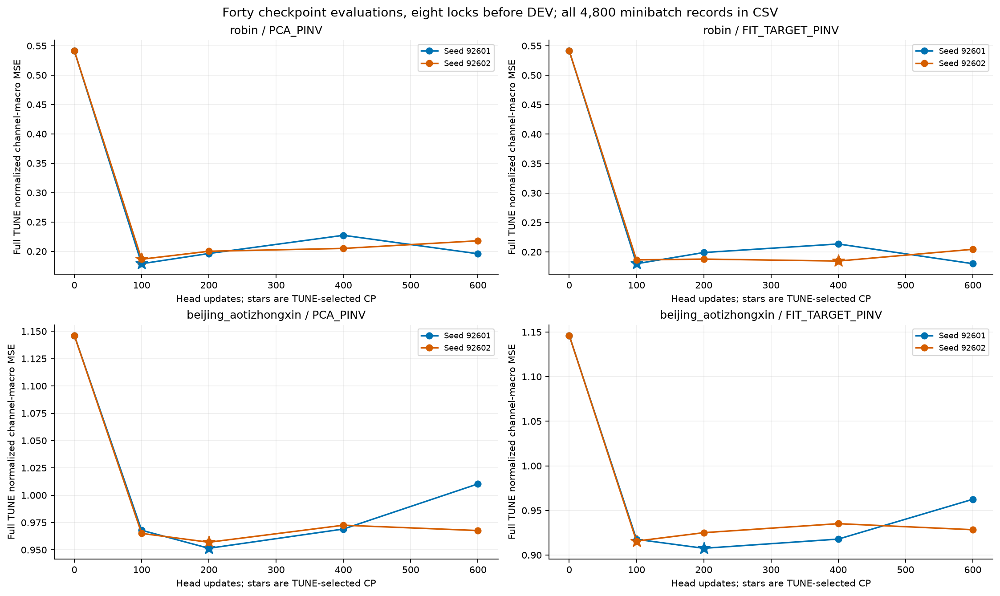
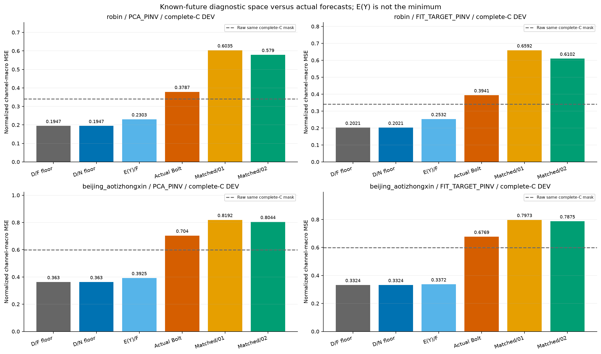
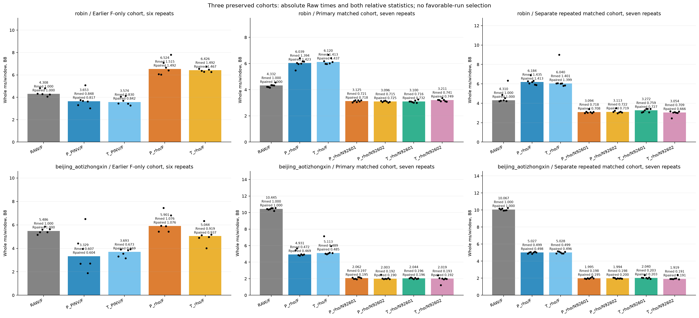

# 선택한 과거 디코더와 재학습한 작은 native head: 무엇이 남았는가

실험의 답은 실행 가능한 작은 K 디코더와 미래 출력 공간의 여지가 남아 있다는 것이다. 이것과 실제 잠재 미래 예측의 성공은 다르다. 아래는 TUNE로 선택한 shrinkage, 고정 head에 D만 바꾼 대조, 새 D에 맞춰 실제 학습한 head와 세 비용 cohort를 연결한 기록이다.

## 먼저 확인한 답과 원수치

[확인] robin/PCA_PINV/TUNE 정규화 MSE: Raw 0.056951091; static Bolt 0.104702758; unregularized Bolt 0.693878798; selected Bolt 0.087647752; old frozen native01/02 0.180280233/0.190228148; freshly matched native01/02 0.179000379/0.186672565.
[확인] 같은 mask의 current-C persistence MSE는 0.541433527, fresh native01/02의 persistence 대비 비율은 0.330605/0.344775다. Raw와 persistence는 서로 다른 기준이다.
[확인] robin/PCA_PINV/VAL 정규화 MSE: Raw 0.340401887; static Bolt 0.532063803; unregularized Bolt 0.431921567; selected Bolt 0.378742147; old frozen native01/02 0.588938229/0.571095727; freshly matched native01/02 0.603474794/0.579036158.
[확인] 같은 mask의 current-C persistence MSE는 1.308464073, fresh native01/02의 persistence 대비 비율은 0.461209/0.442531다. Raw와 persistence는 서로 다른 기준이다.
[확인] robin/FIT_TARGET_PINV/TUNE 정규화 MSE: Raw 0.056951091; static Bolt 0.075569448; unregularized Bolt 0.156193050; selected Bolt 0.070904497; old frozen native01/02 0.174831139/0.182348775; freshly matched native01/02 0.180129768/0.184690603.
[확인] 같은 mask의 current-C persistence MSE는 0.541433527, fresh native01/02의 persistence 대비 비율은 0.332690/0.341114다. Raw와 persistence는 서로 다른 기준이다.
[확인] robin/FIT_TARGET_PINV/VAL 정규화 MSE: Raw 0.340401887; static Bolt 0.564240397; unregularized Bolt 0.373466779; selected Bolt 0.394111414; old frozen native01/02 0.645185989/0.611153467; freshly matched native01/02 0.659218802/0.610172053.
[확인] 같은 mask의 current-C persistence MSE는 1.308464073, fresh native01/02의 persistence 대비 비율은 0.503811/0.466327다. Raw와 persistence는 서로 다른 기준이다.
[확인] beijing_aotizhongxin/PCA_PINV/TUNE 정규화 MSE: Raw 0.758435638; static Bolt 1.009348491; unregularized Bolt 0.983708633; selected Bolt 0.978183115; old frozen native01/02 0.961197435/0.955842010; freshly matched native01/02 0.951491961/0.957015006.
[확인] 같은 mask의 current-C persistence MSE는 1.146234706, fresh native01/02의 persistence 대비 비율은 0.830102/0.834921다. Raw와 persistence는 서로 다른 기준이다.
[확인] beijing_aotizhongxin/PCA_PINV/EVAL 정규화 MSE: Raw 0.589575414; static Bolt 0.778177077; unregularized Bolt 0.696380597; selected Bolt 0.696671169; old frozen native01/02 0.814911251/0.778728880; freshly matched native01/02 0.809982105/0.793996461.
[확인] 같은 mask의 current-C persistence MSE는 0.908441877, fresh native01/02의 persistence 대비 비율은 0.891617/0.874020다. Raw와 persistence는 서로 다른 기준이다.
[확인] beijing_aotizhongxin/FIT_TARGET_PINV/TUNE 정규화 MSE: Raw 0.758435638; static Bolt 0.935872434; unregularized Bolt 0.920843409; selected Bolt 0.916742955; old frozen native01/02 0.906248623/0.912500609; freshly matched native01/02 0.907600321/0.915689258.
[확인] 같은 mask의 current-C persistence MSE는 1.146234706, fresh native01/02의 persistence 대비 비율은 0.791810/0.798867다. Raw와 persistence는 서로 다른 기준이다.
[확인] beijing_aotizhongxin/FIT_TARGET_PINV/EVAL 정규화 MSE: Raw 0.589575414; static Bolt 0.694519401; unregularized Bolt 0.669978818; selected Bolt 0.668548248; old frozen native01/02 0.782386363/0.778402421; freshly matched native01/02 0.787425449/0.779279771.
[확인] 같은 mask의 current-C persistence MSE는 0.908441877, fresh native01/02의 persistence 대비 비율은 0.866787/0.857820다. Raw와 persistence는 서로 다른 기준이다.

[판단] 선택된 ridge는 이 기록의 Bolt TUNE 목적을 안정화하는 대조다. ρ를 Bolt TUNE로 고른 결과이므로 native 전용으로 최적화한 조건이 아니다. gain·출력 방향·과거 적합 오차가 함께 달라진다. 개선을 gain 하나의 인과 원인으로 확정하지 않는다. 새 head가 persistence를 개선한 결과는 과거 표현에서 예측 가능한 정보가 일부 사용됐다는 제한된 근거다. 따라서 표현이 아무 쓸모없거나 native가 전혀 학습하지 못했다고 말하지 않는다. Raw보다 나쁜 결과와 이 학습 효과를 함께 보고한다. 같은 actual-Y 목적과 D를 사용했지만 이 제한된 affine512→48 head·600 update 조건에서 전 문제가 해결됐다고 볼 수 없다. 고정 Bolt가 이 head군보다 나은 사례는 Bolt의 필요성이나 모든 다른 predictor보다 우월함을 증명하지 않는다.

## 과거 정보·선정·미래 진단의 계약

E는 원 PCA/FIT-target 공간으로 고정했다. FIT-target E는 이전 단계에서 실제 FIT 미래 innovation의 감독을 사용했고 배포 E 입력은 과거만 본다. origin별 D는 알려진 원 C 과거512와 true observation mask를 쓰는 centered ridge이며 λ=ρ·trace(G)/K다. 미래 target으로 D를 fitting하지 않았지만 TUNE 미래 정답은 정상 ρ 선택과 native checkpoint 선택에 사용했다. 모든 네 Bolt ρ lock, 새 native 여덟 lock과 전체 registry를 보존했으며 DEV에 앞서 잠갔다. DEV는 이미 노출된 탐색적 구간이고 독립 holdout 일반화 검증이 아니다.

decoder 정보는 K future streams + current C + 원 C의 known past에서 계산한 per-origin K×C coefficients다. strict K-only 압축이나 static D와 동일한 decoder-side information 비교가 아니다. Bolt NumPy와 native Torch32에는 같은 ρ·λ 규칙을 썼지만 backend별 표현과 D·λ 바이트가 같다는 주장은 하지 않는다. static/local 실패, 모든 양수ρ의 FIT/TUNE 결과, native 두 seed의 나쁜 결과를 CSV에 남겼다. current-C persistence는6개 같은 split을 두 E context에 반복 기재한12contexts이고12독립 draw가 아니다. 그 baseline의 whole deployment 비용은 측정하지 않았다. 검사 통과를 예측 개선으로 바꾸지 않는다.





## 디코더 조건을 맞춘 native 재학습

새 head8개는 원 selected native D[n]과 cached 과거 E를 고정하여 actual-C 관측 macro 정규화 MSE로 600 update씩 학습했다. 이전 static head의 weights를 재사용하지 않았다. 0/100/200/400/600 update의 full TUNE score40개에서 정확히 같은 값이면 이른 checkpoint를 선택했다. seed는 초기 zero weights를 바꾸는 대신 minibatch 순서를 바꾼다. 4,800개 minibatch loss·gradient 기록과 training cost·parameter 수·lock을 보존한다. minibatch loss를 full FIT loss라고 하지 않는다. 원 고정 head의 D 개입과 새 matched 학습은 구분한다. 더 큰/다른 native나 native 전용ρ·architecture·training budget 탐색은 하지 않았다.





## 작은 K 출력 공간과 실제 잠재 예측 사이

선정된 D32[n]을 실수로 해석한 origin별 rowspace에 실제 미래 Y−currentC를 투영한 최소값은 미래를 아는 진단이다. 같은 complete-C mask에서만 Raw·E(Y)·actual Bolt·old/fresh native와 비교한다. 이 수학적 최소는 정규화 MSE에 한정하며 MAE·물리 단위 점수는 최소해의 값일 뿐 각각의 최소값이 아니다. E(Y)는 strict minimum이 아니다. Raw에 공간 부등식을 적용하지 않는다. 이전 static/global rank-K floor를 현재 D[n]의 하한으로 사용하지 않는다. FP32 전체 출력의 strict lower bound나 과거 정보의 충분성을 증명한 것으로 말하지 않는다.

[확인] robin/PCA_PINV/complete-C VAL: D/F real minimum 0.194717889, E(Y)/F 0.230315141, actual Bolt 0.378742147; D/native real minimum 0.194717886, fresh native01/02 0.603474794/0.579036158.
[확인] robin/FIT_TARGET_PINV/complete-C VAL: D/F real minimum 0.202114826, E(Y)/F 0.253156642, actual Bolt 0.394111414; D/native real minimum 0.202114825, fresh native01/02 0.659218802/0.610172053.
[확인] beijing_aotizhongxin/PCA_PINV/complete-C EVAL: D/F real minimum 0.363049891, E(Y)/F 0.392531695, actual Bolt 0.704046997; D/native real minimum 0.363049891, fresh native01/02 0.819159112/0.804362889.
[확인] beijing_aotizhongxin/FIT_TARGET_PINV/complete-C EVAL: D/F real minimum 0.332386372, E(Y)/F 0.337172217, actual Bolt 0.676882960; D/native real minimum 0.332386372, fresh native01/02 0.797332420/0.787507361.

[판단] 낮은 공간 최소값과 큰 actual error가 함께 있으면 실제 잠재 미래 예측 및 D와의 결합에 문제가 남는다. 과거 reconstruction이 낮아도 미래 forecast 적합성을 보장하지 않는다. 이 증거는 입력 표현·future predictor·decoder를 분리해 볼 근거이며, 대조학습·동적 그래프가 꼭 필요하다거나 표현학습 자체가 불가능함을 확정하는 근거가 아니다. 새 matched score와 기존 real minimum의 차이는 같은 mask의 수치 차이로 보고하며 보고서가 새 real-trace 부등식을 추가 검산했다고 하지 않는다.



## 세 실제 비용 cohort의 범위

앞선 F-only cohort는5경로×2데이터×B1/B8=20셀·각6회=120표본이고 native head를 측정하지 않았다. 첫 matched cohort와 별도 process의 동일 프로토콜 반복은 각각7경로로28셀·각7회=196표본이며 새 selected head도 실제 실행한다. 세 cohort의 Raw 절대 시간·각 cohort Raw 중앙값의 비율·짝지은 비율을 모두 보존한다. 빠른 cohort만 고르거나 첫 성공 결과를 반복으로 대체하지 않는다. 서로 다른 시행의 절대 latency를 이어 가속 효과라고 주장하지 않는다. 첫 F-only cohort는 최초5회 rotation만 균형이고 여섯 번째는 추가 permutation이다. 두 matched cohort의 각7회 rotation은 완전히 위치 균형이다. 두 process의14 timing sample을 독립 데이터14개 또는 새로운 방법14개로 세지 않는다.

타이머는 physical causal fill 전부터 FIT normalize → 실제 backend E → 매 callback known-past shrinkage D fitting과 구현된 진단·fit input binding hashes → frozen F 또는 selected head → D/currentC anchor → materialized physical CPU return과 최종 synchronization까지 포함한다. D 또는 native seed의 D를 cache해 타이머 밖으로 빼지 않았다. source/file/state metadata hashes generated outside timed callback·load·참조·warmup·저장·guard·memory snapshot은 측정 밖이다. 이 구현의 진단/hash overhead를 제거한 production 최소 비용이 아니다. shared resident F/head/E가 있는 process RSS/peak VRAM이며 방법별 독점 메모리 감소를 의미하지 않는다. 다른 CPU 활동이 전혀 없었다는 보장은 없고6/7회 같은 origin 반복은 독립 성능표본이 아니다.

[확인] 새 matched cost v1은 physical_bridge alias에 array metadata가 빠진 I/O 계약 오류로 두 데이터 모두 KeyError 'arrays'를 보존했고0셀·0측정이었다. 이 실패를 모델 성능 실패로 세지 않는다. 원 v1 source/result/resource receipt를 유지한 채 fresh v2에서 정확한 canonical bridge의 array metadata를 다시 연결했다. encoder·decoder·ρ·head CP·공차·timer helper를 변경하거나 학습을 재실행한 repair가 아니다. 보고서에는 실제 v2 COMPLETE와 독립 PASS 이후의 비용만 확정 표로 넣고 v1 실패는 별도 provenance CSV/링크로 남긴다.

[확인] 첫 비용 감사 v1의 실패는 상대 literal JSON 경로를 절대 경로 필수 helper에 넘긴 호출 오류였다. 실행된 auditor source·체크섬·예측·공차를 바꾸지 않고 동일 파일의 절대 경로로 fresh audit v2가 PASS했다. 이 호출 복구는 whole cost 재측정이나 모델 학습이 아니며 원 실패 감사와 identity를 보존한다. 별도 비용 반복은 앞선 Raw 시간 차이를 확인하려는 관측 검증이고, 원인 해결이나 빠른 시행 선택이 아니다.



```text
Dataset / New route / B8    whole ms/window    ratio of Raw medians    paired median ratio
SELECTED_F_ONLY_COST
robin/RAW_BOLT 4.307694 1.000000 1.000000
robin/PCA_PINV_BOLT 3.652650 0.847936 0.816850
robin/FIT_TARGET_PINV_BOLT 3.574081 0.829697 0.841812
robin/PCA_SHRUNK_BOLT 6.524381 1.514588 1.491700
robin/FIT_TARGET_SHRUNK_BOLT 6.426125 1.491779 1.466759
beijing_aotizhongxin/RAW_BOLT 5.485637 1.000000 1.000000
beijing_aotizhongxin/PCA_PINV_BOLT 3.328600 0.606785 0.604267
beijing_aotizhongxin/FIT_TARGET_PINV_BOLT 3.692969 0.673207 0.668651
beijing_aotizhongxin/PCA_SHRUNK_BOLT 5.900769 1.075676 1.076295
beijing_aotizhongxin/FIT_TARGET_SHRUNK_BOLT 5.043994 0.919491 0.936573
MATCHED_WHOLE_COST
robin/RAW_BOLT 4.332300 1.000000 1.000000
robin/PCA_SHRUNK_BOLT 6.038600 1.393855 1.422801
robin/FIT_TARGET_SHRUNK_BOLT 6.120212 1.412694 1.437010
robin/PCA_SHRUNK_NATIVE_s92601 3.125012 0.721329 0.717638
robin/PCA_SHRUNK_NATIVE_s92602 3.096388 0.714721 0.725412
robin/FIT_TARGET_SHRUNK_NATIVE_s92601 3.099775 0.715503 0.731584
robin/FIT_TARGET_SHRUNK_NATIVE_s92602 3.210825 0.741136 0.748780
beijing_aotizhongxin/RAW_BOLT 10.444963 1.000000 1.000000
beijing_aotizhongxin/PCA_SHRUNK_BOLT 4.931362 0.472128 0.469497
beijing_aotizhongxin/FIT_TARGET_SHRUNK_BOLT 5.112525 0.489473 0.484918
beijing_aotizhongxin/PCA_SHRUNK_NATIVE_s92601 2.062000 0.197416 0.195226
beijing_aotizhongxin/PCA_SHRUNK_NATIVE_s92602 2.002962 0.191763 0.190282
beijing_aotizhongxin/FIT_TARGET_SHRUNK_NATIVE_s92601 2.044412 0.195732 0.195732
beijing_aotizhongxin/FIT_TARGET_SHRUNK_NATIVE_s92602 2.019000 0.193299 0.191806
REPEAT_MATCHED_WHOLE_COST
robin/RAW_BOLT 4.310338 1.000000 1.000000
robin/PCA_SHRUNK_BOLT 6.184150 1.434725 1.413373
robin/FIT_TARGET_SHRUNK_BOLT 6.039712 1.401216 1.398933
robin/PCA_SHRUNK_NATIVE_s92601 3.093688 0.717737 0.708497
robin/PCA_SHRUNK_NATIVE_s92602 3.113412 0.722313 0.719412
robin/FIT_TARGET_SHRUNK_NATIVE_s92601 3.272150 0.759140 0.727134
robin/FIT_TARGET_SHRUNK_NATIVE_s92602 3.054050 0.708541 0.665520
beijing_aotizhongxin/RAW_BOLT 10.066712 1.000000 1.000000
beijing_aotizhongxin/PCA_SHRUNK_BOLT 5.026725 0.499341 0.497690
beijing_aotizhongxin/FIT_TARGET_SHRUNK_BOLT 5.028162 0.499484 0.496051
beijing_aotizhongxin/PCA_SHRUNK_NATIVE_s92601 1.995200 0.198198 0.194676
beijing_aotizhongxin/PCA_SHRUNK_NATIVE_s92602 1.994012 0.198080 0.199736
beijing_aotizhongxin/FIT_TARGET_SHRUNK_NATIVE_s92601 2.039825 0.202631 0.202699
beijing_aotizhongxin/FIT_TARGET_SHRUNK_NATIVE_s92602 1.918988 0.190627 0.190627
```

MATCHED_WHOLE_COST: 동일 Raw TUNE MSE·MAE≤1.01배와 해당 cohort B8 ratio of medians≤.90을 함께 요구한 검산은 0/12개다.
REPEAT_MATCHED_WHOLE_COST: 동일 Raw TUNE MSE·MAE≤1.01배와 해당 cohort B8 ratio of medians≤.90을 함께 요구한 검산은 0/12개다.
paired median ratio는 다른 기술통계이고 이 기준에 혼용하지 않는다. 두 측정을 새 방법24개로 세거나 기준 확인으로 새 모델·seed·ρ를 재선택하지 않았다.

[확인] robin/Raw B8 절대 ms/window: 앞선 F-only 4.307693750; 첫 matched 4.332300000; 별도 반복 4.310337500. 시행/프로세스 사이 변동 원인은 미확정이며 이를 제거한 speedup을 증명하지 않는다.
[확인] beijing_aotizhongxin/Raw B8 절대 ms/window: 앞선 F-only 5.485637500; 첫 matched 10.444962500; 별도 반복 10.066712500. 시행/프로세스 사이 변동 원인은 미확정이며 이를 제거한 speedup을 증명하지 않는다.

## 확인한 것과 남은 판단

[확인] causal past-only D fitting, 네 Bolt TUNE locks, 새 D에 matched actual-Y native8fit, 새로운 같은-mask 미래 공간 진단, 실제 세 비용 cohort와 독립 감사를 수행한 범위의 기록이다. 보호된 TEST·새 backbone/encoder/decoder 감독 학습·기존 작업 종료나 중단 학습 재개·자동 Git 게시는 하지 않았다. 본 생성기는 JSON metadata만 읽으며 NPZ·checkpoint/model을 열거나 F/head/fit/timer를 실행하지 않는다.

[판단] selected shrinkage가 TUNE 불안정성을 줄이는 결과와 representation/latent future forecast 문제가 모두 해결되는 것은 별개다. 학습 예산·head family·ρ 선정이 제한됐고 이미 본 DEV에 적응해 다음 진단을 고른 탐색적 작업이다. 정규화 MSE의 채택 기준과 비용을 보존한 broad 연구 목적의 달성, 독립 일반화, Bolt 필요성, ExoTimer/contrastive/dynamic graph 효과는 아직 입증하지 않았다. 이전 실패를 덮지 않고 이 보고서의 다음 목적도 그 불확실성을 분리하는 것이다.

## 원수치와 실제 파일

- [shrinkage](../../runs/local_decoder_shrinkage_v1/RESULT.json) — SHA256 `aa553512965bf9253fae1983424e2fcb4f2916cc95ec12e9ed671ae325dbd532`
- [shrinkage_audit](../../audits/LOCAL_DECODER_SHRINKAGE_AUDIT_v1.json) — SHA256 `145999ea8bc7068eba08f08039287a33097cdb4e9ec8dab002f4ebc7630fdda9`
- [space](../../runs/selected_shrinkage_output_space_v1/RESULT.json) — SHA256 `6093d1b2cd7b61c1549aa51ac234476404b13a24edc492a42764ccac0c67deff`
- [selected_cost](../../runs/selected_shrinkage_cost_v1/RESULT.json) — SHA256 `a6496bdc10f766e75ed444436827b1bc054c5f05b13e009c31e8239b8131afd1`
- [selected_cost_audit](../../audits/SELECTED_SHRINKAGE_COST_AUDIT_v1.json) — SHA256 `43e5986d250a707cdb95958e8887184f46794204f10e4d2767acdc7ab83424c6`
- [matched](../../runs/matched_shrunk_native_v1/RESULT.json) — SHA256 `e13587c86a9f28b3dccc5bf445cb85cd855a8a20a0ce1d9caad7dd57b93ba77a`
- [matched_audit](../../audits/MATCHED_SHRUNK_NATIVE_AUDIT_v1.json) — SHA256 `0eb57a67b2ee3c25a7a5309efbdb62e55f756fb0c9552bd251b50f2ea6505077`
- [matched_cost](../../runs/matched_shrunk_native_cost_v2/RESULT.json) — SHA256 `a67df4dacf9fdf354dd8e16cfeebb22017f8d1dcf3551e467b170fefa025457e`
- [matched_cost_audit](../../audits/MATCHED_SHRUNK_NATIVE_COST_AUDIT_v2.json) — SHA256 `cc2b9e432a354b62d362ede8f8fb681e4a9c5d4fbfd65587190c6dabb48bc31d`
- [repeat_matched_cost](../../runs/matched_shrunk_native_cost_repeat_v1/RESULT.json) — SHA256 `e1b0db88225100fa05b7d74178801dc0c4eb77c61e03c8f0c9b64fd91489eed8`
- [repeat_matched_cost_audit](../../audits/MATCHED_SHRUNK_NATIVE_COST_REPEAT_AUDIT_v1.json) — SHA256 `c01026d2314f0700335aa473a85e5bd2dd34b0296af520a20e40612574592af7`
- [preserved matched cost v1 IO failure](../../runs/matched_shrunk_native_cost_v1/RESULT.json) — SHA256 `6940e169e2acaa3c27b08c1c80e1e8ae2ddcef944a100af331629165fff09ea9`
- [confirmed v1 input schema failure](../../audits/MATCHED_NATIVE_COST_INPUT_SCHEMA_FAILURE_IDENTITY_v1.json) — SHA256 `408933948ecfa4e171a493f868c136a96b906417e0096c661e95394655d63171`
- [fresh v2 physical bridge binding repair](../../MATCHED_NATIVE_COST_PHYSICAL_BINDING_REPAIR_KO_v2.md) — SHA256 `511b3aaf72265945c217c20f7d49a8d743c102937848721141a651b0086bfbba`
- [same protocol repeat plan](../../PLAN_MATCHED_COST_REPEAT_KO_v1.md) — SHA256 `73f0beb075295ad3a5be57d779b83dda4b55d60ac1f81a6d586c66f5477893d1`
- [preserved relative path auditor invocation failure](../../audits/MATCHED_COST_AUDIT_RELATIVE_PATH_FAILURE_IDENTITY_v1.json) — SHA256 `07ee9e805073d2cf5deed6489b9555b78ddb80c69533269702bc5c0c5436500b`
- [preserved failed cost audit v1](../../audits/MATCHED_SHRUNK_NATIVE_COST_AUDIT_v1.json) — SHA256 `f30c26542db6658edbff4044d43817d5badaaa2b9431d682cea9c83ad51792f6`
- [prior report 1](../matched_projection_v1/REPORT_KO.md) — SHA256 `4ad724017706b690e2d19ce4e8bdc326e6663f8ca6b0bf6f157ca4641ef0d3e2`
- [prior report 2](../oracle_rank_addendum_v2/REPORT_KO.md) — SHA256 `a75784106b241b7228bd09c6b930b94c2a15097c6fd9c9cde466b12cdcc1d4fe`
- [prior report 3](../decoder_metric_intervention_v2/REPORT_KO.md) — SHA256 `1958073281ea0a9c7cd14bacab2b97b8b4a95063f1015a8c94b25bafe85b5fe5`
- [prior report 4](../FIT_target_comparison_v1/REPORT_KO.md) — SHA256 `fc89475c76f43f0c30d6a0029d96c138c1997dd510c35600664af4fb5337f77c`
- [prior report 5](../past_constant_gate_v1/REPORT_KO.md) — SHA256 `4d53cb0b42f882bc636f4f8e57e5d2c42620382274b7268a2f4345ee4a581fd9`
- [prior report 6](../local_past_decoder_v1/REPORT_KO.md) — SHA256 `cd15f1e0fb4614870713141b631b929696f6d46f92a2cccd76556ced2d1bd74b`
- [report source](../../make_shrinkage_matched_native_report_v1.py) — SHA256 `58ea5384e4d2d04b54ad69ac828784b919da251e31a1f82b079e816889178211`
- [SCORES: 552 rows](tables/SCORES.csv)
- [RHO_CANDIDATES: 480 rows](tables/RHO_CANDIDATES.csv)
- [TUNE_SELECTION: 28 rows](tables/TUNE_SELECTION.csv)
- [RHO_LOCKS: 4 rows](tables/RHO_LOCKS.csv)
- [SELECTED_D_BACKENDS: 24 rows](tables/SELECTED_D_BACKENDS.csv)
- [SELECTED_D_WINDOWS: 3264 rows](tables/SELECTED_D_WINDOWS.csv)
- [SELECTED_PAST_RECONSTRUCTION: 48 rows](tables/SELECTED_PAST_RECONSTRUCTION.csv)
- [CURRENT_C_PERSISTENCE: 48 rows](tables/CURRENT_C_PERSISTENCE.csv)
- [CHECKPOINTS: 40 rows](tables/CHECKPOINTS.csv)
- [LEARNING_CURVE: 4800 rows](tables/LEARNING_CURVE.csv)
- [NATIVE_TRAINING: 8 rows](tables/NATIVE_TRAINING.csv)
- [NATIVE_LOCKS: 8 rows](tables/NATIVE_LOCKS.csv)
- [OUTPUT_DIAGNOSTIC: 264 rows](tables/OUTPUT_DIAGNOSTIC.csv)
- [OUTPUT_GEOMETRY: 24 rows](tables/OUTPUT_GEOMETRY.csv)
- [SELECTED_F_ONLY_COST: 20 rows](tables/SELECTED_F_ONLY_COST.csv)
- [SELECTED_F_ONLY_COST_SAMPLES: 120 rows](tables/SELECTED_F_ONLY_COST_SAMPLES.csv)
- [MATCHED_WHOLE_COST: 28 rows](tables/MATCHED_WHOLE_COST.csv)
- [MATCHED_WHOLE_COST_SAMPLES: 196 rows](tables/MATCHED_WHOLE_COST_SAMPLES.csv)
- [REPEAT_MATCHED_WHOLE_COST: 28 rows](tables/REPEAT_MATCHED_WHOLE_COST.csv)
- [REPEAT_MATCHED_WHOLE_COST_SAMPLES: 196 rows](tables/REPEAT_MATCHED_WHOLE_COST_SAMPLES.csv)
- [REGISTERED_ADOPTION: 24 rows](tables/REGISTERED_ADOPTION.csv)
- [COST_FAILURE_PROVENANCE: 1 rows](tables/COST_FAILURE_PROVENANCE.csv)
