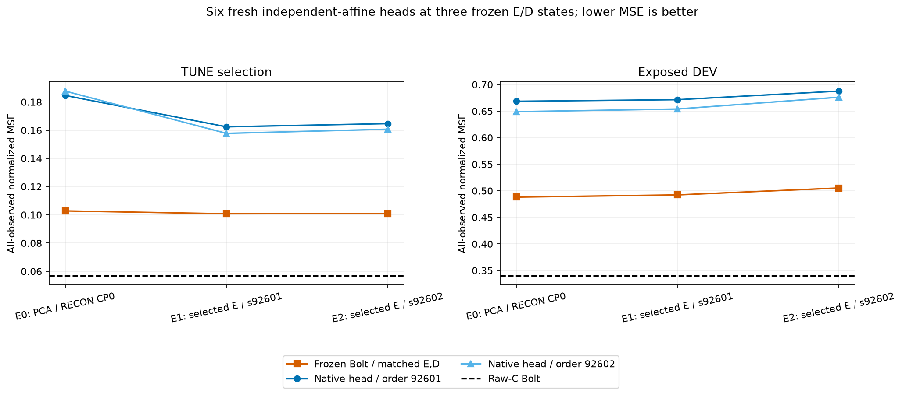

# 작은 K·고정 Bolt 연구: 현재까지의 결과와 남은 문제

**작은 K로 Raw-C Bolt의 정확도와 전체 추론 비용을 함께 유지한다는 목표는 아직 해결하지 못했다.** 표현·디코더·예측기를 나눠 실제 실행했고, 좋아진 중간 지표와 Raw 대비 실패를 함께 남겼다. 이 묶음은 사용자의 명시적 `main` 게시 요청에 따른 기록이다. 새 학습을 실행하거나 기존 실패 기록을 덮어쓴 게시가 아니다.

[최신 완료 보고서: 같은 L7 E/D의 Bolt·native 비교](reports/matched_l7_native_v2/REPORT_KO.md) · [최신 잠재값 보정: 과학 실행·감사 완료, 비용 미실행](reports/fixed_l7_latent_calibration_snapshot_v1/REPORT_KO.md) · [모든 상세 보고서](#reports) · [코드와 재현 조건](CODE_AND_REPRODUCTION_KO.md)

## 먼저 확인된 답

1. **단순히 입력을 잘 복원하면 미래도 잘 예측된다는 보장은 없었다.** 같은 E에서 D의 재구성/예측 목적과 lag0/lag7을 나눈 대조는 TUNE에서 예측 목적 D가 12/12 개선됐지만 기노출 DEV에서는 5/12만 개선됐다. Raw를 이긴 조건은 0/24였다. 이후 실제 F 입력 gradient를 통해 E/D도 학습했으므로 지금의 실패 전체를 “재구성 목적만 학습했기 때문”이라고 설명할 수 없다. [2×2 대조](reports/causal_lag_objective_v1/REPORT_KO.md), [E 갱신 대조](reports/linear_e_adaptation_v2/REPORT_KO.md)

2. **출력 공간의 제약과 실제 미래 좌표 예측의 격차가 모두 남았다.** 같은 D32·알려진 과거 offset·complete-C 출력 행·전체 HK 미래 좌표·등록된 수치 cutoff에 조건부로 진단했다. Robin에서는 특정 고정 D 공간이 Raw 수준을 담지 못하는 구간이 있었고, 다른 공간/구간에서는 여지가 있어도 실제 예측이 Raw보다 나빴다. 미래 정답을 쓰는 E(Y)나 rank-K oracle는 원인 진단이며 배포 성능·과거 예측 가능성의 증명이 아니다. [고정 D 진단](reports/matched_projection_v1/REPORT_KO.md), [미래를 아는 rank-K 진단](reports/oracle_rank_addendum_v2/REPORT_KO.md), [학습 뒤 공간 진단](reports/learned_output_space_v2/REPORT_KO.md)

3. **원 채널을 혼합하지 않는 대조도 문제를 해결하지 못했다.** FIT 관측 과거의 재구성으로 고른 원 채널 subset을 같은 global-D 규칙으로 비교했고 실제 작은 K Bolt 추론도 새로 실행했다. DEV 정규화 MSE는 Robin subset .812394 대 Raw .340402, Beijing subset .866360 대 Raw .589575였다. 이것은 해당 greedy 선택·K·고정 D의 결과이며 모든 원 채널 선택의 불가능성을 뜻하지 않는다. [subset 대조와 수치 실패 복구 기록](reports/raw_subset_comparison_v1/REPORT_KO.md)

4. **같은 E/D에서 현재 단순 native는 더 싸지만 더 부정확했다.** Robin의 세 고정 L7 E/D에 K별 독립 affine 512→48 head를 두 순서 seed로 새로 학습했다. TUNE·DEV 모두 6/6에서 같은 E/D의 Bolt보다 나빴다. 모든 native 계열의 한계나 Bolt의 보편적 필수성을 증명한 결과는 아니다. [정확도·학습 곡선·전체 비용](reports/matched_l7_native_v2/REPORT_KO.md)

5. **가장 최근의 작은 잠재값 보정도 Raw gap을 해결하지 못했다.** 고정 세 E/D에서 scale-only/scale+bias를 나눈 6조건·42 ridge 후보·6 identity를 실제 적합·평가했다. 5/6은 identity를 골랐다. 나머지 하나의 TUNE MSE는 약 .0114% 낮아졌지만 DEV는 약 .0412% 높아졌다. 과학 실행과 저장 결과 독립 감사는 완료했고, 이 보정의 새 전체 비용과 정식 4그림 보고서 생성은 아직 수행하지 않았다. [최신 상태·원수치](reports/fixed_l7_latent_calibration_snapshot_v1/REPORT_KO.md)

검사 PASS는 성능 개선이나 독립 일반화 검증을 뜻하지 않는다. 보호된 TEST를 사용하지 않았고, 개발 구간은 이미 여러 번 노출된 적응적 탐색 자료다. FIT 미래를 정상 학습 target으로 쓰는 것, 실제 미래를 쓰는 oracle 진단, 배포 시점의 입력을 구분했다. 누출 검사의 실제 적용 범위는 각 보고서에 적었다.

## 같은 E/D native 대조의 원수치

아래는 Robin C17/K4, L512/H48, FIT256/TUNE64/기노출 VAL30, 현재 C anchor, lag [0,1,2,4,8,16,32]의 원 관측 위치 채널 macro 정규화 MSE다. E0는 원 PCA E/RECON D이고 E1/E2는 앞선 E-only 학습의 선정 상태다. native 두 seed는 zero-init head의 minibatch 순서 차이다.

```text
고정 E/D / head seed     TUNE native   같은 E/D Bolt   DEV native    같은 E/D Bolt
E0 / 92601              .184653839    .102808327      .668503409    .488093013
E0 / 92602              .187744649    .102808327      .648906082    .488093013
E1 / 92601              .162411046    .100779781      .671559879    .492266798
E1 / 92602              .157760811    .100779781      .653993027    .492266798
E2 / 92601              .164674747    .100926120      .687721473    .505250004
E2 / 92602              .160720123    .100926120      .676164218    .505250004
Raw-C Bolt 참고          .056951091                    .340401887
```



모든 head가 사전 CP0/100/200/400/600 중 CP100을 골랐다. 이후 TUNE 오차는 높았고 clip 빈도는 .776667~.861667이었다. 이것만으로 충분 수렴·학습 부족·과적합 중 하나를 확정하지 않는다. E1/E2는 앞서 Bolt를 통과해 최적화한 이력이 있으므로 모든 예측기의 전체 학습 이력까지 같은 비교도 아니다.

같은 complete-C TUNE의 retained numeric minimum은 E0 .0609840323/E1 .0597340174/E2 .0595795763으로 Raw .0569510909보다 높다. DEV에서는 .3068850413/.3069056211/.3111773358로 Raw .3404018870보다 낮지만 실제 Bolt/native는 모두 Raw보다 나빴다. 이 minimum을 모든 실수·FP32 미래 예측의 보편 하한으로 확대하지 않는다.

같은 물리 TUNE 첫 B의 실제 전체 경로를 재측정했다. 아래는 **batch latency** 중앙값이며 B8의 window당 값은 8로 나눈다.

```text
경로                       B1 batch ms       B8 batch ms
Raw-C Bolt                 12.6679           26.0837
같은 E/D Bolt 3경로         13.0499~13.4508   14.0141~14.6001
같은 E/D native 6경로        1.4092~1.5277     1.8778~2.0273
```


20조건·100표본이며 물리 입력의 causal fill/FIT 정규화부터 실제 CUDA E/F 또는 native/L7 D와 물리 CPU 반환·sync를 포함한다. 캐시 예측 반환으로 F 비용을 대체하지 않았다. 명시적 warm2 외 reference/precheck도 비측정으로 실행했고, 5순환은 10위치의 완전 균형이 아니다. 내부 finite/shape 검사는 timer 안, 외부 meter/hash/save/메모리 수집은 밖이다. 공유 resident 메모리와 같은 첫 B 반복을 독점 메모리·독립 표본으로 세지 않는다. 다른 실행 cohort의 빠른 시간만 골라 합치지 않았다.

## 최신 잠재값 보정의 실제 상태

세 E/D를 고정하고 `u' = u + a_k(u-z_last) + b_k`의 두 family를 비교했다. 미래만 보정하고 알려진 과거 prefix·lag별 원점 기준·현재 C anchor는 유지한다. FIT 관측 채널 macro 가중 FP64 직접 solver와 FIT-only RMS를 썼고, 실제 CUDA FP32 C 예측의 TUNE 자체 관측수 MSE로 선정했다. FP64 선형 surrogate와 실제 FP32 출력의 차이는 별도 측정했다.

```text
현재 완료: 6 fit / 실제 6 SVD / ridge 42 + identity 6
           FIT·TUNE 실제 평가 96 / 선정 DEV 6 / 선정 잠금 6
           독립 과학 감사 PASS: 3,672 score fields, 관련 SOURCE/input/result 226 SHA
아직 미실행: 새 전체 비용 / 정식 4그림 보고서·최종 보고 검산
```

선정은 E2 scale-only의 λ10 하나를 제외하면 identity다. 그 한 조건은 TUNE .100914578701 대 baseline .100926119788, DEV .505458118884 대 baseline .505250003864였다. Raw DEV .340401887028보다 나쁘다. 다른 다섯 조건은 원 baseline과 byte-exact이다. 실제 FIT에서 일부 잔차를 줄일 수 있었다는 것과 TUNE/DEV로 옮겨졌다는 것을 구분한다. identity 중복 경로를 다섯 개의 별도 학습 방법이나 속도 승리로 세지 않는다.

이때 새 F load/forward·E/D gradient 학습·optimizer update·native head weight load는 0이었다. 기존 실제 F 캐시를 재사용한 과학 평가이고, 향후 비용 측정은 실제 F를 새로 실행해야 한다. 과학 실행 완료를 비용·정식 보고까지 완료했다고 바꾸지 않았다. [독립 감사](../projection_followup_v1/audits/FIXED_L7_LATENT_CALIBRATION_AUDIT_v1.json), [사전 계획](../projection_followup_v1/PLAN_FIXED_L7_LATENT_CALIBRATION_KO_v1.md)

<a id="reports"></a>
## 상세 보고서 전체

아래는 이번 후속 연구의 최신 읽기용 사본이다. 각 폴더에서 원 CSV·PNG·SVG와 원 manifest를 함께 볼 수 있다.

1. [PCA/ForeCA와 실제 Bolt·native, 같은 고정 D 진단](reports/matched_projection_v1/REPORT_KO.md)
2. [미래를 아는 global rank-K oracle: 고정 공간과 K 자체를 구분](reports/oracle_rank_addendum_v2/REPORT_KO.md)
3. [D-only pinv(E) 개입과 실제 전체 비용](reports/decoder_metric_intervention_v2/REPORT_KO.md)
4. [FIT 미래 target을 사용한 표현 공간과 matched native](reports/FIT_target_comparison_v1/REPORT_KO.md)
5. [과거 exact-constant output gate와 같은 trick의 Raw 대조](reports/past_constant_gate_v1/REPORT_KO.md)
6. [각 origin의 과거로 적합한 local D와 실제 비용](reports/local_past_decoder_v1/REPORT_KO.md)
7. [local-D shrinkage·새로 맞춘 native·별도 비용 반복](reports/shrinkage_matched_native_v1/REPORT_KO.md)
8. [원 채널 subset 대조: 같은 global-D 규칙](reports/raw_subset_comparison_v1/REPORT_KO.md)
9. [lag0/lag7 × RECON/FORECAST 목적의 2×2 대조](reports/causal_lag_objective_v1/REPORT_KO.md)
10. [동결 F 입력 gradient를 통한 선형 E 갱신 대조](reports/linear_e_adaptation_v2/REPORT_KO.md)
11. [F-input stop-gradient 대조](reports/f_input_gradient_ablation_v1/REPORT_KO.md)
12. [학습 뒤 새 E/D의 실제 출력 공간 진단](reports/learned_output_space_v2/REPORT_KO.md)
13. [RECON D 초기화 민감도](reports/recon_init_sensitivity_v1/REPORT_KO.md)
14. [RECON D를 고정하고 E만 갱신한 대조](reports/fixed_recon_d_e_adaptation_v1/REPORT_KO.md)
15. [같은 L7 E/D에서 새 native와 Bolt, 실제 전체 비용](reports/matched_l7_native_v2/REPORT_KO.md)

스타일을 고치기 전의 완료 보고서도 보존했다: [rank oracle v1](reports/oracle_rank_addendum_v1/REPORT_KO.md), [D metric v1](reports/decoder_metric_intervention_v1/REPORT_KO.md), [Linear E v1](reports/linear_e_adaptation_v1/REPORT_KO.md), [학습 뒤 공간 v1](reports/learned_output_space_v1/REPORT_KO.md). 그림 생성 도중 중단된 [matched native v1의 부분 산출물과 실패 표식](reports/matched_l7_native_v1/FAILED_PRESERVED.json)은 완료 보고서로 세지 않았다. v2는 조건 label과 checkpoint artifact의 이름 충돌만 고쳤다.

이전 SELF/JOINT 정보 진단은 [20261014 게시 묶음](../publication_main_20261014_v1/README_KO.md)에 있다. 그때의 gate 종료를 공통 패턴 압축의 필요조건이나 모든 표현 학습의 실패로 확대하지 않았다. 이후 계속 실행한 결과가 위 후속 보고서들이다. 기존 D2·잔차 보정·joint-Y/Raw-F teacher 증류도 앞서 수행했으므로 이번 잠재값 보정을 첫 예측 목적 학습이나 첫 teacher 시도로 소개하지 않는다.

## 무엇이 남았는가

현재의 E/D·K·선정 손실·학습 예산에서 Raw 정확도 격차는 남는다. 다음 판단에는 출력 공간의 제약과 실제 미래 좌표의 오류, 같은 목적에서의 학습 안정성과 구간 이동을 나눠야 한다. 새 기법을 추가하는 것 자체를 성과로 세지 않는다. 작은 보정의 정식 비용·보고가 미완료인 상태이며 추가 연구나 독립 일반화 검증까지 완료했다고 표시하지 않는다.

데이터 계약은 원 scaler·origin·observed mask를 유지했다. TUNE 선정과 DEV 개방 순서의 저장 lock, 원본 SHA, 실패·부분 성공, 실제 비용 cohort와 자원 receipt를 보고서별로 보존했다. 잠재 입력은 K streams만으로 끝나지 않고 K 과거 buffer와 현재 C anchor를 포함하며, 일부 gate/local-D는 C 과거 통계까지 추가한다. 이를 모두 같은 decoder 정보량이나 strict K-only로 부르지 않는다.

[코드·공개 범위·재현 조건](CODE_AND_REPRODUCTION_KO.md) · [원본 SHA와 링크만 고친 사본 맵](REPORT_COPY_MAP.json) · [당시 현황 v9 원문](../projection_followup_v1/CONTINUATION_STATUS_KO_v9.md)

[현재 자원 snapshot v10](../projection_followup_v1/audits/RESOURCE_SNAPSHOT_20261015_v10.json)은 종료 receipt128개·관찰 당시 RUNNING0, 기록된 process CPU 2,360.3125초와 GPU process meter wall 1,449.067329초를 보존한다. GPU kernel 시간이나 전체 대화 비용의 합계가 아니며 SOURCE·일부 합성·게시 metadata 작업은 이 계측에 포함되지 않는다.

원보고서에 있는 “미게시”, “승인 대기”, “미실행”, 과거 상한 등은 각 문서 작성 당시의 역사 기록이다. 현황 v9의 “잠재값 보정 실제0”도 그 시점의 기록이며, 이 게시 시점에는 위 과학 실행·감사만 추가 완료됐다. 원문을 고쳐 과거 기록을 바꾸지 않았다. NPZ·원자료·모델 가중치·checkpoint는 게시하지 않으며 Git clone만으로 실제 실험 재현이 가능하다고 주장하지 않는다.

[게시 파일 SHA 목록](FILES.json) · [게시 검증 기록](PUBLICATION_CHECKS.json)
