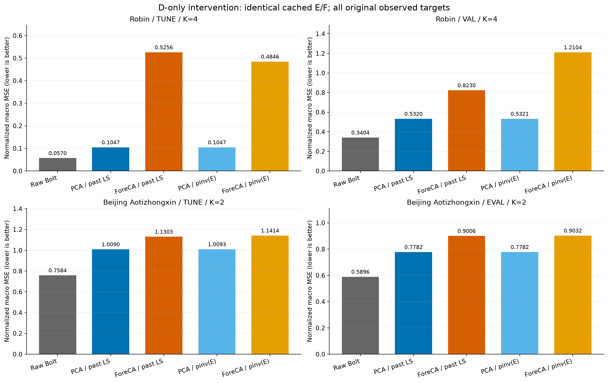
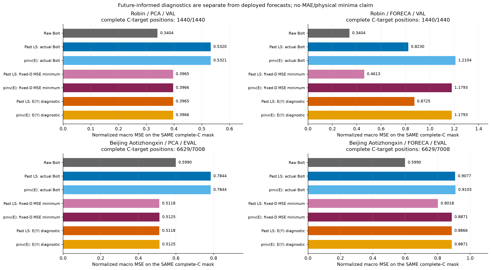
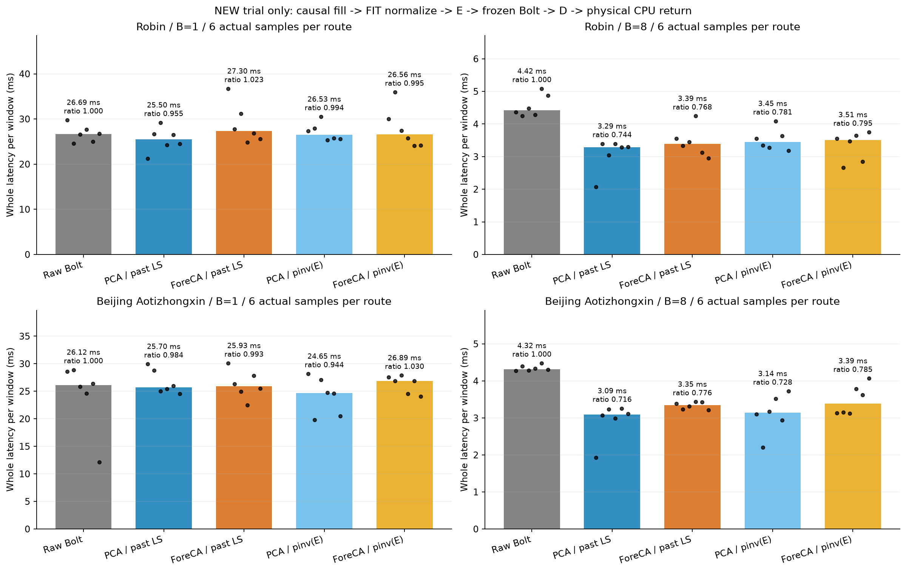

# 고정 인코더·예측기에 디코더만 바꾼 실제 진단과 전체 비용

[확인] `D = pinv(E_FP32)`로 디코더만 바꾸는 단순한 수정은 이번 두 데이터의 작은 K 예측을 해결하지 못했다. PCA는 원 디코더와 점수가 거의 비슷하고, Robin ForeCA는 TUNE에서 좋아졌어도 DEV에서는 악화됐다. 모든 새 비용 조건을 실제로 측정했으며, B8의 속도 이득이 정확도 보존을 충족시키지는 못했다. 이 결론은 지정한 행렬 교체와 노출된 개발 구간에 관한 것이다. 전체 표현학습 방법, 작은 K, 또는 고정 Bolt의 가능성을 부정하는 결론으로 확대할 수 없다.

## 먼저 답해야 할 질문

디코더가 잠재 오차를 C 공간에 전달하는 방식만 고치면 되는지 시험했다. 기존 E와 원래 선택된 Bolt·native head의 잠재 미래·마지막 과거 표현을 그대로 두고, 관측된 FIT 과거에 맞춘 affine least-squares 디코더 `ORIGINAL_PAST_LS`를 배포 E의 FP32 값을 FP64로 해석한 의사역행렬 `ENCODER_PINV`로 교체했다. 의사역행렬 cutoff는 고정 `1e-15`이며 seed, TUNE, DEV의 미래값으로 새 D를 선택하거나 맞추지 않았다. 원 D 재현 48건을 독립적으로 byte-exact 확인했다. cached probe의 96회 CPU 복원은 새 E/F/head forward나 모델 학습 96회가 아니다.

[확인] 이 개입은 D의 출력 공간·크기·오차 metric을 함께 바꾼다. 비직교성만을 고립한 인과실험이라고 말할 수 없다. native head는 원 D에 맞춘 actual-Y 손실로 이미 학습된 head를 고정했으므로, 새 D를 위해 최적화된 native 모델과 Bolt의 경쟁 결과가 아니다. 별도 비용 실행은 저장한 잠재 미래를 그대로 돌려쓰는 proxy 대신 실제 `E → frozen Bolt → D` forward를 수행했다. 비용표의 다섯 방법에는 native가 없다.

## 비교 계약과 실제 실행 범위

Robin은 C=17/K=4, Beijing Aotizhongxin은 C=11/K=2를 유지한다. L=512/H=48, 기존 FIT 256창·TUNE 64창, Robin VAL 30창 및 이미 노출된 Beijing EVAL 146창의 같은 origins·FIT 통계·원 관측 mask를 사용했다. 결측 과거는 창 안에서 과거 방향으로 채우고 초기 결측에는 FIT 평균을 쓴다. 배포 입력에 실제 미래값을 넣지 않았다. protected TEST에 접근하지 않았고, 이 개발 결과는 독립 holdout 일반화 검증이 아니다. 이번 행렬 개입을 본 뒤 K, 손실, checkpoint, 분기나 채택 기준을 바꾸지 않았다.

예측은 NumPy FP32에서 `raw_last + (latent_future - encoded_history_last) @ D`이다. current-C anchor가 있으므로 엄격한 K-only 통신 압축이 아니다. decoder bias는 과거 재구성에서만 쓰이며 innovation에서 제외된다. 새 D는 encoder center를 과거 재구성 bias로 사용하고 별도로 fit하지 않았다. 주지표는 원 관측 target에 대한 채널 균등 정규화 macro MSE이며 MAE도 함께 보고한다. 단위가 다른 채널의 물리 단위 오차 평균은 보조 진단이고, 이 평균을 일률적인 물리적 효용 점수로 읽으면 안 된다.

독립 검산을 통과한 범위는 base cells 12개, D cells 24개, cached CPU forecast 96건, 새 전체 배포 비용 20조건과 시간 표본 120개다. 새 encoder/backbone/head 학습은 0회다. CSV 행 수는 mask·metric·재사용 baseline을 나눈 보고 단위이며 독립 실험 또는 독립 표본 수가 아니다.

## 배포 점수: 원 관측 target 모두 사용

다음은 Raw와 Bolt 연결의 정규화 MSE/MAE 원수치다. full observed mask에서 채널별 표본 수는 다를 수 있다. matched complete-C 진단값과 혼합하지 않는다.

```text
Dataset / Split                 Raw MSE   Raw MAE   PCA old/new MSE      ForeCA old/new MSE
robin/tune   0.056951091 0.097401173 0.104733019/0.104702758 0.525601060/0.484641465
robin/val    0.340401887 0.313192123 0.532048934/0.532063803 0.822981362/1.210370368
beijing_aotizhongxin/tune   0.758435638 0.499495790 1.008971309/1.009348491 1.130309158/1.141447145
beijing_aotizhongxin/eval   0.589575414 0.407916509 0.778238708/0.778177077 0.900557095/0.903214674
```



Robin ForeCA의 TUNE Bolt MSE는 0.525601060에서 0.484641465로 줄고 MAE도 0.521664313에서 0.375734728로 줄었다. 그러나 DEV MSE는 0.822981362에서 1.210370368로 늘었다. 이 불일치를 TUNE 개선만으로 감추거나 새 성공 gate를 만들지 않는다. PCA는 같은 공간의 가까운 디코더 교체라 작은 수치 차이가 있지만 Robin·Beijing 모두 Raw 정확도에 도달하지 않는다. Beijing ForeCA는 DEV MSE가 0.900557095에서 0.903214674로 변해 역시 해결되지 않았다.

native 두 minibatch-order seed도 동일한 잠재 궤적을 새 D로 복원했다. 예를 들어 Robin ForeCA DEV MSE는 원 D에서 0.679014623/0.713484658, pinv(E)에서 1.241763213/1.227917594다. 이 수치는 원 D로 학습한 head에 새 D를 끼워 넣은 결과이며, 새 D로 재학습하면 같은 결과라는 증거는 아니다. 과거 reconstruction의 변화도 별도 CSV에 보존했지만 reconstruction 개선을 미래 예측 개선으로 바꾸어 해석하지 않는다. 이전 POINTWISE/MAIN 경로는 이미 actual-Y 목적을 사용했으므로 전체 실패를 ‘재구성만 학습했기 때문’이라는 하나의 설명으로 정리할 수 없다.

## 실제 미래를 사용하는 진단은 배포 점수와 분리

E(Y)는 알려진 실제 미래를 고정 E로 인코딩해서 D로 복원하는 진단이다. complete-C target 위치에서만 주요 oracle 비교로 사용한다. 일부 미래 채널이 관측되지 않은 위치에서 E에 넣기 위해 0으로 대체한 성분은 알려진 미래 정보가 아니므로 full observed E(Y) 점수를 주요 비교·그림·CSV에서 제외했다. 배포 모델의 선택이나 forward에 E(Y)를 사용하지 않았다. E(Y)의 오차는 임의의 잠재 미래를 허용한 수학적 최솟값이라고 할 수 없다.

고정 D 진단은 같은 complete-C 위치에서 실제 `Y - currentC`를 D의 행공간으로 최소제곱 투영한다. 배포 D32를 실수 FP64 연산으로 해석한 해당 공간의 **정규화 MSE 최솟값**이다. 그 해에서 나온 MAE·물리 단위 MSE는 해당 목적의 최솟값이 아니다. FP32 rounding이나 비선형 decoder, 다른 출력 공간, 무제약 Raw 예측기까지 포함하는 일반 하한도 아니다. 특히 Raw에 고정 D 하한 부등식을 적용하지 않는다.

```text
Dataset / Projection / DEV     Raw complete MSE   old-D minimum   pinv(E)-D minimum
robin/PCA   /val  0.340401887     0.396541619     0.396551217
robin/FORECA/val  0.340401887     0.461340297     1.179326868
beijing_aotizhongxin/PCA   /eval 0.598972295     0.511797660     0.512486320
beijing_aotizhongxin/FORECA/eval 0.598972295     0.801825480     0.887104368
```



[확인] Robin ForeCA의 새 D 고정공간 최솟값 자체가 DEV에서 1.179326868로, 같은 mask의 Raw 0.340401887보다 높다. pinv(E)의 E(Y)가 그 최솟값에 가깝다고 해서 예측이 좋아진 것은 아니다. 원 D의 complete-C 최소값 0.461340297와 비교하면 출력 공간 교체가 유리하지 않았다. Beijing complete-C Raw는 0.598972295이며 full-mask Raw 0.589575414와 다르다. 이 두 수치를 같은 비교에 넣지 않는다. 별도 미래-informed rank-K 진단에서 더 좋은 출력 공간이 알려진 미래에 존재했으므로, 특정 D의 실패를 K 차원의 원천적 불가능성으로 바꿀 수도 없다. 과거만으로 그런 공간과 잠재 미래를 안정적으로 알아낼 수 있는지는 여전히 미확정이다.

## 새 실제 전체 배포 비용

원 D가 나쁘거나 새 D에서 정확도가 개선되지 않았어도 모든 비용 조건을 실행했다. 두 데이터 × B1/B8 × 다섯 Bolt 경로 = 20조건이며, 각 방법 warmup 2회 후 실제 시간 6개를 기록했다. 첫 다섯 회는 회전 순서로 다섯 위치를 균등 배치했고 여섯 번째는 seeded 추가 순서다. 여섯 회 전체를 완전한 balanced 설계라고 말하지 않는다. 각 조건은 같은 첫 B개 개발 origins를 반복하므로 120개의 새 독립 데이터 표본도 아니다.

타이머에는 실제 causal fill·FIT normalize·E·고정 Bolt GPU forward와 전송·D·물리 단위 CPU 출력 및 마지막 synchronization을 포함한다. 디스크·모델·행렬 로딩, D 구성, 참조 출력, warmup, 저장·hash, 타이머 밖 guard와 memory snapshot은 제외한다. stage별 비용을 분해하지 않았으므로 특정 단계가 병목이라고 단정하지 않는다. 같은 새 실행 안에서만 Raw와 비교하고 이전 시행의 절대 latency에 연결해 효과를 주장하지 않는다. memory는 F와 행렬들이 공유된 프로세스의 RSS·VRAM 관측값이다. 각 방법의 독점 메모리, isolated peak 또는 K 압축에 따른 VRAM 절감량은 아니다.

```text
Dataset / B / Route                          median ms/window    ratio of medians    median paired ratio
robin/B1/RAW_BOLT                    26.6940        1.000000            1.000000
robin/B1/PCA_PAST_LS_BOLT            25.5044        0.955438            0.988084
robin/B1/FORECA_PAST_LS_BOLT         27.2978        1.022617            1.100907
robin/B1/PCA_ENCODER_PINV_BOLT       26.5307        0.993884            0.992300
robin/B1/FORECA_ENCODER_PINV_BOLT    26.5577        0.994894            0.985003
robin/B8/RAW_BOLT                     4.4188        1.000000            1.000000
robin/B8/PCA_PAST_LS_BOLT             3.2886        0.744222            0.678782
robin/B8/FORECA_PAST_LS_BOLT          3.3917        0.767576            0.777872
robin/B8/PCA_ENCODER_PINV_BOLT        3.4493        0.780601            0.759511
robin/B8/FORECA_ENCODER_PINV_BOLT     3.5126        0.794914            0.772300
beijing_aotizhongxin/B1/RAW_BOLT                    26.1152        1.000000            1.000000
beijing_aotizhongxin/B1/PCA_PAST_LS_BOLT            25.7046        0.984279            1.015598
beijing_aotizhongxin/B1/FORECA_PAST_LS_BOLT         25.9293        0.992883            1.009240
beijing_aotizhongxin/B1/PCA_ENCODER_PINV_BOLT       24.6500        0.943895            0.995797
beijing_aotizhongxin/B1/FORECA_ENCODER_PINV_BOLT    26.8934        1.029799            1.009049
beijing_aotizhongxin/B8/RAW_BOLT                     4.3176        1.000000            1.000000
beijing_aotizhongxin/B8/PCA_PAST_LS_BOLT             3.0894        0.715531            0.710778
beijing_aotizhongxin/B8/FORECA_PAST_LS_BOLT          3.3509        0.776107            0.770004
beijing_aotizhongxin/B8/PCA_ENCODER_PINV_BOLT        3.1413        0.727544            0.734568
beijing_aotizhongxin/B8/FORECA_ENCODER_PINV_BOLT     3.3900        0.785142            0.771232
```



사전 기준은 B8 **중앙 latency의 비율** ≤0.90 및 같은 TUNE MSE·MAE 각각 Raw의 1.01배 이하를 함께 요구한다. paired 비율의 중앙값은 별도 기술통계이고 채택 gate에 대신 쓰지 않는다. 8개 후보 중 속도 조건 통과는 8개, 세 조건 동시 통과는 0개다. 빠른 경로가 있어도 정확도 보존에는 실패했다. 이 gate 재검산은 모델 선택을 새로 한 것이 아니며, 이후 결과를 보고 임계값을 조정하지 않았다. 여섯 반복과 짧은 실행만으로 deployment 환경 전체의 속도 일반화나 유의성 검증을 주장하지 않는다.

## 해결된 부분과 다음에 남은 판단

[확인] 원 디코더 replay가 실제 원 예측과 같다는 점, label-free pinv(E) 개입을 실제 inference에 연결할 수 있다는 점, 새 전체 배포 forward와 물리 단위 출력의 parity, 같은 mask의 숫자를 구분한 보고를 해결했다. 따라서 구현이 전혀 되지 않아 방법 가능성을 확인하지 못한 상태는 지났다. 이번 단순 D 교체는 Raw 수준 정확도를 보존하면서 비용을 낮추는 해결책으로 채택하지 않는다.

[추정·다음 판단] E가 보존하는 정보와 D의 출력 방향, 그 방향의 미래 변화가 과거로부터 예측 가능한지를 함께 검증하는 비교가 더 직접적이다. 단순 pinv 교체만으로 충분한지에 대한 답은 부정적이지만, 고정된 임의 출력 공간에서 실패했다고 해서 예측 목적 공간 학습, D와 latent predictor의 공동 적합, 과거 조건부 동적 공간까지 실패했다고 볼 근거는 없다. 재학습 비교가 필요하다면 같은 K·raw anchor·FIT/TUNE 분리·actual-Y 정규화 MSE·고정 Bolt·비용 계약을 유지하고 독립 데이터 노출을 구분해야 한다. 이것들은 이번에 완료한 실험으로 쓰지 않는다. 대조학습·학습 그래프·ExoTimer 방식도 이번 D-only 개입으로 실행하거나 입증하지 않았다.

## 원수치·코드·검산 연결

- [이전 matched projection 보고서](../matched_projection_v1/REPORT_KO.md)
- [미래-informed rank-K 별도 진단](../oracle_rank_addendum_v2/REPORT_KO.md)
- [decoder producer](../../../projection_followup_v1/runs/decoder_metric_probe_v1/RESULT.json) — SHA256 `40fd36904ee3f5c31f16dd8a74126d25216cda2e4e81804659846c69e1f50b62`
- [decoder independent audit](../../../projection_followup_v1/audits/DECODER_METRIC_PROBE_AUDIT_v1.json) — SHA256 `ae258aeebbc5b90da3678b62b3c041550f49c2ede7afce67c47f44056c93e688`
- [whole cost producer](../../../projection_followup_v1/runs/decoder_metric_cost_v1/RESULT.json) — SHA256 `54ed1942b3ba86035528f25ff839e4b72748a5f5988ed07c83ccd7014a6873e8`
- [whole cost independent audit](../../../projection_followup_v1/audits/DECODER_METRIC_COST_AUDIT_v1.json) — SHA256 `271a77ed342b2dea454232b42a9a9f56a4fe1cda018d110e3329d9dcbd2fb3c4`
- [report generator](../../../projection_followup_v1/make_decoder_metric_report_v2.py) — SHA256 `13bf74228bc03ce0bd0f79d0fd231d7a923b56952005cd07286ff5b0f488ebf7`
- [whole cost runner](../../../projection_followup_v1/run_decoder_metric_cost_v1.py) — SHA256 `f3bf29eabc7aab5f86d3bcccde39175e3ef133095edb57cec4470eea950967e7`
- [whole timing helper](../../../projection_followup_v1/whole_decoder_metric_cost_v1.py) — SHA256 `26ae210e71971533d8053f2725bfa68e88c3732b834d225c9d66752ab0917fa4`
- [DEPLOYMENT_AND_ORACLE_SCORES: 192 rows](tables/DEPLOYMENT_AND_ORACLE_SCORES.csv)
- [FIXED_D_DIAGNOSTIC: 24 rows](tables/FIXED_D_DIAGNOSTIC.csv)
- [GEOMETRY: 24 rows](tables/GEOMETRY.csv)
- [PAST_RECONSTRUCTION: 24 rows](tables/PAST_RECONSTRUCTION.csv)
- [SOURCE_LINEAGE: 12 rows](tables/SOURCE_LINEAGE.csv)
- [WHOLE_COST: 20 rows](tables/WHOLE_COST.csv)
- [WHOLE_COST_SAMPLES: 120 rows](tables/WHOLE_COST_SAMPLES.csv)
- [REGISTERED_ADOPTION: 8 rows](tables/REGISTERED_ADOPTION.csv)

원 JSON·NPZ·모델·과거 보고서는 덮어쓰지 않았다. 이 보고서 생성기는 JSON metadata를 읽어 표·그림을 만들 뿐 학습·F forward·NPZ 또는 checkpoint 로딩을 수행하지 않는다. 완료는 위에서 지정한 실제 개입·비용·검산 범위이고, 전체 연구 목표 달성 또는 독립 일반화 검증의 완료를 의미하지 않는다.
