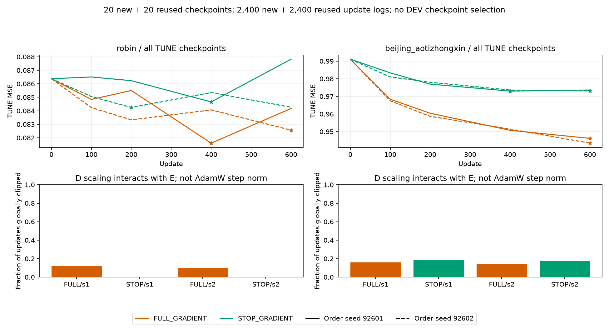
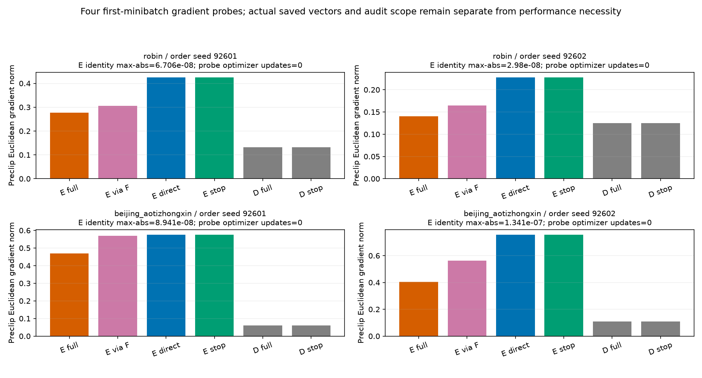
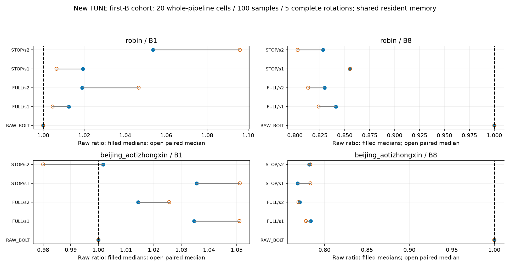

# F 입력 gradient를 끊은 L0 대조 결과

**같은 초기값·minibatch 순서에서 stop-gradient가 기존 full-gradient보다 정규화 MSE가 큰 비교는 TUNE 4/4, 기노출 DEV 4/4다. 두 방식의 8조건 중 Raw보다 DEV MSE가 작은 조건은 0/8이다.** 이 결과는 현재 L0·선형 E/D·600 update의 최적화 대조이며 연구 전체가 해결됐다는 뜻이 아니다.

검증한 질문은 **F 입력으로 돌아가는 gradient가 이 구성의 E 적응에 도움을 주는가**다. F 출력 tensor에만 detach를 적용하고, E가 만든 과거 기준값의 직접 경로와 D 학습을 유지했다. F 예측값은 제거하지 않았다. 매번 갱신된 E의 과거를 실제 frozen Bolt에 넣어 미래를 새로 계산했으며 캐시나 실제 미래 Y로 대체하지 않았다. F 입력 gradient·F 예측값·Bolt/TSFM 자체의 필요성은 서로 다른 질문이다. 이번 결과만으로 native·대조학습·그래프 또는 F 예측값의 필요성을 증명하지 않는다.

Robin C17/K4와 Beijing C11/K2, L512/H48, FIT256/TUNE64·기노출 VAL30/EVAL146, 초기 PCA/FORECAST-LS E/D·고정 center·current-C anchor·관측 mask·scaler를 유지했다. 정보 인터페이스는 K streams+K past buffer+current-C anchor이므로 strict K-only 압축이 아니다. 새 조건은 L0의 stop-gradient 4 fit뿐이다. full-gradient 4조건과 E 고정·CP0/LS·Raw는 이미 검산한 이전 결과를 재사용하며 새로 학습했다고 세지 않는다. seed92601/92602는 동일 초기값의 minibatch 순서만 바꾸므로 독립 초기화나 독립 표본이 아니다.

새 학습은 4×600=2,400 update, 20 CP이며 비교용 이전 full-gradient의 2,400 update·20 CP 로그를 별도로 표시한다. 네 실제 probe는 optimizer update 0회다. 같은 seed의 600×4 배치·AdamW.001/WD0/clip1·고정 전체 FIT 관측수 가중 macro MSE·CP0/100/200/400/600을 유지했다. 전체 TUNE MSE 최소와 이른 tie로 CP를 고르고 4개 성공/실패 잠금과 registry를 봉인한 뒤 DEV를 추론했다. 같은 update budget이라도 선정 CP는 다를 수 있는 학습 procedure ablation이며 모든 선정 예측을 CP600끼리의 비교로 해석하지 않는다. FIT 미래 Y는 손실 target으로만 쓰고 배포 forward는 과거만 받는다.

```text
dataset seed   CP_full CP_stop TUNE_full    TUNE_stop    DEV_full     DEV_stop
Robin   92601     400     400 0.081605417 0.084656466 0.585106428 0.590139326
Robin   92602     600     200 0.082566925 0.084247868 0.582798885 0.588827988
Beijing 92601     600     400 0.946152209 0.973002851 0.654038940 0.690746663
Beijing 92602     600     600 0.943447728 0.973074997 0.650313815 0.693139920
```

표는 all-observed channel-macro 정규화 MSE다. complete-C/물리 단위 점수·전체 채널 원수치는 CSV에 따로 보존했다.


[SVG](figures/01_matched_accuracy.svg)

**gradient와 최적화의 범위.** 초기 canonical32의 Z/F/lag 특징/예측은 full·stop·이전 CP0와 byte 비교했다. seed별 첫 FIT minibatch의 clipping 전 D gradient 동일성과 `E_stop≈E_full−E_via_F`를 등록 공차 atol1e−5/rtol2e−6으로 검사했고 실제 벡터를 보존했다. 독립 감사는 저장된 F-input VJP 이후의 chain-rule를 NumPy로 검산하며 실제 F/VJP/backward/optimizer를 재실행한 검사는 아니다. 구체적인 scope는 감사 JSON 그대로 읽는다. 초기 D gradient가 같아도 global clipping과 이후 E trajectory는 D 계수 변화도 바꾸므로 F gradient의 단독 인과효과나 순수한 E 방향만 분리한 대조가 아니다. scalar norm에서 재구성한 clip 계수와 CP 계수 변화만 기록했으며 실제 per-step AdamW parameter update norm을 측정한 것은 아니다.


[SVG](figures/02_checkpoints_and_clipping.svg)


[SVG](figures/03_gradient_probes.svg)

**비용은 새 실제 배포 cohort다.** Raw+full 두 seed+stop 두 seed의 5경로를 첫 TUNE B1/B8 origins에서 warmup2·5완전순환으로 측정했다. 총20조건·100표본이며 이전9경로 시간이나 빠른 시행을 새 분모로 재사용하지 않았다. physical causal fill/FIT 정규화→GPU E/실제 frozen F/lag D→물리 단위 CPU 반환·sync를 포함하고 model/state setup·hash·학습·warmup·저장·guard/memory snapshot은 타이머 밖이다. F detach는 학습 backward 개입이므로 배포 inference가 저절로 빨라진다고 해석하지 않는다. 실제 두 통계는 아래와 같고 B1/B8 전체 표본·timestamp는 CSV에 있다.

```text
dataset route                      B8_ms/window ratio_medians median_paired
Robin   RAW_BOLT                     4.317550 1.000000 1.000000
Robin   FULL_s92601                  3.631263 0.841047 0.823864
Robin   FULL_s92602                  3.582550 0.829765 0.813318
Robin   STOP_s92601                  3.691362 0.854967 0.855390
Robin   STOP_s92602                  3.575938 0.828233 0.802734
Beijing RAW_BOLT                     4.517012 1.000000 1.000000
Beijing FULL_s92601                  3.540750 0.783870 0.778131
Beijing FULL_s92602                  3.481737 0.770805 0.769353
Beijing STOP_s92601                  3.470800 0.768384 0.783382
Beijing STOP_s92602                  3.532563 0.782057 0.783193
```


[SVG](figures/04_whole_pipeline_cost.svg)

ratio-of-medians와 반복별 paired ratio 중앙값을 분리했다. 같은 첫 origins 반복100개는 독립 데이터100개가 아니다. 모든 선택 E/D와 F가 resident인 공유 RSS/VRAM이며 방법별 독점 메모리나 장비 독점은 주장하지 않는다. 새 학습과 별도 비용의 자원은 RESOURCES에 기록했고 이전16fit 전체 자원을 재사용4조건에 임의 배분하지 않았다. 이전16fit과 새4fit process의 모집단·고정 overhead가 다르므로 두 wall 시간을 직접 나눠 학습 speedup이라고 주장하지 않는다.

**남는 판단.** stop-gradient가 악화되면 현재 global clipping·AdamW·E/D 상호작용을 포함한 최적화에서 F 경로가 도움이 됐다는 조건부 근거다. 비슷하거나 나아지면 이 구성에서는 해당 backward 없이도 적응 이득이 유지될 가능성이라는 범위다. 어느 경우도 F 미래 예측값을 없애도 된다는 결론은 아니다. 이미 노출된 두 자료와 L0만의 적응적 탐색이며 독립 일반화·모든 lag·충분한 수렴·다른 표현의 한계를 확정하지 않는다. 후속 학습 연장은 이번에 수행하지 않았다. 실행/검산 성공을 Raw 개선이나 연구 해결로 바꾸어 말하지 않는다.

원수치·실패 상태·재개 근거:

- [SCORES.csv](tables/SCORES.csv): 180행
- [PAIRED.csv](tables/PAIRED.csv): 48행
- [CHECKPOINTS.csv](tables/CHECKPOINTS.csv): 40행
- [UPDATES.csv](tables/UPDATES.csv): 4800행
- [CLIP_SUMMARY.csv](tables/CLIP_SUMMARY.csv): 8행
- [PROBES.csv](tables/PROBES.csv): 4행
- [SELECTION.csv](tables/SELECTION.csv): 8행
- [WHOLE_COST.csv](tables/WHOLE_COST.csv): 20행
- [WHOLE_COST_SAMPLES.csv](tables/WHOLE_COST_SAMPLES.csv): 100행
- [RESOURCES.csv](tables/RESOURCES.csv): 2행
- [PROVENANCE.csv](tables/PROVENANCE.csv): 4행

- [train](../../../projection_followup_v1/runs/f_input_gradient_ablation_v1/RESULT.json): `e27989fb23716be8bbf507442d44033884b28522d641a010d18b426a0eb6d10a`
- [audit](../../../projection_followup_v1/audits/F_INPUT_GRADIENT_ABLATION_AUDIT_v1.json): `64f19658ac8bc8cee1d6fa3713113a7146ba282ebb8ad2b9eb49498d91e6418f`
- [cost](../../../projection_followup_v1/runs/f_input_gradient_cost_v1/RESULT.json): `354cbeb47e298c1f313c08c52a61abeb19020396dfa1980e4c12b41647e2c9de`
- [cost_audit](../../../projection_followup_v1/audits/F_INPUT_GRADIENT_COST_AUDIT_v1.json): `0a70e0a1be13044846bca8bbb1414794857ee7e6eb6f76f43d679c4070f835dc`
- [audit_source](../../../projection_followup_v1/audit_f_input_gradient_ablation_v1.py): `512629c4bc02e5dd08d05cb1cad64da5d5036e13ef8b457faf98a2a619d0c232`
- [cost_audit_source](../../../projection_followup_v1/audit_f_input_gradient_cost_v1.py): `9aaff46507a0e9f35d77f5a44a28d91ae0826d2bd0822a28d341e548220a0db4`
- [full_gradient_parent](../../../projection_followup_v1/runs/linear_e_train_v1/RESULT.json): `3f0cbd9176f2e7882778452e537564aab7445e1b88c1534fd48b1bce7ef639a4`
- [full_gradient_parent_audit](../../../projection_followup_v1/audits/LINEAR_E_ADAPTATION_AUDIT_v1.json): `9796b4ed53f74186bc2513db56fe321c2d450cdd9bffbb7c5f341766e73ee36d`
- [controller_source](../../../projection_followup_v1/run_f_input_gradient_ablation_v1.py): `0b13a1a6d2d2ac73af74a1e9bcc1383a1404b12016fc42a3cea0dbfdaf1a1ed5`
- [plan](../../../projection_followup_v1/PLAN_F_INPUT_GRADIENT_ABLATION_KO_v1.md): `375ddfaae4e538035c4c3e775e7523dc342e702159b071943a2e8f85be21d8ba`
- [parent_report](../linear_e_adaptation_v2/REPORT_KO.md): `eff21bf19811b2f5a09945494aeca5817d22a2dd4f6d7da8b406a46a8f467230`
- [parent_report_manifest](../linear_e_adaptation_v2/MANIFEST.json): `67b73f080dedb654b26bb49c14e445ab7914af6d4900b504a2bf45aa0654a488`
- [parent_report_audit](../../../projection_followup_v1/audits/LINEAR_E_REPORT_AUDIT_v1.json): `755574afa0e1e1a85f4e29de6453da18080f15fbdc4589a4b248bb61ded6ff05`
- [selection_registry](../../../projection_followup_v1/runs/f_input_gradient_ablation_v1/SELECTION_REGISTRY.json): `cd1d9d5db618a5496d602c447eeeb7b2e0b0a5b0c4030a7c40df04c7fc66fee1`
- [cost_plan](../../../projection_followup_v1/PLAN_F_INPUT_GRADIENT_ABLATION_KO_v1.md): `375ddfaae4e538035c4c3e775e7523dc342e702159b071943a2e8f85be21d8ba`
- [report_utility](../../../projection_followup_v1/make_linear_e_adaptation_report_v2.py): `32e2460ea4724144067f264ab1ceb0332cd04c5fce2296838024c119c9572466`
- [report_source](../../../projection_followup_v1/make_f_input_gradient_report_v1.py): `db79167b70b69db0b76e5c63e8cf679cb2be91f84cb9577f24cf3c22263e0cbb`

- [robin/FULL_GRADIENT/s92601 원 곡선](../../../projection_followup_v1/runs/linear_e_train_v1/robin_L0_E_LEARN_s92601_UPDATES.jsonl)
- [robin/STOP_GRADIENT/s92601 원 곡선](../../../projection_followup_v1/runs/f_input_gradient_ablation_v1/robin_L0_STOP_s92601_UPDATES.jsonl)
- [robin/FULL_GRADIENT/s92602 원 곡선](../../../projection_followup_v1/runs/linear_e_train_v1/robin_L0_E_LEARN_s92602_UPDATES.jsonl)
- [robin/STOP_GRADIENT/s92602 원 곡선](../../../projection_followup_v1/runs/f_input_gradient_ablation_v1/robin_L0_STOP_s92602_UPDATES.jsonl)
- [beijing_aotizhongxin/FULL_GRADIENT/s92601 원 곡선](../../../projection_followup_v1/runs/linear_e_train_v1/beijing_aotizhongxin_L0_E_LEARN_s92601_UPDATES.jsonl)
- [beijing_aotizhongxin/STOP_GRADIENT/s92601 원 곡선](../../../projection_followup_v1/runs/f_input_gradient_ablation_v1/beijing_aotizhongxin_L0_STOP_s92601_UPDATES.jsonl)
- [beijing_aotizhongxin/FULL_GRADIENT/s92602 원 곡선](../../../projection_followup_v1/runs/linear_e_train_v1/beijing_aotizhongxin_L0_E_LEARN_s92602_UPDATES.jsonl)
- [beijing_aotizhongxin/STOP_GRADIENT/s92602 원 곡선](../../../projection_followup_v1/runs/f_input_gradient_ablation_v1/beijing_aotizhongxin_L0_STOP_s92602_UPDATES.jsonl)

생성기는 JSON·JSONL만 읽고 NPZ/model·학습·F·타이머를 실행하지 않았다. 기존 결과와 실패 기록을 덮지 않으며 이 보고서 생성이 Git push·논문/PPT 완료를 뜻하지 않는다.
