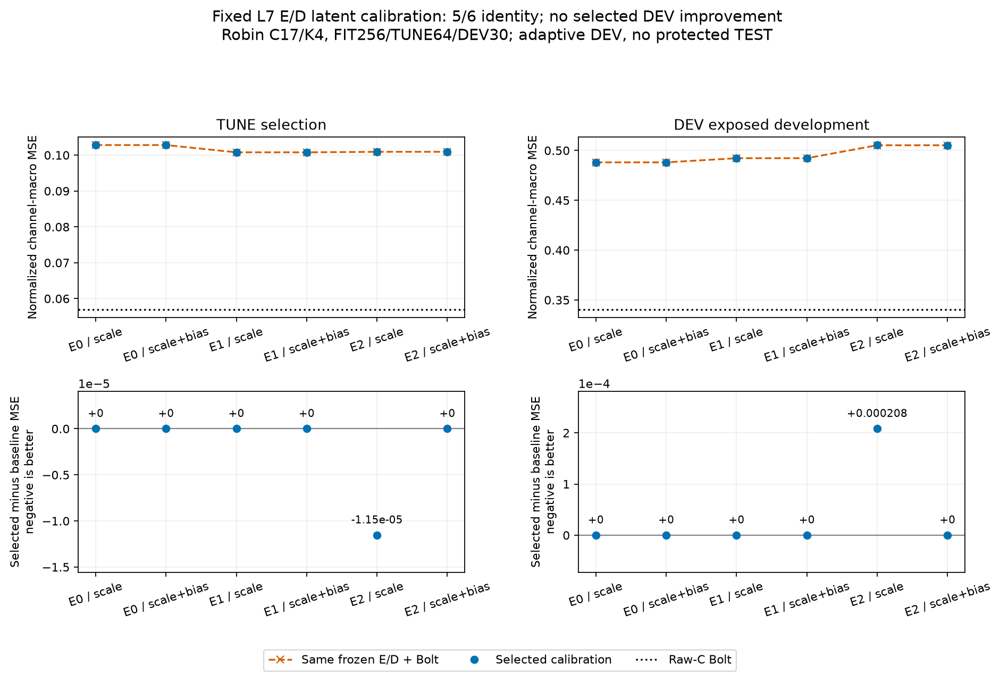

# 고정 L7 잠재값 보정: 게시 시점 결과

[확인] **6조건 중5개는 보정하지 않는 identity를 선택했고, 새 DEV 개선은0/6이다.** 같은 E/D에서 전역 scale4계수 또는 scale+bias8계수의 작은 보정은 Raw-C Bolt와의 정확도 차이를 해결하지 못했다. 이 결론은 현재 보정식·고정 E/D·개발 구간에 한정된다.

이 문서는 이미 실행·독립 검산한 JSON의 **중간 게시 요약**이다. 예정된 전체 비용과 통합 보고서의 완료를 의미하지 않는다. [6선정 조건 전체 원수치](SELECTED.csv) · [48후보·FIT/TUNE·FP64/FP32 계수](ALL_CANDIDATES.csv)

```text
고정 E/D 상태         scale TUNE / DEV          scale+bias TUNE / DEV
E0 RECON CP0          .102808327 / .488093013    .102808327 / .488093013
E1 E-only 92601       .100779781 / .492266798    .100779781 / .492266798
E2 E-only 92602       .100914579 / .505458119    .100926120 / .505250004
Raw-C Bolt 참고       .056951091 / .340401887
```

E2 scale-only만 λ10을 골랐다. 원 TUNE .10092611978772857→.10091457870111374로 약.0114% 낮아졌지만 DEV .5052500038642814→.5054581188842874로 약.0412% 높아졌다. 나머지는 원래 frozen Bolt 출력을 그대로 선택했다. FIT에서 오차를 줄이는 후보는6/6에 존재했다. 선정 TUNE 이득은1/6에서 약.0114%뿐이었고 DEV 개선은0/6이었다. 직접 회귀로 푼 작은 선형 보정이라 단순히 optimizer 업데이트 부족만으로 설명하기는 어렵다. 모든 표현·비선형 보정의 한계로 확대하지 않는다.



## 비교 조건과 수학

Robin C17/K4, L512/H48, FIT256/TUNE64/이미 노출된 DEV30, 원 scaler·origin·관측 mask·current-C anchor·lag0/1/2/4/8/16/32를 유지했다. 원 PCA E/RECON D인 E0와 앞선 E-only 선정 E1/E2를 각각 고정했다. 동일한 cached actual Bolt 미래 u에 `u' = u + a_k(u-z_last) + b_k`를 적용했다. 새 F 실행·E/D 학습·optimizer·큰 백본 학습은0이다.

FIT의 관측 채널 macro 가중치와 FIT-only RMS를 사용해 직접 FP64 weighted-design SVD를 풀었다. λ는0/1e-6/1e-4/.01/.1/1/10이고 identity를 별도 비교했다. 실제 FP32 출력의 TUNE MSE로 골랐으며 정확한 동률은 identity 우선, 이후 큰 λ 우선이다. 6조건 선택을 모두 잠근 뒤 DEV를 평가했다. E1/E2의 표현은 이전 FIT 미래 감독 이력을 가진다. K streams+K 과거 buffer+현재 C anchor이므로 strict K-only가 아니다.

L7 복원은 lag별 `z_past[-1-lag]` 기준과 known-past prefix를 유지한다. 모든 lag의 기준을 현재 latent 하나로 바꾸지 않았다. 실수 대수와 FP32 계산은 다르며, identity만 별도 무연산 byte-exact 경로다. 후보 FIT/TUNE의 FP32 실제값과 선형 FP64 surrogate 최대 차이는1.846326501575568e-6이다. surrogate 최적해를 실제 FP32 최적성이나 배포 parity로 쓰지 않았다.

## 실행·검산·미완료

- 완료:6fit/6SVD,42ridge+6identity, FIT/TUNE96평가, 선정 DEV6평가,6잠금, 기존 actual F context9개 재사용, 현재 D baseline byte 재복원9개.
- 독립 감사 PASS: 직접 lag 설계·가중치·RMS·λ0 least squares/양λ augmented least squares, 계수 cast/hash, FP32 q/lag 출력,3672score fields,6선정 잠금,226관련 hash를 검산했다. F·optimizer·timer를 감사자가 다시 실행한 것은 아니다.
- 미실행: 이 보정 경로의 실제 전체 배포 비용, 그 비용의 독립 검산, 계획한 전체 통합 보고서·보고 검산. 준비된 SOURCE/합성 또는 미실행 fixture를 실제 결과로 세지 않았다.
- 과학 실행 CPU22.59375초/GPU process meterwall22.5436956초. 독립 감사 CPU7.234375초/wall7.2635797초. GPU 수치는 CUDA kernel 시간이 아니다. 게시용 JSON 읽기·그림 생성은 별도 비계측 metadata 작업이다.

[실제 결과 JSON](../../../projection_followup_v1/runs/fixed_l7_latent_calibration_v1/RESULT.json) · [독립 감사 PASS](../../../projection_followup_v1/audits/FIXED_L7_LATENT_CALIBRATION_AUDIT_v1.json) · [실행 코드](../../../projection_followup_v1/run_fixed_l7_latent_calibration_v1.py) · [사전 계획](../../../projection_followup_v1/PLAN_FIXED_L7_LATENT_CALIBRATION_KO_v1.md) · [이 요약 생성 코드](../../make_calibration_snapshot.py) · [게시 색인](../../README_KO.md)

DEV는 반복 노출된 탐색 구간이고 보호 TEST 접근은0이다. 독립 저장 산술 검산 PASS를 독립 일반화·성능 개선·문제 해결로 바꾸지 않는다. 다음에는 같은 조건의 실제 비용을 측정하고, 기존 E/D 공간 제약과 F 미래 예측 격차를 함께 검토해야 한다.
