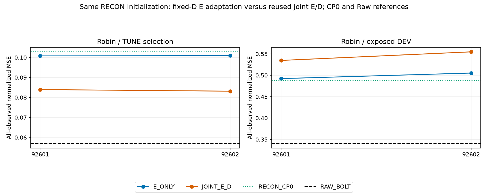
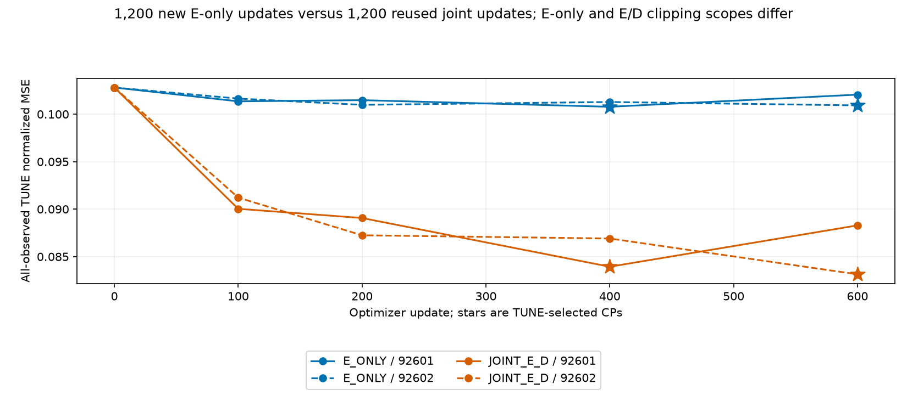
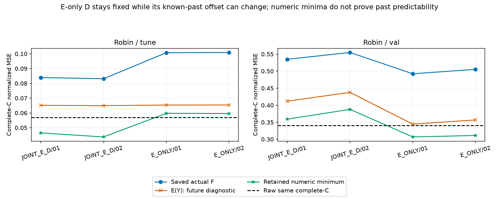

# 같은 RECON D를 고정한 E 적응과 E/D 공동 적응

[확인] D를 고정한 E_ONLY는 기노출 DEV에서 재사용 JOINT_E_D보다 2/2 조건이 좋았지만 TUNE는 2/2 조건에서 나빴다. DEV는 학습 전 RECON CP0보다 2/2, Raw보다 2/2 조건이 나빴다. D 고정이 현재 절차의 DEV 악화를 줄였더라도 해결이나 독립 일반화 성공으로 보지 않는다.

All-observed 정규화 MSE 기준 RECON CP0 TUNE 0.1028083258, DEV 0.4880930144; Raw TUNE 0.0569510909, DEV 0.3404018870.

[확인] 같은 complete-C에서 새 E_ONLY minimum은 TUNE 2/2 조건에서 Raw보다 높고, DEV 2/2 조건에서 Raw보다 낮았다. D가 같아도 E가 만든 known-past offset은 달라진다. 낮은 DEV numeric minimum은 실제 F 출력의 개선이나 과거 예측 가능성의 증명이 아니며 실제 점수·E(Y)와 나눠 봐야 한다.

- seed 92601: 새 E_ONLY CP400, TUNE 0.1007797811, DEV 0.4922667978; 재사용 JOINT_E_D CP400, TUNE 0.0839358966, DEV 0.5347583753.
- seed 92602: 새 E_ONLY CP600, TUNE 0.1009261198, DEV 0.5052500039; 재사용 JOINT_E_D CP600, TUNE 0.0831365911, DEV 0.5548254075.

**같은 입력과 다른 학습 범위.** Robin C17/K4, L512/H48, FIT256/TUNE64/노출 VAL30, 원 scaler·origin·mask·현재 C anchor와 lag [0,1,2,4,8,16,32]를 유지했다. 새 모델은 같은 RECON 초기 E/D/center와 원 JOINT CP0 상태·4개 forward component를 byte-exact로 대조했고 CP0 probe optimizer update는0이다. 기존 FIT 과거 재구성 D32와 center를 고정하고 E만 FIT 미래 actual-Y 예측 손실로 학습했다. E와 D의 감독 이력을 나눠 기록한다. F 파라미터는 동결하되 실제 F 입력 gradient는 유지했다.

새 2fit 1,200 update·10CP와 기존 같은 RECON 초기 JOINT_E_D 2fit 1,200 update·10CP 재사용이다. 같은 seed별600×4 minibatch 순서·고정 FIT 관측수 가중 macro MSE·AdamW lr.001/WD0/clip1·CP0/100/200/400/600·전체 TUNE 최소와 이른 tie를 유지했다. 두 성공/실패 lock·registry를 봉인한 뒤 DEV를 추론했다. clipping은 새 E_ONLY에서 E만, JOINT_E_D에서 E와 D를 함께 제한하므로 E의 유효 update scale도 달라질 수 있다. 같은 계산량이나 D 변화의 순수 단일 인과효과로 부르지 않는다. 실제 per-step AdamW update norm은 미측정이다.

**D 고정 검증의 범위.** 새 각600 optimizer-step 뒤 requires_grad/grad=None flag를 검사하고 로그 D gradient norm=0 및 E_ONLY clipping 범위를 보존했다. 저장된 각5CP와 선정 복원 시점에서 D·center bytes가 초기값과 같음을 검사했다. 이것이 감사자가 실제 optimizer나 매 update bytes를 독립 재생했다는 뜻은 아니다. CP와 최종 bytes 검산, producer의 per-step flag 기록, 저장 score·E/lag/D 산술 검산을 구분한다.

**선정된 공간.** 새 E-only TUNE/DEV4cell은 학습 감사 중 새 계산이고 JOINT4cell은 이미 PASS한 RECON 감사의 계산 재사용이다. 같은 complete-C 마스크에서 actual/E(Y)/FLAT와 minimum을 보존한다. E-only D와 시간축 공동 행렬 A는 원 RECON 값으로 고정됐지만 학습된 E가 만든 known-past offset은 달라질 수 있다. JOINT 선정 D는 별도 상태이므로 그 A와 같다고 주장하지 않는다. 두 불변 SVD/LS 수학 경로 교차이며 세 번째 외부 재현은 아니다.

- E_ONLY / 92601 / tune: actual 0.1007797811, E(Y) 0.0653314024, minimum 0.0597340174, Raw 0.0569510909; complete 3072/3072.
- E_ONLY / 92601 / val: actual 0.4922667978, E(Y) 0.3444583145, minimum 0.3069056211, Raw 0.3404018870; complete 1440/1440.
- JOINT_E_D / 92601 / tune: actual 0.0839358966, E(Y) 0.0651372950, minimum 0.0464636790, Raw 0.0569510909; complete 3072/3072.
- JOINT_E_D / 92601 / val: actual 0.5347583753, E(Y) 0.4118414421, minimum 0.3590566709, Raw 0.3404018870; complete 1440/1440.
- E_ONLY / 92602 / tune: actual 0.1009261198, E(Y) 0.0653594391, minimum 0.0595795763, Raw 0.0569510909; complete 3072/3072.
- E_ONLY / 92602 / val: actual 0.5052500039, E(Y) 0.3568081284, minimum 0.3111773358, Raw 0.3404018870; complete 1440/1440.
- JOINT_E_D / 92602 / tune: actual 0.0831365911, E(Y) 0.0649257898, minimum 0.0437424020, Raw 0.0569510909; complete 3072/3072.
- JOINT_E_D / 92602 / val: actual 0.5548254075, E(Y) 0.4376727022, minimum 0.3878149017, Raw 0.3404018870; complete 1440/1440.

minimum은 D32·known-past offset·같은 관측 출력 행·rcond1e-15 retained numeric space에 조건부인 정규화 MSE 해다. 모든 실수/FP32 미래나 비선형 표현의 보편 하한·과거 예측 가능성은 아니다. HK 미래 미지수를 모두 유지하며 H×7K가 아니다. MAE·물리 단위 값은 이 MSE 해의 점수이지 각각의 minimum이 아니다. 원 real/FP32 false-bound flags와 버린 성분을 그대로 남겼다. E(Y)는 실제 미래를 사용하는 NumPy FP32 진단이며 불완전 C horizon의 현재 C 채움이 L7 뒤 출력에도 전파될 수 있어 배포 불가다. FLAT latent persistence는 알려진 lag prefix 때문에 현재 C persistence와 같다고 볼 수 없다.

**남은 판단.** D 고정과 E/D 공동 갱신의 TUNE/DEV·공간 차이를 분리해 읽어야 한다. E-only가 공동 적응보다 좋아도 학습 전 RECON/Raw를 이기지 못하면 현재 압축 예측 문제의 해결은 아니다. 큰 모델 학습·무조건 연장·대조학습/그래프/Bolt 필요성으로 확대하지 않는다. 기존 joint-Y/RF3 등 예측 목적 E/D 학습을 이미 수행했다. 기노출 DEV의 문제를 보고 고른 적응적 대조이므로 독립 일반화 검증이 아니다. K streams+K 과거 buffer+현재 C anchor이므로 strict K-only도 아니다.

새 deployment 비용은 현재 미측정이며 다른 cohort의 기존 timing을 차용하지 않는다. RESOURCE는 새 두 학습 실행과 저장 결과 감사·공간 계산 자원이다. 실제 F forward/backward·optimizer·매 update loss를 감사자가 독립 재실행한 것은 아니다. 원 결과·실패·선정·SOURCE는 보존했다. 보고서 생성은 JSON/JSONL metadata만 읽으며 원 NPZ/model/F/학습/TEST/Git을 실행하지 않는다.

- [SCORES.csv](tables/SCORES.csv): 72행
- [PAIRED.csv](tables/PAIRED.csv): 24행
- [CHECKPOINTS.csv](tables/CHECKPOINTS.csv): 20행
- [UPDATES.csv](tables/UPDATES.csv): 2400행
- [CONDITIONS.csv](tables/CONDITIONS.csv): 4행
- [PROBES.csv](tables/PROBES.csv): 2행
- [SPACE_CELLS.csv](tables/SPACE_CELLS.csv): 8행
- [SPACE_METHODS.csv](tables/SPACE_METHODS.csv): 24행
- [SVD_CERTIFICATES.csv](tables/SVD_CERTIFICATES.csv): 8행
- [RESOURCE.csv](tables/RESOURCE.csv): 2행

- [train](../../../projection_followup_v1/runs/fixed_recon_d_e_adaptation_v1/RESULT.json): `4b1559216ea99937ca8e7e0f6cdac9885abc29479a6050d82336dcfa0305bb2b`
- [audit](../../../projection_followup_v1/audits/FIXED_RECON_D_E_ADAPTATION_AUDIT_v1.json): `f79324dc9452192601ac16b483e4b19c296f3c252f5814062c7c05f7d4f9e85b`
- [joint_recon_diagnostic](../../../projection_followup_v1/runs/recon_init_sensitivity_v1/RESULT.json): `f0fc3f95f1e1a61eff4ffc99b7bb7d62affd34afa064f6e29113bb0c37f52ec8`
- [joint_recon_audit](../../../projection_followup_v1/audits/RECON_INIT_SENSITIVITY_AUDIT_v2.json): `b1d28415ade18db8ddc0c987a14e879268413efdd5d1c62ad93e27b24becd52e`
- [full_gradient_parent](../../../projection_followup_v1/runs/linear_e_train_v1/RESULT.json): `3f0cbd9176f2e7882778452e537564aab7445e1b88c1534fd48b1bce7ef639a4`
- [full_gradient_parent_audit](../../../projection_followup_v1/audits/LINEAR_E_ADAPTATION_AUDIT_v1.json): `9796b4ed53f74186bc2513db56fe321c2d450cdd9bffbb7c5f341766e73ee36d`
- [causal_lag_diagnostic](../../evidence/projection_followup_v1/runs/actual_causal_lag_objective_v1/RESULT.json.gz): `4168cd05962e479130a722919310f4c192c1bab03d9b78cb7983754f2e502c17`
- [causal_lag_audit](../../evidence/projection_followup_v1/audits/CAUSAL_LAG_OBJECTIVE_AUDIT_v2.json.gz): `d395a82e76a31e38520db1dd4d56642963ca4e362f358a6d86480049d402a31d`
- [selection_registry](../../../projection_followup_v1/runs/fixed_recon_d_e_adaptation_v1/SELECTION_REGISTRY.json): `f5f01c93f7453512dab13d3a7eff19e02aa75ac80a9a2ce95b1ea878292d7079`
- [joint_selection_registry](../../../projection_followup_v1/runs/recon_init_sensitivity_v1/SELECTION_REGISTRY.json): `91822148b5a211451c1fcbaa489e3df9cb6f0a010c642c7a11fd2f974895809f`
- [plan](../../../projection_followup_v1/PLAN_FIXED_RECON_D_E_ADAPTATION_KO_v1.md): `9cad402f8769ad5f21047c5fc800c32bacdcef4ff7ae1faeb28391db37873fa0`
- [controller_source](../../../projection_followup_v1/run_fixed_recon_d_e_adaptation_v1.py): `1c5f5a1e8f878b15705fc8f808af35ab8bc0ea9cdbc21375b7ad789a5dc45ff1`
- [parent_report](../recon_init_sensitivity_v1/REPORT_KO.md): `cb82dbac77968b510dda060b9534ded20f2386b178f5e9fdc651b473e16e7082`
- [parent_report_manifest](../recon_init_sensitivity_v1/MANIFEST.json): `f63836e8060d0b4619e5d9ad1f712aab2884389555b9cac39e8b2c266ba766b7`
- [parent_report_audit](../../../projection_followup_v1/audits/RECON_INIT_REPORT_AUDIT_v1.json): `66ac298d8847bf1e96659a066e092e64b56d5c81530263d8da830f2a40aa75ab`
- [audit_source](../../../projection_followup_v1/audit_fixed_recon_d_e_adaptation_v1.py): `adaae4d3bc0767192ac8a98a4cacf2f087800558fe72d8b391cafeb72a5c2fba`
- [metadata_utility](../../../projection_followup_v1/make_linear_e_adaptation_report_v2.py): `32e2460ea4724144067f264ab1ceb0332cd04c5fce2296838024c119c9572466`
- [selection_utility](../../../projection_followup_v1/make_recon_init_sensitivity_report_v1.py): `fe9a579603f1ef92d298ad76d589dc95410940de94f34d85cab678fd4a5aa685`
- [report_source](../../../projection_followup_v1/make_fixed_recon_d_e_adaptation_report_v1.py): `99b8e6638637b8e5e27f1092d2567f832273f350e9dce79d4a894c6e033ff392`
