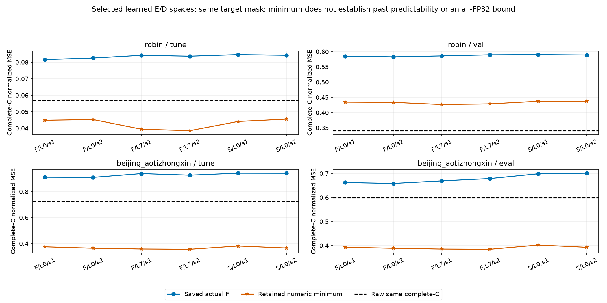
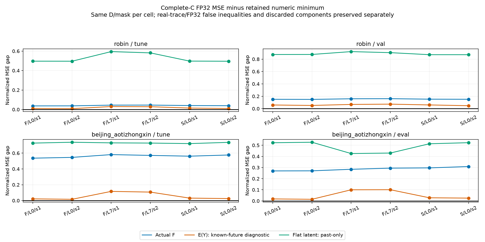
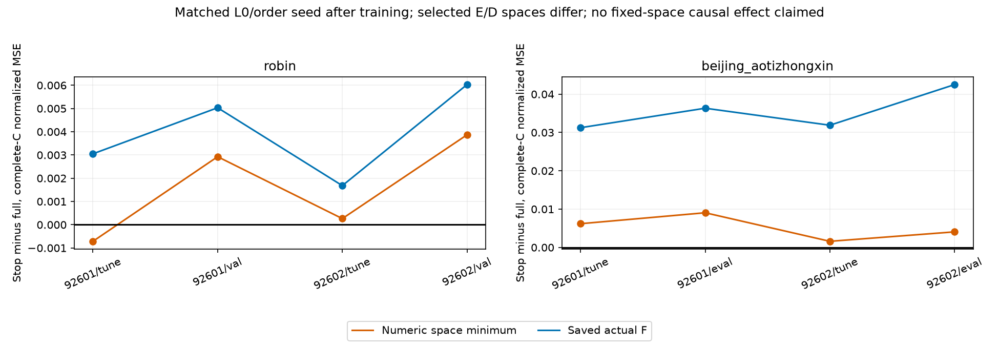
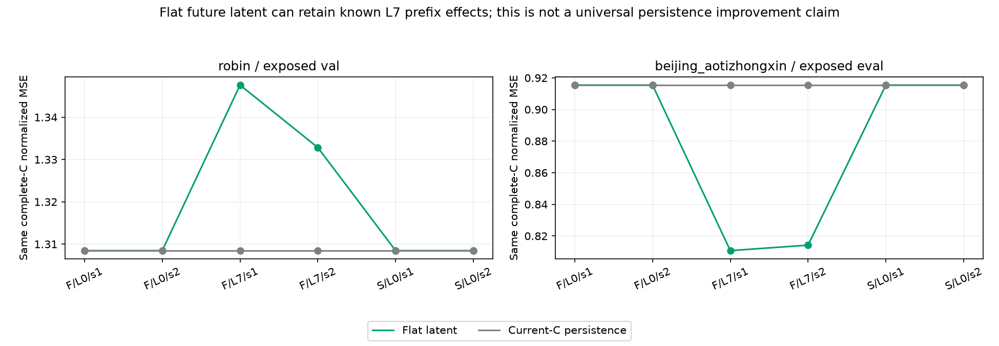

# 학습된 E/D의 공간과 실제 잠재 미래 예측 오차

실제 진단 24/24, 실패·관측부족 등 미완료 0/24. 원 상태는 `COMPLETE`, 독립 감사는 `PASS`다. 기존 선정 E/D 12상태의 TUNE·기노출 DEV를 재사용한 원인 진단이며 새 학습·F 추론·새 선정·배포 비용 측정은 모두0이다.

**Robin: 동일 complete-C에서 minimum>Raw가 TUNE 0/6 → 기노출 DEV 6/6로 달라졌다.** 현재 선정 D32와 known-past offset의 수치 유지 공간이 이 DEV 구간에서는 제약으로 남는다는 조건부 진단이다. 구간별 차이를 확인했을 뿐 분포 shift가 원인이라고 확정하지 않는다.

대표 FULL_L0/seed92601 tune: complete-C normalized MSE actual F=0.081605417, E(Y)=0.055391715, minimum=0.044809252, Raw=0.056951091.

대표 FULL_L0/seed92601 val: complete-C normalized MSE actual F=0.585106428, E(Y)=0.493148813, minimum=0.433986105, Raw=0.340401887.

**Beijing: 동일 complete-C DEV에서 minimum>Raw 0/6, E(Y)<Raw 6/6, actual F>Raw 6/6다.** 현재 선정 공간에는 여지가 있고 미래 실제 C를 인코딩한 E(Y)도 Raw보다 낮지만 실제 F가 그 좌표에 정렬되지 않는 문제가 남는다는 단서다. 이를 F만의 단독 원인이나 과거로 그 미래 좌표를 예측할 수 있다는 증거로 확대하지 않는다.

대표 FULL_L0/seed92601 tune: complete-C normalized MSE actual F=0.910717272, E(Y)=0.396065198, minimum=0.374576300, Raw=0.724321448.

대표 FULL_L0/seed92601 eval: complete-C normalized MSE actual F=0.662370234, E(Y)=0.410796693, minimum=0.392870582, Raw=0.598972295.

```text
dataset split condition          minimum     actual_F    E(Y)        Raw_complete Raw_allobs
Robin   tune  FULL_L0_s92601      0.044809252 0.081605417 0.055391715 0.056951091 0.056951091
Robin   val   FULL_L0_s92601      0.433986105 0.585106428 0.493148813 0.340401887 0.340401887
Robin   tune  FULL_L0_s92602      0.045241086 0.082566925 0.053777585 0.056951091 0.056951091
Robin   val   FULL_L0_s92602      0.433246324 0.582798885 0.485117890 0.340401887 0.340401887
Robin   tune  FULL_L7_s92601      0.039395305 0.084223697 0.069718568 0.056951091 0.056951091
Robin   val   FULL_L7_s92601      0.426193909 0.585823376 0.494439364 0.340401887 0.340401887
Robin   tune  FULL_L7_s92602      0.038496393 0.083696560 0.067220374 0.056951091 0.056951091
Robin   val   FULL_L7_s92602      0.428284025 0.589452844 0.501344365 0.340401887 0.340401887
Robin   tune  STOP_L0_s92601      0.044094478 0.084656466 0.058658868 0.056951091 0.056951091
Robin   val   STOP_L0_s92601      0.436912660 0.590139326 0.497006562 0.340401887 0.340401887
Robin   tune  STOP_L0_s92602      0.045503553 0.084247868 0.055469946 0.056951091 0.056951091
Robin   val   STOP_L0_s92602      0.437114072 0.588827988 0.484968239 0.340401887 0.340401887
Beijing tune  FULL_L0_s92601      0.374576300 0.910717272 0.396065198 0.724321448 0.758435638
Beijing eval  FULL_L0_s92601      0.392870582 0.662370234 0.410796693 0.598972295 0.589575414
Beijing tune  FULL_L0_s92602      0.363653380 0.909627391 0.379751554 0.724321448 0.758435638
Beijing eval  FULL_L0_s92602      0.388353391 0.658640397 0.403036376 0.598972295 0.589575414
Beijing tune  FULL_L7_s92601      0.357626432 0.938850559 0.473722454 0.724321448 0.758435638
Beijing eval  FULL_L7_s92601      0.385097128 0.669179873 0.485046684 0.598972295 0.589575414
Beijing tune  FULL_L7_s92602      0.355580435 0.926649256 0.462667807 0.724321448 0.758435638
Beijing eval  FULL_L7_s92602      0.384233151 0.678737862 0.485041983 0.598972295 0.589575414
Beijing tune  STOP_L0_s92601      0.380766109 0.941965473 0.411872526 0.724321448 0.758435638
Beijing eval  STOP_L0_s92601      0.401916356 0.698705987 0.430125256 0.598972295 0.589575414
Beijing tune  STOP_L0_s92602      0.365247133 0.941524904 0.390372699 0.724321448 0.758435638
Beijing eval  STOP_L0_s92602      0.392411917 0.701142407 0.417698820 0.598972295 0.589575414
```

**마스크를 섞지 않는다.** 위 minimum·actual F·E(Y)·Raw_complete는 모든 C가 관측된 horizon만 쓰는 complete-C 정규화 MSE다. Raw_allobs와 실제 예측의 all-observed 점수는 채널별 원 관측 위치에서 따로 계산했다. 특히 Beijing의 complete-C Raw와 전체 관측 Raw는 같은 수치가 아니므로 한쪽을 다른 비교의 분모로 쓰지 않는다. 24조건의 Raw는 동일 자료·split의 4개 고유 baseline을 각 상태에서 반복 참조한 값이며 24개의 독립 평가가 아니다.


[SVG](figures/01_actual_space_and_raw.svg)

**계산한 공간.** 갱신된 D32와 저장된 실제 latent past를 그대로 써 joint HC×HK 선형 실수 맵과 origin별 known-past offset을 다시 만들었다. lag가 7개여도 미래 자유변수는 HK이며 H×7K가 아니다. 출력의 complete-C 행만 줄이고 관측 없는 horizon의 미래 좌표는 남겼다. rcond1e−15의 retained numeric left-singular 공간 minimum이며 exact0 열만 줄인 LS 후 전체 HK 좌표 복원과 SVD 출력을 교차했다. 이전 초기 PCA D의 minimum을 재사용하지 않았다. SVD_GROUPS는 mask별 rank·singular 경계·normal certificate 요약이며 전체 vector는 원 JSON/NPZ에 있다.

minimum은 정규화 MSE 목적의 수치 유지 공간 해다. 그 해의 MAE·물리 MSE는 각각의 minimum이 아니며 모든 실수/모든 FP32 예측에 대한 보편 하한도 아니다. 실제 FP32·실수 trace·retained trace를 분리했고 원 real/FP32 부등식 거짓은 TRACES에 그대로 남겼다. retained trace에만 최소 부등식을 필수 검사한다. 낮은 minimum은 미래를 이미 아는 자유 좌표로 얻은 것이므로 과거 예측 가능성·독립 일반화·작은 K의 일반 가능성을 입증하지 않는다.


[SVG](figures/02_future_diagnostic_gaps.svg)

**E(Y)는 배포 입력이 아니다.** 실제 미래 C를 선정 E/center로 NumPy FP32 인코딩했다. C 일부가 결측인 horizon은 벡터 전체를 current-C로 바꿔 인코딩하며, L7에서는 그 대체가 이후 관측 horizon에도 전파될 수 있다. 이 backend의 반올림은 저장 Torch 인코딩과 다를 수 있다. E(Y)가 좋거나 나쁜 것은 해당 예측 목적 D에서 자연스러운 E(Y) 좌표와 복원이 정렬됐는지의 진단이며 잠재 최적해나 예측 성공 자체가 아니다. 과거 E/D의 FIT 미래 감독은 인정하고 이번 진단에서 새 적합·선정에 미래를 쓰지 않았다는 범위만 주장한다.

L0의 full·stop 조건은 같은 초기값·minibatch-order seed·600 update budget에서 출발했지만 선정 CP와 학습 후 E/D가 다르다. 출력 공간 차이와 실제 예측 차이를 함께 제시하며 동일 고정 공간의 단독 인과효과로 부르지 않는다. L7은 별도 구조 진단으로 계수 수·buffer·offset이 다르다. K streams+K past buffer+현재 C anchor이므로 strict K-only도 아니다.


[SVG](figures/03_full_stop_space_contrasts.svg)

**FLAT과 current-C persistence를 구분한다.** FLAT은 미래 latent를 마지막 latent로 반복한 과거 전용 대조다. L7의 알려진 past prefix와 lag별 기준값 때문에 복원 결과가 현재 C 반복과 다를 수 있다. 이는 특정 구조의 반례·현재 조건 비교이며 FLAT의 보편 우수성이나 미래 정답의 복구를 뜻하지 않는다.


[SVG](figures/04_flat_and_current_C.svg)

**검산과 한계.** 저장 actual-F 파일·관측 mask·scaler·origin·선정 상태 SHA를 결속했고 원 실제 점수와 NumPy E/lag/D 재생을 대조했다. LS/SVD 교차 및 별도 감사는 기존 불변 수학 경로를 재사용한 수치 검산이며 새로운 F 실행이나 독립적인 일반화 검증이 아니다. 두 자료의 기노출 구간에서 수행한 적응적 원인 탐색이다. 기존 joint-Y/RF3 등 예측 손실의 E/D 학습을 이미 실행했으므로 이번은 예측 목적 표현의 첫 시도가 아니다. 이 진단으로 새 모델·학습 연장·Bolt/대조학습/그래프 필요성을 결정했다고 쓰지 않는다. 새 timing이 없어 deployment latency나 speedup은 보고하지 않는다. RESOURCE의 CPU/wall은 이 저장 결과 진단 실행 자원이다.

- [CELLS.csv](tables/CELLS.csv): 24행
- [SCORES.csv](tables/SCORES.csv): 672행
- [TRACES.csv](tables/TRACES.csv): 72행
- [SVD_GROUPS.csv](tables/SVD_GROUPS.csv): 654행
- [MATCHED_L0_FULL_STOP.csv](tables/MATCHED_L0_FULL_STOP.csv): 8행
- [FAILURES.csv](tables/FAILURES.csv): 0행
- [RESOURCE.csv](tables/RESOURCE.csv): 1행

- [diagnostic](../../evidence/projection_followup_v1/runs/learned_output_space_v1/RESULT.json.gz): `cf042cc764ff36cbb877211777721783efadbaab6ba8741268eaccba26cbb34b`
- [audit](../../../projection_followup_v1/audits/LEARNED_OUTPUT_SPACE_AUDIT_v1.json): `1b0dbacb711becce70ac877825cd53b84069918ff62ac79dc9b9b5d8ac410738`
- [stop_gradient_diagnostic](../../../projection_followup_v1/runs/f_input_gradient_ablation_v1/RESULT.json): `e27989fb23716be8bbf507442d44033884b28522d641a010d18b426a0eb6d10a`
- [stop_gradient_audit](../../../projection_followup_v1/audits/F_INPUT_GRADIENT_ABLATION_AUDIT_v1.json): `64f19658ac8bc8cee1d6fa3713113a7146ba282ebb8ad2b9eb49498d91e6418f`
- [full_gradient_parent](../../../projection_followup_v1/runs/linear_e_train_v1/RESULT.json): `3f0cbd9176f2e7882778452e537564aab7445e1b88c1534fd48b1bce7ef639a4`
- [full_gradient_parent_audit](../../../projection_followup_v1/audits/LINEAR_E_ADAPTATION_AUDIT_v1.json): `9796b4ed53f74186bc2513db56fe321c2d450cdd9bffbb7c5f341766e73ee36d`
- [causal_lag_diagnostic](../../evidence/projection_followup_v1/runs/actual_causal_lag_objective_v1/RESULT.json.gz): `4168cd05962e479130a722919310f4c192c1bab03d9b78cb7983754f2e502c17`
- [causal_lag_audit](../../evidence/projection_followup_v1/audits/CAUSAL_LAG_OBJECTIVE_AUDIT_v2.json.gz): `d395a82e76a31e38520db1dd4d56642963ca4e362f358a6d86480049d402a31d`
- [selection_registry](../../../projection_followup_v1/runs/f_input_gradient_ablation_v1/SELECTION_REGISTRY.json): `cd1d9d5db618a5496d602c447eeeb7b2e0b0a5b0c4030a7c40df04c7fc66fee1`
- [full_gradient_selection_registry](../../../projection_followup_v1/runs/linear_e_train_v1/SELECTION_REGISTRY.json): `71a79e3327225a14aea156a7b6cb92e86286e350dbd11f6c83f7ebe204c75680`
- [plan](../../../projection_followup_v1/PLAN_LEARNED_OUTPUT_SPACE_DIAGNOSTIC_KO_v1.md): `e4441118dca54d7720ab35e764e6fee6c16a2860c8e1ffe8b638bd799abe3cca`
- [producer_source](../../../projection_followup_v1/run_learned_output_space_diagnostic_v1.py): `08f5806c80b825c9510eaaad9eaf85c9fb0e9633668e3d33be0317162e50f795`
- [audit_source](../../../projection_followup_v1/audit_learned_output_space_v1.py): `0e33409bd54c776c7f4d3df08fbe7969470e5e8cef21922162ddb6e55a62a1a5`
- [report_utility](../../../projection_followup_v1/make_linear_e_adaptation_report_v2.py): `32e2460ea4724144067f264ab1ceb0332cd04c5fce2296838024c119c9572466`
- [report_source](../../../projection_followup_v1/make_learned_output_space_report_v2.py): `c086fd012e022729595a7b1fd869a11b2cad5aa989cfb04ed75b3160f671adeb`

보고서 생성기는 JSON metadata만 읽으며 원 NPZ/model·F·훈련·TEST·Git을 실행하지 않았다. 실행/검산 완료와 연구 해결을 구분한다.
