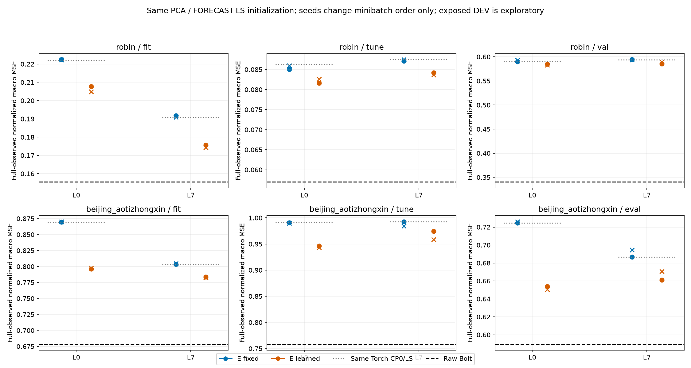
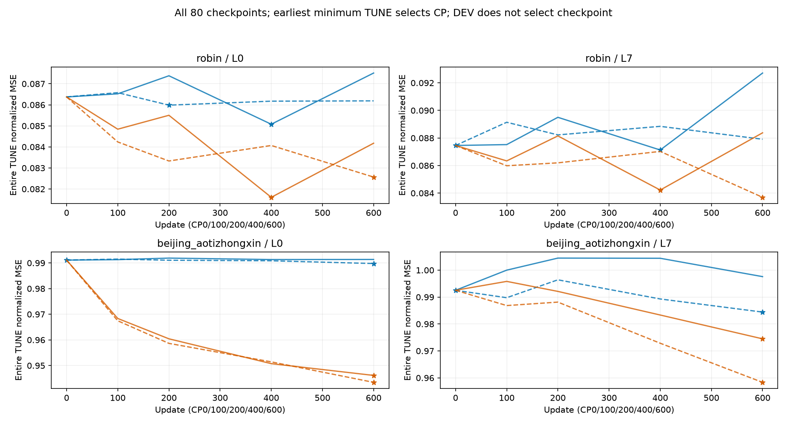
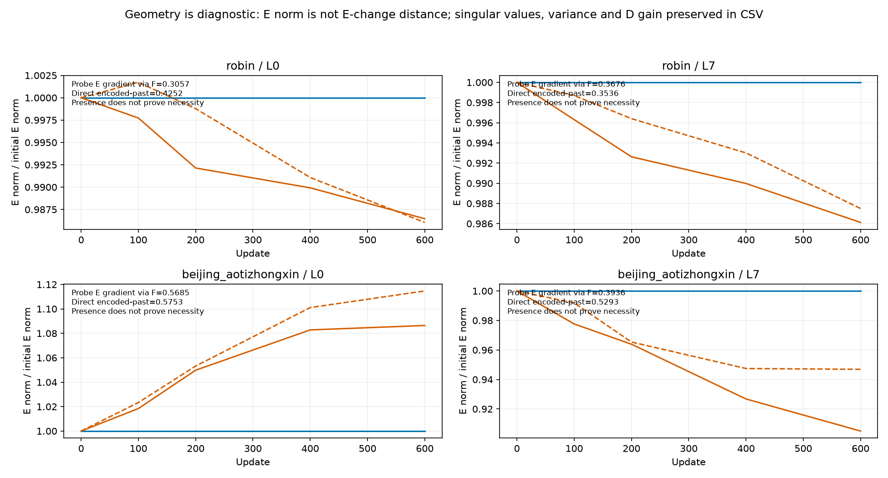
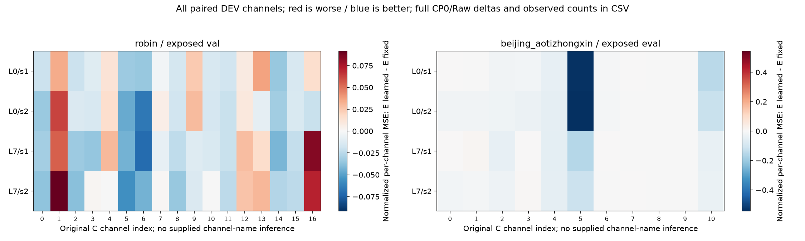

# 같은 초기값에서 E 고정·갱신을 분리한 결과

**E를 갱신한 조건이 같은 lag·minibatch-order seed의 E 고정보다 정규화 MSE를 낮춘 비교는 TUNE 8/8, 기노출 DEV 8/8이다. 그러나 Raw보다 기노출 DEV MSE가 작은 선정 조건은 0/16이다.** 아래 원수치는 초기 CP0/LS 및 Raw와 함께 읽는다. D-only가 초기값에서 나빠진 것만으로 표현 학습의 성공이라고 판단하지 않는다. 실행·검산 완료와 연구 목적 해결은 별개다.

**F를 통과하는 gradient는 실제 확인했지만 필요성은 미확정이다.** 네 실제 probe는 loss→F future→F input→E 경로와 encoded-past 기준값/알려진 prefix에서 E로 가는 직접 경로를 분리했다. 총 E gradient만으로 F 경로를 증명하지 않았다. E 갱신이 좋아져도 stop-gradient-F나 동일 native 대조가 없어 Bolt gradient 또는 Bolt 자체의 필요성을 입증하지 않는다.

**정상 FIT 감독과 배포 정보 조건.** FIT 미래 Y는 actual-C 손실 target에만 쓰며 forward는 origin에서 알려진 과거만 받는다. E는 시점별 C→K 선형 행렬, center는 고정 buffer, F는 실제 frozen Bolt q.5 H64의 앞48, D는 origin-reference lag 선형 복원이다. K streams·K 과거 buffer·현재 C anchor를 쓰므로 strict K-only가 아니다. 미래 label 누출이 없다는 좁은 구현 검사와 독립 일반화는 구분한다.

Robin C17/K4와 Beijing C11/K2, L512/H48, FIT256/TUNE64와 기노출 VAL30/EVAL146, 원 scaler·origin·관측 mask를 유지했다. 초기 PCA와 각 lag의 FORECAST-LS D는 고정 출발점이며 PCA가 최선이라고 선정한 결과가 아니다. L0와 L7은 계수가 7배 달라 동일 용량 비교가 아니다. 같은 초기값의 seed92601/92602는 minibatch 순서만 바꾸므로 독립 초기화나 독립 데이터 반복으로 세지 않는다.

본 학습은 16 fit × 600 update = 9,600회이며 실제 기술 probe의 추가 4회 update와 별도로 기록했다. AdamW lr.001/weight_decay0, batch4, clip1, CP0/100/200/400/600을 고정했다. 손실은 FIT 전체의 고정 채널별 관측수로 가중한 `N_fit/B/C_active × Σ SSE_batch_c/count_fit_c`다. minibatch별 관측수 macro와 같다고 쓰지 않는다. 80개 CP 중 전체 TUNE 정규화 MSE가 최소인 것을 고르고 exact tie는 이른 CP를 택했다. 16개 잠금·registry가 모두 봉인된 뒤 DEV를 열었다.

```text
dataset  lag  seed   CP_fixed CP_learn  TUNE_fixed TUNE_learn  DEV_fixed DEV_learn
Robin    L0   92601      400      400 0.085078153 0.081605417 0.590266666 0.585106428
Robin    L0   92602      200      600 0.085984533 0.082566925 0.593404504 0.582798885
Robin    L7   92601      400      400 0.087129233 0.084223697 0.594129886 0.585823376
Robin    L7   92602        0      600 0.087457543 0.083696560 0.594049756 0.589452844
robin Raw exposed_DEV MSE=0.340401887
Beijing  L0   92601        0      600 0.991114998 0.946152209 0.724655020 0.654038940
Beijing  L0   92602      600      600 0.989774847 0.943447728 0.725922467 0.650313815
Beijing  L7   92601        0      600 0.992518081 0.974486823 0.686653748 0.661183648
Beijing  L7   92602      600      600 0.984420845 0.958324270 0.694394519 0.670734263
beijing_aotizhongxin Raw exposed_DEV MSE=0.589575414
```

표는 채널별 관측 위치를 사용하는 channel-macro 정규화 MSE다. complete-C 및 물리 단위 점수는 별도 CSV에 보존했다.


[SVG](figures/01_accuracy_and_cp0.svg)


[SVG](figures/02_paired_e_contrasts.svg)


[SVG](figures/03_checkpoint_selection.svg)

E 갱신 8조건 중 6/8은 마지막 CP600을 선택했다. 따라서 600 update의 비교 결과를 수렴이나 충분한 훈련의 증거로 해석하지 않는다. 더 오래 학습할 때 달라질 가능성은 남지만 추가 연장은 아직 미계획·미실행이다. 현재 원수치나 선정 CP를 바꾸지 않는다.

**학습 안정성과 표현 유용성은 따로 본다.** 전체 update의 손실·E/D gradient·clip 여부와 모든 CP의 E/D singular value·TUNE latent variance·D feature→C gain을 보존했다. E norm 변화는 초기→최종 E 거리와 다르며 gain은 공동 H-horizon 미래 오차의 상한이 아니다. 독립 감사가 저장 상태로 계산한 초기→선정 E/D 거리·E rank는 CONDITIONS에 원 metadata로 보존한다. 없는 진단값을 0으로 추정하지 않는다. 입력 NaN을 mask 뒤에서 제곱해 gradient를 오염시키지 않도록 미관측 target을 차이·제곱 전에 안전하게 처리했다. finite 통과나 nonzero gradient만으로 예측 표현이 적합하다고 결론 내리지 않는다. 감사는 저장된 실제 F 미래와 계수의 산술·점수·선정·로그를 검산했으며 F forward·backward·optimizer와 9,600 손실값을 독립 재실행한 것은 아니다. 네 probe의 VJP 수치는 실제 producer 증거이며 독립 VJP replay로 바꾸어 말하지 않는다.


[SVG](figures/04_geometry_and_gradient_scope.svg)

**압축 경로가 언제나 빠른 것은 아니다.** 같은 cohort Raw와 비교한 ratio-of-medians에서 선정 16조건 중 B1이 더 느린 조건은 16/16, B8이 더 빠른 조건은 16/16이다. batch 크기와 Torch E/lag D 및 CPU↔GPU 처리의 전체 비용을 함께 본다. 이 측정만으로 어느 단계가 차이를 만들었는지 인과 분해하지 않는다.

**비용은 별도 실제 전체 추론이다.** 새 9경로 × 2자료 × B1/B8 = 36조건, warmup2·9완전순환의 324표본이다. 첫 TUNE origins와 선정 CP의 동일 TUNE 예측을 reference로 쓰며 DEV timing은 하지 않았다. 원 physical causal fill/FIT 정규화부터 선택된 Torch E→실제 frozen GPU F→Torch lag D/currentC anchor→물리 단위 CPU 반환과 최종 sync를 포함한다. 데이터·모델·선정 E/D setup 및 학습·reference·warmup·저장·source/file/state metadata hash·guard·memory snapshot은 타이머 밖이다. 새 E/D 적합·native head 실행은 없다. 같은 첫 B TUNE origins를 반복하므로 324개의 독립 평가 자료가 아니다. 모든 E/D와 F가 resident인 공유 process RSS/VRAM을 방법별 독점 메모리나 장비 독점으로 바꾸어 말하지 않는다.

```text
dataset  route                   B8_ms/window ratio_medians median_paired
Robin    RAW_BOLT                  5.815188 1.000000 1.000000
Robin    L0_E_FIXED_s92601         3.511712 0.603886 0.624654
Robin    L0_E_FIXED_s92602         3.471262 0.596930 0.595097
Robin    L0_E_LEARN_s92601         3.399400 0.584573 0.617025
Robin    L0_E_LEARN_s92602         3.456338 0.594364 0.618370
Robin    L7_E_FIXED_s92601         3.377125 0.580742 0.599017
Robin    L7_E_FIXED_s92602         3.804012 0.654151 0.654151
Robin    L7_E_LEARN_s92601         3.607650 0.620384 0.629118
Robin    L7_E_LEARN_s92602         3.476375 0.597810 0.611942
Beijing  RAW_BOLT                  4.430225 1.000000 1.000000
Beijing  L0_E_FIXED_s92601         3.531112 0.797050 0.765326
Beijing  L0_E_FIXED_s92602         3.801675 0.858122 0.778950
Beijing  L0_E_LEARN_s92601         3.443975 0.777382 0.859953
Beijing  L0_E_LEARN_s92602         3.450287 0.778806 0.754823
Beijing  L7_E_FIXED_s92601         3.439525 0.776377 0.806034
Beijing  L7_E_FIXED_s92602         3.382825 0.763579 0.846656
Beijing  L7_E_LEARN_s92601         3.325362 0.750608 0.770878
Beijing  L7_E_LEARN_s92602         3.584013 0.808991 0.871275
```


[SVG](figures/05_whole_pipeline_cost.svg)

ratio-of-medians와 반복별 paired ratio의 중앙값은 다른 통계라 둘 다 보존했다. ACCURACY_COST_REFERENCE의 ×1.01 MSE/MAE·B8≤.90은 이전 묶음 기준을 그대로 참고 적용한 값이다. 비용 계획은 본 학습 시작 뒤·첫 네 조건 TUNE 노출 뒤에 작성됐으므로 이번 학습의 사전등록 gate라고 부르지 않는다. 조건 선정은 TUNE MSE뿐이며 DEV 최저 조건으로 선택을 바꾸지 않는다.

**채널별 실패 위치.** 같은 lag·seed의 8개 비교에서 전체 채널의 E 갱신−고정/CP0/Raw 정규화 MSE 차이와 관측수를 CHANNEL_COMPARISONS에 보존했다. 아래 그림의 channel index는 원 순서이며 metadata에 없는 채널명을 추정하지 않았다. horizon별 오차는 metadata에 없어 미측정이다. 한 채널의 큰 악화가 전체 macro 오차에 미친 흔적과 기저표현의 원인을 구분한다.


[SVG](figures/06_channel_error_deltas.svg)

**남은 불확실성.** E 갱신이 개선해도 선형 E/D 공동 적응 안의 결과다. 이득이 없으면 현재 초기 PCA·작은 K·선형 lag·600 update 조건의 한계이며 모든 예측 목적 표현의 불가능성이 아니다. 설계는 이미 노출된 DEV를 본 뒤의 적응적 탐색이고 독립 일반화는 확인하지 않았다. 과거 joint-Y와 RF3도 frozen F를 통한 E/D 학습을 실제 수행했다. 이번을 최초 end-to-end 학습 또는 재구성만 했던 연구를 처음 예측 목적으로 바꾼 시도로 포장하지 않는다. 새 대조는 같은 선형 초기값·origin 기준 D에서 E 적응을 분리한다는 것이다.

전체 원수치와 재현 근거는 다음 상대 링크에 있다.

- [SCORES.csv](tables/SCORES.csv): 252행
- [PAIRED_E.csv](tables/PAIRED_E.csv): 96행
- [CHANNEL_COMPARISONS.csv](tables/CHANNEL_COMPARISONS.csv): 336행
- [CHECKPOINTS.csv](tables/CHECKPOINTS.csv): 80행
- [UPDATES.csv](tables/UPDATES.csv): 9600행
- [CONDITIONS.csv](tables/CONDITIONS.csv): 16행
- [PROBES.csv](tables/PROBES.csv): 4행
- [SELECTION_LOCKS.csv](tables/SELECTION_LOCKS.csv): 16행
- [WHOLE_COST.csv](tables/WHOLE_COST.csv): 36행
- [WHOLE_COST_SAMPLES.csv](tables/WHOLE_COST_SAMPLES.csv): 324행
- [ACCURACY_COST_REFERENCE.csv](tables/ACCURACY_COST_REFERENCE.csv): 16행
- [EXECUTION_RESOURCES.csv](tables/EXECUTION_RESOURCES.csv): 3행
- [PROVENANCE.csv](tables/PROVENANCE.csv): 5행
- [PRESERVED_FAILURES.csv](tables/PRESERVED_FAILURES.csv): 0행

- [probe](../../../projection_followup_v1/runs/linear_e_probe_v1/RESULT.json): `00440bf6e09ac31db4666ffc656ec348cc4b5f698b18600c65d0ff99cf0d1b8d`
- [train](../../../projection_followup_v1/runs/linear_e_train_v1/RESULT.json): `3f0cbd9176f2e7882778452e537564aab7445e1b88c1534fd48b1bce7ef639a4`
- [audit](../../../projection_followup_v1/audits/LINEAR_E_ADAPTATION_AUDIT_v1.json): `9796b4ed53f74186bc2513db56fe321c2d450cdd9bffbb7c5f341766e73ee36d`
- [cost](../../../projection_followup_v1/runs/linear_e_cost_v1/RESULT.json): `5038bc1cd6c52fadf4b9397b3eabb9f1bcf3085c9901d954222d43835c05a97d`
- [cost_audit](../../../projection_followup_v1/audits/LINEAR_E_COST_AUDIT_v1.json): `7ddd11e9d201d4dad9e051a99e4fc0d52af7d0441a0ea3fef10c646f87827a8f`
- [audit_source](../../../projection_followup_v1/audit_linear_e_adaptation_v1.py): `4d31543d2f1e9f9920096e545865c6f9eee88e912961f83310abd4c44458aa89`
- [cost_audit_source](../../../projection_followup_v1/audit_linear_e_cost_v1.py): `26374f7f3531863450661781fd9b11bb4e019afc5394765dc4c135142272909a`
- [plan](../../../projection_followup_v1/PLAN_LINEAR_E_ADAPTATION_KO_v1.md): `0bed877924c7cff13477a379f42ad5ace9b20d8f4011d3137ceff6080d7c4a6d`
- [controller_source](../../../projection_followup_v1/run_linear_e_adaptation_v1.py): `e268528d77d17b0c8f5a300ff8d667ce5ddd25b1f61754c3895df87929fcd1f3`
- [pure_source](../../../projection_followup_v1/linear_e_adaptation_v1.py): `17c8ac7d20b9f3dd759a3b3fb2e019e027469e9c8a057eb1176da98b9c319931`
- [selection_registry](../../../projection_followup_v1/runs/linear_e_train_v1/SELECTION_REGISTRY.json): `71a79e3327225a14aea156a7b6cb92e86286e350dbd11f6c83f7ebe204c75680`
- [causal_lag_diagnostic](../../evidence/projection_followup_v1/runs/actual_causal_lag_objective_v1/RESULT.json.gz): `4168cd05962e479130a722919310f4c192c1bab03d9b78cb7983754f2e502c17`
- [causal_lag_audit](../../evidence/projection_followup_v1/audits/CAUSAL_LAG_OBJECTIVE_AUDIT_v2.json.gz): `d395a82e76a31e38520db1dd4d56642963ca4e362f358a6d86480049d402a31d`
- [parent_report](../causal_lag_objective_v1/REPORT_KO.md): `d8c7b1e09c2b1677bc40dea8bccc5ec081756ca9cbf088fccb9d8ec52fcf3928`
- [parent_report_manifest](../causal_lag_objective_v1/MANIFEST.json): `e4e04e2a86a58f02da2fed28cda4eb2e59c0f1973db98d1f57c470645e0965ea`
- [parent_report_audit](../../../projection_followup_v1/audits/CAUSAL_LAG_REPORT_AUDIT_v1.json): `4f208f364222f6810a6366eb242e7e4abf90a8a317fdda831b7d11f0d5ff2ca2`
- [cost_plan](../../../projection_followup_v1/PLAN_LINEAR_E_WHOLE_COST_KO_v1.md): `d53c2293b700d4a8965222af7adb7975a944619d246b99989e68e47c451ea7f1`
- [report_source](../../../projection_followup_v1/make_linear_e_adaptation_report_v1.py): `9a3bacdf31e3f2c3105f87c7b7f4b5d854cf55e1a121c009c5486fb7184810a1`

- [robin_L0_E_FIXED_s92601 원 학습 곡선](../../../projection_followup_v1/runs/linear_e_train_v1/robin_L0_E_FIXED_s92601_UPDATES.jsonl): `974a24ee679cb166c695e29622c59d83cb6f43713828d9e0623a46b22d6020f6`
- [robin_L0_E_FIXED_s92602 원 학습 곡선](../../../projection_followup_v1/runs/linear_e_train_v1/robin_L0_E_FIXED_s92602_UPDATES.jsonl): `1891eb8b071388c0f9eb0638b1d7f8762bbeb84ea6f2fdceede8489a1b96d284`
- [robin_L0_E_LEARN_s92601 원 학습 곡선](../../../projection_followup_v1/runs/linear_e_train_v1/robin_L0_E_LEARN_s92601_UPDATES.jsonl): `8d56aa3f934657f209ca7d7a1975a28a4ac1d926f06306cc72fdbb215616505e`
- [robin_L0_E_LEARN_s92602 원 학습 곡선](../../../projection_followup_v1/runs/linear_e_train_v1/robin_L0_E_LEARN_s92602_UPDATES.jsonl): `5efadf9dfbee29014c5f90da9c38f9fb5c262edf18a23ea82b7989ee73740c49`
- [robin_L7_E_FIXED_s92601 원 학습 곡선](../../../projection_followup_v1/runs/linear_e_train_v1/robin_L7_E_FIXED_s92601_UPDATES.jsonl): `ef45ba369724ab9f62fd6c01940adde7744b9b738d139462e5abe5c9e6fb8fa7`
- [robin_L7_E_FIXED_s92602 원 학습 곡선](../../../projection_followup_v1/runs/linear_e_train_v1/robin_L7_E_FIXED_s92602_UPDATES.jsonl): `bdd6f3bb55574359dc864ccd8543dde6bcbcff626dacb27efcf7cac97837d26f`
- [robin_L7_E_LEARN_s92601 원 학습 곡선](../../../projection_followup_v1/runs/linear_e_train_v1/robin_L7_E_LEARN_s92601_UPDATES.jsonl): `e0be728e80b53a3564189f64153957947638be9afbe1ca990be7ba77fcd481d4`
- [robin_L7_E_LEARN_s92602 원 학습 곡선](../../../projection_followup_v1/runs/linear_e_train_v1/robin_L7_E_LEARN_s92602_UPDATES.jsonl): `64f9f40fc13a3071d4e1230b6969788ace708f126407794e2d91f9a8b1d6215d`
- [beijing_aotizhongxin_L0_E_FIXED_s92601 원 학습 곡선](../../../projection_followup_v1/runs/linear_e_train_v1/beijing_aotizhongxin_L0_E_FIXED_s92601_UPDATES.jsonl): `21505ea8b9c7668cac665efb050292566984db2e66c911e6452e90d1b9335e88`
- [beijing_aotizhongxin_L0_E_FIXED_s92602 원 학습 곡선](../../../projection_followup_v1/runs/linear_e_train_v1/beijing_aotizhongxin_L0_E_FIXED_s92602_UPDATES.jsonl): `36a739ed84b049a41ac58f6270005445edc5ad9f5f01cb62cdfdd755cd41436a`
- [beijing_aotizhongxin_L0_E_LEARN_s92601 원 학습 곡선](../../../projection_followup_v1/runs/linear_e_train_v1/beijing_aotizhongxin_L0_E_LEARN_s92601_UPDATES.jsonl): `c6657013d97733c2723f34453e11762ad355cab9518e18077ca7208f28fba03f`
- [beijing_aotizhongxin_L0_E_LEARN_s92602 원 학습 곡선](../../../projection_followup_v1/runs/linear_e_train_v1/beijing_aotizhongxin_L0_E_LEARN_s92602_UPDATES.jsonl): `3f4d4fd7c77a764dd81b74ff38f8a7d33d249fc8f571e3f0d439378b6e1f9b4e`
- [beijing_aotizhongxin_L7_E_FIXED_s92601 원 학습 곡선](../../../projection_followup_v1/runs/linear_e_train_v1/beijing_aotizhongxin_L7_E_FIXED_s92601_UPDATES.jsonl): `147dc450e682c277af3366d83aab73b2da745c38be78988193fd70a8f6f2393d`
- [beijing_aotizhongxin_L7_E_FIXED_s92602 원 학습 곡선](../../../projection_followup_v1/runs/linear_e_train_v1/beijing_aotizhongxin_L7_E_FIXED_s92602_UPDATES.jsonl): `49c611f3cd2bf044ece2d9e6d4e8c4946453d5126596c785ec889d013b133e76`
- [beijing_aotizhongxin_L7_E_LEARN_s92601 원 학습 곡선](../../../projection_followup_v1/runs/linear_e_train_v1/beijing_aotizhongxin_L7_E_LEARN_s92601_UPDATES.jsonl): `8c0b5944ad1850fd4bdd08e0566768ac0d7afa938aefc89f9421de02da0c1f57`
- [beijing_aotizhongxin_L7_E_LEARN_s92602 원 학습 곡선](../../../projection_followup_v1/runs/linear_e_train_v1/beijing_aotizhongxin_L7_E_LEARN_s92602_UPDATES.jsonl): `26a29900815b09d2aca1129897db2a03c8459be8b7bc3119f394c66b8b226fe9`

보고서 생성기는 JSON·JSONL metadata만 읽었다. 계수·예측 원배열은 독립 감사가 검산한 원 artifact에 두고 NPZ·모델을 다시 열거나 F/학습/타이머를 재실행하지 않았다. 기존 파일·실패 기록은 보존하며 보고서 생성은 Git push나 논문/PPT 완료를 뜻하지 않는다.
