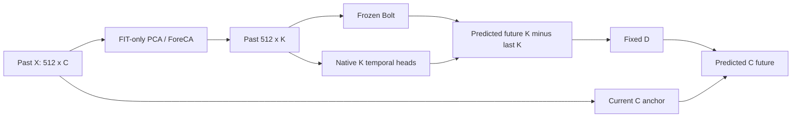
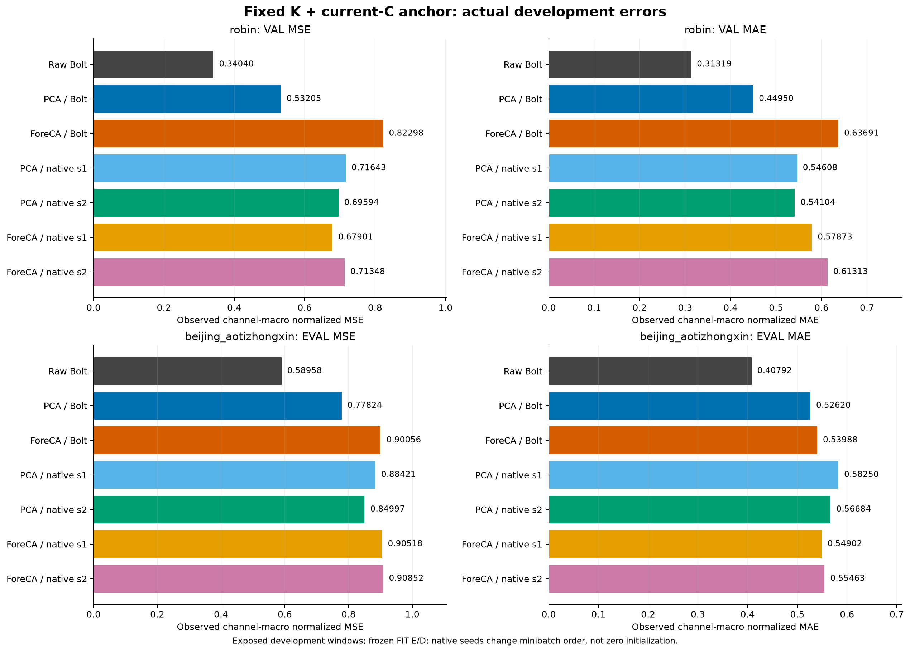
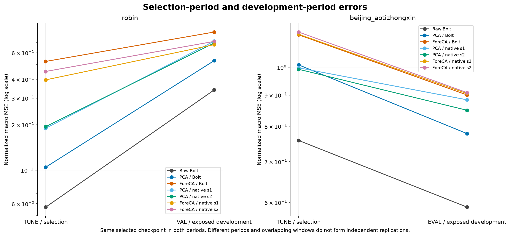
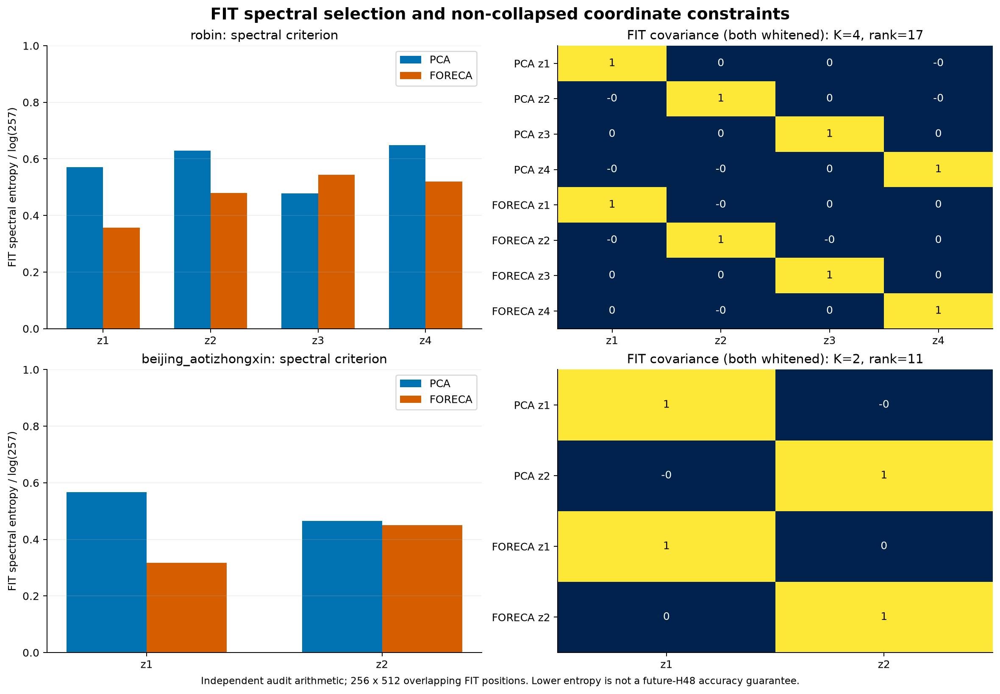
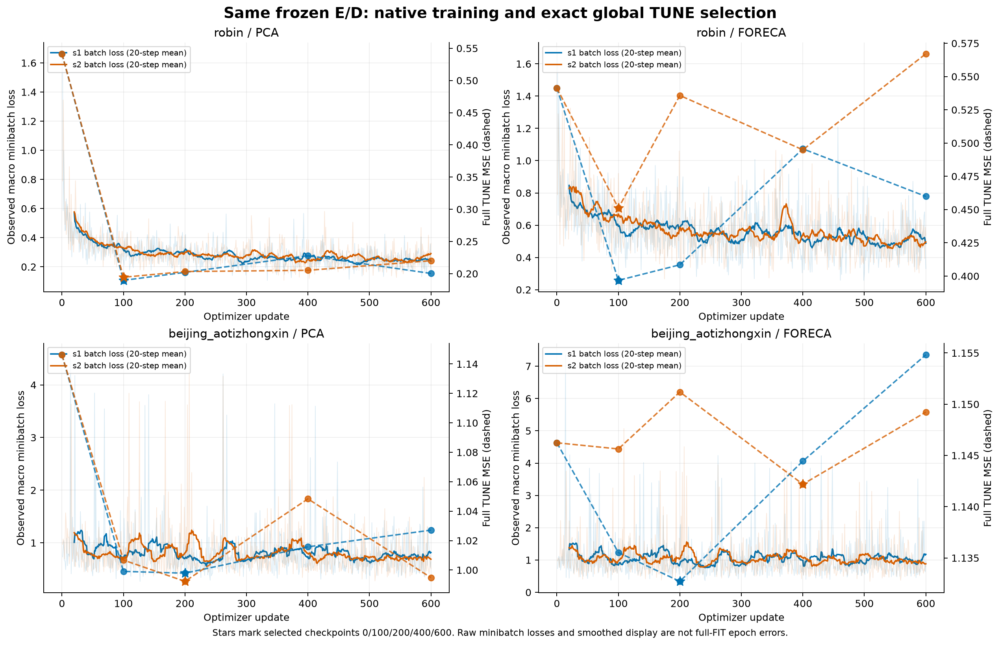
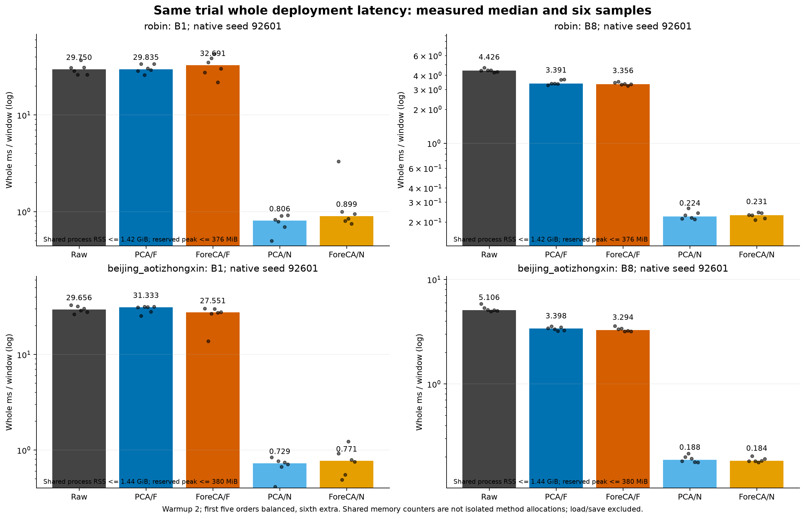
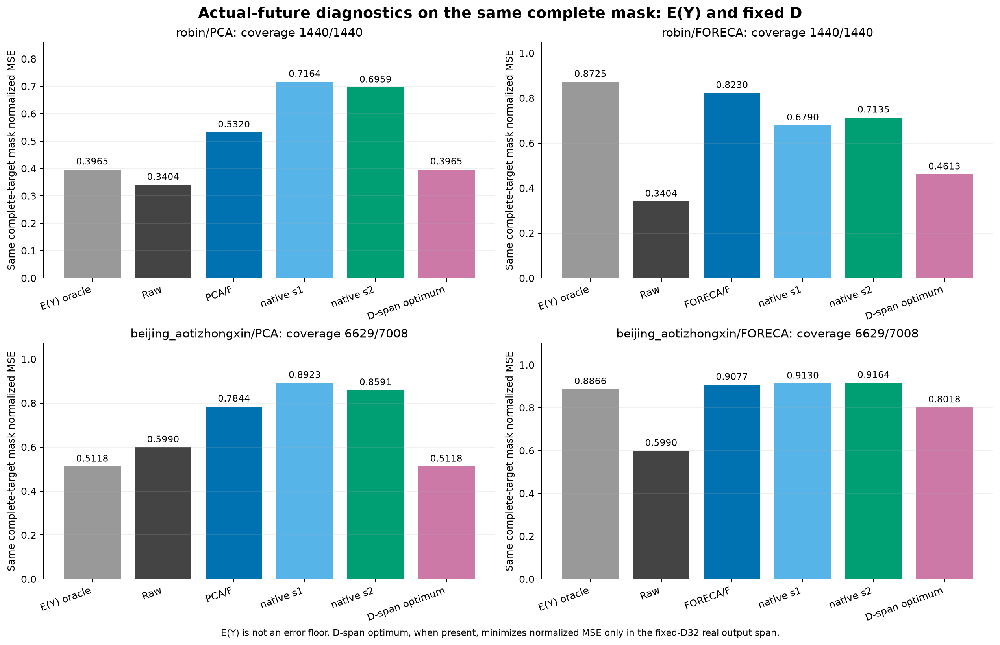

# 작은 K 투영·고정 Bolt·Native 예측기: 실제 비교

[확인] 이 감사에 채택한 producer는 PCA/ForeCA 원리 투영 4개, 고정 복원 D 4개, native 8개의 실제 적합·학습과 20조건·120회 whole 추론을 기록했다. 독립 감사 PASS를 확인한 producer에만 이 보고서를 묶었다. 전체 물리 시도 수나 연구 전체 해결·독립 일반화 검증을 뜻하지 않는다. 앞선 미채택 시도는 각 실행·감사 기록과 구분한다.

## 핵심 질문의 답

**과거만 사용하는 작은 K 표현이 정확도·비용을 함께 유지했는가?** [확인] 이번 고정 K·현재 C anchor 조건에서는 Raw Bolt보다 작은-K 경로의 TUNE/개발 오차가 컸다. JOINT ridge 실패를 필요조건으로 쓰지 않고 압축 경로를 직접 검사했지만, 이 PCA/ForeCA 묶음에서 정확도 유지 근거를 얻지 못했다. 비용 감소와 정확도 유지 여부는 별개다.

**시간 예측성 투영이 PCA보다 좋았는가?** [확인] ForeCA 원리 경로의 FIT spectral entropy와 unit-variance/rank를 확인했다. 아래 원수치에서 ForeCA+Bolt의 개발 MSE는 두 자료 모두 PCA+Bolt보다 컸다. [추정] 낮은 스펙트럼 엔트로피가 H48의 원 C 미래 보존·복원·Bolt 호환성까지 보장하지 않는 경쟁 설명이 남는다. 이를 모든 예측 목적 표현의 실패로 확대하지 않는다.

**Bolt를 붙이는 단계가 항상 문제였는가?** [확인] 동일 E/D를 고정한 native로 F만 교체했다. Robin의 PCA에는 Bolt가 두 native보다 개발 MSE가 낮았지만, ForeCA에서는 두 native가 Bolt보다 낮았다. Beijing PCA의 native는 TUNE MSE가 Bolt보다 낮아도 개발 MSE는 높았다. 특정 좌표·시기·head에서의 조건부 비교이며 모든 native보다 Bolt가 우월/불필요하다는 결론은 아니다.

**표현·미래 예측·D 중 무엇이 남았는가?** [확인] 실제 미래 E(Y)는 미래 복원 최적 latent가 아니므로 error floor가 아니다. Robin ForeCA 개발 E(Y) MSE 0.872497271, native seed92601 0.679014623를 실제 동일 mask에서 비교했다. E(Y)보다 낮은 실제 예측 오차는 이 진단이 엄밀한 floor라는 주장과 충돌한다. [추정] 현재 E/D와 실제 미래 변화의 불일치 및 forecaster의 조건별 오차가 함께 남는다. 학습 문제 또는 방법의 본질적 한계 하나로 확정할 수 없다.

**누출이 있었는가?** [확인] E/D는 FIT 과거로 적합했고 native의 실제 미래 label은 FIT 학습 및 TUNE checkpoint 선택에 사용했다. 배포 입력은 과거와 현재 C anchor뿐이다. 실제 추출된 2-window payload의 target/future-mask 교란 후 고정 모델 출력 불변을 저장했다. 전체 원자료 미래를 교란한 재학습·전처리 재실행이나 모든 가능한 누출 부재의 증명은 아니다. 보호 TEST 접근은 없었다.

**대조학습·동적 그래프가 필요한가?** [확인] 이번에는 새 contrastive/graph를 학습하지 않았다. 두 static 선형 투영의 실패로 필요성을 증명하거나 가능성을 기각할 수 없다. 다음 방법은 현재의 정보 보존·복원·예측기 진단을 해결하는 가설로 정해야 한다.

**새로 분리된 고정 D의 제한은 무엇인가?** [확인] 다음 수치는 같은 complete-target mask에서 실제 미래를 사용한 기하 진단이다. normalized-MSE 최소가 Raw보다 큰 고정 D는 forecaster만 바꾸는 것으로 그 Raw보다 작은 오차를 얻을 수 없는 제한이 남는다. 선택한 D32의 실수 부분공간/현재 C anchor에 한정하며 다른 D나 학습 목표 전체의 불가능성은 아니다.

- robin/PCA: 고정-D 최소 0.396541619, 같은 mask Raw 0.340401887; 선택된 고정 D의 최소가 Raw보다 큼.
- robin/FORECA: 고정-D 최소 0.461340297, 같은 mask Raw 0.340401887; 선택된 고정 D의 최소가 Raw보다 큼.
- beijing_aotizhongxin/PCA: 고정-D 최소 0.511797660, 같은 mask Raw 0.598972295; 선택된 D의 도달 가능 최소는 Raw보다 작지만 실제 과거 예측 가능성은 미확정.
- beijing_aotizhongxin/FORECA: 고정-D 최소 0.801825480, 같은 mask Raw 0.598972295; 선택된 고정 D의 최소가 Raw보다 큼.

## 동일 비교 조건과 실제 원수치

Robin C17/K4·Beijing Aotizhongxin C11/K2, L512/H48, FIT256/TUNE64·개발 VAL30/EVAL146를 유지했다. E는 시점별 선형 C→K이고 모든 경로가 current C anchor를 받으므로 strict K-only 압축이 아니다. 같은 전체 C 과거 입력을 읽는 전처리 비용도 포함했다. 개발 구간은 반복 노출되었으며 독립 holdout이 아니다.



PCA도 whitening하여 두 투영의 FIT 잠재 분산을1로 맞췄다. 같은 중첩 FIT 창256×512 positions의 공분산을 쓰며 이들을 독립 표본으로 세지 않았다. D는 원 관측 FIT 과거만 정답으로 삼은 채널별 masked affine least squares다. 미래 target을 D 적합에 넣지 않았다. 서로 다른 E의 D 클래스·적합 규칙을 맞춘 것이며 D 가중치가 byte 동일하다는 뜻은 아니다.

ForeCA는 [원 논문](https://proceedings.mlr.press/v28/goerg13.pdf)의 spectral forecastability 원리를 적용한 고정 투영이다. 이번 Hann·단측257빈·7빈 반사 smoothing·성분별200반복/결정적2초기방향은 사전 고정한 적용 계약이며 공식 R 구현의 정확한 benchmark 재현이라고 부르지 않는다. FIT entropy만으로 방향을 선택했고 TUNE/DEV로 spectral 설정을 탐색하지 않았다.

```text
dataset                split  method / seed                 MSE          MAE          selected CP
robin                  fit    RAW_BOLT                      0.155467495  0.211677064   None
robin                  fit    PCA_BOLT                      0.245334513  0.329562767   None
robin                  fit    PCA_NATIVE_92601              0.306536326  0.412197655    100
robin                  fit    PCA_NATIVE_92602              0.305891790  0.410099830    100
robin                  fit    FORECA_BOLT                   0.615027149  0.576552733   None
robin                  fit    FORECA_NATIVE_92601           0.597304288  0.574924830    100
robin                  fit    FORECA_NATIVE_92602           0.599468496  0.581833664    100
robin                  tune   RAW_BOLT                      0.056951091  0.097401173   None
robin                  tune   PCA_BOLT                      0.104733019  0.197103799   None
robin                  tune   PCA_NATIVE_92601              0.189630762  0.299831841    100
robin                  tune   PCA_NATIVE_92602              0.194456753  0.299465846    100
robin                  tune   FORECA_BOLT                   0.525601060  0.521664313   None
robin                  tune   FORECA_NATIVE_92601           0.396785825  0.482075150    100
robin                  tune   FORECA_NATIVE_92602           0.451114838  0.507318393    100
robin                  val    RAW_BOLT                      0.340401887  0.313192123   None
robin                  val    PCA_BOLT                      0.532048934  0.449497944   None
robin                  val    PCA_NATIVE_92601              0.716427992  0.546083997    100
robin                  val    PCA_NATIVE_92602              0.695939643  0.541042431    100
robin                  val    FORECA_BOLT                   0.822981362  0.636914229   None
robin                  val    FORECA_NATIVE_92601           0.679014623  0.578734266    100
robin                  val    FORECA_NATIVE_92602           0.713484658  0.613132433    100
beijing_aotizhongxin   fit    RAW_BOLT                      0.678540336  0.470732932   None
beijing_aotizhongxin   fit    PCA_BOLT                      0.907082603  0.589244232   None
beijing_aotizhongxin   fit    PCA_NATIVE_92601              0.776495976  0.551778618    200
beijing_aotizhongxin   fit    PCA_NATIVE_92602              0.799229256  0.550044829    200
beijing_aotizhongxin   fit    FORECA_BOLT                   1.036914729  0.608067222   None
beijing_aotizhongxin   fit    FORECA_NATIVE_92601           1.020049151  0.610020275    200
beijing_aotizhongxin   fit    FORECA_NATIVE_92602           1.017419788  0.613372016    400
beijing_aotizhongxin   tune   RAW_BOLT                      0.758435638  0.499495790   None
beijing_aotizhongxin   tune   PCA_BOLT                      1.008971309  0.607676290   None
beijing_aotizhongxin   tune   PCA_NATIVE_92601              0.997847327  0.639454816    200
beijing_aotizhongxin   tune   PCA_NATIVE_92602              0.992298625  0.623177302    200
beijing_aotizhongxin   tune   FORECA_BOLT                   1.130309158  0.596443493   None
beijing_aotizhongxin   tune   FORECA_NATIVE_92601           1.132715365  0.603258440    200
beijing_aotizhongxin   tune   FORECA_NATIVE_92602           1.142190261  0.614221750    400
beijing_aotizhongxin   eval   RAW_BOLT                      0.589575414  0.407916509   None
beijing_aotizhongxin   eval   PCA_BOLT                      0.778238708  0.526196949   None
beijing_aotizhongxin   eval   PCA_NATIVE_92601              0.884212438  0.582502681    200
beijing_aotizhongxin   eval   PCA_NATIVE_92602              0.849968799  0.566835258    200
beijing_aotizhongxin   eval   FORECA_BOLT                   0.900557095  0.539880947   None
beijing_aotizhongxin   eval   FORECA_NATIVE_92601           0.905182297  0.549021375    200
beijing_aotizhongxin   eval   FORECA_NATIVE_92602           0.908517246  0.554634849    400
```

[전체 정규화·채널별 원단위 지표](tables/COMPARISON.csv). 서로 다른 물리 단위의 channel-macro를 하나의 의미 있는 원단위 목표로 해석하지 않고 원단위 지표는 채널별 진단으로 둔다.







## 학습과 선택을 분리한 기록

Native는 잠재 K채널 각각의512→48 affine time head이고 입력은 z_past−z_last다. E/D는 동결하고 D 뒤 actual-Y 관측 정규화 macro MSE로 학습했다. AdamW .001·wd0·clip1·batch4·600 update, CP0/100/200/400/600 중 TUNE MSE 최소를 선택하며 exact tie는 가장 이른 CP다. 두 seed는 동일 zero 초기화의 배치 순서를 바꾸며 독립 랜덤 초기화 반복이라고 세지 않았다.

FP32 배포식은 `raw_last + ((predicted_future_K - encoded_history_last_K) @ D)`다. D bias는 과거 재구성에만 쓰고 innovation에서는 상쇄한다. CP0=현재값 유지의 실제 parity를 확인했다. 원 MAIN 연산 순서와 별도 계약이며 그 기존 결과를 덮거나 byte 동일하다고 주장하지 않는다.

[40개 checkpoint 선택](tables/CHECKPOINT_SELECTION.csv) · [모든 실제 minibatch 학습 곡선](tables/TRAINING_CURVE.csv) · [8개 native 학습 시간·용량](tables/TRAINING_COST.csv) · [FIT spectral·rank·분산 검사](tables/SPECTRAL_GEOMETRY.csv). 학습 시간은 latent 캐시·선택·callback을 포함한 각 native fit의 측정 wall이며 optimizer kernel만의 시간이 아니다. 그림의20-step 이동평균은 표시용이며 checkpoint 선택 손실이나 full-FIT 오차가 아니다.



## 실제 추론 비용과 불확실성

같은 trial에서 Raw·PCA/F·ForeCA/F·PCA/native·ForeCA/native × 두 자료 × B1/B8의20조건을 측정했다. 각 warmup2·6repeat이며 첫5 circular 순서만 모든 위치에 균형이고6번째는 사전 seeded 추가 순서다. 전체6회를 완전 균형으로 부르지 않는다. 동일 첫 B1/B8 개발 origins를 반복하며 독립 hardware 반복이 아니다. native 비용은 seed92601이다.

타이머는 실제 causal CPU forward-fill·FIT 정규화·E→forecaster→D·필요한 H2D/F/D2H·동일 CPU inverse·원단위 CPU 반환·최종 sync를 포함한다. data/model/state 로드, 참조 추론, warmup, 저장/해시/guard는 밖이다. 단계별 시간 분해를 새로 측정하지 않았다. 공유 상주 F와 모든 state의 RSS/VRAM counter이므로 방법별 단독 메모리 절감으로 해석하지 않는다. 이전 trial의 절대 지연과 직접 순위를 합치지 않는다.

```text
dataset                batch method          whole ms/window  paired Raw median ratio
robin                   B1   RAW_BOLT         29.750200        1.000000
robin                   B1   PCA_BOLT         29.835400        0.966993
robin                   B1   FORECA_BOLT      32.691000        1.159315
robin                   B1   PCA_NATIVE       0.806100         0.026575
robin                   B1   FORECA_NATIVE    0.898650         0.032630
robin                   B8   RAW_BOLT         4.425681         1.000000
robin                   B8   PCA_BOLT         3.391013         0.760064
robin                   B8   FORECA_BOLT      3.355719         0.757724
robin                   B8   PCA_NATIVE       0.223794         0.049331
robin                   B8   FORECA_NATIVE    0.230681         0.051197
beijing_aotizhongxin    B1   RAW_BOLT         29.656100        1.000000
beijing_aotizhongxin    B1   PCA_BOLT         31.332550        0.977268
beijing_aotizhongxin    B1   FORECA_BOLT      27.550700        0.907807
beijing_aotizhongxin    B1   PCA_NATIVE       0.728950         0.024215
beijing_aotizhongxin    B1   FORECA_NATIVE    0.771300         0.026518
beijing_aotizhongxin    B8   RAW_BOLT         5.105656         1.000000
beijing_aotizhongxin    B8   PCA_BOLT         3.397712         0.653269
beijing_aotizhongxin    B8   FORECA_BOLT      3.294044         0.636923
beijing_aotizhongxin    B8   PCA_NATIVE       0.187731         0.036378
beijing_aotizhongxin    B8   FORECA_NATIVE    0.183587         0.035987
```

[20조건 비용](tables/COST.csv) · [120 실제 시간 샘플](tables/COST_SAMPLES.csv). 비용의 paired median ratio와 median 시간의 ratio는 서로 다른 요약이며 혼동하지 않는다. 오차 증가1% 이내·MAE 증가1% 이내·B8 median 지연10% 감소는 사전 탐색 기준이고 유의성/독립 확증이 아니다. 정확도 기준을 못 넘은 빠른 경로를 채택 성공으로 쓰지 않는다.

[사전 비용 절충 기준의 8개 실제 판단](tables/COST_ADOPTION.csv)은 TUNE MSE/MAE 각각 Raw의1.01배 이내와 **B8 whole 중앙값 자체의 비율≤.90**을 사용한다. paired ratio의 중앙값을 그 기준에 대입하지 않는다. native seed92602의 별도 비용은 측정하지 않았으므로 seed92601 비용을 다른 seed의 비용 검증으로 바꾸어 말하지 않는다.



## 실제 미래 E(Y)와 복원 진단의 해석

Oracle는 실제 미래가 모든 C에서 관측된 시점만 사용한다. 방법들도 동일 complete-target mask로 다시 점수화하여 부분 target의 임의 fill에 의한 이득을 피했다. Beijing의 oracle 비교 mask는 원 deployment 관측 mask와 달라 위 full-score 표의 값을 그대로 비교하지 않는다. Oracle는 배포 입력·학습·TUNE/분기 선택·비용·방법 순위에 들어가지 않았다.

```text
dataset                projection split  complete/total    E(Y) MSE     Raw same-mask MSE
robin                  PCA        fit    12288/12288       0.124761981  0.155467495
robin                  PCA        tune   3072/3072         0.068559658  0.056951091
robin                  PCA        val    1440/1440         0.396541633  0.340401887
robin                  FORECA     fit    12288/12288       0.587760708  0.155467495
robin                  FORECA     tune   3072/3072         0.610974272  0.056951091
robin                  FORECA     val    1440/1440         0.872497271  0.340401887
beijing_aotizhongxin   PCA        fit    10881/12288       0.495251867  0.637629605
beijing_aotizhongxin   PCA        tune   2904/3072         0.419411339  0.724321448
beijing_aotizhongxin   PCA        eval   6629/7008         0.511811810  0.598972295
beijing_aotizhongxin   FORECA     fit    10881/12288       0.984124985  0.637629605
beijing_aotizhongxin   FORECA     tune   2904/3072         1.064055506  0.724321448
beijing_aotizhongxin   FORECA     eval   6629/7008         0.886569800  0.598972295
```

[동일 mask의 모든 방법·oracle·원단위 진단](tables/ORACLE_MATCHED_MASK.csv). E(Y)는 고정 D를 통한 미래 오차를 최소화하는 latent를 최적화하지 않았다. ForeCA에서는 실제 예측 native가 E(Y)보다 나으므로 이를 lower bound라고 표현하는 것은 실제 반례와 충돌한다. E(Y) 오차는 표현/복원 불일치의 보조 단서다.



### 고정 D의 도달 가능한 미래 부분공간

[확인] [추가 진단 원문](ADDITIONAL_DIAGNOSTIC_METADATA.json)은 [추가 독립 감사](ADDITIONAL_DIAGNOSTIC_AUDIT.json) PASS와 diagnostic/producer/projection-audit의 exact SHA를 각각 확인한 별도 입력이다. 실제 미래를 사용했지만 E/D/F·원 checkpoint 선택·분기·예측을 바꾸지 않았다. 배포 방법이나 새로운 미래 예측 실험으로 세지 않는다.

`delta_star = (Y64 - current_C64) @ pinv(D32_as64)`로 구한 실제 미래 latent innovation은 all-C 관측 위치에서 **선택된 고정 D32의 실수 부분공간 안 normalized MSE**를 최소화한다. 이는 고정 D에만 적용되는 기하 진단이고 모든 표현·비선형/가변 D의 최적 하한이나 과거에서 예측 가능한 latent라는 증명이 아니다. Raw는 이 부분공간을 쓰지 않으므로 Raw에 하한 부등식을 적용하지 않는다. FP32 실제 예측과 실수 산술의 차이는 측정된 MSE allowance로 구분한다.

**MAE와 서로 다른 물리 단위의 MSE는 이 normalized-MSE 최소해의 점수일 뿐 각각의 최소가 아니다.** 세 지표의 모두 최적 floor라고 부르지 않는다. [동일 complete-mask 원수치](tables/FIXED_D_MATCHED_MASK.csv) · [rank/특이값/정규방정식/기하](tables/FIXED_D_GEOMETRY.csv).

```text
dataset                projection split  norm-MSE minimum  Raw same mask   E(Y) same mask
robin                  PCA        fit    0.124761960       0.155467495     0.124761981
robin                  PCA        tune   0.068559639       0.056951091     0.068559658
robin                  PCA        val    0.396541619       0.340401887     0.396541633
robin                  FORECA     fit    0.263919765       0.155467495     0.587760708
robin                  FORECA     tune   0.263990294       0.056951091     0.610974272
robin                  FORECA     val    0.461340297       0.340401887     0.872497271
beijing_aotizhongxin   PCA        fit    0.495237674       0.637629605     0.495251867
beijing_aotizhongxin   PCA        tune   0.419391781       0.724321448     0.419411339
beijing_aotizhongxin   PCA        eval   0.511797660       0.598972295     0.511811810
beijing_aotizhongxin   FORECA     fit    0.887579359       0.637629605     0.984124985
beijing_aotizhongxin   FORECA     tune   0.949857179       0.724321448     1.064055506
beijing_aotizhongxin   FORECA     eval   0.801825480       0.598972295     0.886569800
```

[판단] 같은 mask에서 고정 D의 normalized-MSE 최소가 Raw보다 크면, 그 고정 D를 유지한 채 F/head만 바꾸어 Raw보다 작게 만드는 목표에는 표현 가능한 미래 변화의 제한이 남는다. 최소가 Raw보다 작아도 과거에서 그 latent를 실제로 예측할 수 있다는 뜻은 아니며 예측 단계의 검증이 필요하다. E(Y)와 D-span 최적점의 차이는 기존 E/D의 미래 재구성 좌표 차이도 보여 준다.

[확인] 채택 producer의 전체 실행 wall은 42.208719초다. terminal receipt의 process CPU는 55.75초, process wall은 42.21269220020622초로 별도 기록했다. GPU process 표시는 해당 process의 분류이며 GPU kernel 시간이나 native GPU 학습 시간을 뜻하지 않는다. native는 CPU에서 학습했고 투영 적합·F추론·저장·검산을 각기 완전히 분해한 시간 측정은 이 producer에 없다.

[보존한 선행 시도](../../../projection_followup_v1/runs/actual_projection_v1/RESULT.json): 상태 `COMPLETE`, source JSON SHA `40c44c4d7d10cba0b38a11dc148e5a61a0dd64c5c9b7bbd1850733040602beef`. 실패 정보 `null`. 채택 producer의 PASS와 합치지 않는다.

[보존한 선행 시도](../../../projection_followup_v1/audits/PROJECTION_RESULTS_AUDIT_v1.json): 상태 `FAILED_PRESERVED`, source JSON SHA `fb7dc32bd2f50ac2042372682822ab09c063fcb9c7adf82bff99db58b66dec6a`. 실패 정보 `{"type": "AuditFailure", "message": "NUMERIC_MISMATCH:native_checkpoint_TUNE:mse"}`. 채택 producer의 PASS와 합치지 않는다.

[확인·실행 기록] 제공·존재 확인한 producer들의 물리 native fit 합계는 16개이며 이번 유효 producer의8개와 구분한다. 두 run이 같은8조건을 반복했다면 이를16개의 다른 방법·독립 초기화로 세지 않는다. 첫 CP 점수 산술/배치 경로의 불일치와 canonical 저장 수선은 숫자 재현의 문제이며 모든 이전 표현 실패의 원인으로 확대하지 않는다.

## 검산·계보·실패 범위

[확인] 독립 감사 PASS: projection4·native8·CP40·비용20·시간샘플120, 저장 예측 배열 88개·지표 필드 1464개를 확인했다. 감사는 저장 native state의 NumPy 예측 산술을 재현했고 새 native 학습을 다시 수행하지 않았다. F 실제 forward/normalizer 동작의 독립 재실행이나 타이머·hardware peak 재측정으로 바꾸어 쓰지 않는다.

[실제 producer](../../../projection_followup_v1/runs/actual_projection_v2/RESULT.json) · [독립 감사](../../../projection_followup_v1/audits/PROJECTION_RESULTS_AUDIT_v2.json) · [보고서 원천/SHA](PROVENANCE.json) · [그림·CSV·MD 파일 SHA](MANIFEST.json). 이 생성기는 terminal JSON과 소스 metadata만 읽으며 NPZ·원자료·checkpoint·모델 가중치·TEST를 열지 않았다. source snapshots의 SHA와 현재 source는 실험 기록과 감사의 명시 범위로 구분한다.

[확인] 새 학습·추론은 이전 SELF/JOINT 중단 gate를 이 고정 묶음에 한해 수정한 사용자 승인 뒤 수행했다. 이후 인간의 상한 해제 지시를 별도 기록하고 기존 승인·시계·결과를 수정하지 않았다. 실제 신경망 backbone 학습·설치/다운로드·기존 job 종료·자동 commit/push는 이 묶음에 포함하지 않는다. 실패/미실행 결과는 완료로 바꾸지 않는다.

## 남은 질문과 다음 판단

[판단] 동일 D에서 미래 변화가 도달 가능한 부분공간에 얼마나 남는지와, 그 latent를 과거만으로 예측하는 난도를 나누어야 한다. E(Y)만으로 이 둘을 분리했다고 선언하지 않는다. 고정 D의 적합한 미래 rowspace 진단, 예측 목적 D/표현의 기존 동일 조건 근거, 현재값·잔차 우회의 동등 비용을 검토한 뒤 빠진 최소 대조를 정한다. 새로운 loss/head/graph를 이 결과만으로 계속 늘리지 않는다.

[판단] 현재 유지되는 기여는 SELF/JOINT의 필요조건 오류를 바로잡고, 실제 작은-K PCA/ForeCA와 같은 E/D의 F/native를 정확도·관측 mask·전체 비용에 연결한 실패 경계다. 아직 주장할 수 없는 것은 작은 K의 원미래 정확도 유지, 예측 목적 표현의 보편적 성공/실패, contrastive/dynamic graph의 필요성, 독립 일반화다. 최상위 목적은 작은 K와 고정 Bolt를 쓸 근거를 찾거나 경계를 판별하는 것으로 유지한다.
