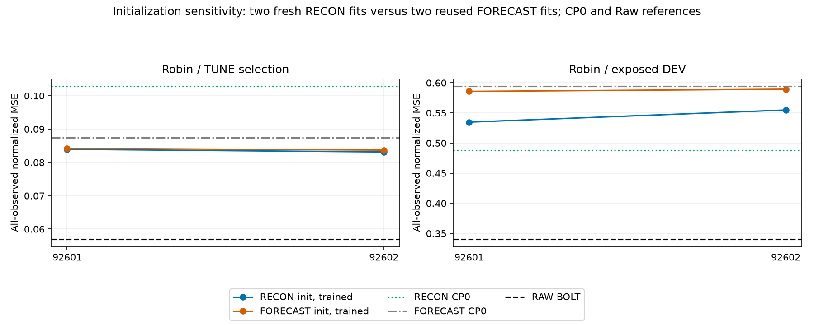
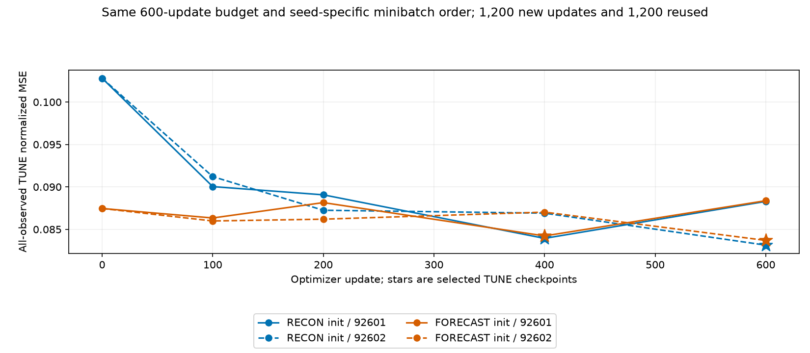
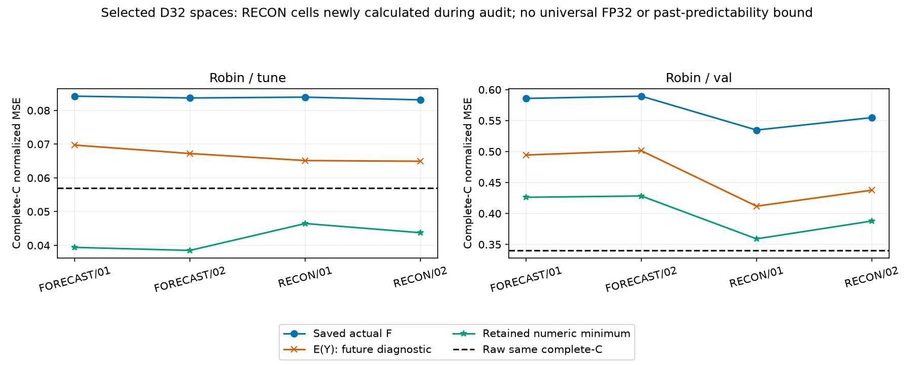

# Robin L7: RECON D 초기화 민감도

[확인] 새 RECON 초기화 학습은 TUNE에서 초기 RECON CP0보다 2/2 조건이 좋아졌지만, 기노출 DEV에서는 2/2 조건이 원 RECON CP0보다 나빴다. 원 FORECAST 초기화의 학습 결과보다는 DEV 2/2 조건이 개선됐고 Raw보다 나쁜 조건은 2/2이다. 초기화가 결과에 영향을 주었으나 현재 600 update 예측 목적 E/D 학습으로 원 고정 RECON·Raw 격차가 해결되지는 않았다.

All-observed 정규화 MSE: RECON CP0 TUNE 0.1028083258, DEV 0.4880930144; Raw TUNE 0.0569510909, DEV 0.3404018870.

[확인] 새 선정 D의 DEV retained numeric minimum도 같은 complete-C Raw보다 2/2 조건에서 높았다. seed 92601: actual 0.5347583753, E(Y) 0.4118414421, minimum 0.3590566709, Raw 0.3404018870; seed 92602: actual 0.5548254075, E(Y) 0.4376727022, minimum 0.3878149017, Raw 0.3404018870. 현재 선정 D와 알려진 과거 offset에 조건부인 진단이므로 모든 표현의 불가능성을 뜻하지 않는다. 다음 고정 D 대조에서 E 갱신과 D 공간 이동의 효과를 분리할 필요가 있다.

- seed 92601: 새 RECON-init CP400, TUNE 0.0839358966, DEV 0.5347583753; 재사용 FORECAST-init CP400, TUNE 0.0842236965, DEV 0.5858233755.
- seed 92602: 새 RECON-init CP600, TUNE 0.0831365911, DEV 0.5548254075; 재사용 FORECAST-init CP600, TUNE 0.0836965604, DEV 0.5894528440.

**비교 조건.** Robin C17/K4, L512/H48, FIT256/TUNE64/기노출 VAL30, 같은 scaler·origin·mask·현재 C anchor·lag [0,1,2,4,8,16,32]를 유지했다. 초기 PCA E와 center는 원 CP0와 byte-exact이고 기존 FIT RECON D32만 복사했다. 이후 두 초기화 모두 같은 actual-C 예측 손실로 E/D를 갱신한다. 재구성 목적 학습과 예측 목적 학습 전체의 대조가 아니다. E/D는 AdamW lr .001/WD0/clip1/B4/600 update, 전체 FIT 채널 관측수 고정 가중 macro MSE, seed별 동일 minibatch 순서를 쓴다. F는 동결하고 실제 F 입력 gradient를 유지한다. seed는 순서의 차이이며 두 독립 자료나 일반화 반복이 아니다.

새 2fit의 1,200 update·10CP와 기존 FORECAST-init 2fit의 1,200 update·10CP 재사용을 구분한다. 새 CP0 parity probe 2개는 optimizer update 0이다. CP0/100/200/400/600의 전체 TUNE MSE와 이른 tie로 선정한 뒤 두 성공/실패 lock 및 registry를 봉인하고 DEV를 추론했다. 새 결과로 기존 CP·학습 예산·선정 규칙을 바꾸지 않았다. K streams + K 과거 buffer + 현재 C anchor이므로 strict K-only는 아니다.

**선정된 공간에 남은 문제.** 아래는 같은 complete-C mask의 actual F, E(Y), FLAT 및 retained numeric minimum이다. all-observed 주점수와 마스크를 섞지 않는다. 새 RECON-init의 4cell은 학습 감사 중 새 계산이며, 기존 FORECAST-init 4cell은 이전 실제 진단 재사용이다. 불변 SVD와 exact-zero-column-reduced LS 두 수학 경로를 교차했지만 새 진단을 별도 외부 감사자가 다시 재현했다고 부르지 않는다.

- RECON / 92601 / tune: actual 0.0839358966, E(Y) 0.0651372950, minimum 0.0464636790, Raw 0.0569510909; complete 3072/3072.
- RECON / 92601 / val: actual 0.5347583753, E(Y) 0.4118414421, minimum 0.3590566709, Raw 0.3404018870; complete 1440/1440.
- FORECAST / 92601 / tune: actual 0.0842236965, E(Y) 0.0697185684, minimum 0.0393953049, Raw 0.0569510909; complete 3072/3072.
- FORECAST / 92601 / val: actual 0.5858233755, E(Y) 0.4944393643, minimum 0.4261939088, Raw 0.3404018870; complete 1440/1440.
- RECON / 92602 / tune: actual 0.0831365911, E(Y) 0.0649257898, minimum 0.0437424020, Raw 0.0569510909; complete 3072/3072.
- RECON / 92602 / val: actual 0.5548254075, E(Y) 0.4376727022, minimum 0.3878149017, Raw 0.3404018870; complete 1440/1440.
- FORECAST / 92602 / tune: actual 0.0836965604, E(Y) 0.0672203738, minimum 0.0384963926, Raw 0.0569510909; complete 3072/3072.
- FORECAST / 92602 / val: actual 0.5894528440, E(Y) 0.5013443650, minimum 0.4282840252, Raw 0.3404018870; complete 1440/1440.

minimum은 선정 D32와 known-past offset, 관측 출력 행, rcond 1e-15로 남긴 수치 공간에서 정규화 MSE만 최소화한 값이다. 미래 미지수는 HK이며 H×7K 자유 변수가 아니다. MAE·물리 단위 오차는 그 MSE 해의 값이고 각각의 최소가 아니다. 모든 FP32/실수 예측의 보편 하한이나 과거 정보로 그 미래를 예측할 수 있다는 증명이 아니다. 원 real/FP32 false-bound flags와 버린 성분은 SPACE_METHODS에 그대로 남겼다. E(Y)는 실제 미래를 쓰는 NumPy FP32 진단이며 배포 불가하다. 불완전 C horizon은 현재 C로 채우며 L7의 뒤 horizon에도 영향을 줄 수 있다. FLAT은 잠재 미래 persistence여서 알려진 과거 lag 때문에 현재 C persistence와 같다는 보장이 없다.

**검산 범위와 다음 판단.** 기존 FIT에서 적합된 초기 D를 다시 fit하지 않았고 새 학습은 E/D 예측 손실 갱신이다. 초기화 민감도는 확인하되 낮은 과거 D minimum을 새 D 가능성으로 재사용하지 않는다. 학습 감사는 저장 E/lag/D 산술·score·CP·로그·order·lock과 원 파일 보존을 확인하며 실제 F forward/backward·optimizer·매 update 학습 손실을 독립 재실행한 것은 아니다. 감사 중 새 계산된 공간과 실제 latent forecast gap을 분리해야 하며, 현재 결과만으로 재구성 표현의 원리적 실패·학습 수렴·Bolt/대조학습/동적 그래프 필요성을 확정하지 않는다. 기노출 DEV에서 원인을 본 뒤 선택한 적응적 탐색이므로 독립 일반화 검증이 아니다. 기존 joint-Y/RF3 등의 예측 목적 E/D 학습도 이미 실행했다.

새 deployment 비용은 계획대로 미측정이다. 같은 구조라도 다른 cohort의 기존 timing을 새 계수 비용으로 차용하지 않는다. RESOURCE는 새 두 학습 실행과 저장 결과 감사·공간 계산의 CPU/wall이며, 기존 16fit process와 직접 나누어 초기화별 학습 speedup을 주장하지 않는다. 기존 결과·실패·선정·보고서는 보존했고 이번 보고 생성은 JSON/JSONL metadata만 읽으며 NPZ/model/F/훈련/TEST/Git을 실행하지 않는다.

**보존된 감사 실패.** 감사 v1은 같은 path·SHA의 공간 진단 record 한쪽에 bytes 항목이 추가된 metadata dict를 통째 비교하여 멈췄다. 원 실패와 SOURCE를 보존하고 v2에서 path·SHA 결속으로 고쳤다. 학습·예측·배열·수식·공차를 바꾼 복구가 아니며 v1의 실패를 PASS로 덮지 않았다. 현재 학습 검산 PASS와 새 공간 COMPLETE는 별도 v2 기록이다.

- [SCORES.csv](tables/SCORES.csv): 84행
- [PAIRED.csv](tables/PAIRED.csv): 24행
- [CHECKPOINTS.csv](tables/CHECKPOINTS.csv): 20행
- [UPDATES.csv](tables/UPDATES.csv): 2400행
- [CONDITIONS.csv](tables/CONDITIONS.csv): 4행
- [PROBES.csv](tables/PROBES.csv): 2행
- [SPACE_CELLS.csv](tables/SPACE_CELLS.csv): 8행
- [SPACE_METHODS.csv](tables/SPACE_METHODS.csv): 24행
- [SVD_CERTIFICATES.csv](tables/SVD_CERTIFICATES.csv): 8행
- [RESOURCE.csv](tables/RESOURCE.csv): 2행

- [train](../../../projection_followup_v1/runs/recon_init_sensitivity_v1/RESULT.json): `f0fc3f95f1e1a61eff4ffc99b7bb7d62affd34afa064f6e29113bb0c37f52ec8`
- [audit](../../../projection_followup_v1/audits/RECON_INIT_SENSITIVITY_AUDIT_v2.json): `b1d28415ade18db8ddc0c987a14e879268413efdd5d1c62ad93e27b24becd52e`
- [full_gradient_parent](../../../projection_followup_v1/runs/linear_e_train_v1/RESULT.json): `3f0cbd9176f2e7882778452e537564aab7445e1b88c1534fd48b1bce7ef639a4`
- [full_gradient_parent_audit](../../../projection_followup_v1/audits/LINEAR_E_ADAPTATION_AUDIT_v1.json): `9796b4ed53f74186bc2513db56fe321c2d450cdd9bffbb7c5f341766e73ee36d`
- [learned_output_space_diagnostic](../../evidence/projection_followup_v1/runs/learned_output_space_v1/RESULT.json.gz): `cf042cc764ff36cbb877211777721783efadbaab6ba8741268eaccba26cbb34b`
- [learned_output_space_audit](../../../projection_followup_v1/audits/LEARNED_OUTPUT_SPACE_AUDIT_v1.json): `1b0dbacb711becce70ac877825cd53b84069918ff62ac79dc9b9b5d8ac410738`
- [causal_lag_diagnostic](../../evidence/projection_followup_v1/runs/actual_causal_lag_objective_v1/RESULT.json.gz): `4168cd05962e479130a722919310f4c192c1bab03d9b78cb7983754f2e502c17`
- [causal_lag_audit](../../evidence/projection_followup_v1/audits/CAUSAL_LAG_OBJECTIVE_AUDIT_v2.json.gz): `d395a82e76a31e38520db1dd4d56642963ca4e362f358a6d86480049d402a31d`
- [selection_registry](../../../projection_followup_v1/runs/recon_init_sensitivity_v1/SELECTION_REGISTRY.json): `91822148b5a211451c1fcbaa489e3df9cb6f0a010c642c7a11fd2f974895809f`
- [plan](../../../projection_followup_v1/PLAN_RECON_INIT_SENSITIVITY_KO_v1.md): `b8242b7b84fa8aa884280a96db92132d83c9b67c575bbd4854282513b85e488e`
- [controller_source](../../../projection_followup_v1/run_recon_init_sensitivity_v1.py): `a00300046d2236c46be7d6d532cead122cd178f066a62fd4bbbea76566d2534b`
- [audit_source](../../../projection_followup_v1/audit_recon_init_sensitivity_v2.py): `55066f6dbc6ce8c6a175fe4ce5c8952fe8eabdde15492fd097b3a8d98c1ecdfd`
- [report_utility](../../../projection_followup_v1/make_linear_e_adaptation_report_v2.py): `32e2460ea4724144067f264ab1ceb0332cd04c5fce2296838024c119c9572466`
- [preserved_failed_audit](../../../projection_followup_v1/audits/RECON_INIT_SENSITIVITY_AUDIT_v1.json): `9d5cfdcfd58645669f0a7f1ff56dbceb6e33f99a87784246b79523917ed6693a`
- [report_source](../../../projection_followup_v1/make_recon_init_sensitivity_report_v1.py): `fe9a579603f1ef92d298ad76d589dc95410940de94f34d85cab678fd4a5aa685`
