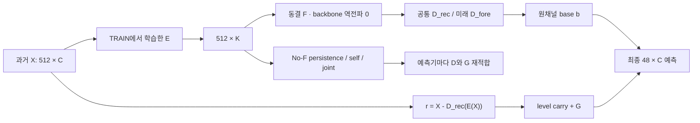

> 과거 캠페인 텍스트의 게시 사본입니다. 당시의 수치·상태·내용을 유지했으며 링크와 이 안내만 바꿨습니다. 현재 연구 완료 상태는 [최신 색인](../../../README_KO.md), 추가 게시 범위와 미게시 역사자료는 [참고 안내](../../README_KO.md)를 확인하세요.

# LEVEL 압축기 A–H 실행 보고

이 파일은 실행 중인 보고서다. 최종 상태·전수 수치·비용·그림 검산이 끝나기 전까지 전체 완료를 뜻하지 않는다. 기본 및 추가 K·시간 분할·Peacock·Electricity128의 158개 조건에서 실제 실행 산출물이 생성됐다. 과거 대응 비교도 별도로 보존했다. 현재 새 LoRA/head 기준선과 전수 비용 측정이 이어지고 있으며, 최종 상태는 독립 검산과 실행 ledger·coverage를 기준으로 갱신한다.

## 목적과 판단 단위

목적은 **동결된 단변량 TSFM에서 채널 수를 줄일 때 생기는 정확도 손실을 포함해, 표현·미래 readout·잔차 경로의 추가 가치와 전체 비용을 구분하는 것**이다. 재구성 오차나 보조 예측 손실 하나가 낮아졌다고 압축기가 좋다고 판단하지 않는다. 최종 원채널 MSE와 MAE, 실제 지연시간과 메모리, E 학습·캐시·D·G 비용을 함께 본다.

TSFM은 여러 시계열로 미리 학습해 새 시계열에 적용하는 시계열 파운데이션 모델이다. 이번 F는 Chronos-Bolt이며 각 latent 채널을 하나의 단변량 입력으로 처리한다. E가 여러 원채널을 K개로 섞어도 F 자체가 그 K채널 사이를 공동 예측하는 구조로 바뀌지는 않는다. 따라서 좋은 재구성 부분공간, 자기과거로 예측하기 쉬운 좌표, F가 잘 예측하는 좌표는 서로 다른 조건이다.

## 실행 계약과 해석 제한

- 기본 L=512, H=48, 두 seed 92601/92602, neural fit마다 실제 2880 updates를 고정했다. 최종 checkpoint가 matched-budget 주 비교다. TRAIN 내부 선택 checkpoint는 보조 자료다.
- 새 clean 비교는 TRAIN 내부 fit/calibration/selection과 outer VAL을 나눴다. scaler·graph·E는 fit 구간으로, 미래 D와 G는 별도 calibration 구간으로 적합하고 규제는 TRAIN selection으로 골랐다. target timestamp가 겹치지 않도록 purge했다.
- 과거 재사용 수치는 full-TRAIN 전처리와 VAL 선택 이력이 있어 새 clean 순위에 섞지 않는다. 같은 target·mask·origin·정규화 계약이 확인된 결과만 대응 비교한다.
- 압축기/G 학습 loss는 관측 entry 평균이며 보고 MSE/MAE는 관측 채널별 오차를 평균한 macro metric이다. 새 LoRA/head는 기존 검증된 구현의 관측 채널 macro MSE로 학습하므로 이 차이를 명시한다. 결측 target은 0 정답으로 채점하지 않는다. latent target의 보간 의존성도 별도 기록한다.
- TRAIN 미래를 E의 학습 정답으로 사용하는 것과 추론 때 미래를 입력으로 사용하는 것을 구분한다. oracle 미래 latent는 병목 진단만 한다. 실제 추론은 origin 이전 과거와 F 예측만 사용한다.
- No-F self/joint 선형 probe는 과거32시점을 쓴다. F의512 history보다 짧으므로 이 비교만으로 F의 필요성을 확정하지 않는다. 원채널 NLinear512 대조를 별도로 둔다.
- 두 seed와 이미 노출된 개발 자료의 시간순 backtest는 모집단 일반화의 충분한 증거가 아니다. overlapping forecast cell은 독립 표본으로 세지 않는다. 시간 bootstrap은 실제 target timestamp `origin+h`의48/96시점 block에 동일한 draw를 적용한다.
- D의 과학 결과는 FP64 회귀 계수를 사용해 생성한 FP32 예측이다. 배포 비용 runner는 FP32 GPU D를 사용하며 원예측과 수치 차이를 기록한다. 작은 수치 차이가 있는 비용 측정을 비트 단위 동일 실행이라고 쓰지 않는다.

## 반드시 보존해야 하는 접근 오류와 수정 이력

**[확인] Electricity 자료 조사 중 agent가 전체 Arrow target을 두 번 메모리로 읽어 보호 구간에 접근했다.** 모델 학습·추론·선택·채점에는 그 target을 사용하지 않았으나, 캠페인 전체의 ‘보호 TEST 새 접근0’ 조건은 충족하지 못했다. 이 사실은 [접근 오류 기록](PROTECTED_ACCESS_INCIDENT.json)에 남겼다. 전체 보호 guard는 실패로 유지한다. 이후 Electricity 실행은 원 Arrow 전체를 읽거나 해시하지 않고, 보호 시작33000 이전의 고정 구간 `[26856,33000)` 및 lexical128개 실제 채널만 정확한 byte slice로 읽은 안전 subset NPZ에 의존한다. 그 후 loader의 local 접근0 검사와 캠페인 전체 접근 오류는 별개다.

최초 수동 분석에는 CPU/RSS 실측 영수증이 없어 CPU240초 추정과 초기 import/setup60초 추정을 합친300초 예약을 예산에 반영했다. 이 값은 실측값이 아니다. 이후 프로세스는 import를 포함한 whole-process CPU를 기록한다. 원자료·과거 파일과 기존 실행 중 작업을 종료하거나 덮지 않았는지는 최종 보존 검산에서 확인한다.

초기 정성 그림의 과거/새 정규화 혼합과 origin 기준 bootstrap 오류를 발견해 invalid 이력으로 보존했다. 새 그림은 동일 truth/mask/origin 계약만 묶고, 실제 관측되지 않은 Actual은 선을 끊는다. 초기 NaN 요약 실패, Windows JSON 일시 접근 실패, Mini/Tiny의 잘못 가정한 cache 경로 실패도 삭제하지 않는다. Mini/Tiny는 검증된 로컬 checkpoint 경로로 재시도한다. 세부 변경은 [source 이력](../../README_KO.md#unpublished-historical-dependencies), [시각화 오류](../../README_KO.md#unpublished-historical-dependencies), [bootstrap 오류](../../README_KO.md#unpublished-historical-dependencies)를 따른다.

## 1. 교수님이 제안한 PCA 대체를 무엇으로 실제 실행했는가?

**[확인: 기본 조건 완료]** PCA만 실행한 상태가 아니다. 현재 시점 Point MLP와 과거8lag causal TCN의 다섯 학습 목적40fit, 공식 TS2Vec small/large8fit, 논문 Eq.1–3을 구현한 GTConvAE 계열의 세 arm12fit, 공식 DCA 두 seed×두 자료4fit을 실행했다. 새 clean PCA4조건도 동일 F/D 계약으로 계산했다. 이후 추가 K·시간 prefix·Peacock·고차원 자료에서는 사전 고정한 대표만 재적합한다.

TS2Vec 원형의 마지막 causal 표현→원채널48step ridge도 실제 학습·추론하며 E→F→D와 구분한다. GT는 이름만 바꾼 기존 GraphTimeNLEncoder가 아니라 product shift와 polynomial convolution의 명시 행렬 동치를 검산한 별도 구현이다. 조사만 한 AdaPTS/TRMF/VICReg를 원형 benchmark 실행으로 세지 않는다.

## 2. 학습형 압축기의 가치는 어디에서 나왔는가?

원공간 재구성, TRAIN 분산으로 규격화한 latent F/probe 예측, decoder gain, 최종 원공간 예측을 따로 본다. 같은 observed mask에서 oracle 분해 `MSE = E[a²]+E[e²]+2E[ae]`도 직접 검산한다. 교차항의 상쇄 때문에 oracle 복원 오차를 달성 가능한 예측 하한으로 부르지 않는다.

PCA의 U를 고정한 두 Q로 회전해 재구성이 유지되는지 검산하고, 각 회전에서 F와 D를 다시 계산한다. 이는 같은 부분공간이라도 단변량 F의 좌표별 예측이 달라질 수 있는지를 보는 진단이다. 최적 회전을 찾았다는 결과가 아니다.

현재 기본 clean 조건에서 학습형 E만 붙인 E0는 Raw F보다 대체로 나쁘다. 일부 G가 E0의 큰 손상을 줄이지만 그 결과만으로 E가 새로운 정보를 제공했다고 말할 수 없다. 최종 전수 수치와 fit-bound B 진단을 연결해 표현 손실·F 전이 실패·decode 증폭을 구분한다.

## 3. self-predictive loss의 추가 가치는 guard로 설명되는가?

C0 REC, C1 guard+detached 보조 predictor, C2 SELF beta.1, C3 SELF beta1, C4 joint beta1을 같은 입력 풀·초기화·update 계약으로 비교한다. C1과 C3는 보조 predictor의 구조와 계산을 맞추고 E로 예측 gradient가 가는지만 구분한다. C0 대비 개선과 C1 대비 개선은 서로 다른 질문이다.

**[확인: 기본 E0 결과]** Robin TCN에서는 C3가 C1 대비 원공간 MSE·MAE를 개선하지만, Jena의 두 구조와 Robin MLP에서는 같은 방향이 유지되지 않는다. 한편 TRAIN 분산으로 규격화한 F의 latent 오차가 줄어드는 경우도 있으므로, 이를 모두 ‘F 전이가 없다’고 부르면 부정확하다. **잠재 좌표의 F 예측오차 개선과 원공간 예측 개선의 분리**가 현재의 관찰이다. decoder gain·표현 좌표·oracle 복원·교차항을 함께 보되, 이들의 동반 변화만으로 원인을 확정하지 않는다. 전체 LEVEL 및 K/fold 결과를 연결해 적용 범위를 판단한다.

scale-collapse 검산은 latent/예측을 상수배하고 decoder를 역비례 확대해 원공간 예측이 유지되는지 확인한다. `variance+epsilon` 때문에 latent 수치만 작아진 경우를 성능 개선으로 인정하지 않는다. 상수·동일채널·rank 손실·과도한 decode gain flag와 실제 fit-bound 통계를 함께 보고한다.

## 4. GTConvAE/TS2Vec 원형과 무엇이 다른가?

[METHOD_DELTA](../../README_KO.md#unpublished-historical-dependencies)는 원문·현재 변경·전이 위험을 각각 기록한다. [GTConvAE/LoG2022](https://proceedings.mlr.press/v198/sabbaqi22a.html)의 원형은 공간 노드를 유지하고 시간축을 줄인다. 현재는 causal past→present 시간 graph, 시간축 유지, 추가 C×feature→K projection을 사용한다. 공간 graph는 TRAIN 상관 기반 대칭 graph이며 실제 물리 graph나 학습된 directed lagged causal graph가 아니다. no-spatial-message arm에도 projection의 채널 혼합은 남는다.

[TS2Vec/AAAI2022](https://ojs.aaai.org/index.php/AAAI/article/view/20881)는 hierarchical contrastive loss를 유지한다. 작은 K, window pool, TRAIN 내부 ridge 선택과 F 연결은 변경이다. small/large의 동일2880update는 동일 연산량을 뜻하지 않는다. causal rolling의 padding200을 실제로 반복 계산하며 training/SWA 중복 weight residency도 비용에 포함한다. temporal contrast를 자기과거 latent forecasting loss라고 바꾸어 부르지 않는다.

[DCA/NeurIPS2019](https://papers.nips.cc/paper_files/paper/2019/hash/704cddc91e28d1a5517518b2f12bc321-Abstract.html)는 공식 Gaussian/stationarity 기반 예측정보 목적을 bounded CPU fit했다. capped 비수렴은 보존하며 전역 최적이라고 쓰지 않는다. 부분공간 내부 가역변환 불변성과 각 좌표의 자기과거 예측성은 같은 조건이 아니다.

## 5. D만으로 충분한가, G 또는 F가 필요한가?

**[확인: 과거 A층]** 기존22개 encoder 경로의 native/common base, 같은 q의 direct/base-residual과 열 개 λ를 대응 비교했다. 일부 MSE 개선은 MAE 악화와 함께 나타났으며, Raw F 대비 두 지표 동시 개선으로 일반화할 근거는 없었다. 이 결과는 새 clean 조건의 순위와 섞지 않는다.

새 clean 조건에서는 기본 b, last residual carry, level 없는 G, centered residual LEVEL, 원래 centered raw G를 비교했다. 원래 raw G가 이미 X−X_last이므로 E4와 E5는 같은 계산으로 연결했다. 별도로 D8 유/무와 G 유/무의 상호작용을 비교한다. F와 No-F 각각의 D/G를 재적합하며, F 전용 후단을 No-F에 그대로 연결한 손상을 F의 가치로 해석하지 않는다.

NLinear512와 새 clean LoRA/head 기준선까지 보아야 F의 실용 필요성과 외부 residual 적응의 차이를 평가할 수 있다. 원형 F 역전파0 계약은 압축 후보에 적용하고 LoRA/head의 허용된 backbone/head backward는 예외로 따로 계수한다.

## 6. 정확도·학습비용·배치·K를 함께 고려해 유지할 후보가 있는가?

첫 실제 측정은 Robin MLP SELF1 E0의 B1 중앙11.392ms, Jena native TS2Vec large E0의 B32 중앙341.970ms, Robin Raw small F의 B32 중앙90.249ms였다. 서로 자료·채널 수·입력 fixture 또는 batch가 다르므로 이 세 건으로 대응 속도비나 메모리 이득을 계산하지 않는다. 각 건의 관측값일 뿐이다. 자원 bookkeeping 소스 변경 전 원 영수증을 보존하며, 전수 비용 실행에서 현재 소스에 묶인 새 측정으로 갱신한다.

전수 비용 표는 독립 process, warmup10/timed50과 원시 표본을 보존한다. B1/4/32 및 원채널 microbatch를 함께 보며, source parity·load·disk·window 생성 제외 범위를 명시한다. Raw 채널을 그대로 두고 나눠 처리하는 방법으로 같은 메모리 목적을 달성할 수 있는지도 검사한다.

MSE/MAE 각각의0/5/10/20% 손실 표와 교집합, 실제 관측 memory-cap별 가능한 오차·지연시간을 보고한다. 이 격자는 사용자의 허용 손실이나 논문 합격선이 아니다. 최초 분석의 CPU 일부 미계측과 lifecycle의 누락된 구성요소는0으로 채우지 않는다. 실제 모든 자료가 갖춰지기 전 후보 유지 판정을 확정하지 않는다.

## 7. 시간·자료가 바뀌어도 방향이 유지되는가?

사전 고정 TRAIN prefix70%/85%의 두 fold에서 scaler·graph·E·D·G를 다시 적합하고, Peacock의 기존 TRAIN/VAL 및 실제128채널 Electricity로 대표 후보를 확인한다. 이 자료는 과거 연구자에게 노출되었고 Electricity는 원 TEST 앞 TRAIN 내부 확인이므로 독립 확증이라고 부르지 않는다. 자료 하나에서 좋아졌다는 이유로 다른 자료의 악화를 삭제하지 않는다.

유효 origin 수와 실제 timestamp block 수를 명시한다. 짧은 fold와 two-seed 결과를 충분한 일반화 보장으로 부르지 않는다. 현재 보고서의 이 절은 추가 실행·bootstrap 결과가 연결되기 전까지 미완료다.

## 8. 알려진 것을 빼고 남는 기여 후보는 무엇인가?

[AdaPTS/ICML2025](https://proceedings.mlr.press/v267/benechehab25a.html) 등에서 encoder→단변량 FM→decoder 및 latent dimension에 따른 비용 조정은 이미 다룬다. AE나 GT/TS2Vec를 PCA 대신 넣었다는 것만으로 새로운 기여를 주장하지 않는다. [TRMF](https://papers.neurips.cc/paper_files/paper/2016/file/85422afb467e9456013a2a51d4dff702-Paper.pdf)의 재구성+latent dynamics와 [VICReg](https://arxiv.org/abs/2105.04906)의 collapse guard도 알려진 원리다.

현재 남길 수 있는 문제정의는 **‘F 역전파 없이 학습한 표현의 좌표별 예측성이 동결 단변량 F와 최종 원공간 예측에 언제 전이되며, decoder prior·residual·microbatch 기준선까지 포함해 어떤 비용 조건에서 유효한가?’**다. 기여 후보는 보조 목적의 전이 실패/성공 조건, 부분공간과 좌표계의 차이, D/G의 중복 또는 독립 효용, 전체 비용 경계의 실측이다. 후속 전체 결과에서도 정확도·비용 동시 이점이 없다면 실용적 개선 방법으로 주장할 후보가 없다는 결론을 남긴다.

## 산출물과 재개

실제 상태와 실패 이유는 [ledger](../../README_KO.md#unpublished-historical-dependencies), [RUN_MANIFEST](../../README_KO.md#unpublished-historical-dependencies), [명령 이력](../../README_KO.md#unpublished-historical-dependencies)을 따른다. [프로토콜](../../README_KO.md#unpublished-historical-dependencies), [재사용 근거](../../README_KO.md#unpublished-historical-dependencies), [자료 계약](DATA_CONTRACT.json), [자원 상한](../../README_KO.md#unpublished-historical-dependencies)과 각 case의 prediction/trace/checkpoint SHA가 재현 근거다. 최종 그림과 검산, 후보별 유지/조건부 유지/보류/기각 및 판정을 뒤집을 최소 증거는 전수 실행 뒤 연결한다.
