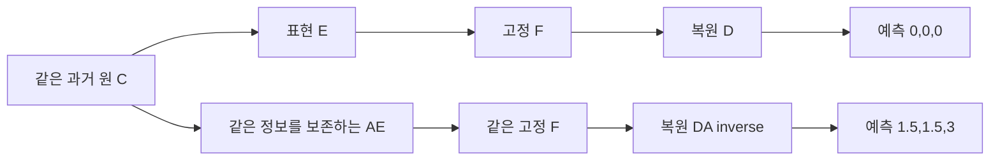

> 과거 캠페인 텍스트의 게시 사본입니다. 당시의 수치·상태·내용을 유지했으며 링크와 이 안내만 바꿨습니다. 현재 연구 완료 상태는 [최신 색인](../../../README_KO.md), 추가 게시 범위와 미게시 역사자료는 [참고 안내](../../README_KO.md)를 확인하세요.

# 현재 실패 설명에서 배제한 것과 남은 좌표계 문제

상태: **SOURCE·기존 실행 기록 검토 / 새 모델 실험 없음**. 이 문서는 실제 코드 경로, 이미 완료한 gradient 기록, 수학적 반례를 구분한다. 현재 Chronos-Bolt의 좌표 변환 불변성이나 새 보정 성능을 측정한 보고서가 아니다. SOURCE fixture 정의를 통과한 시험으로 세지 않는다.

[확인] 완료한 MAIN 잔차 보정 코드·보고·그림은 main `645481253114884227b1022a3cc90b0f4f31b638`에 게시했다. [게시 목차](../../../../../smallk_failure_followup_20261014/publication_main_20261014_v3/README_KO.md)와 [실제 결과](../../../../../smallk_failure_followup_20261014/report_main_residual_v1/REPORT_KO.md), [오차 기여도](../../../../../smallk_failure_followup_20261014/report_main_residual_error_diagnosis_v1/REPORT_KO.md)를 먼저 볼 수 있다. 새 SOURCE 준비와 이 검토는 그 완료 cohort에 포함되지 않는다.

## 1. 현재 MAIN을 재구성만 학습한 모델로 설명하면 안 된다

[확인: SOURCE] 현재 MAIN의 예측 경로는 다음과 같다.

\[
z=E(X_{past}),\qquad \hat z=F(z),\qquad
\hat Y=X_t+D(\hat z)-D(z_t).
\]

[engine.forward_path](../../../../../smallk_predictive_alignment_20261013/engine.py#L108)는 F 출력으로 미래 C를 예측하며, 실제 Y에 대한 예측 손실로 E/D를 학습한다. 원 C의 현재값 anchor도 남는다. 따라서 strict K-only 정보 병목이라고 부르거나, 현재 실패를 단순히 “재구성 목적만 사용해서”라고 설명하면 실제 비교 조건과 맞지 않는다. 재구성만으로 예측 적합성을 보장할 수 없다는 일반적인 명제와 현재 모델의 학습 목적은 따로 다뤄야 한다.

[확인: SOURCE] [FrozenBolt](../../../../../forecast_component_study_20261013/component_experiment.py#L92)는 F 가중치를 `requires_grad_(False)`로 동결하지만, 학습 때는 `pipeline.predict()` 대신 `model(context=rows).quantile_preds`를 직접 호출한다. 가중치 동결은 입력 z에 대한 미분을 제거하지 않는다. 로컬 Bolt는 연속 값을 정규화·patch embedding으로 보내며, 원 Chronos의 값 양자화/tokenization 경로와 구분해야 한다. 공식 구현도 Bolt의 연속 patch 입력과 직접 quantile 예측을 보여준다. [공식 Chronos 저장소](https://github.com/amazon-science/chronos-forecasting), [공식 Bolt 소스](https://github.com/amazon-science/chronos-forecasting/blob/main/src/chronos/chronos_bolt.py).

위 upstream main 링크는 개념·공식 구현 출처다. 과거 실행 당시 로컬 설치본과 같은 byte였다는 증거로 쓰지 않는다.

## 2. F를 통과한 학습이 실행됐다는 기존 기록이 있다

[확인: 기존 실행] [joint gradient 원수치](../../../../../smallk_failure_followup_20261014/report_joint_followup_v2/tables/joint_gradients.csv)의 Robin seed92601, 실제-Y 목적에서 update 0/99/199/399/599의 F 입력 gradient norm은 각각 다음과 같다.

```text
update           0           99          199         399         599
F input norm     .045167699  .020914258  .012789292  .017483836  .021593580
finite           True        True        True        True        True
```

[gradient 검사 SOURCE](../../../../../smallk_failure_followup_20261014/run_joint_objectives_v2.py#L72)는 loss→F 출력의 gradient를 구하고, 그 gradient를 F 출력→z로 다시 전달한다. anchor의 `-D(z_t)` 경로만으로 E gradient가 생긴 것을 F 학습 증거로 혼동하지 않는다. [learning 기록](../../../../../smallk_failure_followup_20261014/report_joint_followup_v2/tables/joint_learning.csv)은 12조건마다600 update와 E18/D6 parameter tensor 변화를 기록한다.

[판단] 이 증거는 “F가 동결됐으므로 E가 전혀 학습되지 않았다”는 구체적인 설명을 배제한다. gradient 존재와 parameter 변화는 좋은 최적해, 유용한 표현, 독립적인 일반화를 보장하지 않는다. 일부 TUNE 선택이 update0인 사실도 남아 있다. gradient 소실·방향 불량·최적화 난도·용량 한계 중 무엇이 성능을 제한하는지는 아직 확정하지 않았다.

## 3. 내부 정규화 좌표를 D에 잘못 넘긴다는 불일치는 찾지 못했다

[확인: SOURCE] 로컬 Bolt의 입력 정규화는 stream별 loc/scale을 만들고, 출력에서 같은 loc/scale로 inverse한다. D가 받는 값은 내부 표준화 좌표가 아니라 원 E 좌표의 잠재 예측이다. 원 MAIN, 후속 진단, 배포 비용 경로는 같은 `replace_normalizer`를 사용한다. 원 CP의 E/D state를 strict load한다. 이번 SOURCE 추적에서 현재 경로의 구체적인 정규화/decoder 좌표 불일치를 찾지 못했다.

과거에는 상수 rain context에서 sqrt backward가 비유한 gradient를 만든 실제 문제가 있었으며 [수정 SOURCE](../../../../../forecast_generalization_study_20261013/diagnose_constant_gradient.py#L10)는 forward를 보존하고 variance0의 backward만 고친다. 이는 이미 다룬 특정 학습 문제다. 현재 Robin/Beijing 성능 실패 전체를 이 오류로 다시 설명할 근거는 없다.

[확인: 현재 파일 관찰] 이번 읽기 시점 로컬 `chronos_bolt.py` SHA256은 다음과 같다.

```text
93b3af9e4521ea981c4228b1acaa252321f7a190512f956088394426182c8b8c
```

이는 현재 디스크 소스 관찰이고 과거 loaded code 동일성 증거는 아니다. 기존 F state_dict hash는 parameter-free normalizer 종류·eps·arcsinh·선택 quantile·설정·설치 코드 전체를 보장하지 않는다. 새 [behavior contract SOURCE](../../README_KO.md#unpublished-historical-dependencies)는 이 메타데이터와 실제 전달된 Python binding의 source-file SHA를 가중치 hash와 따로 기록한다. 모델·데이터를 로드하거나 forward/patch를 호출하지 않는다. 실제 loaded signature는 아직 **UNKNOWN**이고, transitive 라이브러리/kernel 동일성이나 수치 동등성을 증명하는 도구도 아니다.

새 normalizer를 eval 이후 할당하면 하위 module의 `training` flag가 기본 True일 수 있다. 현재 normalizer forward/inverse는 이 flag를 사용하지 않는다. flag 차이를 수치 실패로 단정하지 않고 모델과 하위 모듈 상태를 따로 기록하도록 준비했다.

## 4. 정보 보존과 고정 예측기 적합성은 다르다: 손계산 반례

다음은 **분석용 toy 연산자**다. 실제 Chronos의 .5 quantile 출력은 학습된 미래 예측이고, 과거 sample median이 아니다. 이 반례에서만 F를 각 stream의 과거3점 median으로 정의한다. 데이터 실험이나 실제 Bolt 측정으로 세지 않는다.

K2 잠재 상태에서 C3 입력을 \(x=(z_1,z_2,z_1+z_2)\)로 만들자. E는 앞의 두 좌표를 취하고 D는 세 좌표를 정확히 복원한다. 다른 표현을 가역행렬 A와 함께 \(E'=AE\), \(D'=DA^{-1}\)로 만들면 두 표현은 같은 정보를 보존하고 재구성이 정확히 같다.

\[
D'E'(x)=DA^{-1}AE(x)=DE(x)=x.
\]

그런데 동일한 고정 F를 각 좌표에 적용한 예측은 자동으로 같지 않다. 충분조건은 다음의 equivariance이며, D가 차이를 지우는 경우까지 고려하면 일반적인 필요조건이라고 쓰지는 않는다.

\[
F(Az_{past})=A F(z_{past}).
\]

과거 잠재3점과 orthogonal Hadamard mixing을 다음처럼 택한다. 여기서 A의 determinant는 -1이므로 순수 회전이라고 부르지 않는다.

\[
z_{past}=\{(0,0),(0,3),(3,0)\},\qquad
A=\frac1{\sqrt2}\begin{bmatrix}1&1\\1&-1\end{bmatrix}.
\]

원 좌표의 stream별 median은 \((0,0)\)이고 원 C 예측은 \((0,0,0)\)이다. 변환 좌표의 두 stream은 각각

\[
u=\{0,3/\sqrt2,3/\sqrt2\},\quad
v=\{0,-3/\sqrt2,3/\sqrt2\}.
\]

median은 \((3/\sqrt2,0)\)이다. A의 역변환은 \((1.5,1.5)\)를 주므로 원 C 예측은 \((1.5,1.5,3)\)이 된다. 재구성·보존 정보는 같은데 예측은 달라졌다. 정확한 과거 재구성에서는 현재값 anchor \(x_t-D(z_t)\)도 상쇄되므로 anchor를 추가해도 이 반례는 남는다. 미래 정답을 정하지 않았으므로 어느 예측이 더 정확한지 주장하지 않는다.



[판단] shared univariate F에 들어가는 K stream이 어떤 기저의 어떤 시간 궤적이 되는지가 중요할 수 있다. stream별 loc/scale 정규화는 cross-channel mixing에 대한 equivariance를 자동으로 만들지 않는다. F가 stream을 독립 처리해도 E가 채널·지연 관계를 stream 안에 반영할 가능성은 있다. “F에 채널 attention이 없으므로 관계를 전혀 못 쓴다”까지 확대하면 안 된다.

이 반례는 **재구성/정보 보존만으로 임의의 고정 F와 호환된다는 보장이 없다는 것**을 보여준다. 실제 E가 나쁜 기저를 선택했는지, 실제 Bolt가 동일한 mixing에서 얼마나 달라지는지, 그것이 현재 실패의 주원인인지는 미측정이다. 현재 MAIN에 이미 예측 목적을 사용했다는 사실도 이 반례로 바뀌지 않는다.

## 5. 다음 질문을 좁힌 SOURCE 구현

[새 p49K 모듈](../../README_KO.md#unpublished-historical-dependencies)은 원 MAIN을 보존하면서 과거33K 요약에 (a) 과거에서 생성한 F 예측48점 또는 (b) 최근 과거48점을 16개 연속3점 평균으로 요약해 추가한다. 둘 다 마지막 과거 z를 FP32로 먼저 빼며 endpoint를 추가하지 않는다. 두 경로는49K: Robin196, Beijing98이다. 이전 [p50K 계획 v1](../../README_KO.md#unpublished-historical-dependencies)은 보존했고 실제 실행 시에는 [새 v2 계약](../../README_KO.md#unpublished-historical-dependencies)을 사용해야 한다.

이 변경은 recent-past endpoint가 정의상0인 반면 forecast endpoint는 비영일 수 있는 구조적 교란을 SOURCE 단계에서 제거한다. registered p가 같아도 rank·상관·effective prior는 다를 수 있어 완벽한 capacity match로 부르지 않는다. 미래 F 요약은 전체 과거의 결정적 변환이며 미래 정답 정보가 추가되는 것이 아니다. 제한된 선형 readout이 접근하기 쉬운 조건을 제공하는지 확인하는 비교다.

독립 SOURCE 검토에서 FP32 차감→평균, FIT-only FP64 통계, 공유 MEAN/ZERO, \(\alpha N_c\) thin-SVD, FP32 MAIN addition의 확정적인 산술/shape 오류는 발견하지 못했다. 이것은 실행 시험 PASS가 아니다. 새 feature11개와 behavior9개 fixture **정의**는 미실행이며 실제 캐시 존재·provenance·signature도 아직 UNKNOWN이다.

## 6. 지금 주장할 수 있는 범위

[확인] frozen F를 통과한 학습은 실제 실행됐다. MAIN을 재구성-only로 설명할 수 없고, 현재 SOURCE에서 구체적인 normalization→D 좌표 오류는 찾지 못했다. Beijing의 제한적인 MSE 개선은 MAE 악화를 동반하며 Robin 정확도 격차는 남았다.

[판단] 남은 질문은 **“과거 표현이 보유한 정보를 고정 F와 D/readout이 충분히 활용하는가, 이를 작은 모델과 일관된 선택 조건으로 개선할 수 있는가?”**다. 새로운 대조학습이나 directed graph를 넣는 것만으로 해결된다고 주장하지 않는다. 먼저 original MAIN을 잃지 않는 paired 보정의 유용성을 확인하고, 좌표 변환 진단은 별도 조건을 고정해야 한다. 알려진 exposed EVAL은 새 독립 일반화 검증이 아니다.

현재 MAIN 잔차 phase의 실제 수행은 승인된 고정 wall 만료 전에 끝났다. 만료는 **2026-10-14 12:06:54.786 KST**이고 CPU663.094103901/900초, GPU40.763349894/300초를 사용했다. 이후에는 SOURCE·문서·기존 기록 읽기만 수행했다. 새 실행 clock·자원 연장·모델 추론·solver·시험·계수 선택은 활성화하지 않았다. 연구 전체 성능 목표는 아직 해결되지 않았다.
