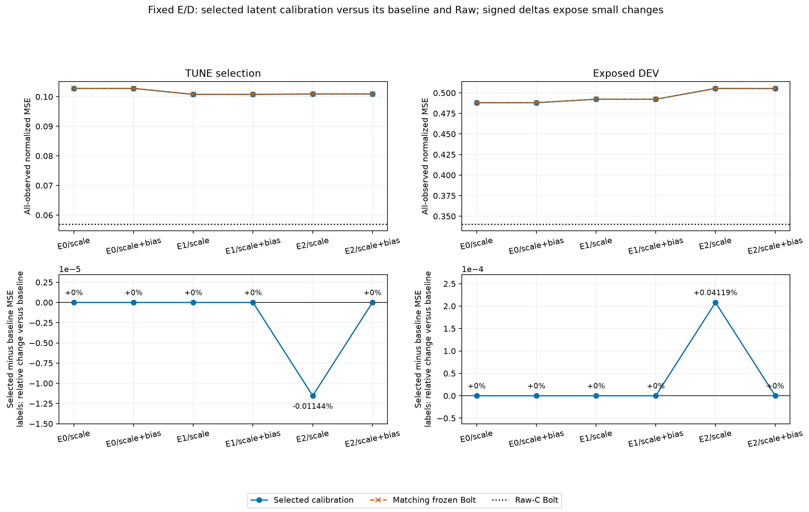
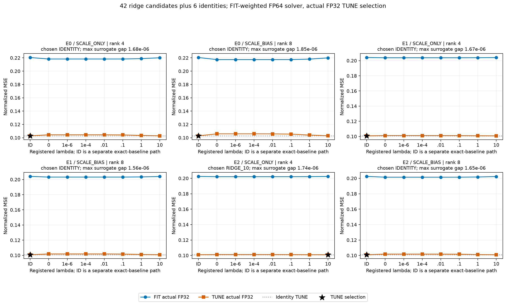
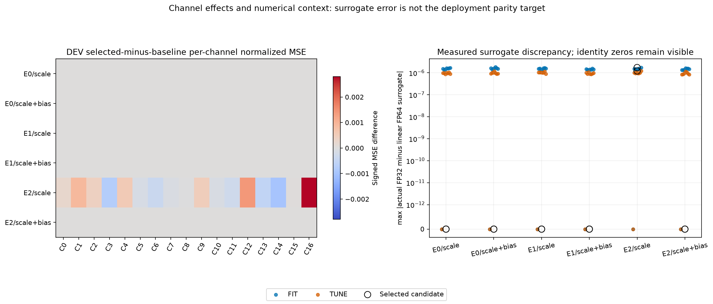
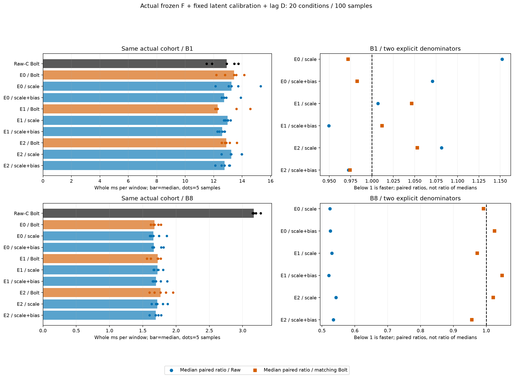

> 게시 사본입니다. 원문 작성 당시의 로컬·준비·미실행 상태는 역사로 보존합니다. 최신 완료/미해결 상태와 게시 범위는 [색인](../../README_KO.md)을 확인하세요. 과학 원본은 바꾸지 않고 링크와 이 안내만 추가했습니다.

# 고정 L7 E/D의 잠재 미래 scale·bias 보정

[확인] 6조건 중 identity 선정은 5/6이다. 원 Bolt baseline보다 MSE가 낮은 선정 q는 TUNE 1/6, 기노출 DEV 0/6이고 Raw보다 DEV MSE가 낮은 조건은 0/6이다. 이 작은 보정이 Raw gap을 해결했다고 볼 수 없다. 작은 TUNE 개선은 단일 노출 자료에서의 점추정이며 독립 일반화나 유의한 개선의 근거가 아니다.

- RECON_CP0 / SCALE_ONLY: IDENTITY; TUNE q 0.102808326937, baseline 0.102808326937, delta +0.000000000000 (+0.000000%); DEV q 0.488093013449, baseline 0.488093013449, delta +0.000000000000 (+0.000000%), Raw 0.340401887028.
- RECON_CP0 / SCALE_BIAS: IDENTITY; TUNE q 0.102808326937, baseline 0.102808326937, delta +0.000000000000 (+0.000000%); DEV q 0.488093013449, baseline 0.488093013449, delta +0.000000000000 (+0.000000%), Raw 0.340401887028.
- E_ONLY_s92601 / SCALE_ONLY: IDENTITY; TUNE q 0.100779781094, baseline 0.100779781094, delta +0.000000000000 (+0.000000%); DEV q 0.492266797849, baseline 0.492266797849, delta +0.000000000000 (+0.000000%), Raw 0.340401887028.
- E_ONLY_s92601 / SCALE_BIAS: IDENTITY; TUNE q 0.100779781094, baseline 0.100779781094, delta +0.000000000000 (+0.000000%); DEV q 0.492266797849, baseline 0.492266797849, delta +0.000000000000 (+0.000000%), Raw 0.340401887028.
- E_ONLY_s92602 / SCALE_ONLY: RIDGE_10; TUNE q 0.100914578701, baseline 0.100926119788, delta -0.000011541087 (-0.011435%); DEV q 0.505458118884, baseline 0.505250003864, delta +0.000208115020 (+0.041191%), Raw 0.340401887028.
- E_ONLY_s92602 / SCALE_BIAS: IDENTITY; TUNE q 0.100926119788, baseline 0.100926119788, delta +0.000000000000 (+0.000000%); DEV q 0.505250003864, baseline 0.505250003864, delta +0.000000000000 (+0.000000%), Raw 0.340401887028.

[확인] actual FIT MSE의 후보 최솟값이 identity보다 낮은 조건은 6/6이다. 이 제한된 family가 FIT 잔차 일부를 적합했는지와 TUNE/DEV로 옮겨졌는지를 구분한다. FP64 surrogate 직접 해를 actual FP32 MSE의 정확한 최적해로 부르지 않으며, 이 직접 solver의 결과를 모든 SGD 학습의 수렴 판단으로 확대하지 않는다.

**질문과 고정 조건.** 원 RECON CP0 E0와 이전 E-only 선정 E1/E2의 같은 E/D/center, Robin C17/K4·L512/H48·lag [0,1,2,4,8,16,32]·FIT256/TUNE64/기노출 VAL30·현재 C anchor·원 scaler/origin/mask를 유지했다. E1/E2의 과거 FIT 미래 감독 이력은 없어지지 않지만 이번 E/D/F 학습·optimizer·F load/forward·native head weight load는0이다. FIT 미래는 정상 회귀 response이고 배포 입력은 과거와 동결 F 예측이다.

두 family는 u'=u+a_k(u-z_last), 또는 여기에 b_k를 더하는 P4/P8 global 보정이며 origin/horizon에 계수를 공유한다. 별도 C intercept나 새 D는 없다. 미래만 바꾸는 lag 설계 열을 쓰며 알려진 과거 prefix와 lag별 z_past[-1-lag] 기준을 보존했다. 실수 산술에서 a=-1,b=0은 z_last지만 FP32 u-(u-z_last)의 cancellation 때문에 일반 byte-collapse를 보장하지 않는다. FLAT latent도 현재 C persistence가 아니며 prefix가 끝나도 lag별 기준 때문에 plateau가 남을 수 있다. a=b=0 identity는 원 baseline/future 객체를 그대로 반환하는 별도 byte-exact 경로다.

[확인] 실제 6 fit 조건에서 SVD 호출은 6회이고 ridge42후보+identity6비교를 했다. FIT/TUNE actual FP32 평가는 96개, 선정 DEV는 6개다. 전체 FIT feature가 정확0이면 해당 fit의 SVD0과7개 zero 후보를 보존하는 계약이며 무조건6SVD라고 세지 않는다. 같은 세 상태의 두 family를6개 독립 자료로 세지 않는다.

**적합과 선정.** 원 FIT 관측만 w=1/(C_active·N_FIT,c)로 가중했고 관측 행의 합은1이다. r=Y-actual cached baseline, 비중심 설계의 FIT RMS s_j와 A=sqrt(w)X/s로 FP64 identity-centered ridge를 적합했다. 정확0 feature 열만 제거하고 원 위치에0을 넣었다. lambda0 상대 cutoff1e-12, 양수 lambda의 sigma/(sigma²+lambda)를 구분하고 계수나 음수 gain을 사후 clip하지 않았다. 기존 공간 minimum의 cutoff1e-15를 바꾸는 작업이 아니다. λ=[0,1e-6,1e-4,.01,.1,1,10]과 identity의 actual CUDA FP32 C 예측으로 TUNE 자체 관측수 macro MSE를 계산했다. 동률이면 identity, 이후 큰 lambda를 우선하며 모든6잠금·registry 뒤 DEV를 열었다. FIT 가중치를 TUNE/DEV 분모로 재사용하지 않는다.

**수치 검산의 두 역할.** actual FP32 q+원 lag D는 독립 NumPy FP32 q+lag-specific decode와 고정 atol1e-5/rtol2e-6으로 검산했다. FP64 baseline+Xβ는 이 parity 대상이 아니다. actual과 선형 surrogate의 max/RMS/per-channel 차이는 별도로 측정하고0으로 가정하지 않는다. 계수64→32, FIT RMS/zero columns/rank/singularvalues 및 실제 저장 값을 독립 감사 JSON에서 받아 CSV로 보존했다. 양수 ridge의 augmented weighted least squares 등 독립 solver 검산은 저장 계산을 대상으로 하며 실제 F/GPU/optimizer를 재현한 것이 아니다. rank가 부족하면 계수를 고유한 잠재 의미나 인과효과로 해석하지 않는다.

현재 보존된 actual-minus-surrogate max absolute error의 최댓값은 1.84632650158e-06, RMS의 최댓값은 1.453625731e-07다. 독립 FP32 C parity max error의 최댓값은 1.43051147461e-06다. 세 수치는 서로 다른 검사다.

**현재 고정 공간의 해석.** 앞서 검산된 같은 D32/known-past offset/complete-C/rcond1e-15 retained numeric minimum을 문맥으로 재사용하며 새 공간 적합은0이다. 낮은 DEV minimum은 과거 예측 가능성의 증명이 아니고 TUNE와 DEV의 반대 근거를 함께 읽어야 한다. 모든 실수/FP32 forecast의 보편 하한으로 바꾸지 않는다.

- RECON_CP0 / tune: retained numeric minimum 0.060984032335, Raw 0.056951090934; complete 3072/3072; 이전 감사 문맥 재사용.
- RECON_CP0 / val: retained numeric minimum 0.306885041321, Raw 0.340401887028; complete 1440/1440; 이전 감사 문맥 재사용.
- E_ONLY_s92601 / tune: retained numeric minimum 0.059734017374, Raw 0.056951090934; complete 3072/3072; 이전 감사 문맥 재사용.
- E_ONLY_s92601 / val: retained numeric minimum 0.306905621141, Raw 0.340401887028; complete 1440/1440; 이전 감사 문맥 재사용.
- E_ONLY_s92602 / tune: retained numeric minimum 0.059579576287, Raw 0.056951090934; complete 3072/3072; 이전 감사 문맥 재사용.
- E_ONLY_s92602 / val: retained numeric minimum 0.311177335830, Raw 0.340401887028; complete 1440/1440; 이전 감사 문맥 재사용.

**실제 전체 비용.** 과학 실행에서는 검산된 F 캐시를 썼지만 새 whole cost는 실제 동결 Bolt를 실행한다. 선정 q6+원 Bolt3+Raw1을 같은 물리 TUNE 첫B B1/B8에서 warm2·seed20261015·5순환으로20셀100표본 측정했다. 5순환은10위치 완전 균형이 아니며 명시적 warm2가 전체 비측정 forward2라는 뜻도 아니다. causal CPU fill/FIT 정규화→GPU E→actual F→선정 q 또는 identity→원 lag D/current C anchor→물리 CPU 반환/sync가 timer 안이다. 내부 finite/shape 검사·sync도 남아 있다. 외부 meter/hash/guard/reference/setup/학습·선정/warm/save/memory snapshot은 밖이다. identity가 선정돼도 cached 과학 출력을 반환해 F 비용을 없애지 않았다.

Raw와 같은 E의 원 Bolt를 분모로 paired median ratio와 ratio of medians를 나눠 제시한다. 같은 첫B 반복과 공유 resident 메모리를 독립 표본·독점 peak·모든 backend 최솟값으로 바꾸지 않는다. 다른 cohort의 절대 시간이나 빠른 실행만 차용하지 않는다. identity 선정 route는 matching Bolt와 같은 함수이므로 중복 route의 시간 차이를 서로 다른 학습 방법의 속도 승리로 세지 않는다. q가 identity를 제외하면 H×K 연산을 더하고 F/E/D가 계속 필요하므로 무료 보정으로 부르지 않는다.

- B1 RAW_BOLT: 12.915500 ms/window; Raw paired 1.000000, medians 1.000000; matching Bolt paired 1.000000, medians 1.000000.
- B1 RECON_CP0_BOLT: 13.431400 ms/window; Raw paired 1.025479, medians 1.039944; matching Bolt paired 1.000000, medians 1.000000.
- B1 RECON_CP0_SCALE_ONLY: 13.245500 ms/window; Raw paired 1.152073, medians 1.025551; matching Bolt paired 0.972125, medians 0.986159.
- B1 RECON_CP0_SCALE_BIAS: 12.729300 ms/window; Raw paired 1.070733, medians 0.985583; matching Bolt paired 0.982667, medians 0.947727.
- B1 E_ONLY_s92601_BOLT: 12.280700 ms/window; Raw paired 1.053031, medians 0.950850; matching Bolt paired 1.000000, medians 1.000000.
- B1 E_ONLY_s92601_SCALE_ONLY: 12.983500 ms/window; Raw paired 1.006899, medians 1.005265; matching Bolt paired 1.046532, medians 1.057228.
- B1 E_ONLY_s92601_SCALE_BIAS: 12.603900 ms/window; Raw paired 0.949464, medians 0.975874; matching Bolt paired 1.011827, medians 1.026318.
- B1 E_ONLY_s92602_BOLT: 12.888800 ms/window; Raw paired 0.997933, medians 0.997933; matching Bolt paired 1.000000, medians 1.000000.
- B1 E_ONLY_s92602_SCALE_ONLY: 13.230900 ms/window; Raw paired 1.081445, medians 1.024420; matching Bolt paired 1.052996, medians 1.026542.
- B1 E_ONLY_s92602_SCALE_BIAS: 12.771800 ms/window; Raw paired 0.972436, medians 0.988874; matching Bolt paired 0.974451, medians 0.990922.
- B8 RAW_BOLT: 3.166312 ms/window; Raw paired 1.000000, medians 1.000000; matching Bolt paired 1.000000, medians 1.000000.
- B8 RECON_CP0_BOLT: 1.675325 ms/window; Raw paired 0.523449, medians 0.529109; matching Bolt paired 1.000000, medians 1.000000.
- B8 RECON_CP0_SCALE_ONLY: 1.660875 ms/window; Raw paired 0.524546, medians 0.524546; matching Bolt paired 0.991623, medians 0.991375.
- B8 RECON_CP0_SCALE_BIAS: 1.664362 ms/window; Raw paired 0.525647, medians 0.525647; matching Bolt paired 1.025060, medians 0.993456.
- B8 E_ONLY_s92601_BOLT: 1.723750 ms/window; Raw paired 0.540911, medians 0.544403; matching Bolt paired 1.000000, medians 1.000000.
- B8 E_ONLY_s92601_SCALE_ONLY: 1.720987 ms/window; Raw paired 0.530250, medians 0.543531; matching Bolt paired 0.972639, medians 0.998397.
- B8 E_ONLY_s92601_SCALE_BIAS: 1.697050 ms/window; Raw paired 0.520778, medians 0.535970; matching Bolt paired 1.047942, medians 0.984511.
- B8 E_ONLY_s92602_BOLT: 1.766763 ms/window; Raw paired 0.560688, medians 0.557987; matching Bolt paired 1.000000, medians 1.000000.
- B8 E_ONLY_s92602_SCALE_ONLY: 1.717375 ms/window; Raw paired 0.542529, medians 0.542390; matching Bolt paired 1.020982, medians 0.972046.
- B8 E_ONLY_s92602_SCALE_BIAS: 1.695000 ms/window; Raw paired 0.534786, medians 0.535323; matching Bolt paired 0.956231, medians 0.959382.

[판단] 이번 결과는 이 고정 E/D와 P4/P8 보정·사전 λ 목록 안에서만 해석한다. 실패나 identity 선정을 모든 보정·다른 E/D/K·forecast-compatible 표현의 불가능성으로 확대하지 않는다. 기존 D forecast-LS/D2·MAIN residual·joint-Y/Raw-F teacher 증류는 이미 수행했으므로 첫 calibration·첫 예측 목적 학습·처음 시도할 teacher로 쓰지 않는다. 이미 노출된 DEV와 기존 진단을 보고 고른 적응적 탐색이며 독립 일반화 검증이 아니다. K streams+K 과거 buffer+현재 C anchor여서 strict K-only도 아니다. Bolt 필요성이나 제거 가능성도 이 결과만으로 확정하지 않는다.

FAILURES는 실제 실패 기록을 보존하며 미실행을 성공으로 바꾸지 않는다. 본문·CSV·그림은 JSON metadata만 읽고 NPZ/model/F/학습/TEST/Git을 실행하지 않았다. source 원수치·선정·캐시 재사용과 실제 비용을 구분하며 RESOURCE는 과학 적합/과학 감사/새 비용/비용 감사를 각각 기록한다.

- [CANDIDATE_SCORES.csv](tables/CANDIDATE_SCORES.csv): 384행
- [SELECTED_SCORES.csv](tables/SELECTED_SCORES.csv): 72행
- [BASELINES.csv](tables/BASELINES.csv): 48행
- [PAIRED.csv](tables/PAIRED.csv): 72행
- [CANDIDATES.csv](tables/CANDIDATES.csv): 48행
- [COEFFICIENTS.csv](tables/COEFFICIENTS.csv): 48행
- [SOLVERS.csv](tables/SOLVERS.csv): 6행
- [DIAGNOSTICS.csv](tables/DIAGNOSTICS.csv): 102행
- [SELECTION.csv](tables/SELECTION.csv): 6행
- [SPACE_CONTEXT.csv](tables/SPACE_CONTEXT.csv): 6행
- [FAILURES.csv](tables/FAILURES.csv): 0행
- [WHOLE_COST.csv](tables/WHOLE_COST.csv): 20행
- [WHOLE_COST_SAMPLES.csv](tables/WHOLE_COST_SAMPLES.csv): 100행
- [RESOURCES.csv](tables/RESOURCES.csv): 4행

- [train](../../../projection_followup_v1/runs/fixed_l7_latent_calibration_v1/RESULT.json): `88ddbbf7287ad89b7bf81e170b3e05ddfc89bead700e2fefa50bb0dd4e85f576`
- [audit](../../../projection_followup_v1/audits/FIXED_L7_LATENT_CALIBRATION_AUDIT_v1.json): `b31b742d3947a205dbaf01cd84239b3cde95e1ea9baf3331a3c08c48a0aa5ba0`
- [cost](../../../projection_followup_v1/runs/fixed_l7_latent_calibration_cost_v1/RESULT.json): `d8db7445a7a5a750361149cde9a3ad653d4926e871d72c387fe8cbd285aca17b`
- [cost_audit](../../../projection_followup_v1/audits/FIXED_L7_LATENT_CALIBRATION_COST_AUDIT_v1.json): `4a54f5b738beef15bc02a17687624afb8c4493f5df7463aeb7b8e4e35b619c40`
- [audit_source](../../../projection_followup_v1/audit_fixed_l7_latent_calibration_v1.py): `208816a2656800afa190a9f713abe3e51c4f8ec88cfc1e6116bd4e4788b2464d`
- [cost_audit_source](../../../projection_followup_v1/audit_fixed_l7_latent_calibration_cost_v1.py): `4a78b4b8ecc0e000021941f613360b2e94457a3a2784ff104602be44d98e06d0`
- [parent_report](../../../publication_main_20261015_v1/reports/matched_l7_native_v2/REPORT_KO.md): `2adaf2ac2104b658e36ec10060e58604ce5b699a17f95d4b6ea1b2ee35b70c62`
- [parent_report_manifest](../../../publication_main_20261015_v1/reports/matched_l7_native_v2/MANIFEST.json): `e4ec0a98b24019b37bdd414b9569c322825a3df805bdd084e5d1d843b47e272d`
- [parent_report_audit](../../../projection_followup_v1/audits/MATCHED_L7_NATIVE_REPORT_AUDIT_v1.json): `91da4c088a2328229526f90c83e3b73ad8ba065504036dfb6b32065dc8b51e24`
- [matched_l7_native_diagnostic](../../../projection_followup_v1/runs/matched_l7_native_v1/RESULT.json): `4a6f2d3601c27bf000659aa99a586a2f04d72371766f7558cc78cc16028caa2e`
- [matched_l7_native_audit](../../../projection_followup_v1/audits/MATCHED_L7_NATIVE_AUDIT_v1.json): `429296ac7346189953813292291584d0c5ceb0a60028b4c9b955a2a429a1db87`
- [matched_l7_native_cost](../../../projection_followup_v1/runs/matched_l7_native_cost_v1/RESULT.json): `6fce6c6a462cb0b45f6cc3932f94c615ad02b17892c6aade642bc2ad39a6b51c`
- [matched_l7_native_cost_audit](../../../projection_followup_v1/audits/MATCHED_L7_NATIVE_COST_AUDIT_v1.json): `cd8716119609ad5a3148d7f9c620fb08b938f9a5d36f61ba7f111dc3ca880983`
- [native_selection_registry](../../../projection_followup_v1/runs/matched_l7_native_v1/SELECTION_REGISTRY.json): `d0178a347ca0615071721cb4cfcb65e69c5c82dd67a1f5734b1b7f9564843401`
- [native_bundle_metadata_reader](../../../projection_followup_v1/make_matched_l7_native_report_v2.py): `b401543919ada3d1633df67d909a7ad4152bae5567d479ea6b440ee30033bc20`
- [parent_report_auditor_source](../../../projection_followup_v1/audit_matched_l7_native_report_v1.py): `5f6b7bd4e397603c5441a7b8c765f8032a7f0274c4852bef14b57b8218891980`
- [E_only_diagnostic](../../../projection_followup_v1/runs/fixed_recon_d_e_adaptation_v1/RESULT.json): `4b1559216ea99937ca8e7e0f6cdac9885abc29479a6050d82336dcfa0305bb2b`
- [E_only_audit](../../../projection_followup_v1/audits/FIXED_RECON_D_E_ADAPTATION_AUDIT_v1.json): `f79324dc9452192601ac16b483e4b19c296f3c252f5814062c7c05f7d4f9e85b`
- [joint_recon_diagnostic](../../../projection_followup_v1/runs/recon_init_sensitivity_v1/RESULT.json): `f0fc3f95f1e1a61eff4ffc99b7bb7d62affd34afa064f6e29113bb0c37f52ec8`
- [joint_recon_audit](../../../projection_followup_v1/audits/RECON_INIT_SENSITIVITY_AUDIT_v2.json): `b1d28415ade18db8ddc0c987a14e879268413efdd5d1c62ad93e27b24becd52e`
- [causal_lag_diagnostic](../../../publication_main_20261015_v1/evidence/projection_followup_v1/runs/actual_causal_lag_objective_v1/RESULT.json.gz): `4168cd05962e479130a722919310f4c192c1bab03d9b78cb7983754f2e502c17`
- [causal_lag_audit](../../../publication_main_20261015_v1/evidence/projection_followup_v1/audits/CAUSAL_LAG_OBJECTIVE_AUDIT_v2.json.gz): `d395a82e76a31e38520db1dd4d56642963ca4e362f358a6d86480049d402a31d`
- [controller_source](../../../projection_followup_v1/run_fixed_l7_latent_calibration_v1.py): `2d81492385dc8f2c889993f9c5d4f02b32d1917a8e9e20f1b53c88778173ee04`
- [module_source](../../../projection_followup_v1/fixed_l7_latent_calibration_v1.py): `088b9800724b07ced0c42cfa2f514077e430d2c3a7f291dea6f45d1f444cb523`
- [selection_registry](../../../projection_followup_v1/runs/fixed_l7_latent_calibration_v1/SELECTION_REGISTRY.json): `38ea3787a8b24296f8b54accb777a7eced45592624cbc7b3cb40b8bebdf42682`
- [plan](../../../projection_followup_v1/PLAN_FIXED_L7_LATENT_CALIBRATION_KO_v1.md): `df37a3f667852243392f05195807680bdd3b452ac2636144ed52bcc18a0352b4`
- [cost_plan](../../../projection_followup_v1/PLAN_FIXED_L7_LATENT_CALIBRATION_KO_v1.md): `df37a3f667852243392f05195807680bdd3b452ac2636144ed52bcc18a0352b4`
- [report_utility](../../../projection_followup_v1/make_linear_e_adaptation_report_v2.py): `32e2460ea4724144067f264ab1ceb0332cd04c5fce2296838024c119c9572466`
- [report_source](../../../projection_followup_v1/make_fixed_l7_latent_calibration_report_v1.py): `3b91764dc6864dd09f1f68a07bd94f11094a002f7f508fc2f97d388e147ce1ad`
