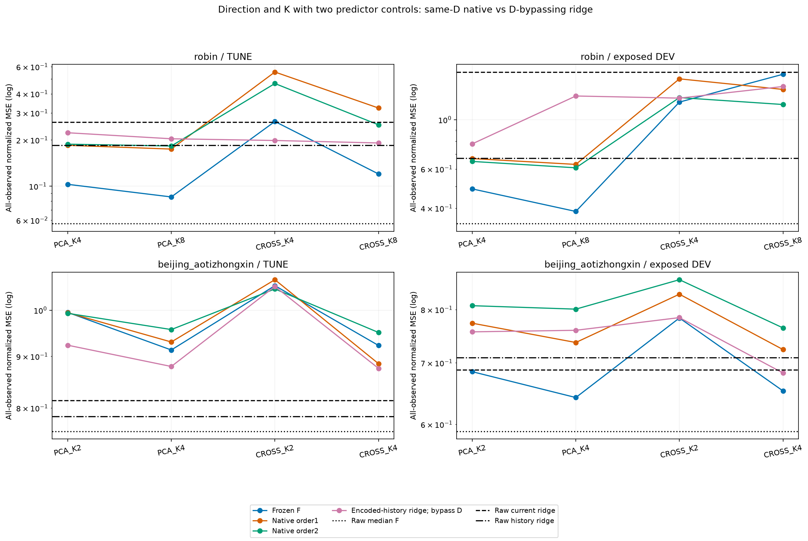
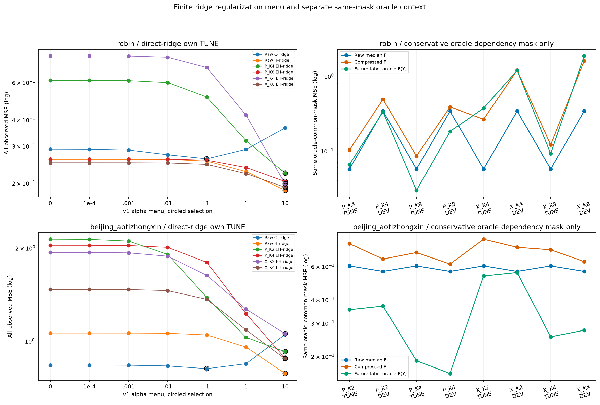
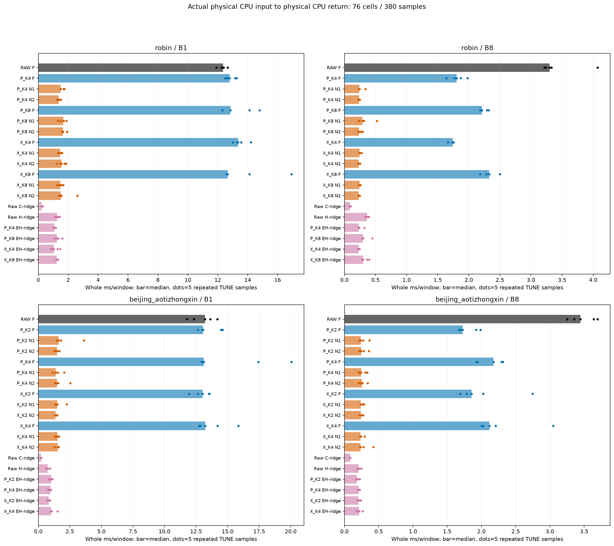
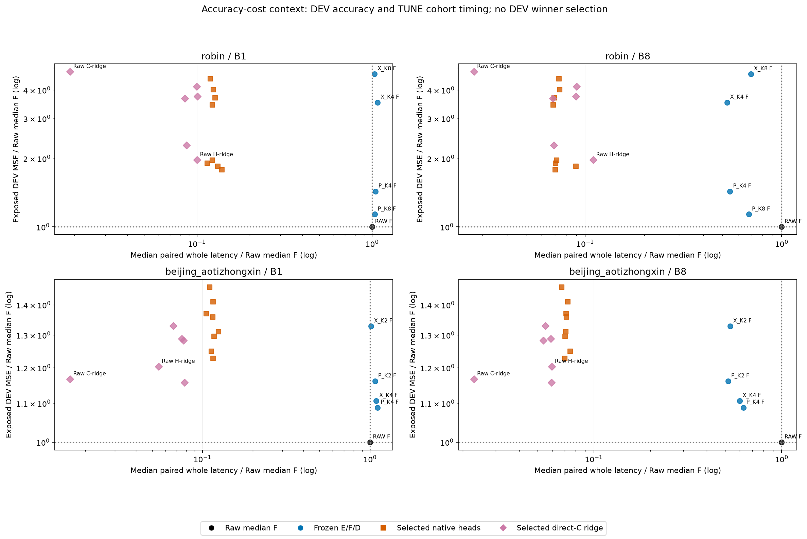

> 게시 사본입니다. 원문 작성 당시의 로컬·준비·미실행 상태는 역사로 보존합니다. 최신 완료/미해결 상태와 게시 범위는 [색인](../../README_KO.md)을 확인하세요. 과학 원본은 바꾸지 않고 링크와 이 안내만 추가했습니다.

# 새 방향·차원과 예측기·직접 회귀의 비교

[확인] 두 dataset의 PCA/CROSS 두 방향과 기본K/2K로8개 E/D를 고정했고 같은 공간에서 native16개를600회씩 학습했다. 이 보고서는 원 median Raw/F 기준만 사용한다. native CP 선정은 CP100 15/16, CP200 1/16이다. direct ridge12개 중 α 목록 최댓값10을 고른 조건은 10/12다. 후보 범위가 제한된 결과이며, α>10의 후속 실험이나 다른 계수를 이번 v1 비용값으로 대체하지 않는다.

- robin: 원 median Raw DEV MSE 0.340401887028; 같은 Raw보다 낮은 frozen F 0/4, 같은 E/D의 F보다 낮은 native 2/8. 이 DEV 비교로 방향·K·seed를 다시 선정하지 않았다.
- robin PCA_K4: F TUNE 0.102808327663, DEV 0.488093007682; native DEV 0.668503389749/0.6489059784; encoded-history 직접 C ridge DEV 0.778306021422. 마지막 경로는 D를 우회한다.
- robin PCA_K8: F TUNE 0.0850621408697, DEV 0.386399234182; native DEV 0.62908957422/0.607335975438; encoded-history 직접 C ridge DEV 1.27810496197. 마지막 경로는 D를 우회한다.
- robin CROSS_MOMENT_K4: F TUNE 0.263873933382, DEV 1.19995172025; native DEV 1.52682113001/1.25723179703; encoded-history 직접 C ridge DEV 1.25024464824. 마지막 경로는 D를 우회한다.
- robin CROSS_MOMENT_K8: F TUNE 0.12009132633, DEV 1.60088729872; native DEV 1.36807006821/1.17018249162; encoded-history 직접 C ridge DEV 1.41030860502. 마지막 경로는 D를 우회한다.
- beijing_aotizhongxin: 원 median Raw DEV MSE 0.589575413763; 같은 Raw보다 낮은 frozen F 0/4, 같은 E/D의 F보다 낮은 native 0/8. 이 DEV 비교로 방향·K·seed를 다시 선정하지 않았다.
- beijing_aotizhongxin PCA_K2: F TUNE 0.994903182114, DEV 0.684693555102; native DEV 0.773136908813/0.807803773068; encoded-history 직접 C ridge DEV 0.756555435826. 마지막 경로는 D를 우회한다.
- beijing_aotizhongxin PCA_K4: F TUNE 0.913157887313, DEV 0.641731213457; native DEV 0.736634245584/0.800842428334; encoded-history 직접 C ridge DEV 0.759497019661. 마지막 경로는 D를 우회한다.
- beijing_aotizhongxin CROSS_MOMENT_K2: F TUNE 1.0574546561, DEV 0.783271811316; native DEV 0.831412724431/0.86216113433; encoded-history 직접 C ridge DEV 0.784032965893. 마지막 경로는 D를 우회한다.
- beijing_aotizhongxin CROSS_MOMENT_K4: F TUNE 0.922633479354, DEV 0.652480585479; native DEV 0.723742972067/0.764055233005; encoded-history 직접 C ridge DEV 0.682434732801. 마지막 경로는 D를 우회한다.

**질문과 공정한 대조.** FIT 과거 covariance whitening의 PCA 방향과 horizon별 complete-C current/future cross-moment 방향을 같은 K/2K에서 비교했다. E와 과거32~511의 관측 reconstruction LS로 얻은 causal L7 D는 각 조건 안에서 고정했다. native는 동일 E/D/center·512과거·48미래·현재 C anchor·lag [0,1,2,4,8,16,32]를 쓰는 stream별 affine temporal head다. zero head와 seed92601/92602의 자료 순서, AdamW lr.001/WD0/B4/clip1/600update 및 CP0/100/200/400/600을 유지한다. 두 seed는 독립 dataset이 아니며 600회는 유한 예산이다. 이 head의 성적을 모든 native 최적화나 채널 혼합 예측기의 불가능성으로 확대하지 않는다.

**D를 우회하는 대조의 의미.** RAW_CURRENT_C는 현재 C로 미래 level, RAW_HISTORY512는 vec(history-currentC)로 미래 innovation, ENCODED_HISTORY512는 같은 actual Torch32 z의 vec(z-z_last)로 미래 innovation을 직접 회귀한다. intercept는 penalty에서 제외하며 원 currentC를 뒤에 더한다. Raw current는 horizon별 complete-C FIT 응답과 subset mean/RMS, history 경로는 전체 FIT mean/RMS와 각(h,c) 관측 subset을 사용한다. horizon별 관측 분모가 다르며 미래 dummy를 응답에 넣지 않는다. D를 우회한 encoded ridge가 좋으면 과거 표현에 예측 정보가 남는 단서지만, latent future 예측·frozen F 성공이나 same-D/capacity match의 증명은 아니다. 원 C의 current anchor와 과거 buffer도 입력 정보다.

ridge의 α=[0,1e-4,.001,.01,.1,1,10]과 FIT 표준화·비벌점 intercept를 고정했다. alpha0의 normalized design minimum-norm cutoff1e-8과 positive ridge의 모든 singular 방향을 구분했다. 실제 배포는 fused coefficient/intercept를 FP32로 저장한 feature32@coef32+intercept32+anchor32이며 own actual FP32 TUNE macro MSE로 선정한다. native 동률은 이른 CP, ridge 동률은 사전 α 순서다. 원16개 및12개 선정 잠금 뒤 DEV를 열었고 DEV는 새 선정에 쓰지 않았다. selected ridge12개만 독립 목적 해를 재계산했고, 미선정72계수는 보존 해시와168개 FIT/TUNE 저장 예측 점수를 검산한 범위다.

**관측 지표와 oracle.** 주 지표는 각 split 자체 true-observed channel count를 분모로 한 normalized channel-macro MSE다. complete-C 지표와 물리 단위 channel 진단도 CSV에 따로 보존했다. E(Y)는 미래 정답을 쓰며 모든 소비 미래 참조가 complete-C인 보수적 oracle dependency mask에서만 Raw/F와 함께 제시했다. 특히 Beijing의 oracle MSE를 all-observed MSE와 직접 비교하지 않는다. E(Y)는 배포 예측기가 아니며 이 단계에서 새 output-space minimum을 계산하지 않았다.

- robin RAW_CURRENT_C_RIDGE: selected α 0.1; TUNE 0.260797490494, DEV 1.63876280576.
- robin RAW_HISTORY512_RIDGE: selected α 10; TUNE 0.185026142208, DEV 0.670413487082.
- beijing_aotizhongxin RAW_CURRENT_C_RIDGE: selected α 0.1; TUNE 0.813524116427, DEV 0.688112991127.
- beijing_aotizhongxin RAW_HISTORY512_RIDGE: selected α 10; TUNE 0.784519870908, DEV 0.709532103736.

**새 전체 배포 비용.** 과학 학습은 기존 F24context(원104forward 기록)를 재사용했지만 이 비용은 실제 frozen F 또는 선정 native/ridge를 실행한다. 원 physical CPU TUNE 첫 B1/B8에서 causal fill/FIT scaler→E/actual F 또는 native/old D, 혹은 direct ridge→physical CPU 반환과 sync까지 측정했다. encoded ridge의 실제 CUDA E와 CPU 특징/계수 계산 및 전송도 timer 안이다. 로드·학습·선정·reference·warmup·save·외부 hash/meter·memory snapshot은 밖이고 내부 shape/finite 검사와 sync는 안에 남는다.

19routes×2datasets×B1/B8의 76/76셀과 380/380개 정수 ns 표본을 보존했다. 각 warm2/실측5이며 19위치 중5회전은 완전 균형이 아니다. 각 셀의5회는 같은 첫B origin 반복이어서 독립 표본 CI를 만들지 않았다. 공유 resident F/24adapter/16head/12CPU ridge 상태의 RSS/VRAM은 독점 메모리가 아니다. query 또는 stream 수의 비를 latency 비로 대체하지 않는다.

Raw와 같은 E의 Bolt 각각에 대해 repeat를 맞춘 median paired ratio와 ratio of medians를 정수 timer 원수치에서 다시 계산해 분리했다. encoded ridge의 matching Bolt 분모는 같은 E일 뿐 D/capacity가 일치한다는 뜻이 아니다. B1/B8는 실제 해당 크기로 실행했고 canonical32 과학 출력과의 first8/물리 reference를 검산했다. 서로 다른 cohort의 시간이나 후속 ridge 계수로 이번 결과를 바꾸지 않았다. 실패 route는 status와 FAILURES에서 보존하며 완전 보고 생성 gate는 과학 및 비용 COMPLETE/독립 PASS를 요구한다.

[해석 범위] 네 번째 그림은 적응적으로 노출된 DEV 정확도와 TUNE cohort 전체 시간을 연결한 문맥이다. DEV를 비용 측정하거나 새 winner를 고른 그림이 아니다. 기존 median Raw 기준을 quantile-summary 선정 Raw로 대체하지 않았고 이번 결과를 SOTA·새 정보 보존 증명·F 필요성/제거 가능성의 확정으로 포장하지 않는다. 같은 자료의 seed·K·방향을 독립 dataset으로 세지 않으며 보호 TEST 접근0, 독립 holdout0, strict K-only0이다. 원 E/D의 과거 supervised 이력과 현재 head/ridge FIT 응답 사용을 구분한다. F/optimizer 전체를 재현한 독립 실험이 아니라 저장 산술·로그·원 source/receipt 검산과 새 실제 timer 기록의 근거다.

본문·CSV·그림은 JSON metadata만 읽었다. NPZ/model/F/GPU/훈련을 이 보고 생성기에서 열거나 실행하지 않는다. RESOURCES는 cross/native/ridge/cost 및 각 감사의 process CPU·process wall·GPU process 범위를 원 필드 그대로 보존하며 학습 wall을 배포 latency로 쓰지 않는다.

- [SCORES.csv](tables/SCORES.csv): 456행
- [DIRECTION_EFFECTS.csv](tables/DIRECTION_EFFECTS.csv): 96행
- [NATIVE_CHECKPOINTS.csv](tables/NATIVE_CHECKPOINTS.csv): 80행
- [RIDGE_CANDIDATES.csv](tables/RIDGE_CANDIDATES.csv): 84행
- [SELECTIONS.csv](tables/SELECTIONS.csv): 28행
- [ORACLE_CONTEXT.csv](tables/ORACLE_CONTEXT.csv): 72행
- [SOLVERS.csv](tables/SOLVERS.csv): 12행
- [WHOLE_COST.csv](tables/WHOLE_COST.csv): 76행
- [WHOLE_COST_SAMPLES.csv](tables/WHOLE_COST_SAMPLES.csv): 380행
- [ACCURACY_COST_REFERENCE.csv](tables/ACCURACY_COST_REFERENCE.csv): 76행
- [RESOURCES.csv](tables/RESOURCES.csv): 8행
- [FAILURES.csv](tables/FAILURES.csv): 0행

- [cross](../../../projection_followup_v1/runs/predictive_cross_moment_v1/RESULT.json): `99bffd5831143ca35947099fef9567f89dd209d83451661decee0682b2b8e13c`
- [cross_audit](../../../projection_followup_v1/audits/PREDICTIVE_CROSS_MOMENT_AUDIT_v1.json): `90c68a9057909fb5b6c23284e5a45523cdf126da178a5ba0d9d9e96a50dede30`
- [native](../../../projection_followup_v1/runs/new_direction_native_v1/RESULT.json): `786edbd75a35d2c5a760a7b4f5af5a1389ee1bc4bc93594d7b359a29ecfd83ed`
- [native_audit](../../../projection_followup_v1/audits/NEW_DIRECTION_NATIVE_AUDIT_v1.json): `51e438d7544bb5c52d2a6ea3ddd2da9c38773b2aa42286cf3a77c67d405d7bf6`
- [ridge](../../../projection_followup_v1/runs/new_direction_direct_ridge_v1/RESULT.json): `b8d7eae62ce5bb52b3d46ffc543f916f8b81857028098370a5b2f8398510f1ed`
- [ridge_audit](../../../projection_followup_v1/audits/NEW_DIRECTION_DIRECT_RIDGE_AUDIT_v1.json): `8bfeb29cc6836d2ff5528c30ee13a4300b79cc4c250a452b9c5c81fdfc9bac90`
- [cost](../../../projection_followup_v1/runs/new_direction_cost_v1/RESULT.json): `8a1876aeb1490a53a4872c294a9ec2e1a4f296a1a32ff8787b084b0b98d6a1fb`
- [cost_audit](../../../projection_followup_v1/audits/NEW_DIRECTION_COST_AUDIT_v1.json): `e2f3ad6f9ad3f6cd3f1344aacfc7829c7818e23842e1d60061b14cc6833f3491`
- [cross_auditor_source](../../../projection_followup_v1/audit_predictive_cross_moment_v1.py): `6577d15a200728dc585bf2c8e93ccff6baabd1ba916384dfb2cce7aa0014a731`
- [cross_controller_source](../../../projection_followup_v1/run_predictive_cross_moment_v1.py): `e5b971277673118454d30f13819a7013c9c0b0ef1c6e682c18d5fab971ef1f50`
- [native_auditor_source](../../../projection_followup_v1/audit_new_direction_native_v1.py): `6654e9dc8680c827ca9626aa6dd97cfe9d199a4c71017b239b7d6cd8e4f78fb5`
- [native_controller_source](../../../projection_followup_v1/run_new_direction_native_v1.py): `4aaf63c4ae078daed71f4b11540d4ade8ee62ffce6a8345bd031fe162b9062e4`
- [ridge_auditor_source](../../../projection_followup_v1/audit_new_direction_direct_ridge_v1.py): `d8b6e8b8ed6862af69e78ecc63758b13fd03378862aa6c6c6644052fa36d85d4`
- [ridge_controller_source](../../../projection_followup_v1/run_new_direction_direct_ridge_v1.py): `7dd19e1504f0ff4b323c52412fac492f2b5c17c23e1ba0d898691a672f5ac88e`
- [cost_auditor_source](../../../projection_followup_v1/audit_new_direction_cost_v1.py): `6d5abc6d85a64d618bd2871b237455294bfc7c666aa8a7caedf88701290e334f`
- [cost_controller_source](../../../projection_followup_v1/run_new_direction_cost_v1.py): `4c721b0b87d9252fa55e90b68e03a35e9b18e15f61dfc9d1b14e4289058f5bfa`
- [cross_plan](../../notes/PLAN_PREDICTIVE_CROSS_MOMENT_KO_v1.md): `cb482c1dfdf4ad17eda79456063eb3895d53a74bd5176b011e11793c43a40669`
- [native_plan](../../notes/PLAN_NEW_DIRECTION_NATIVE_BASELINES_KO_v1.md): `c38919e996d802254821938f925ff6c8d0ee0050634b9410c7bc427a4f1e25ab`
- [ridge_plan](../../notes/PLAN_NEW_DIRECTION_NATIVE_BASELINES_KO_v1.md): `c38919e996d802254821938f925ff6c8d0ee0050634b9410c7bc427a4f1e25ab`
- [whole_cost_source](../../../projection_followup_v1/whole_new_direction_cost_v1.py): `49a094ddd8b40d79932ef6c0dc87ce37548abd8159c0f2b1cae8cb0b617a1ae9`
- [cost_plan](../../notes/PLAN_NEW_DIRECTION_NATIVE_BASELINES_KO_v1.md): `c38919e996d802254821938f925ff6c8d0ee0050634b9410c7bc427a4f1e25ab`
- [report_source](../../../projection_followup_v1/make_new_direction_comparison_report_v1.py): `19f7872dc303949990a7f11db43c0941688cd9f9d91b3a73750b9f2a88990c47`
