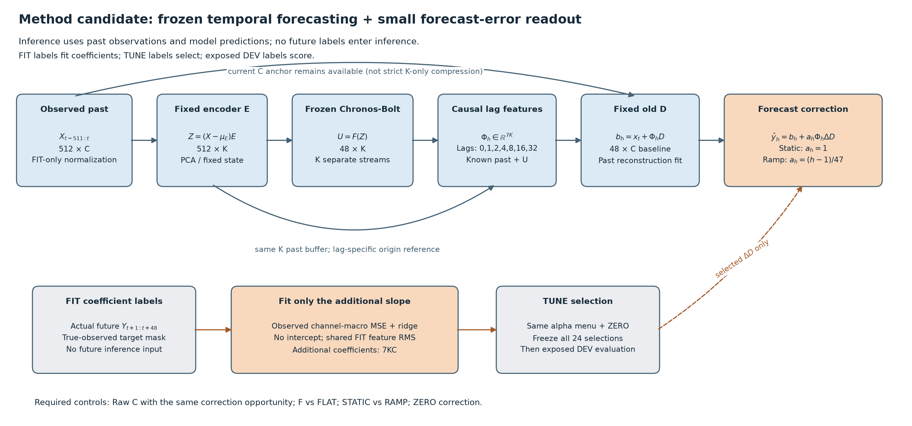

> 게시 사본입니다. 원문 작성 당시의 로컬·준비·미실행 상태는 역사로 보존합니다. 최신 완료/미해결 상태와 게시 범위는 [색인](../../README_KO.md)을 확인하세요. 과학 원본은 바꾸지 않고 링크와 이 안내만 추가했습니다.

# 교수 미팅용 방법론: frozen TSFM의 실행 stream을 줄일 수 있는가

작성일: 2026-10-15. 이 문서는 논문·PPT가 아닌 연구 상담 메모다. **배포식·학습 대상·대조 실험·실제 비용까지 설명할 방법론 후보를 구현했다. 작은 K 경로가 원 C 경로를 대체하는 성공 방법은 아직 얻지 못했다.** 구현 완료, 산술 검산, 성능 우위, 학술적 신규성을 구분한다. 이번 신규 작업은 로컬이며 마지막 게시 커밋 `6f7e312a3b1f6eecb15b134239f2893816864aa4` 뒤의 결과를 포함한다.

## 1. 교수님께 먼저 말할 1분 설명

“시계열 foundation model은 여러 시계열에서 미리 학습한 예측기를 새 데이터에 재사용하는 모델입니다. 여기서는 Chronos-Bolt를 동결하고, 다변량 자료의 각 채널을 하나씩 처리하는 경로를 기준으로 잡았습니다. 질문은 **원 C개 채널을 K개 시계열로 바꿔 백본이 처리할 stream 수를 줄이면서, 실제 예측 정확도와 전체 추론 비용을 유지할 수 있는가**입니다.

과거만으로 K개 시계열을 만들고, 동결된 Bolt가 예측한 K개 미래와 이미 알려진 과거 지연값으로 원 C의 변화량을 복원합니다. 입력 복원이 잘된다고 미래 예측까지 잘되는 것은 아니므로, 표현에 남은 정보·Bolt의 미래 예측·원 채널 복원을 별도 대조로 나눴습니다. 예측 목적의 작은 디코더 보정도 실제 학습했습니다. 현재는 Bolt의 미래가 단순 반복보다 도움이 되지만, 그 이득으로 작은 K의 Raw 대비 정확도 손실을 메우지는 못했습니다. 계산 절감은 B8에서 관측됐고 B1에서는 일관되지 않았습니다.”

여기서 줄이는 것은 **F의 실행 stream 수**다. 원 C 과거를 읽는 encoder, 현재 C값 anchor, K개 과거 buffer는 남는다. 전체 정보·저장·통신이 K차원만 남는 strict K-only 압축이라고 설명하지 않는다. 사전에 허용 정확도 손실률을 정하지 않았으므로, 결과를 본 뒤 특정 손실을 ‘허용 가능’으로 바꾸지 않는다.

## 2. 배포 시 계산과 학습 대상



관측 origin을 t, 과거 길이를 L=512, 예측 길이를 H=48로 둔다. X는 **encoder에 넣기 전에 FIT mean/std로 정규화한 C채널 과거**다. 그림의 encoder 식에서 μ_E는 scaler 평균과 구분되는 별도 **PCA center**다. 현재값 x_t 역시 같은 정규화 단위다.

\[
Z=(X-\mu_E)E,\quad E\in\mathbb R^{C\times K},\qquad
U=F(Z)\in\mathbb R^{H\times K}.
\]

F는 사전학습된 Chronos-Bolt이며 이번 후보에서는 동결한다. 9개 출력 분위 중 median을 사용한다. U는 하나의 K차원 벡터가 아니라 **미래 H개 시점의 K개 stream**이다. 미래 h=1,…,48에 대해 지연 집합은 J={0,1,2,4,8,16,32}다.

\[
\widetilde z_s=\begin{cases}z_s&s\le t\\U_{s-t}&s>t,\end{cases}\qquad
\phi_h=\mathop{\mathrm{concat}}_{\ell\in J}
\left(\widetilde z_{t+h-\ell}-z_{t-\ell}\right)\in\mathbb R^{7K}.
\]

각 lag의 기준은 **z_(t−lag)**다. 모든 lag에서 같은 마지막 z_t를 빼는 식과 다르다. 시점 t를 넘는 정보는 관측 미래가 아닌 F 예측뿐이다. 알려진 과거 prefix는 그대로 쓴다. 현재 C값에 원 디코더의 변화량 복원을 더한다.

\[
b_h=x_t+\phi_hD_{\mathrm{old}},\qquad
\widehat y_h=b_h+a_h\phi_h\Delta D.
\]

STATIC은 a_h=1, RAMP는 사전에 고정한 a_h=(h−1)/47이다. RAMP의 첫 미래 보정은 0이고 마지막은 1이다. 이것은 48개 독립 디코더를 학습하는 방식이 아니다. 추가 학습 slope는 두 arm 모두 ΔD∈R^(7K×C) 하나이며 절편은 없다. 같은 열 수를 가졌어도 유효 rank·규제 prior까지 완전히 같은 모델은 아니다.

```text
구성              이번 비교에서 하는 일                     상태
FIT scaler        원 채널의 단위 정규화                     고정
PCA E, μ_E        C채널 → K개 시계열                        FIT에서 적합 후 고정
Chronos-Bolt F    K개 과거 → K개 미래                        사전학습 가중치 동결
기존 L7 D_old     과거 재구성으로 적합한 변화량 복원           고정
ΔD               실제 미래 오차를 줄이는 추가 7KC slope       이번에 학습
a_h               1 또는 (h−1)/47                            사전 고정·비학습
현재 C anchor     origin에서 이미 알려진 값                  배포 입력
```

실제 배포 산술은 FP32 원 baseline에 별도 FP32 correction을 더한다. D_old+a_hΔD를 먼저 합쳐 한 번 곱하는 연산으로 바꾸지 않았다. Raw 대조는 E=I, lag0의 D=I·다른 lag의 D=0에 대응하지만, Raw baseline 자체는 원 F 출력 bytes를 그대로 쓴다. current+(F−current)의 FP32 재조합을 원 출력과 동일하다고 가정하지 않는다.

이 구조는 과거 지연을 사용하는 통계적 decoder다. 학습된 directed causal graph, 동적으로 갱신되는 그래프, 채널 간 인과관계를 발견한 방법이라고 부르지 않는다.

## 3. 무엇을 어떻게 학습하고 선정했나

FIT 미래 Y는 **학습 label**로만 사용한다. 과거만 사용하는 배포 입력과, 미래 label을 사용하는 감독학습은 구분해야 한다. E(Y)를 넣는 oracle는 별도 원인 진단이고 배포·계수 적합·선정에는 넣지 않는다.

각 input 공간에서 실제 F의 ungated FIT φ에 대해 uncentered RMS s를 한 번 계산하고 F/FLAT×STATIC/RAMP 네 arm이 공유한다. χ_h=a_hφ_h, W=diag(s)ΔD라 할 때, 관측된 target만으로 다음을 적합한다.

\[
\frac1{C_{\rm active}}\sum_c\left[
\frac1{N_c}\sum_{(n,h)\in\mathcal O_c}
\left\{(Y_{nhc}-b_{nhc})-(\chi_{nh}/s)W_c\right\}^2
+\alpha\|W_c\|_2^2\right].
\]

N_c는 해당 채널의 실제 관측 target 수다. 결측 target을 0 label로 학습하지 않는다. 정규화 MSE를 채널마다 먼저 평균한 뒤 채널에 같은 가중치를 주며, 주지표·학습 손실·선정을 이에 맞췄다. MAE와 원단위 per-channel 오차도 별도 기록했다. s=0인 특징은 scale1·slope0으로 처리한다.

α는 0, 1e−4, .001, .01, .1, 1, 10, 100, 1000, 10000이고, 원 baseline을 그대로 반환하는 ZERO도 후보로 둔다. α=0은 design singular cutoff 1e−8의 최소노름 해, α>0은 모든 singular 방향의 ridge다. FP64로 적합하고 실제 FP32 배포 출력의 TUNE MSE로 각 arm의 α/ZERO를 선정했다. 모든 24개 선정을 저장한 뒤 DEV를 평가했다. ZERO를 포함하므로 TUNE 비악화는 메뉴 구성상 보장되며 연구 성능 향상으로 세지 않는다.

자료는 Robin C17/K4·K8, Beijing Aotizhongxin C11/K2·K4다. FIT256/TUNE64, 기존 노출 DEV는 각각 30/146 origin이다. 원 scaler·origin·창별 causal fill·관측 mask를 유지했다. 창과 horizon은 많이 겹치며, Robin FIT의 131072개 과거 timestamp 출현은 1545개의 고유 시점에 해당한다. 이를 대규모 독립 표본으로 세지 않는다.

## 4. 대조군마다 답하는 질문

```text
대조                              답하는 질문
같은 E/D의 F 대 latent-last FLAT   이 구조에서 예측 미래가 단순 반복보다 유용한가?
같은 E/D의 제한된 native head       지정된 작은 학습기보다 F가 유리한가?
E 또는 원 C 과거 → 직접 C ridge    기존 D를 우회하면 이 설정의 직접 예측이 나아지는가?
STATIC 대 고정 RAMP                같은 추가 slope 수에서 시간별 크기 제약이 영향을 주는가?
ZERO 대 학습 보정                  추가 보정이 원 baseline보다 유리한가?
작은 K 대 Raw C                    원 C 경로를 대체할 정확도·실제 비용 근거가 있는가?
```

PCA-FLAT은 알려진 과거 lag가 남으므로 일반적으로 current-C persistence와 다르다. Raw identity 경로의 FLAT은 current-C persistence다. Raw의 추가 slope는 7C², PCA는 7KC라서 Raw 대 PCA를 완전한 capacity match라고 부르지 않는다. 직접 C ridge도 D를 우회하므로 동일 decoder 대조와 합치지 않는다.

PCA만 실행한 상태는 아니다. [이전 compressor 기록](../../references/research/level_compressor_fullscreen_20261011/REPORT_KO.md)에는 point/causal encoder의 여러 목적, TS2Vec, GTConvAE 계열, DCA가 있다. GTConvAE 계열은 원 논문과 달리 시간축 보존·별도 K 투영을 포함한 수정 구현이며, 학습된 directed lagged graph를 검증한 결과가 아니다. 이번 밤의 추가 비교도 회전 Q의 실제 F-input gradient 학습, 예측 cross-moment E, K 확대, native, 직접 ridge·규제 확장, 예측 잔차 D까지 포함한다. PCA는 안정적인 통제 기준으로 썼고 최종 신규 기법으로 확정하지 않았다.

## 5. 정확도와 비용에서 실제 얻은 답

아래는 **이미 노출된 DEV의 관측 채널 macro 정규화 MSE**다. 낮을수록 좋다. 각 arm은 자기 TUNE로 규제를 골랐으며 이 표에서 DEV 최저 arm을 새 winner로 선정하지 않았다.

```text
자료 / 공간            무보정 F        STATIC 보정      RAMP 보정
Robin Raw C            0.340401887     0.340401887      0.340401887
Robin PCA K4           0.488093008     0.561335160      0.567132241
Robin PCA K8           0.386399234     0.525296183      0.441553845
Beijing Raw C          0.589575414     0.579185180      0.574256191
Beijing PCA K2         0.684693555     0.682673637      0.692603931
Beijing PCA K4         0.641731213     0.633718109      0.670855508
```

[확인] 같은 공간·같은 보정 class의 F 대 FLAT 12개 대조에서는 F가 TUNE/DEV 모두 낮았다. F는 이 대조에서 유용했다. 그러나 PCA RAMP 네 조건은 모두 자기 무보정 F보다 DEV가 높았고, 작은 K 보정 8조건 중 Raw보다 DEV가 낮은 조건은 없다. Beijing Raw의 보정 이득은 **압축 고유 이득이 아닌 일반적인 예측 보정의 이득**이다.

같은 E/D native는 stream별 affine 512→48, 600 update, 두 seed의 제한된 대조다. Robin PCA K8의 DEV는 0.629090/0.607336, 같은 F는 0.386399였다. Beijing PCA K4는 native 0.736634/0.800842, F 0.641731이었다. 직접 ridge의 규제 탐색도 확장했지만 Beijing 원 C history ridge DEV 0.630001은 Raw F 0.589575보다 높았다. 이 유한 대조로 모든 작은 예측기의 불가능성이나 F의 보편적 필요성을 주장하지 않는다.


실제 FP32 반환 baseline b와 선정 예측 p의 차이를 c=p−b로 잡으면 같은 관측 mask에서 다음 항등식이 성립한다.

\[
\Delta\mathrm{MSE}=2\operatorname{macro}E[(b-Y)c]
+\operatorname{macro}E[c^2].
\]

Robin K4 STATIC의 interaction은 TUNE −0.029341에서 DEV +0.037270으로 바뀌었다. K8 STATIC은 DEV interaction −0.007181이 유리해도 correction energy +0.146078이 더 커 최종 ΔMSE가 +0.138897이었다. 따라서 ‘D가 불안정하다’는 말보다 **보정 방향이 옮겨지지 않는 경우와 보정 크기가 과도한 경우를 구분**할 수 있다. 이 분해는 관측 오차를 설명하며 과적합·공변량 변화·학습 부족의 유일한 인과 증명은 아니다.

비용은 저장 F cache 반환 시간이 아니라 실제 physical CPU 과거→전처리→CUDA E/F/D→필요한 CPU 보정·전송→physical CPU 반환·sync의 전체 경로다. 아래 값은 **B8 batch 한 번의 median ms**이며 ms/window는 8로 나눈 값이다. 원 실행과 같은 코드·선정 상태의 반복 실행을 모두 남겼다.

```text
자료 / 경로              원 실행 ms/batch    반복 ms/batch
Robin Raw F                   26.6482             26.0451
Robin PCA K8 F                 18.2678             17.7897
Robin PCA K8 F+RAMP            19.0768             18.6375
Beijing Raw F                 18.7247             18.7419
Beijing PCA K4 F               13.4711             13.3045
Beijing PCA K4 F+STATIC        13.6152             13.9938
```

[확인] 이 B8 cohort에서 작은 K 경로의 계산 절감은 있다. B1에서는 Robin K8 무보정도 원/반복에서 Raw 대비 1.0627/1.0036배 latency여서 일관된 이득이 없다. warm2·실측5회, 같은 첫 B개 TUNE 창의 반복 측정으로 독립 신뢰구간이 아니다. 다른 76셀 cohort와 Beijing Raw B8 시간이 달랐던 원인은 미확정이며 유리한 분모를 빌리지 않는다. 정확도와 비용을 동시에 Raw보다 좋게 만든 성공은 아니다.

## 6. 지금 설명할 수 있는 것과 남은 것

**[확인] 재구성 목적만 학습해서 안 된다는 설명은 불충분하다.** 실제 미래 label·teacher·joint E/D·E-only·Q의 F 경유 gradient·forecast D가 이미 실행됐다. 예측 목적은 필요한 후보일 수 있지만 목적을 바꾸기만 하면 해결된다는 주장은 현재 반례와 맞지 않는다. 학습 경로의 gradient와 검산을 확인한 것 또한 최적 수렴·모든 학습 문제의 배제를 뜻하지 않는다.

**[확인] 보정의 시간 이전도 추가로 실행했다.** Robin FIT256을 시간순 A128/B64/C64로 고정하고, 앞 구간 response의 마지막 시점이 다음 구간 origin보다 앞서도록 A/B에서 각각11개 창을 제외했다. 실제 적합/선택/진단은 A117/B53/C64다. A에서만 RMS와 계수를 적합하고 B로 α/ZERO를 선택한 두 경로를 모두 잠근 후, 선정 C 출력과 점수를 계산했다. 기존 TUNE/DEV 배열과 새 F는 사용하지 않았다.

```text
조건부 FIT 내부 진단       B 무보정      B 선정 보정     C 무보정      C 선정 보정
PCA K8 / α10              0.408279788   0.406539000    0.100626173   0.103507497
Raw C / α1                0.328817561   0.321778389    0.074478648   0.075801897
```

두 경로 모두 B의 이득이 C에서 악화로 바뀌었다. PCA의 C signed MSE 차이는 +0.002881324, Raw는 +0.001323249다. 이 두 선형 fit은 독립적인 수치 재풀이도 통과했다. 따라서 **이번 선형 보정의 실패를 반복 optimizer가 덜 끝난 탓으로 설명할 필요는 없지만**, 기존 비선형 표현 학습의 모든 최적화 문제까지 배제한 결과는 아니다. 보정의 시간 이전 불안정이 압축 경로에만 한정되지 않았다는 제한된 반례다.

이 새 C는 독립 holdout이 아니다. scaler/E/old D는 원 full-FIT에서 이미 적합됐고, 원 FIT archive의 C target과 고정 C baseline/특징도 잠금 전에 이미 가용했다. 새 readout의 적합·선정만 A/B로 제한한 **고정 upstream 조건부 진단**이다. C를 연구 전체에서 한 번도 보지 않았거나 전체 pipeline을 시간순 검증했다고 말하지 않는다. 새 계수의 배포 비용은 미측정이며 앞 비용 표를 이 새 정확도와 결합하지 않는다.

**[확인] 정보 보존, 예측 가능성, F 호환성은 별개다.** Robin K8에서 실제 E(Y) 미래를 주는 oracle의 동일 mask DEV는 0.181666으로 Raw 0.340402보다 낮았다. 이는 decoder가 미래를 알 때 가능한 진단 출력이며 과거에서 그 latent를 예측할 수 있다는 증거가 아니다. 현재 예측 cross-moment E도 Raw gap을 해결하지 못했다. 예전 고정 D의 수치 공간 minimum을 새로운 시간 보정 모델의 보편 하한으로 재사용하지 않는다.

**[판단] 대조학습·동적 그래프는 아직 필수 해법으로 정당화되지 않았다.** TS2Vec/GTConvAE 계열을 조사·실험한 사실과, 현재 문제를 그 복잡성으로 해결할 근거는 다르다. 이번 구조는 directed lagged graph 학습이 아니며 ‘lag를 사용했다’는 이유로 그 주장을 하지 않는다. ExoTimer의 시계열–문장 정렬을 그대로 재현한 방법도 아니다. 과거 view와 미래 target의 예측 적합성을 학습하려면 양성쌍·음성쌍/정렬 목표가 어떤 미래 정보와 일치하는지 별도로 증명해야 한다. 같은 공간에 놓았다는 사실만으로 예측 적합성이 보장되지 않는다.

**[판단] Chronos-Bolt는 비교 축으로 유지할 근거가 있지만 압축 경로의 채택 근거는 부족하다.** 지정 native/FLAT 대조에서 F의 이득은 관측했다. 다른 모든 예측기 대비 필요성을 입증하지 않았고, Raw 정확도 손실은 여전히 남는다.

**[확인] 독립 일반화와 신규성은 미입증이다.** 반복 노출된 DEV에서 적응적으로 후보를 만든 연구다. 이번 24개 잠금을 DEV 전에 저장해도 이전 노출을 없애지 않는다. 현재 continuation의 보호 TEST 새 접근은 0이다. 전체 역사에는 [10월11일 기록](../../references/research/level_compressor_fullscreen_20261011/REPORT_KO.md)에 명시된 별도 보호 자료 접근 incident가 있으므로, 전체 연구 역사에 TEST 접근이 없었다고 말하지 않는다.

## 7. 문제 정의와 기여를 어디까지 좁힐 것인가

**문제 정의:** “원 C 과거와 current-C anchor를 허용한 frozen univariate TSFM에서, 실행 stream 수를 K로 줄였을 때 생기는 정확도 손실을 정보 보존·잠재 미래 예측·원 채널 readout으로 나눠 진단하고, 같은 상태의 전체 추론 비용과 함께 Raw 대체 가능성을 평가한다.”

입출력 feature adapter와 frozen F의 결합은 [AdaPTS, ICML2025](https://proceedings.mlr.press/v267/benechehab25a.html), orthogonal 입출력 변환은 [ORTCL, AAAI2026](https://ojs.aaai.org/index.php/AAAI/article/view/39526), horizon별 잔차 보정의 큰 틀은 [Ben Taieb·Hyndman, ICML2014](https://proceedings.mlr.press/v32/taieb14.html) 등 선행이 있다. E–F–D, 회전, ramp 자체를 새 원리로 내세우지 않는다.

현재 방어 가능한 **기여 후보**는 (1) current-C/known-past lag를 드러낸 동일 조건의 단계 분리 절차, (2) ‘재구성만의 문제’, ‘미래 반복이면 충분’, ‘디코더를 조금 유연하게 하면 해결’이라는 설명에 대한 제한된 반례와 오차항 진단이다. 이것만으로 충분한 논문 기여라는 보장은 없다. 성공 알고리즘의 기여 문장을 먼저 정해 놓고 결과를 맞추지 않는다.

**추가 시간순 진단에서도 보정의 이전 근거를 얻지 못했으므로, 같은 exposed 자료에서 D의 함수를 자동으로 늘릴 우선순위는 낮춘다.** 다음에 강한 성능 주장을 하려면 upstream을 포함한 적절한 시간순 적합·평가와 배포 채택 기준이 필요하다. 현재 결과로 모든 압축·디코더의 불가능성을 주장하지 않는다. 지금까지의 자료로는 정확도 손실을 해결했다고 말할 수 없지만, 어떤 구조를 실행했고 어떤 설명이 반례에 막혔는지 교수님께 수식과 원수치로 설명할 수 있다.

## 8. 증거와 검산 범위

- [새 방향·native·ridge 및 실제 전체 비용](../new_direction_comparison_v1/REPORT_KO.md), [ridge 규제 확장](../ridge_regularization_extension_v1/REPORT_KO.md).
- [회전·분위 요약·Q 학습](../methodology_diagnostics_v1/REPORT_KO.md), [공통 latent 보정](../fixed_l7_latent_calibration_v1/REPORT_KO.md).
- [STATIC/RAMP 과학 결과](../../evidence/projection_followup_v1/runs/horizon_decoder_diagnostic_v1/RESULT.json.gz), [독립 과학 검산 PASS](../../evidence/projection_followup_v1/audits/HORIZON_DECODER_DIAGNOSTIC_AUDIT_v1.json.gz): 24 fit·264후보·528 FIT/TUNE·24선정 DEV, 그중 22개 선정 fit 독립 재풀이와 ZERO2개 확인.
- [STATIC/RAMP 상세 보고서·12CSV·4개 그림](../horizon_decoder_diagnostic_v1/REPORT_KO.md), [파일·행수·링크 검사 PASS](../../../projection_followup_v1/audits/HORIZON_DECODER_REPORT_FILE_CHECK_v1.json).
- [새 전체 비용 원 실행](../../../projection_followup_v1/runs/horizon_decoder_cost_v1/RESULT.json), [원 실행 비용 감사 v2 PASS](../../../projection_followup_v1/audits/HORIZON_DECODER_COST_AUDIT_v2.json), [같은 코드 반복](../../../projection_followup_v1/runs/horizon_decoder_cost_repeat_v1/RESULT.json), [반복 비용 감사 v2 PASS](../../../projection_followup_v1/audits/HORIZON_DECODER_COST_REPEAT_AUDIT_v2.json): 각각 72셀·360표본·36 first8 precheck·288창. F GPU나 타이머를 독립 재생한 감사는 아니다.
- 원/반복 비용 감사 v1은 함수명과 지역변수명 충돌로 실패했다. [원 실패](../../../projection_followup_v1/audits/HORIZON_DECODER_COST_AUDIT_v1.json)·[반복 실패](../../../projection_followup_v1/audits/HORIZON_DECODER_COST_REPEAT_AUDIT_v1.json)를 보존하고, 결과·공차·모델을 바꾸지 않은 지역변수명 2곳의 v2 수정으로 재검산했다.
- [오차항 보고서와 그림·7CSV](../horizon_error_terms_v1/REPORT_KO.md): 72 전체·3456 horizon·216 구간·52416 per-channel cell. 항등식 최대 closure 오차 9.70e−15. 저장 endpoint 진단이며 외부 독립 과학 감사나 원인 확정은 아니다.
- [FIT 내부 시간순 보정 진단 결과](../../../projection_followup_v1/runs/purged_readout_stability_v1/RESULT.json), [독립 검산 PASS](../../../projection_followup_v1/audits/PURGED_READOUT_STABILITY_AUDIT_v1.json): 2fit·22후보·44 A/B·선정2 C, 선정 fit2개 독립 재풀이·46개 FP32 출력식·2개 잠금·312개 오차항 cell 확인. 기존 F·upstream·독립 holdout을 재검증한 결과가 아니다.
- [시간순 진단 상세 보고서·6CSV·3개 그림](../purged_readout_stability_v1/REPORT_KO.md), [파일·행수·링크 검사 PASS](../../../projection_followup_v1/audits/PURGED_READOUT_REPORT_FILE_CHECK_v1.json).
- [첫 독자의 방법론 비판](../../notes/PROFESSOR_FIRST_READER_REVIEW_KO_v1.md)은 비용 v2 PASS 이전 snapshot이다. 이 문서는 그 후 실제 PASS를 반영했다. 도식 v1의 겹친 label은 v2에서 위치를 수정했다. v3에서는 μ_E를 명시하고 ‘미래 label은 FIT에만 등장’이라는 부정확한 문구를 ‘FIT 학습·TUNE 선택·노출 DEV 채점, 배포에는 label 없음’으로 바로잡았다. 기존 도식·결과는 보존했다.

MAE·원단위·horizon·관측수·solver·선정 잠금·실패·자원 영수증은 각 상세 결과에 남겼다. 파일 hash/링크 검사와 그림 시각 검토는 과학 실험의 독립 재현이나 holdout 검증을 대신하지 않는다.
