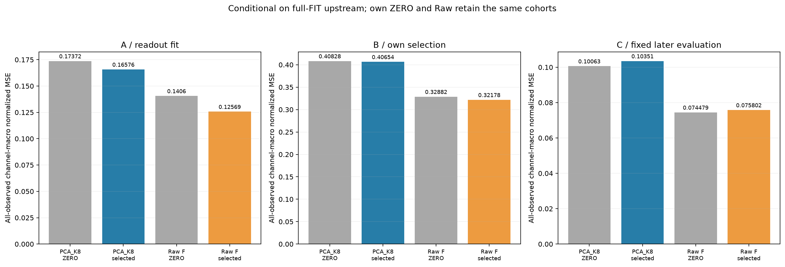
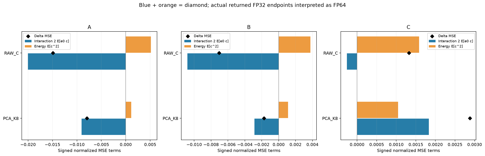
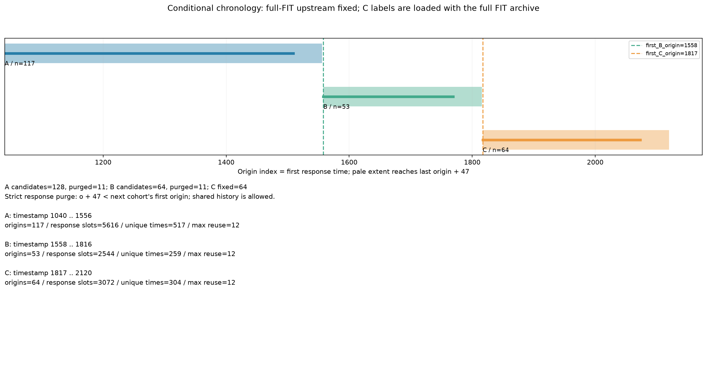

> 게시 사본입니다. 원문 작성 당시의 로컬·준비·미실행 상태는 역사로 보존합니다. 최신 완료/미해결 상태와 게시 범위는 [색인](../../README_KO.md)을 확인하세요. 과학 원본은 바꾸지 않고 링크와 이 안내만 추가했습니다.

# 고정 upstream을 조건으로 한 보정의 시간 이전 진단

[확인] C까지 완료된 2경로 중 2경로는 B에서 자기 ZERO보다 낮은 MSE를 보였지만 C에서는 높았다. 이 조건부 진단에서 B의 이득이 C에 유지됐는지에 답하며, 실패의 유일한 원인이나 모든 readout의 불가능성을 증명하지 않는다.

[확인] Robin FIT256 안의 앞128·중간64·뒤64 후보를 시간순 A/B/C로 고정하고, A/B에서 다음 구간의 첫 origin 전에 끝나지 않는48-step response를 purge했다. 실제 남은 수·timestamp 경계·반복 시점 수는 아래 그림과 SPLITS 표에 보존한다. A의 actual-F ungated RMS와 계수만 새로 적합하고 B의 자기 점수로 선정했다. 두 B 잠금 뒤에만 새 선정 보정의 C 예측·점수를 계산하며 C로 새 선정을 하지 않는다.

**full-FIT upstream 고정 조건부 진단이다.** 기존 scaler·PCA E/center·RECON D·median F cache는 A 밖까지 포함한 full FIT에서 이미 정해졌다. 원 FIT 자료도 이전 연구에서 사용했다. 독립 holdout이나 전체 end-to-end temporal validation으로 부르지 않는다. response 시점의 purge는 과거 history 공유를 없애지 않으며 L+H 완전 분리가 아니다.

원 full-FIT archive를 deserialize할 때 C 정답도 메모리에 로드되고, 고정 upstream의 C baseline·feature 및 C mask·timestamp 요약도 잠금 전에 이미 사용 가능하다. 따라서 C blind·C 접근0·모든 C 출력의 부재를 주장하지 않는다. 두 B 잠금 전 새 선정 보정의 C 예측·C 점수·C를 사용한 선정0은 source 흐름의 계약이며 독립 OS 접근 추적 증거가 아니다. 원 TUNE/DEV/TEST를 이 readout의 적합·선정 자료로 쓰지 않았다.

A-only uncentered RMS와 절편 없는 STATIC slope ridge를 쓰며, 10개 alpha와 ZERO의 실제 FP32 B 관측 채널-macro MSE로 고른다. 정확한 동률은 등록 alpha 순서 뒤 ZERO다. PCA K8과 Raw K17의 추가 slope 수는 달라 동일 매개변수 용량 대조를 주장하지 않는다. timestamp는 원 정수 index이며 달력 시각으로 추정하지 않는다.

실행 metadata: fits 2/2, alpha 후보 20, ZERO 2, A/B 평가 44, C 평가 2, 잠금 2. 보고서에 보존한 실패 경로는 0개다. 실패 지표는0으로 채우지 않는다.

- PCA_K8: ALPHA_10, B 0.406538999728 / ZERO 0.408279787765, C 0.103507496755 / ZERO 0.100626173043.
- RAW_C: ALPHA_1, B 0.321778389338 / ZERO 0.328817560808, C 0.0758018974778 / ZERO 0.0744786484566.

주 비교는 이미 고정된 B/C의 PCA_selected−PCA_ZERO, Raw_selected−Raw_ZERO, PCA_selected−Raw_selected다. 각각의 자기 ZERO와 같은 구간 Raw를 구분한다. A 점수는 적합 구간의 진단이며 일반화 성능으로 해석하지 않는다.

- B: PCA_selected_minus_ZERO=-0.00174078803692, Raw_selected_minus_ZERO=-0.00703917146953, PCA_selected_minus_Raw_selected=0.0847606103903.
- C: PCA_selected_minus_ZERO=0.00288132371147, Raw_selected_minus_ZERO=0.00132324902116, PCA_selected_minus_Raw_selected=0.027705599277.

e0=baseline32_as64−Y32_as64, c=selected32_as64−baseline32_as64로 두고 같은 관측 mask에서 ΔMSE=2 macro E[e0c]+macro E[c²]를 읽는다. 각 채널의 true-observed 평균을 먼저 내고 active 채널을 균등 평균한다. 전체 per-C와 사전1–16/17–32/33–48 구간은 보조 진단으로 남기며 미관측 값은 NA다. 이 산술 분해는 과적합·분포 변화의 유일한 인과 증명이 아니다. 구간·채널·rolling origin·반복 target 시점을 독립 표본으로 세거나 p값·CI를 만들지 않는다.

양성 관찰도 기존 노출 DEV 실패·Raw gap·독립성 부족을 없애지 않는다. 음성 관찰로 더 복잡한 D를 자동으로 추가하거나 모든 readout의 불가능성을 주장하지 않는다. 새 계수의 비용은 미측정이며 이전 timer를 새 정확도에 대입하지 않는다. 자원 표는 이번 적합·저장·검산의 CPU 영수증이고 전체 배포 latency가 아니다. 선정 계수의 독립 검산과 미선정 전체 학습 재실행·F/GPU 재생을 구분한다.

- [SELECTED 2행](tables/SELECTED.csv)
- [CANDIDATES 22행](tables/CANDIDATES.csv)
- [SPLITS 3행](tables/SPLITS.csv)
- [ERROR_TERMS 6행](tables/ERROR_TERMS.csv)
- [MARGINAL_TERMS 120행](tables/MARGINAL_TERMS.csv)
- [RESOURCES 2행](tables/RESOURCES.csv)

- [result](../../../projection_followup_v1/runs/purged_readout_stability_v1/RESULT.json): `4ad5ee73f789a3b21eab8d0b732b04bde2622e5380e915a07f226869a2a6becf`
- [audit](../../../projection_followup_v1/audits/PURGED_READOUT_STABILITY_AUDIT_v1.json): `4113a7dd05616f4ee0285afa4714657ec295674b4bbc8098950b1a345a6b9525`
- [controller_source](../../../projection_followup_v1/run_purged_readout_stability_v1.py): `777c147fa77f63b180470918b902cfde1d07d205d87caa8739cc35e3ec892734`
- [module_source](../../../projection_followup_v1/horizon_decoder_delta_v1.py): `406252e940ae676e7a78f69e067f5b3fa70456bdb1ea27d57169b8964ceabe0e`
- [error_terms_module_source](../../../projection_followup_v1/horizon_correction_error_terms_v1.py): `806a66415834394d1b5efb07bc95fdbd7d103e6167c15abaf7be03f64026a187`
- [auditor_source](../../../projection_followup_v1/audit_purged_readout_stability_v1.py): `245808368224b4af23a57cce542029eb8acc458d80bb9f7511eb9d7961253b8f`
- [horizon_diagnostic](../../evidence/projection_followup_v1/runs/horizon_decoder_diagnostic_v1/RESULT.json.gz): `5f158382640dac74ec63cc3d1005b385c898821d3c032d51b543f2c9b27d7dac`
- [horizon_audit](../../evidence/projection_followup_v1/audits/HORIZON_DECODER_DIAGNOSTIC_AUDIT_v1.json.gz): `0f65053536403a3b7b8f53fca3b9f8274fb1a406eaf6dfdcb73bb0467fffe698`
- [cross_moment_diagnostic](../../../projection_followup_v1/runs/predictive_cross_moment_v1/RESULT.json): `99bffd5831143ca35947099fef9567f89dd209d83451661decee0682b2b8e13c`
- [cross_moment_audit](../../../projection_followup_v1/audits/PREDICTIVE_CROSS_MOMENT_AUDIT_v1.json): `90c68a9057909fb5b6c23284e5a45523cdf126da178a5ba0d9d9e96a50dede30`
- [plan](../../notes/PLAN_PURGED_READOUT_STABILITY_KO_v1.md): `86e407534891b7129d5d7a74772283c3d9113b668b63725d005ebaf114593cc1`
- [selection_registry](../../../projection_followup_v1/runs/purged_readout_stability_v1/B_SELECTION_REGISTRY.json): `224e4c376c943318960a1e22898100e732a3ff61b709120afeaccbf058f34239`
- [result_receipt](../../../projection_followup_v1/resources/47996_1792030081148203100_purged_readout_purged_readout_stability_v1.json): `123d1e79e8c0cbbc2b38ae439b3dc2fab4bf6601e8099f0b0568f2206f571f29`
- [audit_receipt](../../../projection_followup_v1/resources/75296_1792030240558755100_audit_purged_readout_PURGED_READOUT_STABILITY_AUDIT_v1.json): `b1282a605e3f93cd93b8d04ab1b98bb08016c06117157f52bc7bfae5ea733f44`
