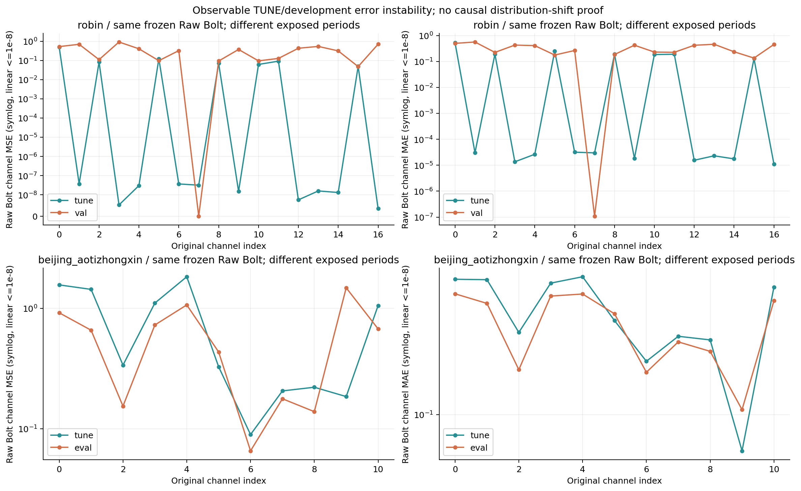
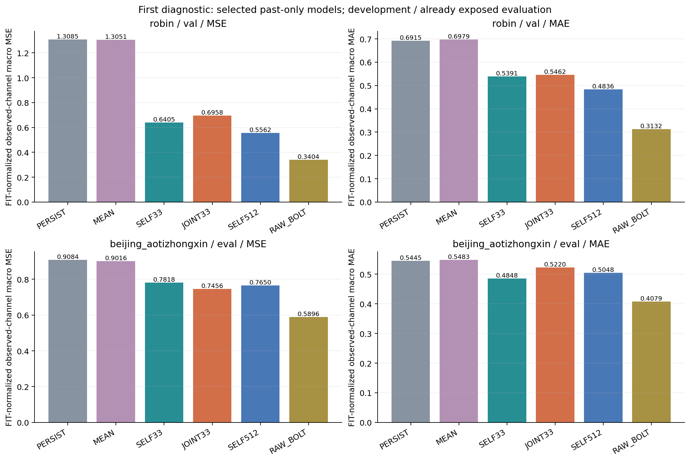
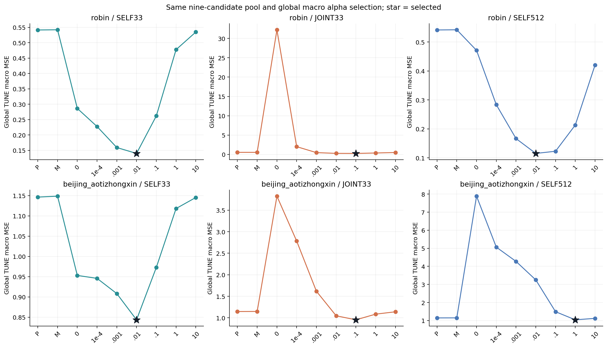
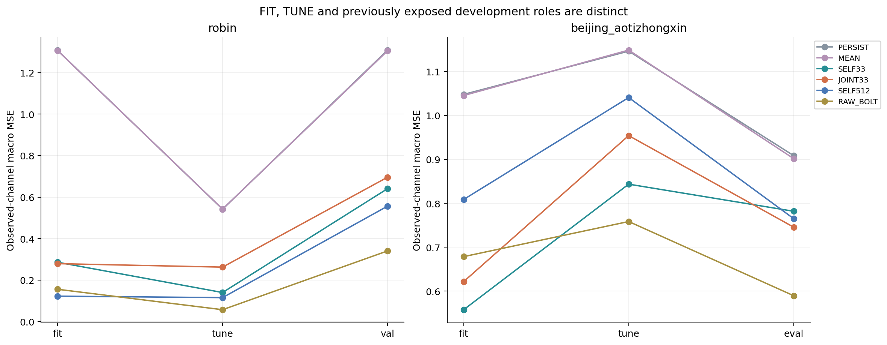
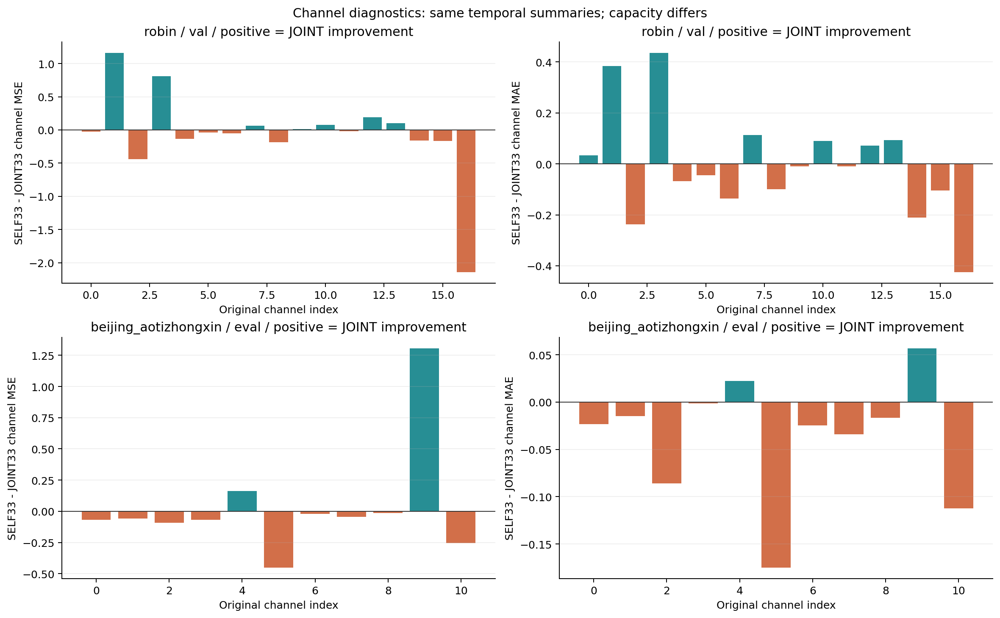
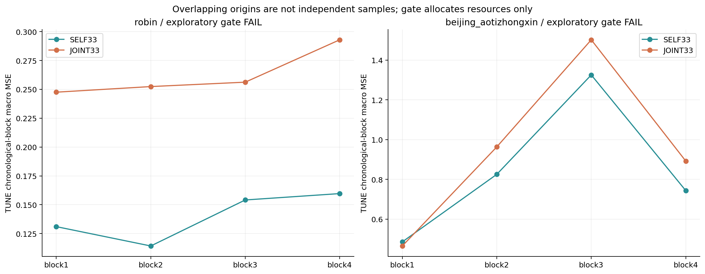
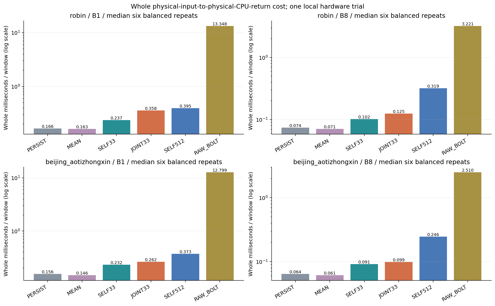
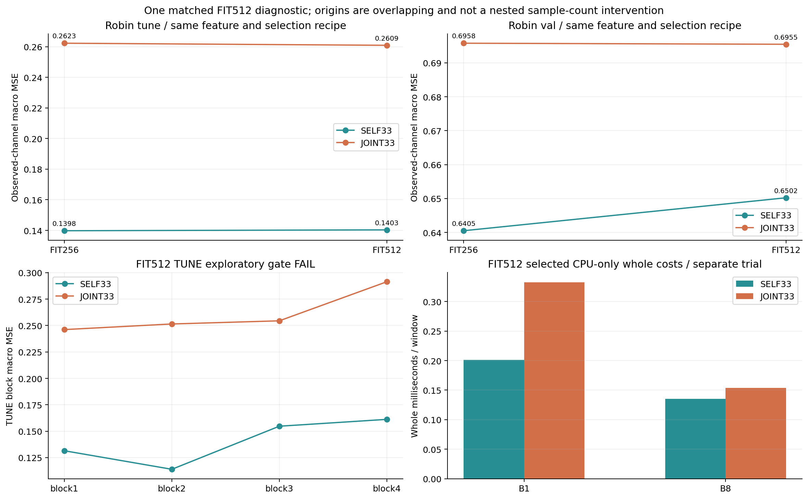

# 공통 채널 정보와 고정 Bolt의 가치: 첫 공정 비교

이 보고서는 승인된 새 캠페인의 첫 SELF33·JOINT33·SELF512 비교와 실제 배포 비용을 다룬다. 후속 표현 학습과 연구 전체의 완료를 뜻하지 않는다. 원수치 검산 통과는 성능 개선이나 독립 일반화 검증이 아니다.

## 먼저 답할 질문

**다른 채널이 도움이 되는가?** SELF33 대 JOINT33은 같은 32×16 평균+현재값을 쓰고, 같은 PERSIST·FIT 평균·7α의 전체 macro TUNE MSE로 선택했다. 입력 차원과 계수 용량은 다르므로 순수 정보의 인과 효과로 해석하지 않는다.

- robin: TUNE MSE 0.139777591 → 0.262253305, MAE 0.219166789 → 0.294391486; MSE 감소 -87.6219%, MAE 변화 34.3230%, 시간순 4블록 중 0개 개선. 탐색 gate 미통과. FIT/TUNE로 고정한 다음 분기는 `MATCHED_FIT512_ONE_DIAGNOSTIC`다.
- beijing_aotizhongxin: TUNE MSE 0.843454174 → 0.953965639, MAE 0.554773904 → 0.591202027; MSE 감소 -13.1022%, MAE 변화 6.5663%, 시간순 4블록 중 1개 개선. 탐색 gate 미통과. FIT/TUNE로 고정한 다음 분기는 `STOP_COMMON_REPRESENTATION_WEAK_EVIDENCE`다.

반례도 남는다. Beijing의 기노출 EVAL에서 JOINT33 MSE는 0.745596667, SELF33은 0.781774393이며, MAE는 각각 0.521992208, 0.484819007다. TUNE와 개발 EVAL의 이득 방향 및 MSE/MAE가 일치하지 않는 부분이 있으므로 ‘다른 채널이 모든 기간에서 쓸모없다’는 결론을 낼 수 없다. 이 EVAL 반례로 이미 고정한 TUNE gate를 사후에 뒤집지도 않았다.

Robin Raw Bolt도 TUNE MSE/MAE 0.056951091/0.097401173에서 VAL 0.340401887/0.313192123로 달라진다. 채널 MSE ≤1e−8인 수는 TUNE 3/17, VAL 1/17이다. 같은 frozen F·FIT 통계에서 관측한 기간별 오차의 불안정성이지, 분포 변화의 인과 원인이나 누출을 이 수치만으로 확정한 것이 아니다.



**강한 자기 채널 대안과 Bolt는 어떠한가?** SELF512는 시간 해상도가 다르므로 공통 정보의 직접 대조가 아니라 강한 단순 기준이다. Raw Bolt는 같은 origins·FIT 정규화·H48의 원채널 예측을 재사용하고, 비용에서는 실제 캐시 모델을 새로 추론했다. 아래 개발 점수는 분기 선택에 쓰지 않았다.

```text
dataset                method     split  selected/alpha       MSE          MAE
robin                  PERSIST    val    PERSIST              1.308464073  0.691485989
robin                  MEAN       val    MEAN                 1.305133324  0.697852290
robin                  SELF33     val    RIDGE/0.01           0.640522982  0.539099252
robin                  JOINT33    val    RIDGE/0.1            0.695788538  0.546223432
robin                  SELF512    val    RIDGE/0.01           0.556201347  0.483626954
robin                  RAW_BOLT   val    RAW_BOLT             0.340401887  0.313192123
beijing_aotizhongxin   PERSIST    eval   PERSIST              0.908441877  0.544506711
beijing_aotizhongxin   MEAN       eval   MEAN                 0.901634157  0.548318082
beijing_aotizhongxin   SELF33     eval   RIDGE/0.01           0.781774393  0.484819007
beijing_aotizhongxin   JOINT33    eval   RIDGE/0.1            0.745596667  0.521992208
beijing_aotizhongxin   SELF512    eval   RIDGE/1.0            0.764975074  0.504784415
beijing_aotizhongxin   RAW_BOLT   eval   RAW_BOLT             0.589575414  0.407916509
```



**누출은 있었는가?** 이 단계의 배포 readout과 Raw Bolt는 과거 history/current anchor만 받았다. FIT 특징 통계·FIT 평균·FIT ridge와 TUNE 선택, DEV payload 이전 분기 잠금을 저장했고 보호 TEST는 접근하지 않았다. 검산의 미래 교란과 산술 gate는 검사한 계약의 통과이며, 실제 모든 가능한 누출이나 독립 일반화를 증명하지 않는다.

**압축기·잠재 예측·디코더 중 무엇이 해결되었는가?** 첫 비교에는 압축과 디코더를 넣지 않았다. 공통 정보에 대한 공정한 readout 근거를 확보한 단계다. 작은 K의 손실 보존과 Bolt/native의 추가 가치는 승인 계획의 다음 분기 또는 기존 동일 조건 근거로 판단해야 한다.

**대조학습과 동적 그래프가 필요한가?** 이번 비교로 필요성을 입증할 수 없다. 단순 self/joint의 자원 gate에 따라 후속을 결정하며, 새로운 대조 손실이나 그래프를 임의로 추가하지 않는다.

## 비교 계약과 원수치

Robin C17·Beijing Aotizhongxin C11, L512/H48, FIT256/TUNE64/VAL30·기노출 EVAL146를 유지했다. 특징 center/population scale과 원자료 정규화는 FIT에서만 정했다. FP32 Y−현재값을 만든 뒤 FP64 centered masked ridge를 학습하며 λ=αNc, 절편 비규제, FP32 innovation+현재값 순서를 썼다. α는 0·1e−4·.001·.01·.1·1·10이고 세 경로 모두 하나의 전체 macro TUNE α를 선택했다.

결정적 ridge를 신경망 seed 두 번의 독립 반복으로 세지 않았다. 새/재사용 모델 묶음과 내부 채널 submodel·mask factorization은 별도 기록한다. JOINT 후보는 이전 7개 선택을 덮지 않고 같은 두 통제를 추가해 새 9pool에서 선택했다.

[전체 지표 CSV](tables/COMPARISON.csv) · [54개 후보 CSV](tables/POOL_SELECTION.csv) · [용량/선택 여유 CSV](tables/CAPACITY.csv) · [24개 비용 CSV](tables/COST.csv)









## 실제 추론 비용과 한계

각 자료에서 같은 첫 1/8 origins로 B1/B8을 측정했다. 6경로 각각 warmup2회 뒤 순서를 균형 배치한 실제 6회 반복을 썼다. 타이머에는 원단위 과거의 창별 causal forward-fill→FIT 정규화→CPU selected readout 또는 H2D·고정 Bolt·D2H→동일 CPU inverse→원단위 CPU 반환·최종 동기화를 포함했다. 디스크/모델/계수 로드·참조 추론·SHA·파일 저장·guard는 타이머 밖이다.

PERSIST/MEAN이 선택되면 그 경로의 실제 통제 비용을 재고 alias를 보존했다. ridge 계수는 비용 측정 중 재학습하지 않았다. 메모리는 공유 Bolt와 여러 CPU 계수가 상주하는 조건의 전체 peak이며 방법별 단독 allocation이나 일반적인 속도 우위가 아니다. 열/클록/carryover와 독립적인 하드웨어 반복은 확인하지 않았다. CPU readout은 현재 NumPy 구현으로, 최적화된 native 구현이라고 주장하지 않는다.



## 검산 범위와 다음 판단

첫 산술 독립 검산의 상태는 `PASS`이며 54개 후보의 저장 예측·관측 마스크·특징 통계·선택·정규방정식·origin·계보를 검사했다. 비용 저장 배열 검산은 `PASS`이며 24조건을 확인했다. 비용 검산은 실제 타이밍을 새로 재측정한 독립 하드웨어 실험이 아니다.

Raw Bolt의 실제 frozen state와 모델 바이너리 SHA, config 및 normalizer의 class/eps/arcsinh/forward parity를 비용 전후 기록했다. weights SHA만으로 동작이 같다고 대신 주장하지 않았다. 실제 모델은 캐시를 사용했고 설치·다운로드·백본 재학습은 없었다.

TUNE gate의 1% MSE·1% MAE·3/4블록 기준은 자원 배분 기준이며 유의성 검정이 아니다. 중첩 origins와 작은 자료 수 때문에 효과의 불확실성이 남는다. 이 보고서의 다음 분기는 이미 FIT/TUNE에서 고정되었고, 전체 새 표현 계열·CPU/GPU·wall 상한 안에서만 후속을 진행한다. 독립 확증은 별도 설계가 필요하며 보호 TEST는 이번 승인 범위에 없다.

[검산과 파일 계보](MANIFEST.json) · [비용 저장 배열 검산](COST_ARRAY_AUDIT.json) · [실행 계획](../../PHASE1_PLAN_KO.md) · [실행 상태와 실패 기록](../../RUN_STATUS.md)

## Robin의 한 번뿐인 FIT512 표본·규제 진단

첫 FIT256에서 JOINT의 FIT 오차는 낮지만 TUNE가 나빠 승인된 1회 진단을 실행했다. 동일 FIT 시간 구간·L512/H48·FIT 정규화·TUNE64·VAL30·특징·9pool·α 선택을 유지하고 self/joint를 함께 FIT512로 학습했다. 기존256 origins와 새512 origins의 교집합은 128개이며 포함 관계가 아니다. 중첩 창도 독립 표본이 아니므로 ‘표본 수만 두 배로 바꾼 인과 실험’으로 해석하지 않는다.

추가 Robin의 원 trainval x 멤버에는 이미 노출된 VAL 행도 들어 있다. 이 멤버를 읽어 FIT prefix만 특징·학습 목표로 구성하고 원256과 새512의 재구성을 검사했다. 새 DEV 점수화 전에 분기를 고정했지만, 해당 멤버의 VAL 바이트가 물리적으로 읽히지 않았다고 주장하지 않는다. 학습/분기에서 FIT/TUNE만 사용한 계약과 실제 파일 I/O의 범위를 구분한다.

확대 후 TUNE SELF33 MSE 0.140339388, JOINT33 MSE 0.260887098; SELF33 MAE 0.218614525, JOINT33 MAE 0.292043071. MSE 감소 -85.8973%, MAE 변화 33.5881%, 개선 블록 0/4. gate는 미통과이고 다음 결정은 `STOP_COMMON_REPRESENTATION_NO_GAIN_AFTER_MATCHED_FIT512`이다.

```text
FIT origins  method   split  selected/alpha       MSE          MAE
256          SELF33   fit    RIDGE/0.01           0.285825349  0.389552428
256          SELF33   tune   RIDGE/0.01           0.139777591  0.219166789
256          SELF33   val    RIDGE/0.01           0.640522982  0.539099252
256          JOINT33  fit    RIDGE/0.1            0.278969183  0.385074017
256          JOINT33  tune   RIDGE/0.1            0.262253305  0.294391486
256          JOINT33  val    RIDGE/0.1            0.695788538  0.546223432
512          SELF33   fit    RIDGE/0.01           0.288695643  0.391170854
512          SELF33   tune   RIDGE/0.01           0.140339388  0.218614525
512          SELF33   val    RIDGE/0.01           0.650235072  0.541981365
512          JOINT33  fit    RIDGE/0.1            0.284318531  0.388103668
512          JOINT33  tune   RIDGE/0.1            0.260887098  0.292043071
512          JOINT33  val    RIDGE/0.1            0.695475901  0.545231035
```



[FIT512 원수치](tables/EXPANDED_COMPARISON.csv) · [추가18pool](tables/EXPANDED_POOL_SELECTION.csv) · [추가 CPU4비용](tables/EXPANDED_COST.csv)

추가4비용은 실제 선택된 FIT512 SELF33/JOINT33 × B1/B8의 CPU 전용 별도 process다. 각각 warmup2·실제6repeat이고 두 순서 위치에3회씩 배치했다. 같은 실제 원단위 VAL 과거에서 whole 예측을 실행했다. 이 process에는 Bolt를 상주시켜 두지 않았고 새 Raw 비용을 재지 않았으므로 first24의 GPU 상주 조건과 메모리·속도 우위를 직접 비교하지 않는다.

## 미실행 후속과 연구 판단

공통 정보 gate가 새 작은-K 보존 비교의 선행 조건이므로 ForeCA 원리 projection과 예측 목적 linear E/D는 이번에 새 학습하지 않았다. 새 native head는 유효한 공통 E/D의 Bolt 추가 가치가 불명확할 때 여는 대조인데 선행 공통 경로가 선택되지 않았다. 추가 RAW33 잔차 결합은 유용한 공통 경로와 개별 정보를 분리하는 후속이며, 기존 MAIN84fit는 이미 있으므로 이름만 바꿔 반복하지 않았다. 긴 Raw L 입력은 입력 범위가 남은 경쟁 설명일 때의 대조다. 이번에는 동일 L512의 자기 채널보다 joint가 TUNE 자원 gate를 넘지 못했고, 허용된 표본·규제 진단 뒤 같은 계열 중단 조건에 도달해 긴 입력 분기로 확대하지 않았다. 이것은 각 미실행 방법의 성능 실패를 주장하는 것이 아니다. 기존 TS2Vec/GTConvAE/LEVEL/동일 E-D의 Bolt/native 결과는 [Phase0 감사](../../PHASE0_AUDIT_KO.md)에 별도로 남아 있다.

이 보고서의 PASS 감사에 묶인 새로운 비교는 42개의 결정적 ridge 모델 묶음과 재사용 14개, 72pool 비교다. 보존한 미채택 시도까지 포함한 실제 기록은 새 56개·재사용 14개·90pool이다. 실행한 것과 검산 후 본 보고서에 채택한 것을 구분한다. 각 묶음 내부의 채널별/마스크별 factorization은 용량 CSV에 따로 남겼다. first2자료와 추가Robin은 서로 독립적인 세 데이터셋이나 세 seed 반복이 아니다.

현재 결론은 **이 Robin·Beijing 계약에서 작은-K 공통 표현을 주연구로 밀어갈 단순 readout 근거가 부족하다**는 조건부 보류다. 재구성 목적의 표현이 예측에 부적합하다는 가설, 학습 최적화 문제, 비선형·지연 의존성의 존재를 이 선형 비교만으로 확정하거나 기각하지 않는다. Raw Bolt를 유지할 실용 근거와 새로운 압축 방법의 연구 기여는 구분해야 하며, 독립 평가와 다른 사전 선정 자료의 공통 정보 근거는 아직 남는다.

## 보존한 실행 실패와 재개 조건

첫 독립 검산 v1은 Beijing metadata의 list/dict 형식 처리에서 실패했다. 원 결과를 보존하고 새 검산 v2에서 고쳤다. 첫 GPU 비용 시도는 기본 Conda Python에 chronos 패키지가 없어 모델을 로드하지 못하고0개 비용 조건으로 실패했다. 설치하거나 기존 시계를 재설정하지 않고 이미 있던 .venv Python으로 새 tag에서 동일 소스를 실행했다. 첫 비용 배열 검산도 producer의 배열 SHA metadata 형식 처리에서 실패하여 새 검산에 정확한 형식을 적용했다. 실패 시도는 삭제하거나 완료로 바꾸지 않았다. 이 실패들은 과학적 방법의 성능 실패와 구분한다. NumPy·Python 환경이 다른 결과의 재현 범위도 exact saved-artifact·선택·parity gate로 제한했다.

최초 dense 진단에는 별도의 실제 산술 문제가 있었다. 원 history의 바이트는 같았지만 FP32 시간 요약의 메모리 배치에 따라 reduction 값이 달랐다. center 최대 차이는5.25e−8이고, JOINT α0 예측의 최대 차이는4.37498e−5로 기존 parity 기준을 넘었다. 허용 오차를 느슨하게 하지 않고 canonical memory 배치를 명시해 같은 FIT/origins/마스크/통계/α/목표로 새 시도를 학습·검산했다. 이는 새 방법이나 범용적인 표현학습 실패 원인이 아니라 이 산술 구현의 재현 문제 수정이다. 최초14fit와 수선한14fit를 모두 실행 기록에 세되, 현재의18pool 감사 PASS producer만 유효 비교에 사용한다.

본 보고서 terminal receipt 기록 전까지 실패/예산 보류 process receipt는 5개였다. 전체 시도와 실제 상태·오류는 [EXECUTION_ATTEMPTS.csv](tables/EXECUTION_ATTEMPTS.csv)에 남겼다. producer의 `COMPLETE` 실행 상태만으로 해당 시도의 독립 산술 검산이 PASS했다고 바꾸어 쓰지 않았다. 보존한 미채택 dense 시도나 metadata 수선은 현재 보고서의 정확한 accepted producer SHA와 감사에서 분리했다.

행정적인 manifest 생성 실패는 별도로 1건 보존했다. PowerShell의 List→array 변환 오류를 고치며 원 승인 시작/만료 시각은 유지했다. 이 행정 오류는 실험 실행이나 새 캠페인 시계 시작으로 세지 않았다.

재개는 gate가 넘지 못한 방법을 자동으로 늘리는 방식이 아니다. 공통 정보를 잘 지원하는 자료/변수 정의 또는 비선형 대조에 대한 별도 목적·데이터 계약을 정할 때 새 범위를 합의한다. 이번 승인 안의 중단은 자원 소진이나 성능 개선 보장이 아니라 기록된 과학적 gate의 결정이다.
