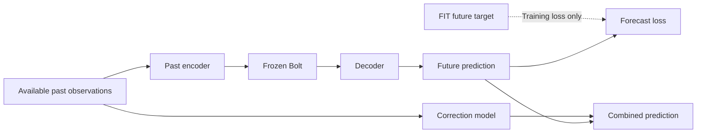

# ExoTimer의 정렬 아이디어와 교수님 제안에 대한 판단

2026-10-13. 이 문서는 사용자가 제공한 ExoTimer PDF, 같은 날 상담 녹취, 이번 연구의 실제 A/A2/B 결과를 구분하여 해석한다. 녹취는 자동 전사이므로 부정확한 단어를 그대로 기술 용어로 확정하지 않았다. 개인 대화 원문과 연락처는 저장소에 복사하지 않는다.

## 1. “나누는 기준을 학습한다”는 이해는 맞지만, 대조학습과의 구분은 수정해야 한다

[확인] ExoTimer PDF 4쪽 식 13은 두 모달리티에 각각 `I_t = P W_t + c_t`, `I_s = H W_s + c_s`를 적용한다. 행렬과 편향이 학습되므로 해시 비트의 부호를 결정하는 경계가 바뀐다. 학습에서는 Gumbel-Softmax 완화를, 추론에서는 sign을 사용한다. 따라서 **표현 공간의 분할 기준을 학습한다**는 이해는 적절하다. [공식 논문](https://ojs.aaai.org/index.php/AAAI/article/view/39908)

그러나 대조학습도 표현 공간을 학습한다. 같은 원본의 두 증강처럼 “가깝게 만들 관계”를 양성쌍으로 정의하고 인코더와 투영기를 조정하는 것이 일반적인 예다. 원시 입력이 이미 수치적으로 비슷한 것들을 모으는 작업에 한정되지 않는다. **대조학습은 학습 목적이고, Bi-Hash는 표현·조회·결합 구조여서 서로 배타적인 선택지가 아니다.** [SimCLR 원저](https://proceedings.mlr.press/v119/chen20j.html)

ExoTimer의 식 14는 해시 코드로 유사도를 계산하고, 식 15는 원래의 연속 표현과 유사도로 조회한 연속 표현을 결합한다. 이진 코드만으로 최종 시계열을 복원하는 구조가 아니다. 해시 비트 수와 우리 연구의 잠재 시계열 채널 수 K도 같은 개념이 아니다. 본문은 별도 positive/negative 대조 손실을 명시하지 않으므로, 정확한 학습 손실이나 대조학습 대비 우월성을 본문에 없는 내용으로 보충하면 안 된다.

[판단] 이 논문에서 가져올 만한 관점은 “두 표현을 사용할 목적에 맞게 연결하는 관계를 학습한다”는 것이다. 이를 곧바로 “미래 예측에 필요한 소수 시계열 성분을 찾아준다”로 확장할 근거는 없다. 식 10–12의 공통 무작위 투영에 관한 각도 보존 설명도 식 13의 모달리티별 학습 투영이 의미 정렬이나 예측 유용성을 자동으로 보장한다는 증명은 아니다. 모듈 제거 실험에서 성능이 떨어졌다는 사실과, 같은 조건의 대조학습보다 해시 분할 자체가 낫다는 인과 주장은 구분해야 한다.

## 2. 교수님 제안은 재구성 불일치 가설과 양립한다

[판단] 상담 02:32–04:35의 핵심은 “100개 채널을 잘 복원할 5개 숫자”보다 **“TSFM이 실제로 예측할 수 있는 소수의 연속 성분”**을 만들자는 제안으로 읽힌다. 재구성을 잘하는 표현이 예측에 적합하다는 보장이 없다는 문제의식을, 실제 사용 예측기를 기준으로 더 구체화한 것이다.

이때 구분해야 할 조건은 세 가지다.

1. 미래를 예측하는 데 필요한 정보를 표현이 보존하는가?
2. 그 정보를 사용할 수 있는 예측기가 존재하는가?
3. 우리가 고정해 둔 특정 Chronos-Bolt가 그 좌표와 시간 패턴을 활용할 수 있는가?

첫째와 둘째를 만족해도 셋째는 보장되지 않는다. 학습 가능한 강한 head가 잘 쓰는 표현과, 각 잠재 채널을 독립 시계열로 처리하는 동결 Bolt가 잘 쓰는 표현은 다를 수 있다. 복잡한 정렬 모듈의 필요성도 이 간극을 줄이는지로 평가해야 한다.

상담 06:55–07:45의 결합 평가 제안도 타당하다. 다만 전체 성능의 이득이 보정기에서만 나올 수 있다. 이번 실험이 원자료 보정기 단독, 원자료 Bolt+같은 보정 구조, 압축 Bolt+보정, 같은 E/D의 단순 예측기+보정을 함께 둔 이유다.

## 3. 미래를 학습 정답으로 쓰는 것과 미래 입력 누출은 다르다

[확인] N-BEATS는 과거 lookback을 입력받아 backcast와 forecast를 출력한다. 실제 미래 관측을 예측 입력으로 읽는다는 뜻이 아니다. 교수님의 설명 역시 “미래 정답을 입력에 섞어도 된다”는 근거로 해석하면 안 된다. [N-BEATS 원저, 3.1–3.2절](https://arxiv.org/html/1905.10437v4)



학습 구간에서 과거만 입력하고 미래를 정답으로 쓰는 것은 정상적인 예측 학습이다. TUNE의 미래 정답으로 checkpoint를 선택하는 것도 선언한 절차 안에서 허용된다. 문제가 되는 것은 예측 원점 이후 실제 관측이 입력·정규화·그래프·표현 추출에 들어가거나, 독립 평가용 VAL/TEST 정답으로 모델·설정을 고르는 경우다. 또한 예측 원점 이전의 전체 과거 창을 양방향 처리하는 것과, 각 중간 시점의 표현까지 엄격하게 과거 전용으로 만드는 것은 다른 계약이다. 후자가 자동 성능 개선 법칙은 아니다.

과거 표현에서 실제 미래 표현을 구별하도록 학습하는 발상에는 CPC라는 선행연구가 있다. 따라서 아이디어 자체는 가능하지만, 새로운 원리라고 주장할 수는 없다. 미래 target encoder를 학습할 경우 붕괴 방지, 겹치는 창의 가짜 음성쌍, 계절성·정체성만 맞히는 쉬운 해답, 추론 시 사라지는 teacher 경로를 점검해야 한다. 무엇보다 일반적인 잠재 예측기와의 정렬이 동결 Bolt와의 호환성을 보장하지 않는다. [CPC 원저](https://arxiv.org/abs/1807.03748)

## 4. 실제 결과를 반영하면 실패 원인에 대한 판단이 바뀐다

### 기존 FORECAST: 목적 함수보다 학습 origin 구성이 먼저 드러났다

[확인] 같은 원래 인코더·head·초기값·loss·batch 크기·600 update에서, 기존 sparse 학습 origin pool을 FIT256으로 바꾸자 다음과 같이 개선됐다. 공통 TUNE64의 물리 단위 macro MSE로 checkpoint를 선택한 뒤 VAL을 평가했다.

```text
                 기존 sparse MSE       FIT256 MSE
Jena seed92601       32063.406            12887.576
Jena seed92602       33796.728            15812.935
Robin seed92601       1376.123              646.548
Robin seed92602       1312.848              819.041
```

이는 기존 FORECAST 실패를 “재구성의 한계” 또는 “새 대조학습이 없어서”로 설명하기에 부족하다는 직접적인 증거다. 바뀐 것은 pool의 크기·위치·중첩도이며 독립 표본 수만의 효과는 아니다. [A2 보고서](stage_a2_dense_pool_v1/REPORT_KO.md)

### 실제 Bolt를 통과하는 예측 목적 학습: 압축 경로의 원단위 오차는 줄었다

새 Stage B에서는 과거512·미래48, Jena K5/Robin K4, causal E와 linear D를 사용했다. REC와 PRED는 같은 구조·초기값·배치 순서다. PRED는 **실제 동결 Bolt를 통과하는 미래 손실로 E와 D를 함께 학습**했다. 별도 미래 teacher나 해시 정렬을 넣지 않았다.

```text
                     REC→Bolt MSE       PRED→Bolt MSE
Jena seed92601          18935.994           13867.543
Jena seed92602          18935.994           12988.519
Robin seed92601           257.023             243.308
Robin seed92602           257.023             245.703
```

REC 네 조건은 모두 미래 TUNE 기준으로 초기 checkpoint 0을 선택했다. 이 표는 이번 학습·선택 규칙의 비교이며, 모든 재구성 표현 학습이 실패한다는 결론이 아니다. E/D 공동 학습이므로 encoder만의 효과나 잠재 미래 예측 오차 자체의 감소를 분리해 입증한 것도 아니다. 공통 규칙으로 D를 다시 적합한 대조는 decoder 효과를 진단하지만, 동일한 수치의 D를 강제로 사용하는 실험은 아니다.

### 재구성 자체의 일반화도 확인해야 한다

[확인] 저장된 40개 REC/PRED checkpoint를 추가 학습 없이 CPU에서 다시 실행했다. 같은 FIT256/TUNE64의 과거 창을 고정해 보니, REC의 초기→final600 **정규화 재구성 MSE**는 다음과 같았다.

```text
                 FIT 초기 → final600           TUNE 초기 → final600
Jena seed92601    0.147215 → 0.145960            0.400644 → 0.460918
Jena seed92602    0.147215 → 0.146069            0.400644 → 0.495028
Robin seed92601   0.116615 → 0.110079            0.038509 → 0.047335
Robin seed92602   0.116615 → 0.110178            0.038509 → 0.049814
```

FIT에서는 조금 개선됐지만 TUNE 과거 창에서는 네 조건 모두 악화했다. 이는 학습 구간에 치우치는 양상과 일치하며, **“입력을 잘 복원하도록 일반화했는데 미래 예측만 실패했다”는 단정은 지지하지 않는다.** TUNE 과거 창 일부는 FIT와 겹치므로 완전히 분리된 시점만의 재구성 평가라고 하지 않는다.

물리 단위 지표는 따로 봐야 한다. Jena TUNE 물리 재구성 MSE는4554.253→4426.273/4469.852로 소폭 개선됐고 Robin은38.435→46.741/48.480으로 악화했다. 학습 목표와 같은 normalized MSE의 일반화 문제, 원단위 평가의 가중 차이, 실제 예측기와의 목적 불일치를 한 원인으로 뭉칠 수 없다. 검사한 latent는 모두 finite이고 최소 채널 표준편차가0.269672로 전체 상수 붕괴는 관찰되지 않았지만, 유용한 정보 보존이나 다른 형태의 붕괴를 배제하는 증거는 아니다. [고정 재구성 진단](reconstruction_audit_v1/REPORT_KO_v2.md)

**지표에 관한 제한도 중요하다.** Robin의 normalized MSE는 REC 0.58401에서 PRED 0.59751/0.60218로 오히려 악화됐다. Jena PRED는 RAW Bolt 대비 물리 MSE가 0.81%/7.10% 줄지만 MAE는 27.16%/28.03% 늘었다. 원단위 MSE 개선을 전체 채널·모든 오차의 개선으로 말하면 안 된다. [B 원수치](stage_b_full_v1/RESULT.json)

### 보정 결합과 TSFM의 필요성: 아직 전체 우위는 없다

[확인] Jena에서는 원자료 보정기 단독 MSE10978.293이 압축 Bolt+원자료 보정 MSE13058.848/12185.094보다 낮다. 동일 E/D의 선형 예측기+보정도 12159.872/11702.367로 압축 Bolt+보정보다 낮다. Robin에서는 원자료 Bolt MSE151.554/MAE5.939가 압축 Bolt+보정 MSE246.034/249.263, MAE9.853/9.894보다 좋다.

Batch8의 측정 전체 경로 시간은 원자료 Bolt Jena31.94ms/Robin27.33ms, 압축 PRED+보정 Jena14.46–15.01ms/Robin13.44–15.66ms다. 따라서 원자료 Bolt 대비 속도와 오차 사이의 교환은 관찰됐다. 다만 보정 단독과 선형 예측기+보정은 약1–2ms이므로 모든 대안을 고려하면 압축 Bolt의 효율 우위가 확립된 것은 아니다. 단일 batch1 비용은 변동이 커 이 배율을 그대로 적용할 수 없다.

보정기 R은 E/D 학습 후 `미래 정답 - 기본 예측`에 적합했다. 이는 순수한 압축 손실뿐 아니라 Bolt 예측·decoder 오차도 포함한다. “나머지 정보만 정확히 분리했다” 또는 전체 E/F/D/R을 공동 최적화했다고 표현하지 않는다. 과거 재구성 잔차를 R의 입력으로 준 별도 대조도 수행했다.

## 5. 지금 좁힐 연구 질문

[판단] 현재 근거에 맞는 질문은 다음과 같다.

> 충분히 다양한 학습 origin과 명시한 오차 기준 아래에서, 실제 동결 예측기를 통과해 학습한 작은 연속 성분이 단순 예측기 및 원자료 예측 대비 어떤 정확도·추론 비용의 교환을 만드는가?

“좋은 압축 표현을 찾는다”보다 구체적이며, 해시·대조학습을 처음부터 필수 요소로 두지 않는다. 확인된 기여 후보는 실패 원인의 분리와 예측기·decoder·보정의 대조 절차다. 새로운 방법의 일반적 성능 우위나 논문 기여가 확정됐다는 뜻은 아니다.

교수님의 lookback 확대와 그래프 제안은 후속 가설이다. 이번 실험은 L512, K 한 설정, 두 seed, 두 자료에 한정되며 새 lookback sweep이나 동적 그래프·미래 정렬 학습을 실행하지 않았다. lookback을 늘릴 때는 실제 receptive field와 예측기가 쓰는 범위도 늘어나야 하고, 가능한 학습 origin이 감소하는 효과를 분리해야 한다. 큰 변경을 추가하기 전에 평가 지표를 고정하고 동일 target origins에서 비교해야 한다.

이번 VAL은 여러 번 사용한 개발 자료이며 Jena371/Robin30개의 겹치는 origin이다. 독립 TEST 일반화 검증이 아니다. [독립 검산](validation_final_review_v2.md)은 수치와 계약의 일관성을 확인하며 성능 우위를 증명하지 않는다.
