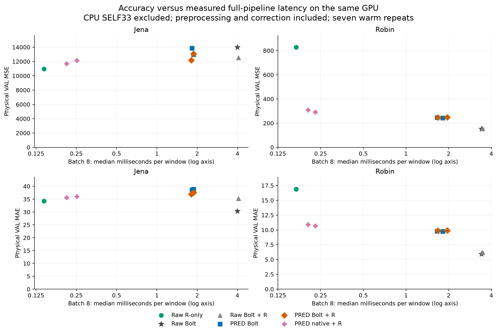

# FORECAST 진단과 예측 성분·보정 연구

2026-10-13 · 실행 시작 HEAD `837c20e9639de8c3a56419e8eddcee2b63006c34`

먼저 [한국어 통합 보고서](report_v1/REPORT_KO.md)를 읽는다. ExoTimer의 학습 가능한 해시 정렬, 교수님 제안, 미래 입력과 학습 정답의 구분은 [비판적 검토](DISCUSSION_KO.md)에 정리했다.

## 확인된 핵심

- 같은 원래 FORECAST에서 학습 origin pool을 바꾼 A2의 물리 VAL MSE는 네 조건 모두 37.61–59.81% 감소했다. 학습 origin 구성의 영향을 먼저 분리해야 한다.
- 실제 동결 Bolt를 통해 E/D를 예측 목적으로 학습하는 경로가 작동했다. REC 대비 물리 MSE는 줄었지만, Robin 정규화 지표는 악화했다.
- 압축+보정의 전체 우위는 입증하지 못했다. Jena의 원자료 보정 단독, Robin의 원자료 Bolt가 중요한 강한 대조군이다. 정확도·비용·시간 구간에 따라 판단이 달라진다.
- 두 자료·두 seed·단일 K/H의 반복 사용 VAL 개발 진단이다. TEST 일반화나 방법군 전체의 성공·실패로 해석하지 않는다.

## 보고서와 원수치

- [학습 origin pool 대조](stage_a2_dense_pool_v1/REPORT_KO.md), [기존 checkpoint/head 진단](stage_a_checkpoint_readout_v1/REPORT_KO.md)
- [고정 과거 창의 재구성 일반화 진단](reconstruction_audit_v1/REPORT_KO_v2.md): REC는 FIT 정규화 재구성 MSE를 줄였지만 TUNE 과거 창에서는 네 조건 모두 악화했다.
- [전체 78경로 CSV](report_v1/all_78_methods.csv), [채널별 CSV](report_v1/val_channel_metrics.csv)
- [주요 paired 비교](report_v1/paired_contrasts.csv), [시간순 네 구간 비교](report_v1/chronological_blocks.csv)
- [batch1/8의 실제 비용과 7개 반복값](report_v1/batch_latency.csv)
- [독립 검산 JSON](validation_final_v2.json), [검산 해석](validation_final_review_v2.md)
- [계획](PLAN_KO.md), [실행 환경·원자료 확인](PREFLIGHT_v1.json), [B 실행 당시 소스·해시](stage_b_full_v1/IMPLEMENTATION_AND_REPRODUCIBILITY.json)

## 재현과 보존

실행 코드는 [Stage A](diagnose_forecast.py), [Stage A2](diagnose_dense_forecast.py), [Stage B](component_experiment.py), [SELF33](self_lag_baseline.py)에 있다. [보고서 생성기](make_study_report.py)는 저장된 결과를 읽어 CSV와 그림을 만든다. 기존 실험 결과를 덮지 않도록 새 실행 tag를 사용한다.

예측 배열·학습된 모델은 저장소의 `.cache/forecast_component_study_20261013/`에 보존된다. 이 로컬 cache, 기존 데이터 자산, pinned Bolt checkpoint는 저장소 코드와 별개이며 GitHub에 자동 배포되지 않는다. 이 폴더의 문서·그림·CSV는 상대경로로 연결했다.

새로운 TEST 사용, 이전 중단 캠페인 재개, 자동 commit/push는 이 연구 범위에 포함하지 않았다. 중간 검산 v1 실패 기록은 보존했고, 과학 결과를 가리키는 최종 검산은 위 v2다.
