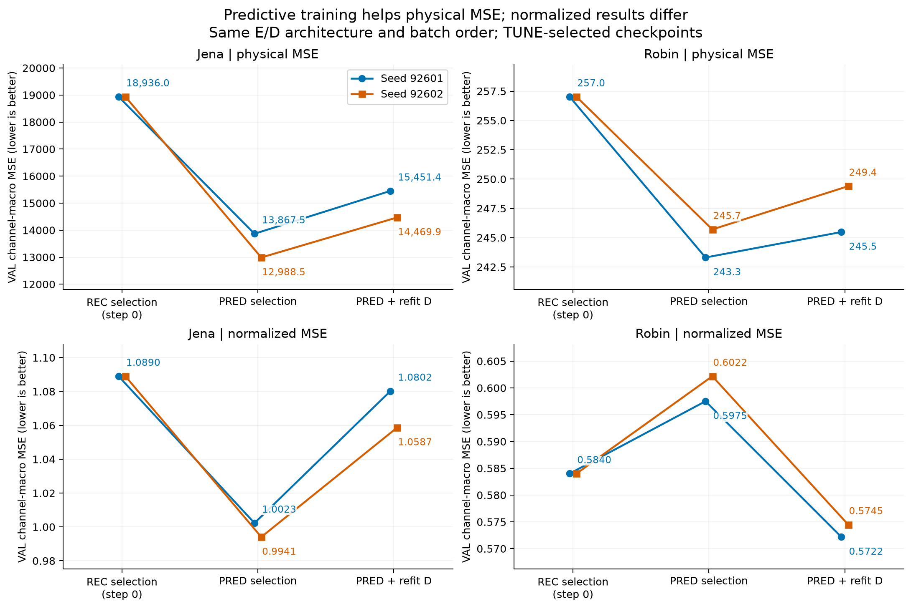

# 지금 확인한 것과 다음에 판단할 것

2026-10-13 · FORECAST 실패 진단 및 동결 TSFM 성분·보정 실험의 독자용 요약

**[확인] 이번에 해결한 것은 기존 실패의 일부 원인을 좁히고, 실제 동결 Bolt를 이용한 학습과 대조 실험을 성립시킨 것이다. 압축 모델의 성능 문제를 완전히 해결하거나 새로운 방법의 우위를 입증한 상태는 아니다.** 지금은 “재구성 표현이 나빠서 실패했다”는 하나의 설명 대신, 학습 창 구성·일반화·예측기·decoder·평가 지표를 구분해서 다음 결정을 내릴 수 있다.

범위는 Jena와 Robin, 신경망 seed92601/92602, 과거512→미래48, Jena21→5성분·Robin17→4성분이다. FIT256/TUNE64와 기존 개발 VAL을 사용했다. VAL origin은 Jena371개·Robin30개이며 창과 예측 정답이 중첩된다. 두 seed와 시간 구간은 독립 일반화 표본으로 취급하지 않는다. 보호 TEST는 사용하지 않았다. 이 문서는 봉인된 결과를 요약하고 다음 판단을 제안하며, 새 실험을 실행한 기록은 아니다.

## 1. 지금 해결하거나 명확히 한 것

### 기존 FORECAST의 실패 원인 중 학습 창 구성을 분리했다

[확인] 원래 encoder·head·초기값·loss·batch 크기·600 updates를 유지하고, sparse 학습 origin pool을 FIT256 pool로 바꿔 실제 다시 학습했다. 공통 TUNE64로 checkpoint를 선택한 결과는 다음과 같다.

```text
자료   seed   기존 sparse VAL MSE   FIT256 VAL MSE   감소율
Jena   92601      32063.406           12887.576       59.81%
Jena   92602      33796.728           15812.935       53.21%
Robin  92601       1376.123             646.548       53.02%
Robin  92602       1312.848             819.041       37.61%
```

같은 final600끼리 비교해도 네 조건의 물리 MSE/MAE가 모두 개선됐다. 따라서 checkpoint 선택 차이만으로 설명되는 결과는 아니다. 다만 pool의 개수·위치·중첩·노출 분포가 함께 달라졌으므로, 독립 표본 수만의 효과로 부르면 안 된다. **기존 FORECAST 부진을 목적 함수나 표현학습 방법 하나의 한계로 기각할 근거가 부족하다는 점은 명확해졌다.**

### 실제 동결 TSFM을 통과해 작은 encoder·decoder를 학습할 수 있음을 확인했다

[확인] PRED는 실제 Chronos-Bolt-small의 미래 예측과 decoder 출력으로 손실을 계산했다. Bolt 가중치는 시작·종료 hash가 같았으며, encoder(E)와 decoder(D)의 gradient 및 실제 optimizer 변화가 확인됐다. 공식 median 추론과의 일치, 과거 전용 causal 검사, 비용 측정 경로와 저장 예측의 일치도 통과했다. 이 검사는 구현과 정보 사용 조건에 대한 근거이며 성능 개선의 증거와 구분한다.

[확인] 같은 초기값·구조·배치 순서의 REC와 비교한 PRED의 물리 MSE는 다음과 같다. REC는 미래 TUNE 선택 기준에서 네 조건 모두 초기 step0을 선택했다.

```text
자료   seed   REC→Bolt VAL MSE   PRED→Bolt VAL MSE
Jena   92601       18935.994           13867.543
Jena   92602       18935.994           12988.519
Robin  92601         257.023             243.308
Robin  92602         257.023             245.703
```

이는 이번 조건에서 예측 목적 학습의 유효한 신호다. E/D 공동 학습이므로 encoder만의 개선, 잠재 미래 예측만의 개선, 모든 재구성 학습에 대한 우위로 확장하지 않는다. 특히 Robin 정규화 MSE는 REC0.5840에서 PRED0.5975/0.6022로 오히려 악화했다. **물리 MSE만의 개선을 전체 정확도 개선으로 표현하지 않도록 기준을 바로잡았다.**



### 고정 과거 창에서 재구성의 일반화 문제를 확인했다

[확인] 저장된 REC/PRED 40개 checkpoint를 같은 FIT/TUNE 과거 창에서 재실행했다. 추가 학습·Bolt 실행·새 VAL 평가는 없었다. REC의 초기0→최종600 정규화 재구성 MSE는 FIT에서 네 조건 모두 조금 감소했지만 TUNE 과거 창에서 모두 증가했다.

```text
자료   seed      FIT 초기→600             TUNE 초기→600
Jena   92601    0.147215→0.145960        0.400644→0.460918
Jena   92602    0.147215→0.146069        0.400644→0.495028
Robin  92601    0.116615→0.110079        0.038509→0.047335
Robin  92602    0.116615→0.110178        0.038509→0.049814
```

그러므로 **재구성 자체의 일반화 문제도 남아 있다.** Jena의 물리 재구성 MSE는 소폭 좋아져, 지표에 따른 차이도 있다. TUNE 과거 창 일부가 FIT와 겹치므로 완전히 분리된 시점만의 검증이라고 하지 않는다. 잠재값은 모두 유한했고 검사 범위에서 전체 상수 출력 붕괴는 관찰하지 못했다. 정보 보존·표현 중복·Bolt 적합성까지 통과했다는 뜻은 아니다.

### 강한 대안과 전체 비용을 포함해 주장할 수 있는 범위를 정했다

[확인] 압축 Bolt 단독, 원자료/과거 재구성 잔차 보정, 같은 E/D의 native 선형 예측기와 보정, 공통 규칙의 D, persistence, 원자료 Bolt와 ridge를 실제 비교했다. 별도 자기 채널 최근33값 ridge를 합쳐 78경로를 기록했다. GPU 경로는 전처리·장비 전달·E/F/D/R·역정규화·CPU 반환을 포함해 batch1/8을 warmup2회 뒤 7회씩 측정했다.

[확인] 전체 결합의 우위는 아직 없다. Jena에서 PRED Bolt+원자료 보정 MSE는13058.848/12185.094였고, 원자료 ridge 단독은10978.293이었다. 동일 E/D의 native+보정도12159.872/11702.367로 더 낮았다. Robin은 원자료 Bolt MSE151.554/MAE5.939가 압축 결합 MSE246.034/249.263, MAE9.853/9.894보다 좋았다. Jena의 원자료 Bolt 대비 물리 MSE 이득도 MAE 악화를 동반한다.


batch8 전체 지연은 원자료 Bolt가 Jena31.938ms/Robin27.331ms, PRED Bolt+보정이 Jena14.459–15.009ms/Robin13.442–15.664ms였다. 압축에 따른 속도·정확도 교환은 관찰됐지만 native/ridge 경로는 약1–2ms여서 모든 대안에 대한 효율 우위는 아니다. batch1 변동, 서로 다른 CPU/GPU 참고군, 함께 상주한 모델의 메모리 측정도 구분했다.

## 2. 아직 해결되지 않은 질문

**[판단] E·잠재 미래 예측·D 중 무엇이 병목인지 완전히 분해하지 못했다.** 공통 규칙으로 D를 다시 적합한 진단은 수행했지만, 이는 E별로 서로 다른 D를 얻는 절차다. 동일한 수치의 D를 고정한 인과 대조도 아니고, 원공간 오차를 세 단계의 독립 기여량으로 정확히 나눈 것도 아니다. 보정 R의 정답도 전체 기본 예측의 잔차라서 순수 압축 손실만을 분리한 값은 아니다.

**[판단] 학습 목표와 선택·주장 기준을 먼저 확정해야 한다.** 이번 학습은 정규화 channel-macro MSE이고 checkpoint 선택은 물리 channel-macro MSE였다. 이 선택 계약은 지켰지만 채널 단위와 분산에 따라 순위가 달라졌다. 어느 지표가 연구의 주목표인지 사전에 정해야 하며, 결과가 좋은 지표로 사후에 목적을 바꾸면 안 된다.

**[판단] 동결 Bolt가 압축 시스템에 꼭 필요한지는 미확정이다.** Jena에서는 같은 E/D·보정의 native가 더 정확하고 빨랐고, Robin에서는 압축 공간 안에서 Bolt가 native보다 좋았지만 원자료 Bolt가 더 정확했다. 현재 두 자료를 묶어 압축 Bolt의 필요성을 주장할 수 없다.

**[판단] 강한 기준군을 넘는 시간적 안정성과 일반화도 확보하지 못했다.** 시간순 네 VAL 구간의 비교는 이미 계산했다. 일부 구간의 악화와 중첩을 확인했으며, 이를 독립 네 반복으로 해석하지 않는다. 새 평가를 할 때는 같은 target origins에서 사전에 고정한 기준군·지표를 유지해야 한다. 독립 TEST 사용은 별도 범위이며 현재 사용하지 않는다.

## 3. 다음 확인의 우선순위

다음은 추가 실행 결과가 아니라 **후속 실험 제안**이다. 이미 통과한 미래 정보 사용 검사와 실제 Bolt 연결 검사를 다시 처음부터 수행해야 한다는 뜻은 아니다. 구조나 입력 계약이 바뀌면 영향을 받는 검사만 다시 적용한다.

1. **고정 origin·평가 기준 아래 학습 일반화를 개선할 수 있는가.** 같은 FIT/TUNE 창과 예측 정답을 유지하고 주평가 지표를 먼저 정한다. 작은 사전 지정 학습 변경을 원조건과 비교해, FIT 개선이 TUNE 재구성·미래 예측으로 이어지는지 확인한다. REC를 미래 예측 기준으로만 선택한 결과와 복원 기준으로 선택한 결과도 구분한다. 여기서 신호가 없으면 복잡한 정렬 방법보다 최적화·용량·시간 분포 문제를 먼저 좁힌다.

2. **성분 수 K와 실제 시간 범위의 손실·비용을 확인한다.** 현재 K는 자료별 한 값뿐이다. 제한된 K·lookback 대조에서 같은 target origins를 유지하고, E의 실제 receptive field(RF127)와 예측기가 보는 범위를 함께 기록한다. 입력 길이만 늘려 정보 사용이 늘었다고 주장하지 않는다. 필요한 과거가 길어져 사용 가능한 origin이 줄어드는 효과도 분리한다.

3. **Bolt·native·원자료 기준군의 전체 경로를 다시 판단한다.** E/D가 고정된 상태의 예측기 대조와 각 방법의 필요한 학습 비용을 명시한다. MAE·정규화 지표·시간 구간도 포함해 정확도와 지연을 같이 비교한다. 단순 예측기나 보정 단독이 계속 더 정확하고 빠르면, 연구 질문을 “어떤 조건에서 동결 TSFM을 연결할 가치가 있는가”로 좁히는 것이 타당하다.

4. **남은 병목에 맞을 때만 미래 정렬·대조학습·지연 그래프를 추가한다.** 직접 예측 목적보다 미래 표현 정렬이 어떤 이득을 내야 하는지 먼저 정한다. 교차 채널 지연이 병목이라는 근거가 있으면 고정 지연 표현과 그래프를 비교하고, 고정 그래프가 부족할 때 동적 그래프를 검토한다. 새 기법 자체를 기여로 삼기보다 정확도·비용·학습 안정성에서 남은 문제를 실제 해결해야 한다.

현재 가장 먼저 해야 할 일은 **학습 일반화와 평가 기준을 고정해서 확인하는 것**이다. 그다음 K·시간 범위와 전체 예측기 대조가 남는다. Bi-Hash·대조학습·동적 그래프는 가능한 후보지만 지금 반드시 필요한 요소라고 결론내리지 않는다.

## 근거와 원수치

- [조건·한계·4개 그림을 포함한 통합 보고서](report_v1/REPORT_KO.md), [교수님 대화와 ExoTimer 해석](DISCUSSION_KO.md).
- [78경로 FIT/TUNE/VAL 원수치](report_v1/all_78_methods.csv), [paired 대조](report_v1/paired_contrasts.csv), [채널별 지표](report_v1/val_channel_metrics.csv), [시간 구간 대조](report_v1/chronological_blocks.csv), [batch1/8 비용과 반복값](report_v1/batch_latency.csv).
- [A2 학습 origin 대조](stage_a2_dense_pool_v1/REPORT_KO.md), [고정 재구성 진단의 최종 해석](reconstruction_audit_v1/REPORT_KO_v2.md).
- [독립 실행 결과 검산](validation_final_review_v2.md), [CSV·그림 범위 감사 V2](CLOSURE_SCOPE_REVIEW_V2.md), [재구성 독립 검산](RECONSTRUCTION_AUDIT_VERIFICATION_v1.md), [최종 50항목 감사](FINAL_AUDIT.json).

검산 통과는 저장 배열·수치·계약의 일관성 확인이다. 이 연구의 반복 사용 개발 VAL 결과를 독립 일반화 검증이나 모델 문제의 완전한 해결로 바꾸어 말하지 않는다.
