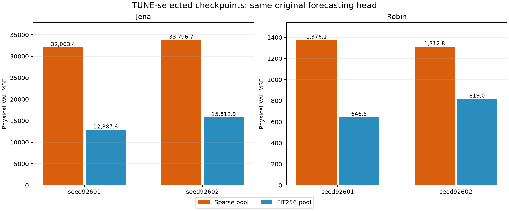
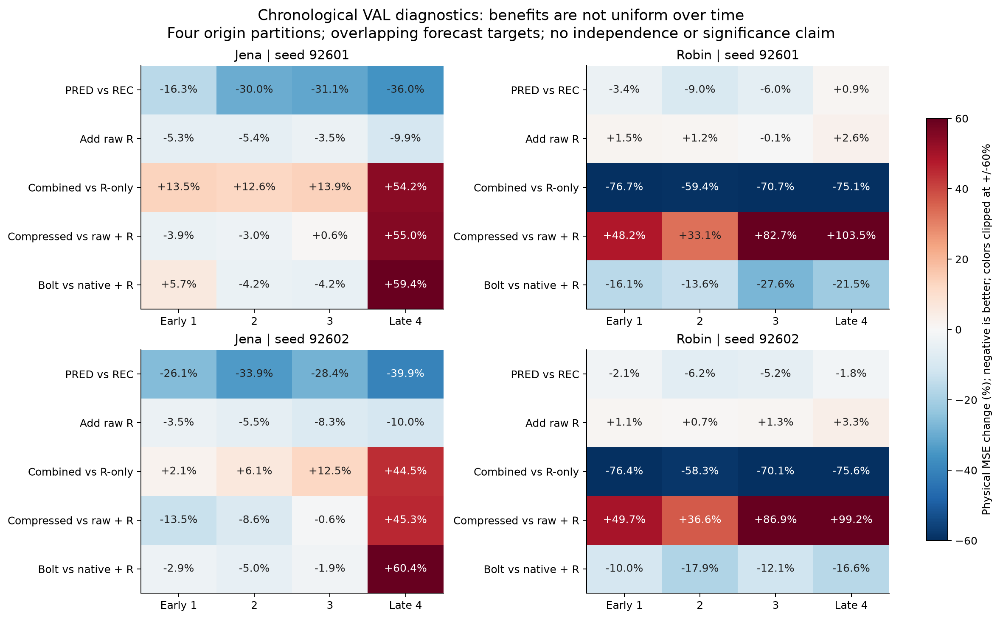

# FORECAST 실패 진단과 동결 TSFM 예측 성분·보정 실험

2026-10-13 · Stage A/A2/B 통합 · 두 데이터, 두 신경망 seed · 반복 사용 VAL 개발 진단

## 먼저 답할 질문

**[확인] 기존 FORECAST 부진에는 학습 origin pool 설계가 크게 기여했다.** 원래 구조·초기값·예측 목적·update 수를 유지하고 Jena37/Robin2의 sparse origin pool을 FIT256으로 바꾼 A2에서, 두 자료·두 seed의 선택 모델 물리 MSE가 모두 개선됐다. 감소 폭은 37.61–59.81%다. 원래 head를 다시 붙이기만 해서는 해결되지 않았지만, pool을 바로잡자 학습 효과가 나타났다. 이것은 재구성 목적의 한계나 대조학습 필요성을 원인으로 확정하는 결과가 아니다.

**[확인] 재구성 자체의 일반화 문제도 남아 있다.** 저장된 codec40개를 고정 FIT/TUNE 과거 창에 재실행한 추가 검사에서, REC의 학습 목적과 같은 정규화 재구성 MSE는 final600이 초기값보다 FIT에서는 네 조건 모두 조금 낮지만 TUNE에서는 네 조건 모두 높았다. 따라서 “재구성이 잘 일반화되는데 미래 예측만 실패했다”고 확정할 수 없다. 다만 Jena의 물리 재구성 MSE는 좋아져, 재구성도 지표별로 해석해야 한다. 이 검사는 추가 학습·새 VAL 평가 없이 수행했다.

**[확인] 동결 Bolt를 통과한 예측 손실로 작은 E/D를 학습하는 것은 실행 가능했다.** Bolt 가중치가 고정된 채 E/D의 실제 gradient와 parameter update가 확인됐다. PRED의 물리 MSE는 REC 선택 결과보다 Jena -26.77%/-31.41%, Robin -5.34%/-4.40% 낮았다. 그러나 Robin의 정규화 MSE/MAE는 모두 악화했다. **네 조건 모두 개선이라는 표현은 물리 MSE에만 해당한다.** REC는 네 조건 모두 학습 전 step0을 선택했으므로 학습된 AE 일반론으로 확대하지 않는다.

**[확인] 보정까지 합친 전체 시스템의 우위는 확보하지 못했다.** Jena에서는 보정이 PRED Bolt보다 좋아지지만 단순 원자료 R-only보다 MSE/MAE가 모두 나쁘다. Robin에서는 보정이 PRED Bolt를 조금 악화시키고, 원자료 Bolt가 압축 계열보다 MSE/MAE 모두 좋다. Jena의 압축 결합은 원자료 Bolt보다 물리 MSE가 낮지만 MAE는 높아 정확도가 일관되게 좋아졌다고 할 수 없다.

**[판단] Bolt를 모든 자료에서 유지할 근거는 부족하다.** Jena의 같은 E/D·보정 조건에서 native 선형 예측기가 Bolt보다 MSE/MAE가 좋고 빠르다. Robin의 같은 압축 표현에서는 Bolt가 native보다 낫지만, 원자료 Bolt가 더 정확하다. 압축 결합은 batch8의 실제 지연을 낮추지만 손실 없는 대체는 아니다. 아래에 원수치와 조건을 함께 제시한다.

## 실험 범위와 비교 계약

- 데이터: Jena C21→K5, Robin C17→K4. 기존 bounded TRAIN/VAL byte SHA를 확인했다. 보호 TEST 접근을 차단했다.
- 정규화·PCA·모델 fitting은 TRAIN 앞80% FIT만 사용한다. 뒤20% TUNE는 선택에 사용하고, VAL로 checkpoint·lambda를 선택하지 않는다.
- Stage B FIT256, TUNE64, VAL Jena371/Robin30 origins. 과거512→미래48. 256은 시간적으로 독립적인 표본 수가 아니다.
- E: PCA 초기 선형 투영 + causal TCN(hidden16, kernel3, dilation1/2/4/8/16/32, RF127), 출력 LayerNorm 없음. D: PCA 초기 K→C 선형 복원. REC/PRED는 seed별 초기값·batch 순서·구조가 같다.
- REC는 과거 재구성, PRED는 실제 동결 Bolt median→D→미래 정답의 normalized channel-macro MSE로 E/D를 공동 학습한다. Adam0.001, batch4, 600 updates, clipping1. **E만 바꾼 인과 대조는 아니다.**
- E/D는 step0/100/200/400/600 중 TUNE 물리 channel-macro MSE가 최소인 것을 선택한다. REC도 동일한 Bolt 미래예측 기준이다. Jena PRED는 두 seed600, Robin은 두 seed200, REC는 모두0 선택.
- 보정 R: 과거512를 16시점씩 평균한32개 블록+마지막값, 33*C 특징의 joint ridge. 원자료 또는 X−D(E(X))를 입력한다. lambda[0.0001,0.01,1,100,10000]를 TUNE로 선택한다. 각 base의 FIT 예측 잔차에 별도로 적합하되 구조·정답·선택 규칙은 동일하다.
- Native: 같은 E/D를 고정하고 전체512 latent를 입력받는 shared linear512→48을 600회 추가 학습한다. persistence와 공통 reconstruction D(lambda0.0001)도 평가했다. Native+R 대조까지 포함했다.
- RAW SELF33은 자기 채널의 최근33값만 쓰는 별도 단순 참고군이다. full512 joint R와 입력 범위·의존성·장비가 같지 않다.
- 모델과 checkpoint는 로컬 cache에 보존했다. 독립 검산 PASS는 저장 결과의 일관성 확인이며 독립 일반화 검증이 아니다.

## 1. 기존 FORECAST는 어디서 실패했는가

[Stage A 상세](../stage_a_checkpoint_readout_v1/REPORT_KO.md)에서 저장 head를 유지해도 기존 부진이 남았다. Robin에서는 원래 학습 origin 두 개를 잘 맞추지만 TUNE는 두 seed 모두 step0을 선택했다. head 교체·긴 readout·표본 수가 섞인 이전 결과만으로 예측 목적 학습을 기각할 수 없었다.

이를 분리한 [Stage A2](../stage_a2_dense_pool_v1/REPORT_KO.md)는 같은 원래 encoder/head·초기 checkpoint·예측 목적·batch size·600회 학습을 유지하고 origin pool만 바꿨다. sparse도 새 CPU replay로 함께 실행했다. 아래는 공통 TUNE64가 선택한 모델이다.

```text
dataset seed  origins       selected steps  sparse MSE/MAE       dense MSE/MAE       MSE change
jena    92601  37->256       400->500      32063.406/55.209  12887.576/37.905   -59.81%
jena    92602  37->256       500->500      33796.728/56.687  15812.935/42.568   -53.21%
robin   92601   2->256         0->500       1376.123/22.736    646.548/15.584   -53.02%
robin   92602   2->256         0->500       1312.848/22.397    819.041/16.458   -37.61%
```



같은 final600 비교에서도 네 조건 모두 물리 MSE/MAE가 개선됐다. 따라서 선택 step 차이만의 결과는 아니다. 다만 바뀐 것은 origin의 개수뿐 아니라 위치·중첩·노출 분포이므로 순수 독립 표본 수 효과라고 단정하지 않는다. 자세한 normalized 수치는 [A2 원수치](a2_origin_pool_contrast.csv)에 있다. A2는 원채널 미래를 직접 출력하므로 이것만으로 잠재 시계열→동결 Bolt 연결의 성공을 주장할 수 없다.

## 2. 예측 성분 학습의 효과와 decoder의 역할

먼저 복원 학습의 상태를 별도로 확인했다. 아래는 **고정된 같은 과거 창**에서 REC step0→600의 실제 재구성 오차다. 서로 다른 mini-batch의 훈련 loss를 비교한 값이 아니다.

```text
dataset seed   FIT norm reconstruction MSE   TUNE norm reconstruction MSE   TUNE physical reconstruction MSE
jena    92601  0.147215 -> 0.145960        0.400644 -> 0.460918         4554.253 -> 4426.273
jena    92602  0.147215 -> 0.146069        0.400644 -> 0.495028         4554.253 -> 4469.852
robin   92601  0.116615 -> 0.110079        0.038509 -> 0.047335         38.435 -> 46.741
robin   92602  0.116615 -> 0.110178        0.038509 -> 0.049814         38.435 -> 48.480
```

정규화 재구성 MSE의 FIT 개선은 TUNE 원점의 과거 창으로 이어지지 않았다. 모든 저장 REC 학습 checkpoint100/200/400/600에서도 같은 방향이었다. Jena 물리 재구성 MSE는 소폭 낮아졌지만 미래 TUNE 물리 MSE는20896.801→21207.776/21223.095로 높아졌다. Robin은 정규화·물리 재구성과 미래 예측의 TUNE 점수가 모두 나빠졌다. **학습 목적과 미래 예측의 부합 여부와 재구성 일반화 문제를 함께 남기는 결과**이며, 실패 원인을 목적 함수 하나로 특정하지 않는다.

검사한80개 latent 조건은 모두 유한했고 최소 채널 std0.269672, std<0.000001 채널0개였다. 검사 범위에서 상수 출력 붕괴는 관측하지 못했지만 유용한 정보 보존이나 Bolt 호환의 증거는 아니다. TUNE origin의 과거 창은 FIT 끝부분을 포함할 수 있으므로 완전히 새로운 시점만의 reconstruction holdout으로 부르지 않는다. [재구성 상세 진단](../reconstruction_audit_v1/REPORT_KO_v2.md), [40 checkpoint 원수치](../reconstruction_audit_v1/metrics.csv), [재채점 검산](../reconstruction_audit_v1/VERIFICATION.json)을 제공한다.


PRED는 실제 사용 예측기인 Bolt를 통과해 학습했다. common reconstruction D를 같은 규칙으로 다시 맞추면 Jena PRED의 MSE는 15451.414/14469.923으로, 원래 PRED D의 13867.543/12988.519보다 나빠진다. 그러나 REC common D의 18936.173보다 여전히 낮다. **E를 바꾼 상태의 효과와 공동 D 적응의 효과가 모두 남는다는 진단**이며, 최적 분해나 독립적인 인과 기여량 계산은 아니다.

Robin에서는 PRED 물리 MSE257.023→243.308/245.703인 반면 normalized MSE0.5840→0.5975/0.6022, normalized MAE0.5282→0.5307/0.5304로 악화한다. 서로 다른 단위의 채널을 평균한 물리 MSE의 개선이 모든 채널·오차 기준의 개선을 의미하지 않는다. [채널별 원수치](val_channel_metrics.csv)에서 점검할 수 있다.

같은 Robin PRED 표현에서 D만 공통 reconstruction D로 바꾸면 물리 MSE는245.481/249.393으로 조금 나빠지지만 normalized MSE는0.5722/0.5745로 좋아진다(REC common D:0.5825). 따라서 표현 자체가 일괄적으로 악화했다고 결론낼 수 없으며, decoder 적응과 평가 metric도 분리해야 한다. 이 보조 진단을 보고 VAL에서 decoder를 다시 선택하지 않았다.

## 3. 결합 시스템과 단순 대안


아래 `seed /1`은92601, `/2`는92602다. E step은 codec의 선택점, F step은 native forecaster의 선택점이다. Bolt 가중치 update는 항상0이다. 점수가 낮을수록 좋다. 네 metric은 물리 MSE/MAE와 FIT 표준편차로 정규화한 MSE/MAE다. 물리 단위는 채널마다 다르므로 두 데이터의 수치를 서로 평균하지 않는다.

### Jena

```text
method / seed              MSE       MAE      normMSE  normMAE   E step / F step
RAW_SELF_LAG                 25563.570   47.063   1.2549   0.6064     - /   -
RAW_R_ONLY                   10978.293   34.266   0.8782   0.5111     - /   -
RAW_BOLT                     13981.151   30.391   0.8486   0.4161     - /   -
RAW_BOLT_RAW_R               12520.367   35.287   0.8445   0.4664     - /   -
REC_BOLT/1                   18935.994   43.895   1.0890   0.6286     0 /   -
REC_BOLT/2                   18935.994   43.895   1.0890   0.6286     0 /   -
REC_BOLT_RAW_R/1             13871.384   38.677   0.9405   0.5460     0 /   -
REC_BOLT_RAW_R/2             13871.384   38.677   0.9405   0.5460     0 /   -
PRED_BOLT/1                  13867.543   38.645   1.0023   0.5885   600 /   -
PRED_BOLT/2                  12988.519   38.911   0.9941   0.5978   600 /   -
PRED_BOLT_RAW_R/1            13058.848   37.560   0.9607   0.5655   600 /   -
PRED_BOLT_RAW_R/2            12185.094   36.941   0.9436   0.5635   600 /   -
PRED_BOLT_RESIDUAL_R/1       13167.581   37.214   0.9322   0.5442   600 /   -
PRED_BOLT_RESIDUAL_R/2       12193.627   37.216   0.9186   0.5490   600 /   -
PRED_NATIVE_RAW_R/1          12159.872   36.044   0.8713   0.5077   600 / 600
PRED_NATIVE_RAW_R/2          11702.367   35.612   0.8678   0.5081   600 / 600
PRED_BOLT_COMMON_D/1         15451.414   41.351   1.0802   0.6335   600 /   -
PRED_BOLT_COMMON_D/2         14469.923   40.905   1.0587   0.6280   600 /   -
```

PRED+rawR는 PRED 단독보다 좋아지지만 R-only(10978.293/34.266)를 이기지 못한다. 같은 E/D의 native+R도 PRED Bolt+R보다 MSE/MAE가 낮다. 원자료 Bolt(13981.151/30.391)와 비교하면 압축 결합은 MSE가 낮지만 MAE가 높다. REC+R 대비 PRED+R의 물리 MSE는 좋아져도 normalized MSE는0.9405→0.9607/0.9436으로 나빠진다. 따라서 최적 방법 하나를 선언하지 않는다.

물리 MSE 개선은 채널마다 균등하지 않다. 원자료 Bolt 대비 PRED Bolt의 주된 이득은 SWDR/PAR/maxPAR 채널에서 나타나고, wind direction/raining/rho 등은 손해를 본다. 단위와 분산이 큰 채널의 제곱오차 감소가 물리 macro MSE를 지배할 수 있으므로, 이를 모든 채널에서 유용한 공통 성분을 얻었다는 뜻으로 바꾸지 않는다. 채널별1482개 행과 정규화 동반 지표를 함께 제공한다.

### Robin

```text
method / seed              MSE       MAE      normMSE  normMAE   E step / F step
RAW_SELF_LAG                   512.196   12.369   0.8448   0.6123     - /   -
RAW_R_ONLY                     826.786   16.890   1.1427   0.7957     - /   -
RAW_BOLT                       151.554    5.939   0.3404   0.3132     - /   -
RAW_BOLT_RAW_R                 154.439    6.192   0.3452   0.3227     - /   -
REC_BOLT/1                     257.023    9.931   0.5840   0.5282     0 /   -
REC_BOLT/2                     257.023    9.931   0.5840   0.5282     0 /   -
REC_BOLT_RAW_R/1               260.358   10.011   0.5983   0.5351     0 /   -
REC_BOLT_RAW_R/2               260.358   10.011   0.5983   0.5351     0 /   -
PRED_BOLT/1                    243.308    9.759   0.5975   0.5307   200 /   -
PRED_BOLT/2                    245.703    9.779   0.6022   0.5304   200 /   -
PRED_BOLT_RAW_R/1              246.034    9.853   0.6008   0.5332   200 /   -
PRED_BOLT_RAW_R/2              249.263    9.894   0.6031   0.5340   200 /   -
PRED_BOLT_RESIDUAL_R/1         248.606    9.880   0.6031   0.5345   200 /   -
PRED_BOLT_RESIDUAL_R/2         251.050    9.908   0.6043   0.5346   200 /   -
PRED_NATIVE_RAW_R/1            307.819   10.895   0.6715   0.5715   200 / 400
PRED_NATIVE_RAW_R/2            292.330   10.690   0.6741   0.5696   200 / 200
PRED_BOLT_COMMON_D/1           245.481    9.913   0.5722   0.5267   200 /   -
PRED_BOLT_COMMON_D/2           249.393    9.947   0.5745   0.5268   200 /   -
```

원자료 Bolt(151.554/5.939)가 압축 계열과 SELF33(512.196/12.369), R-only(826.786/16.890)보다 낮은 MSE/MAE를 보였다. 압축 Bolt에 raw R 또는 재구성 잔차 R을 추가하면 여기서는 조금 악화한다. 같은 압축 E/D에서는 Bolt+R가 native+R보다 좋지만 이것이 압축해야 할 근거는 아니다.

전체78경로의 FIT/TUNE/VAL, normalized/physical metric, E/F 선택점, lambda, 학습시간은 [all_78_methods.csv](all_78_methods.csv)에 있다. 주요 차이는 [paired_contrasts.csv](paired_contrasts.csv)에 candidate−reference로 기록했다. 두 seed는 반복 실행 두 개이며 신뢰구간을 추정하기에 충분한 독립 반복으로 간주하지 않는다.

## 4. 시간에 따라 같은 결론인가



VAL origin을 시간순 네 부분으로 나누고 **각 부분에서 다시 channel-macro 점수를 계산**했다. Jena origin 수93/93/93/92, Robin8/8/7/7이며, 예측 horizon이 겹쳐 인접 구간의 target도 일부 중첩된다. 독립 네 반복·유의성 검정·외부 검증으로 해석하지 않는다. 색 범위는±60%로 제한했지만 숫자는 실제 백분율이다. [전체 block 수치](chronological_blocks.csv)는 physical/normalized MSE/MAE를 모두 포함한다.

## 5. 정확도와 전체 실행 비용


RTX4070, float32, TF32 off, CPU threads2에서 같은 GPU 경로를 batch1/8로 측정했다. 매 측정 warmup2, 실제 동기화 반복7회다. raw 관측의 CPU forward-fill·FIT 정규화→GPU 전달→E/F/D→R→역정규화→CPU 반환을 포함하며 모델 로드·디스크 읽기는 제외한다. GPU 작업을 실제 동기화했다. CPU SELF33은 장비가 달라 이 그림에서 제외했다.

```text
dataset seed method                 batch1 ms   batch8 ms   batch8 ms/window
jena    -     RAW_BOLT                   12.806      31.938         3.992
jena    -     RAW_R_ONLY                  0.864       1.149         0.144
jena    92601 PRED_BOLT_RAW_R            14.649      15.009         1.876
jena    92602 PRED_BOLT_RAW_R            12.937      14.459         1.807
jena    92601 PRED_NATIVE_RAW_R           1.689       2.015         0.252
jena    92602 PRED_NATIVE_RAW_R           1.600       1.693         0.212
robin   -     RAW_BOLT                   21.928      27.331         3.416
robin   -     RAW_R_ONLY                  0.959       1.342         0.168
robin   92601 PRED_BOLT_RAW_R            13.538      13.442         1.680
robin   92602 PRED_BOLT_RAW_R            14.103      15.664         1.958
robin   92601 PRED_NATIVE_RAW_R           1.474       1.627         0.203
robin   92602 PRED_NATIVE_RAW_R           1.460       1.832         0.229
```

batch8 ms는 **8개를 함께 처리한 시간**이고, ms/window는 이를8로 나눈 값이다. batch1 측정에는 변동이 있으므로 일괄적인 속도 향상률을 주장하지 않는다. batch8에서는 압축 결합이 raw Bolt보다 빠르지만, Jena R-only와 native+R는 더 빠르고 MSE도 낮다. Robin에서는 압축으로 비용이 줄어드는 대신 정확도를 잃는다. [7개 반복 원수치와 batch1/8 비용](batch_latency.csv)을 함께 제공한다.

메모리 수치는 Bolt와 현재 case 모듈이 함께 상주한 process의 allocated VRAM/RSS다. 방법별 독립 peak나 encoder 압축에 따른 VRAM 절감으로 읽으면 안 된다. 별도 CPU SELF33 지연은 CSV에 장비 차이를 명시했고 matched GPU speedup 계산에서 제외했다.

작업 비용은 모델 순수 추론 시간과 다르다. Stage A 본체 wall6.430초, A2 wall42.938초, Stage B GPU 사용 process wall157.295초였다. Stage B preflight를 합친 누적은 약175.32초다. neural train_wall_seconds는 TUNE 평가·checkpoint 쓰기도 포함한다. 저장된 학습 상태는 REC/PRED4800회와 native6000회, 총10800 optimizer updates다. A2 추가 학습4800회는 별도다.

재구성 추가 검사는 CPU 전용이며 본체 CPU21.812초/wall13.716초, 검산·보고 포함 CPU22.578초/wall14.407초다. 추가 optimizer update·Bolt 실행·새 VAL 평가0회다.

CSV의 학습시간은 해당 경로에 필요한 공유 codec/native 비용이 여러 method 행에 반복 표시될 수 있다. 행을 단순 합산해서 전체 campaign 비용으로 계산하지 말고 각 stage의 resource 기록을 사용해야 한다.

## 6. 검산 결과와 현재 결론의 한계

[독립 검산](../validation_final_v2.json)에서 A/A2/B/SELF 모두 PASS다. source·data·checkpoint·prediction SHA와 FIT/TUNE/VAL 수치를 확인했다. 본 보고서도 같은 origin·target·mask·mean/std를 가진 예측끼리만 paired 비교했다. Bolt 시작/종료 state hash 동일, 공식 median parity, E/D의 실제 gradient 및 optimizer 변화, causal counterfactual, timed pipeline과 저장 예측 parity를 통과했다. 자세한 해석 범위는 [검산 메모](../validation_final_review_v2.md)를 따른다.

현재 근거는 **기존 부진의 일부를 학습 origin 설계로 설명하고, 동결 Bolt를 통한 저차원 E/D의 예측 목적 학습이 작동함을 보인 개발 진단**이다. 압축+보정의 정확도 우위, 모든 metric의 개선, 논문급 독립 일반화, 다양한 K/H에 대한 우위는 입증하지 못했다. 여기서는 K=floor(C/4),H48,단일 Bolt-small,두 seed,두 자료만 시험했다. 반복 사용 VAL과 중첩창의 한계가 남는다.

대조학습·미래 표현 정렬이 반드시 필요하다는 근거는 나오지 않았다. 직접 예측 목적과 origin 설계만으로도 개선이 나타났다. 후속 정렬을 추가한다면 이 직접 예측 조건보다 실제 추가 이득이 있어야 한다. 동적 그래프의 필요성도 이번 실험에서 검사하지 않았으므로 새 결론을 내리지 않는다.

## 산출물과 재현

- [실험 계획](../PLAN_KO.md), [A2 protocol](../STAGE_A2_PROTOCOL.md).
- [Stage B 실행 코드](../component_experiment.py), [실행 당시 코드 snapshot](../stage_b_full_v1/component_experiment_snapshot.py), [환경·재현성 기록](../stage_b_full_v1/IMPLEMENTATION_AND_REPRODUCIBILITY.json).
- [Stage B 전체 JSON](../stage_b_full_v1/RESULT.json), [SELF33 JSON](../self_lag_reference_v1/RESULT.json), [A2 전체 JSON](../stage_a2_dense_pool_v1/RESULT.json).
- [보고서 생성 코드](../make_study_report.py). 그림은 PNG와 동일 이름 SVG를 함께 제공한다: [목적/decoder SVG](objective_and_decoder.svg), [전체성능 SVG](whole_system_quality.svg), [비용 SVG](accuracy_cost.svg), [시간구간 SVG](chronological_diagnostics.svg).
- [교수님 대화·ExoTimer 제안에 대한 해석](../DISCUSSION_KO.md).

학습·예측 tensor와 모델 state는 `.cache/forecast_component_study_20261013/`에 보존되어 있다. 보고서/CSV/그림은 저장소 상대경로로 연결하지만, 로컬 비공개 cache가 GitHub에 자동으로 배포되는 것은 아니다. 기존 결과를 덮지 않는 새 tag로 재실행해야 한다. 이 보고서는 이미 봉인된 결과를 읽었으며 TEST 접근·신규 학습·commit/push를 수행하지 않았다.
