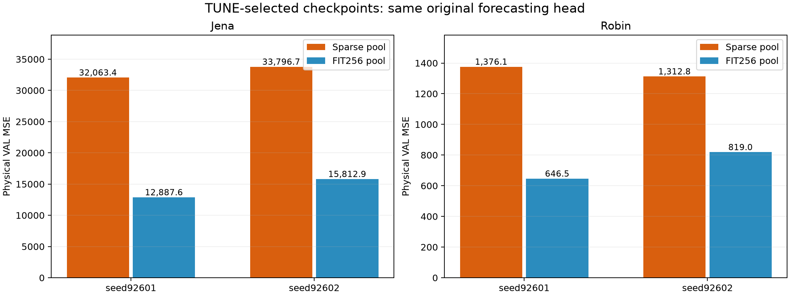
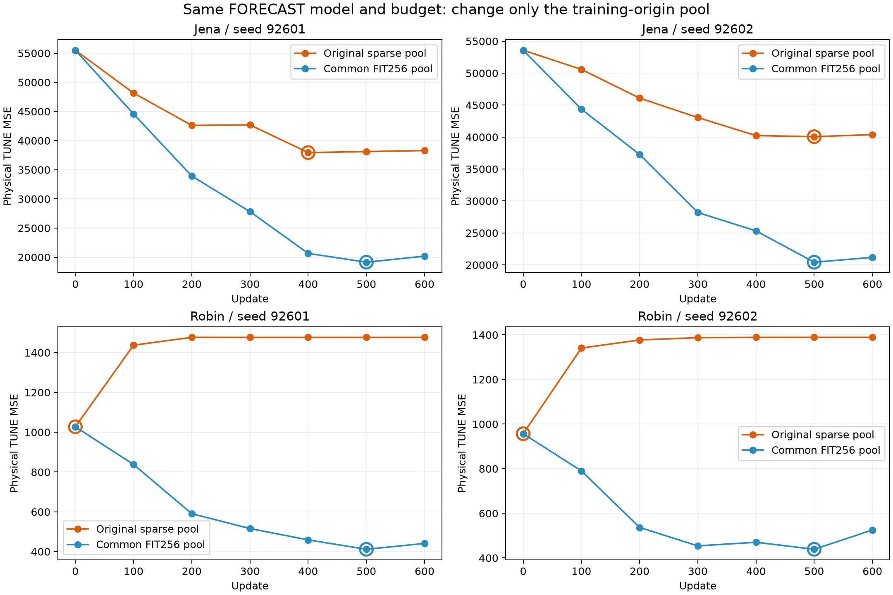

# FORECAST 학습 origin pool의 영향 — Stage A2

[확인] 원래 FORECAST 구조·초기 encoder/head·loss·batch size·600 update를 유지하고 학습 origin pool만 기존 sparse(Jena37/Robin2)에서 공통 FIT256으로 바꿨다. 두 자료·두 seed 모두 TUNE로 선택한 원래 head의 VAL MSE가 개선됐다. **현재 부진에서 학습 origin pool 설계가 상당한 역할을 했다는 직접적인 대조 증거**다. 미래 표현 정렬이나 새 압축기를 넣어서 얻은 개선이 아니다.

## TUNE 선택 결과

```text
자료   seed   sparse update  dense update   sparse VAL MSE/MAE       dense VAL MSE/MAE       MSE 변화
jena   92601           400           500   32063.406/ 55.209     12887.576/ 37.905      -59.81%
jena   92602           500           500   33796.728/ 56.687     15812.935/ 42.568      -53.21%
robin  92601             0           500    1376.123/ 22.736       646.548/ 15.584      -53.02%
robin  92602             0           500    1312.848/ 22.397       819.041/ 16.458      -37.61%
```

선택은 공통 TUNE64의 물리 단위 channel-macro MSE로만 했다. dense 네 조건 모두 update500이 선택됐다. Robin sparse는 두 seed 모두 update0을 선택했고 dense에서는 학습 후 모델이 선택됐다. VAL은 선택 checkpoint와 사전에 정한 final600에만 평가했다.



## 동일한 final600 비교

```text
자료   seed      sparse MSE      dense MSE       sparse MAE    dense MAE
jena   92601      32654.908      14540.413         56.149       37.935
jena   92602      34992.233      16619.476         58.419       41.582
robin  92601       1869.793        774.838         25.758       15.960
robin  92602       2072.502        908.088         26.801       16.973
```

final600에서도 네 조건 모두 MSE/MAE가 개선되어 checkpoint 선택 차이만으로 설명되는 결과가 아니다. dense가 최종까지 계속 좋아지는 것은 아니므로 더 오래 학습하면 무조건 개선된다고 해석하지 않는다.



## 무엇을 고정했고 무엇이 달라졌는가

- 초기값: 각 seed의 기존 E_u0000 실제 encoder/head와 byte SHA를 그대로 사용했다. paired sparse/dense의 encoder/head 초기 state hash가 동일하다.
- 구조: causal RF63, latent16, 마지막 z→48*C 선형 head, 입력512. 채널 수·데이터·FIT-only 정규화·missing fill·H48을 유지했다.
- 학습: Adam lr0.001, 600 update, Jena batch8 / Robin batch2, 기존 observed-element masked MSE. gradient clipping이나 목적 함수를 추가하지 않았다. 총4800개 update의 loss·parameter gradient finite 검사를 통과했다.
- sparse: 저장된 기존 600개 batch origin 배열을 실제 그대로 재생했다. 원래 make_batches와 seed+31로 만든 배열과도 동일함을 확인했다. dense: 같은 make_batches·seed+31을 공통 FIT256 pool에 적용했다. 배치당 표본 수와 총 표본 노출 수는 paired 조건에서 같다.
- **origin pool의 크기·위치·중첩도가 바뀐다.** 이를 256개 독립 표본 확보나 오직 독립 표본 수만의 효과로 바꾸어 말하지 않는다. 같은 원자료에서 더 많은 예측 시작점을 학습에 노출한 효과다.
- 신경망 재학습 경로는 모두 새 CPU 실행이다. 기존 Jena CPU/Robin GPU 결과를 그대로 새 sparse 결과로 사용하지 않았다. 기존 sparse 최종 파라미터와 CPU replay의 실제 차이는 RESULT의 original_final_comparison에 남겼다. 두CPUthread/기존GPU 커널의 수치 궤적 차이를 원본 결과 오류로 단정하지 않는다.

## 해석과 남은 문제

[판단] 기존 FORECAST가 나빴다는 결과만으로 예측 목적 학습을 기각하거나, 재구성 대신 복잡한 대조학습이 반드시 필요하다고 판단하면 안 된다. 동일 예측 목적도 기존 sparse pool을 고치면 크게 개선된다. 이 결과는 목적 함수보다 학습 origin 설계가 먼저 점검되어야 했다는 근거다.

Jena dense의 선택 MSE12887.576/15812.935는 앞 Stage A raw joint63/95 ridge(22766.847/20010.149)보다 낮다. 하지만 Robin dense646.548/819.041은 기존 raw SELF33 ridge512.196보다 높아, 단순 대안보다 항상 좋은 단계는 아니다. rawSELF33은 관측 채널/과거 범위/모델 용량이 동일한 비교가 아니라 저비용 실용 대조군이다.

이 모델은 원래 채널의 미래를 직접 출력한다. **잠재 시계열의 미래를 동결 Bolt가 잘 예측한다는 증거는 아직 아니다.** 따라서 Stage B에서 예측 성분→동결 Bolt→복원/보정 경로를 별도로 시험하고, 이 dense 직접 예측 모델을 원자료 신경망 대조군으로 남기는 것이 타당하다.

## 보존·검산·비용

8개 신규 학습이 정상 종료했다. 모델56개 checkpoint, 신규 VAL예측16개와 source/data/초기값 SHA를 검증하고 예측의 물리 MSE/MAE를 별도 계산으로 검산했다. [검산 기록](VERIFICATION.json), [전체 결과](RESULT.json), [원수치 CSV](metrics.csv).

실제 학습/평가 본체 CPU 82.406초, wall 42.938초, GPU0, PyTorch threads2. CPU300초 상한 이내. Python import/프로세스 시작은 별도이며 모델 순수 추론 지연으로 해석하지 않는다.

TEST 접근 차단, 기존 source/checkpoint/결과 보존, 새 cache만 기록했다. VAL은 반복 개발 자료이며 독립 일반화 검증은 아니다. 신경망 학습 초기값·배치·새 checkpoint는 로컬 cache 자산이므로 저장소 코드만으로 모든 자산이 배포되는 것은 아니다.

```powershell
.venv/Scripts/python.exe research/forecast_component_study_20261013/diagnose_dense_forecast.py --tag NEW_UNIQUE_TAG
```

기존 결과를 덮지 않도록 새 tag를 사용해야 한다. 이번 보고는 dense_pool_v1의 봉인된 결과를 대상으로 한다.
