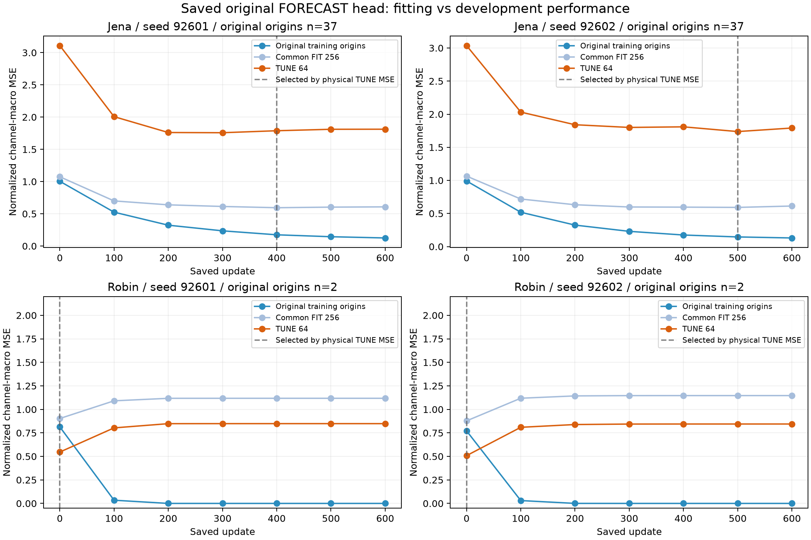
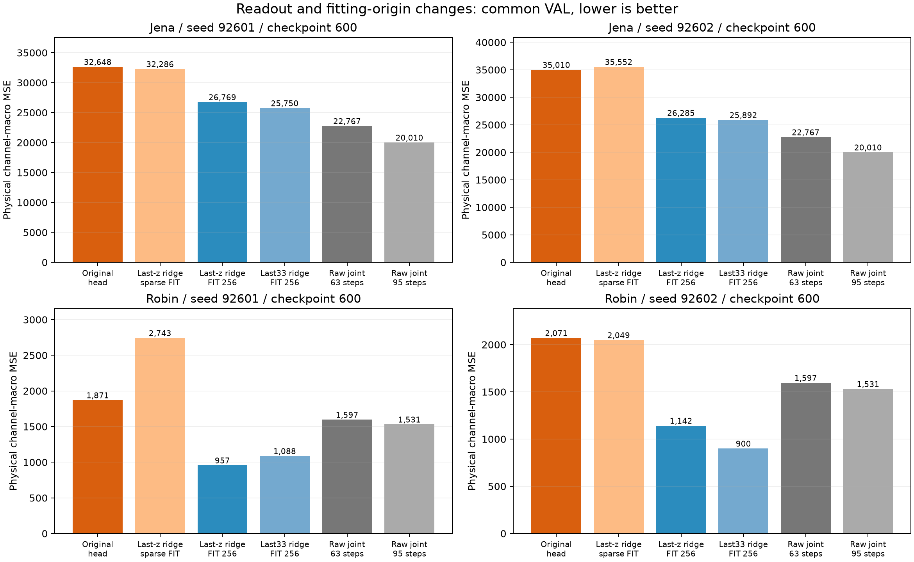

# 저장된 FORECAST 실패 위치 진단 — Stage A

[확인] 기존 encoder/head checkpoint 28개를 실제 재추론했다. 신규 신경망 학습은 없으며, 새 ridge만 FIT에 적합했다. 결과는 기존 VAL을 다시 사용하는 개발 진단이다. 독립 일반화 검증이나 방법군 전체의 실패 판정이 아니다.

## 먼저 얻은 답

- **원래 head를 버렸기 때문에만 실패한 것은 아니다.** Jena 최종 checkpoint의 원래 head MSE 32648.064/35010.134보다 공통 FIT256의 last33 ridge 25749.831/25892.494가 낮다. 다만 학습 origin 수, 과거 길이, 정규화/규제가 동시에 달라지므로 ridge 구조만의 이득으로 해석하면 안 된다.
- **Robin에서 원래 예측 모델의 학습은 관측된 TUNE/VAL 일반화를 악화시켰다.** 두 seed 모두 TUNE가 학습 전 update0을 선택했다. 기존 고유 학습 origin 2개는 거의 정확히 맞추지만, 공통 FIT256과 TUNE에서는 좋아지지 않았다. 이는 현재 표본 구성에서의 과적합/분포 차이와 일치하며, 예측 목적 전체가 불가능하다는 뜻이 아니다.
- **학습 표본 증가와 readout 교체를 분리하면 표본 효과가 크다.** 최종 encoder의 last-z ridge를 원래 sparse origins로 fit한 것보다 같은 feature를 공통 FIT256으로 fit한 것이 네 조건에서 모두 MSE가 낮다. encoder 재학습은 하지 않았으므로 새로운 temporal feature 학습의 효과는 아니다.
- **Jena의 저장 head checkpoint를 TUNE로 고르면 final600보다 조금 개선된다.** 그러나 두 seed 모두 raw joint63/95 ridge보다 여전히 나쁘다. early stopping만으로 해결되지 않았다.
- **긴 latent readout의 효과는 일관적이지 않다.** final600의 last33은 last-z보다 Jena 두 seed와 Robin seed92602에서 좋지만 Robin seed92601에서는 나쁘다. 입력길이를 늘리면 항상 좋아진다는 근거가 아니다.

## 원래 head: TUNE 선택과 final600

```text
자료   seed    선택 update   선택 VAL MSE/MAE         final600 VAL MSE/MAE
jena   92601      400       32063.692/ 55.209       32648.064/ 56.138
jena   92602      500       33791.985/ 56.683       35010.134/ 58.434
robin  92601        0        1376.123/ 22.736        1871.490/ 25.769
robin  92602        0        1312.848/ 22.397        2070.939/ 26.790
```

선택은 공통 TUNE64의 물리 단위 channel-macro MSE다. 과거 로그의 소수 고정 batch 정규화 학습 손실 최저점과 선택 기준 및 표본이 다르다. Robin TUNE가 L512보다 짧더라도 목표 구간을 TUNE 안에 두고 입력 과거가 FIT를 포함하도록 허용하는 기존 readout 계약에서는 64개 평가 origin을 확보할 수 있다.



## 같은 최종 encoder에서 head·readout 표본·과거 길이 분리

```text
자료   seed      head       z1/sparse   z1/FIT256   z33/FIT256   raw63      raw95
jena   92601   32648.064   32286.201   26769.246   25749.831   22766.847   20010.149
jena   92602   35010.134   35552.043   26285.344   25892.494   22766.847   20010.149
robin  92601    1871.490    2743.320     956.833    1088.285    1596.534    1530.834
robin  92602    2070.939    2049.252    1142.364     900.457    1596.534    1530.834
```

z1/sparse는 encoder를 원래 학습했던 고유 origin(Jena37/Robin2)에 새 ridge를 적합한다. z1/FIT256은 같은 feature와 ridge 목적을 공통 FIT256에 적합한다. 두 조건 모두 같은 TUNE λ grid를 사용하지만 선택 λ는 달라질 수 있다. z33/FIT256은 마지막33 latent를 평탄화한다. Raw joint는 모든 원 채널의 마지막63 또는95 값을 같은 ridge 절차로 사용한다. 신경망과 raw ridge는 함수 용량까지 동일하지 않으며, 단순 대조군의 역할이다.



## 데이터·검사·재사용 계약

- 기존 bounded TRAIN/VAL 원자료 SHA와 데이터 계약 SHA를 확인했다. FIT-only fill/scaler, H48, 공통 FIT256/TUNE64, VAL Jena371/Robin30을 그대로 사용했다. TEST 경로는 접근 차단 audit hook으로 보호한다.
- 28 checkpoint의 실제 byte SHA와 step/seed/condition을 확인했다. 원래 head는 모든 checkpoint에서 원래 학습 origin·공통 FIT·TUNE로 평가하고, VAL은 TUNE로 선택한 update와 사전 비교 대상 final600에만 평가했다. 이후 다른 readout도 이 두 checkpoint를 사용하며 VAL로 checkpoint를 재선택하지 않았다.
- 저장 head는 마지막 z 하나만 입력하므로 네트워크 유효 과거 길이는63이다. 마지막33 latent는95이다. full512 대비 tail95/63 parity, 95 이전 변경 무반응, 최근 관측 변경 양성대조를 실제 실행했다. 단, 이는 전처리된 입력에 대한 receptive field이며 missing-value forward-fill은 더 오래된 관측값을 전달할 수 있다. Raw와 latent 모두 같은 과거 전처리를 사용했다.
- 기존 RESULT의 공통ridge 점수는 REUSED_RECORDED_RESULT로 보존했다. 이번 CPU 재추론·ridge 재적합 결과는 별도다. Jena 기존 prediction과 최대 정규화 차이는 약8e-8이다. Robin은 이전 GPU 결과와 최대0.00275/0.00323, 물리 MSE0.05055/0.19304 차이가 있어 byte/수치 완전동일 재현이라고 말하지 않는다. 새 비교들은 모두 동일 CPU 경로다.
- 학습/평가 origin들은 시간적으로 겹칠 수 있다. 256/64/371/30은 독립 표본 수가 아니다. 물리 MSE는 단위가 다른 채널들의 평균이므로 [원수치 CSV](metrics.csv)에 정규화 MSE/MAE도 동반했다.
- 38개 신규 VAL 예측 파일의 SHA, target/origin/mask 형상, 독립적인 MSE/MAE 재계산을 검사했다. 원자료/체크포인트 및 결과 연결은 [검산 기록](VERIFICATION.json)과 [전체 결과](RESULT.json)에 남겼다.

## 다음 실험에 주는 제약

먼저 신경망 FORECAST를 동일 FIT256 origin과 충분한 causal context로 학습하고, 원래 head를 유지한 TUNE 선택을 포함해야 한다. 그 뒤 적은 성분→동결 Bolt→복원과 잔차 보정을 비교한다. 원자료 직접 예측, 잔차 모델 단독, 압축 Bolt 단독, 결합, 원자료 Bolt+동일 보정 모델을 두어 보정 모델이 혼자 이득을 만든 경우와 압축 경로의 추가 기여를 구분한다. 이 Stage A는 해당 전체 결합의 가능성이나 비용 개선을 아직 입증하지 않았다.

## 실행과 재현

```powershell
.venv/Scripts/python.exe research/forecast_component_study_20261013/diagnose_forecast.py --tag NEW_UNIQUE_TAG
.venv/Scripts/python.exe research/forecast_component_study_20261013/stage_a_verify_and_report.py
```

실험 실행은 기존 파일을 덮지 않는 고유 tag가 필요하다. 보고/검산 스크립트는 봉인된 checkpoint_readout_v1을 대상으로 하며 기존 보고 출력이 있으면 중단한다. 체크포인트와 원자료는 로컬 비공개 cache에 있어 저장소만으로 모델 재현이 완료되지는 않는다.

실제 분석 본체 비용: CPU 9.297초, wall 6.430초, GPU0; PyTorch threads2. 실행 정상 종료. 이 수치는 모델 warm inference 지연 비교가 아니라 데이터 로딩·checkpoint 평가·ridge 적합·결과 저장을 포함한 Stage A 작업 시간이며 Python import/프로세스 시작 시간은 제외한다.
