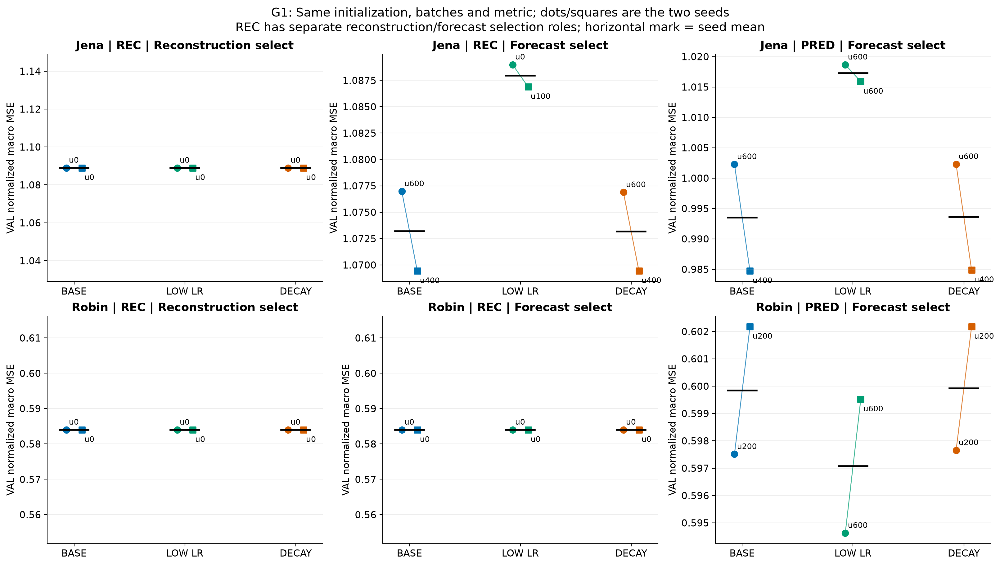
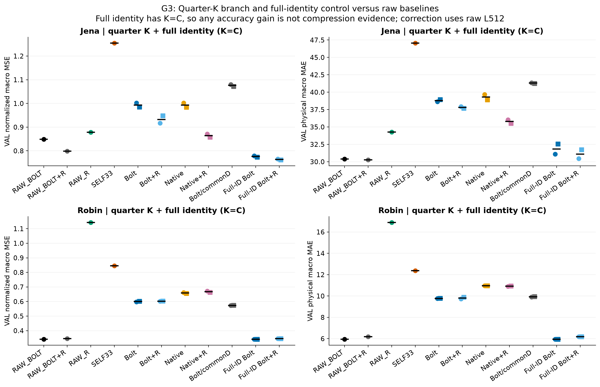
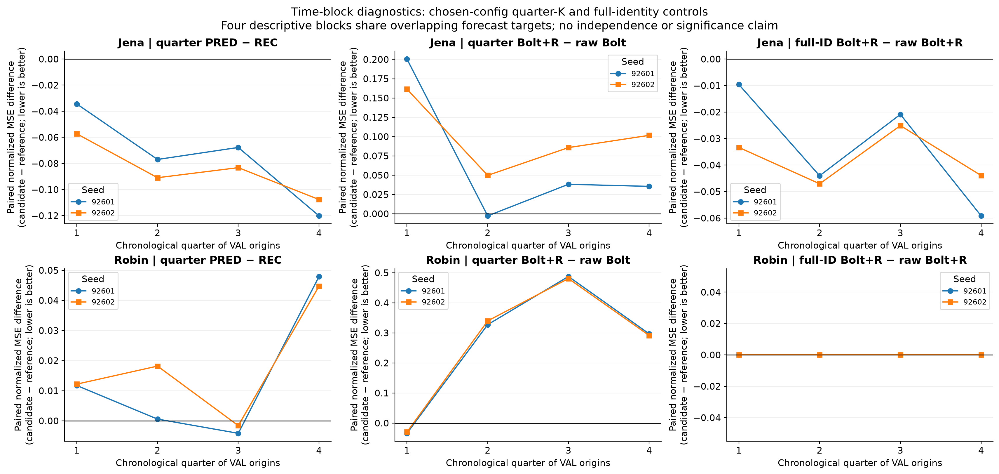

# 정규화 평가 기준을 맞춘 학습 일반화·압축·예측기 대조 결과

2026-10-13. **[확인] 주평가지표는 사용자가 선택한 FIT 통계 기반 정규화 channel-macro MSE다.** 학습 손실, 미래 TUNE checkpoint 선택, 보정 ridge lambda 선택을 이 기준에 맞췄다. REC 복원 선택은 같은 정규화 MSE를 과거 복원에 적용한 별도 역할이다. 아래는 반복 사용한 개발 VAL 진단이며 독립 일반화 검증이 아니다.

## 먼저 답해야 할 질문

### 선택 기준만 바꾸면 기존 결론이 달라지는가?

```text
자료   목적/선택           seed   old→new u  VAL normMSE old→new  변화%
jena   PRED/FORECAST       92601  600→600    1.002280→1.002280    +0.00
jena   PRED/FORECAST       92602  600→400    0.994051→0.984703    -0.94
jena   REC/FORECAST        92601  0→600      1.088989→1.076980    -1.10
jena   REC/FORECAST        92602  0→400      1.088989→1.069423    -1.80
jena   REC/RECONSTRUCTION  92601  0→0        1.088989→1.088989    +0.00
jena   REC/RECONSTRUCTION  92602  0→0        1.088989→1.088989    +0.00
robin  PRED/FORECAST       92601  200→200    0.597512→0.597512    +0.00
robin  PRED/FORECAST       92602  200→200    0.602179→0.602179    +0.00
robin  REC/FORECAST        92601  0→0        0.584007→0.584007    +0.00
robin  REC/FORECAST        92602  0→0        0.584007→0.584007    +0.00
robin  REC/RECONSTRUCTION  92601  0→0        0.584007→0.584007    +0.00
robin  REC/RECONSTRUCTION  92602  0→0        0.584007→0.584007    +0.00
```

**[확인] G0는 저장된 모델의 학습을 재사용하고 선택한 state에서 미래 예측을 새로 실행했다.** 목표와 checkpoint 선택의 영향이며 새로운 학습 효과가 아니다. REC 복원 선택과 미래 선택을 합치지 않았다. 물리 단위 MSE 우위와 정규화 MSE 우위가 다를 수 있으므로 이전 결론을 새 주지표로 그대로 옮기지 않는다.

### 낮은 학습률·weight decay가 일반화를 개선하는가?

```text
자료   목적/선택           설정    선택u(seed1,2)  미래 TUNE normMSE 평균  미래 VAL normMSE 평균  미래 VAL 원단위MAE 평균
jena   REC/RECONSTRUCTION  BASE    0,0             1.261809                1.088989               43.895280
jena   REC/RECONSTRUCTION  LOW_LR  0,0             1.261809                1.088989               43.895280
jena   REC/RECONSTRUCTION  DECAY   0,0             1.261809                1.088989               43.895280
jena   REC/FORECAST        BASE    600,400         1.258365                1.073201               44.116261
jena   REC/FORECAST        LOW_LR  0,100           1.261127                1.087934               43.913933
jena   REC/FORECAST        DECAY   600,400         1.258335                1.073161               44.117020
jena   PRED/FORECAST       BASE    600,400         1.186693                0.993492               38.793225
jena   PRED/FORECAST       LOW_LR  600,600         1.214367                1.017281               43.582033
jena   PRED/FORECAST       DECAY   600,400         1.185467                0.993585               38.781321
robin  REC/RECONSTRUCTION  BASE    0,0             0.078332                0.584007               9.930785
robin  REC/RECONSTRUCTION  LOW_LR  0,0             0.078332                0.584007               9.930785
robin  REC/RECONSTRUCTION  DECAY   0,0             0.078332                0.584007               9.930785
robin  REC/FORECAST        BASE    0,0             0.078332                0.584007               9.930785
robin  REC/FORECAST        LOW_LR  0,0             0.078332                0.584007               9.930785
robin  REC/FORECAST        DECAY   0,0             0.078332                0.584007               9.930785
robin  PRED/FORECAST       BASE    200,200         0.075238                0.599845               9.769128
robin  PRED/FORECAST       LOW_LR  600,600         0.075867                0.597075               9.804781
robin  PRED/FORECAST       DECAY   200,200         0.075258                0.599915               9.768514
```

**[확인] Jena G2 설정은 BASE**다. 후보별 두 seed 평균 미래 TUNE 정규화 MSE는 BASE=1.186693, LOW_LR=1.214367, DECAY=1.185467다. 최선 후보의 BASE 대비 TUNE 개선은 0.10%였고, 사전 1% screen 규칙을 적용했다. 이 규칙은 유의성 검정이 아니다.

[확인] Jena PRED LOW_LR의 VAL 주오차 평균은 BASE 대비 +2.39%다. seed별 차이는 92601: +1.64%, 92602: +3.17%다. 음수는 개선, 양수는 악화다.

[확인] Jena PRED DECAY의 VAL 주오차 평균은 BASE 대비 +0.01%다. seed별 차이는 92601: +0.00%, 92602: +0.02%다. 음수는 개선, 양수는 악화다.

**[확인] Robin G2 설정은 BASE**다. 후보별 두 seed 평균 미래 TUNE 정규화 MSE는 BASE=0.075238, LOW_LR=0.075867, DECAY=0.075258다. 최선 후보의 BASE 대비 TUNE 개선은 0.00%였고, 사전 1% screen 규칙을 적용했다. 이 규칙은 유의성 검정이 아니다.

[확인] Robin PRED LOW_LR의 VAL 주오차 평균은 BASE 대비 -0.46%다. seed별 차이는 92601: -0.48%, 92602: -0.44%다. 음수는 개선, 양수는 악화다.

[확인] Robin PRED DECAY의 VAL 주오차 평균은 BASE 대비 +0.01%다. seed별 차이는 92601: +0.02%, 92602: -0.00%다. 음수는 개선, 양수는 악화다.

[판단] 변화가 TUNE와 VAL에서 같은 방향인지, 두 seed와 네 시간 구간에서 반복되는지를 함께 본다. 낮은 TUNE 오차 하나만으로 일반화 해결을 선언하지 않는다. 모든 설정은 동일 초기 codec·배치 순서·600 update를 사용했고, 선택에 u0을 포함했다.



### FIT 경계 이후의 과거 위치에서도 재구성이 개선되는가?

```text
자료   seed   설정    FIT normMSE u0→600  TUNE 창 전체 u0→600  TUNE post-FIT 위치 u0→600  고유시점  관측위치합
jena   92601  BASE    0.147215→0.145960   0.400644→0.460918    0.377275→0.429205          5194      649086
jena   92602  BASE    0.147215→0.146069   0.400644→0.495028    0.377275→0.462767          5194      649086
jena   92601  DECAY   0.147215→0.145963   0.400644→0.460876    0.377275→0.429159          5194      649086
jena   92602  DECAY   0.147215→0.146071   0.400644→0.495247    0.377275→0.462967          5194      649086
jena   92601  LOW_LR  0.147215→0.146113   0.400644→0.444160    0.377275→0.415587          5194      649086
jena   92602  LOW_LR  0.147215→0.146207   0.400644→0.452491    0.377275→0.424341          5194      649086
robin  92601  BASE    0.116615→0.110079   0.038509→0.047335    0.043593→0.052693          351       190485
robin  92602  BASE    0.116615→0.110178   0.038509→0.049814    0.043593→0.054555          351       190485
robin  92601  DECAY   0.116615→0.110079   0.038509→0.047333    0.043593→0.052693          351       190485
robin  92602  DECAY   0.116615→0.110179   0.038509→0.049818    0.043593→0.054557          351       190485
robin  92601  LOW_LR  0.116615→0.110127   0.038509→0.046562    0.043593→0.051920          351       190485
robin  92602  LOW_LR  0.116615→0.110180   0.038509→0.047760    0.043593→0.052839          351       190485
```

[확인] REC 12개 fit 중 u600의 FIT 복원 주오차는 12개에서 줄었고, FIT 이후 TUNE 위치의 복원 주오차는 12개에서 커졌다. **복원 학습의 안정적 일반화가 확보됐다고 전제할 수 없다.** [판단] 이 조건의 일반화 한계와 미래 예측에 적합한 목적의 문제를 분리해야 하며, “복원은 성공했지만 미래만 실패”나 특정 방법의 본질적 한계로 단정하지 않는다.

[확인] post-FIT 점수는 TUNE 과거 창 중 FIT 끝 이후의 실제 관측 위치만 포함한다. TUNE 전체 과거 창에는 FIT 위치도 섞여 있어 이 보조 검사를 추가했다. 같은 시점이 여러 창에 반복되므로 관측위치합을 독립 표본수로 읽지 않는다. 이 점수는 checkpoint 선택에 쓰지 않았다. 전체 44 fit의 checkpoint 원수치는 [reconstruction_curves.csv](reconstruction_curves.csv)에 있다.

### 성분 수·시간 범위 중 어디에서 손실이 생기는가?

```text
자료   변형               K   L    RF   TUNE normMSE 평균  VAL normMSE 평균  VAL seed1,2        VAL 원단위MAE 평균
jena   Quarter K          5   512  127  1.186693           0.993492          1.002280,0.984703  38.793225
jena   Half K             10  512  127  1.118756           0.879588          0.881052,0.878125  37.308657
jena   Full PCA rotation  21  512  127  1.093866           0.838204          0.831232,0.845177  36.933258
jena   Full identity      21  512  127  1.055828           0.776536          0.779089,0.773983  31.833638
jena   Quarter K | L128   5   128  127  1.327561           1.140786          1.155769,1.125802  48.544899
jena   Quarter K | RF31   5   512  31   1.200137           1.007437          1.010910,1.003965  40.571149
robin  Quarter K          4   512  127  0.075238           0.599845          0.597512,0.602179  9.769128
robin  Half K             8   512  127  0.067041           0.482768          0.483150,0.482385  9.818127
robin  Full PCA rotation  17  512  127  0.062903           0.326012          0.326012,0.326012  7.102469
robin  Full identity      17  512  127  0.056951           0.340402          0.340402,0.340402  5.938975
robin  Quarter K | L128   4   128  127  0.126252           0.676714          0.663367,0.690060  11.875247
robin  Quarter K | RF31   4   512  31   0.074217           0.601245          0.605332,0.597158  9.911222
```

[확인] Jena quarter-K 기본 대비 각 변형의 VAL 주오차 평균 변화는 Half K: -11.46%, Full PCA rotation: -15.63%, Full identity: -21.84%, Quarter K | L128: +14.83%, Quarter K | RF31: +1.40%다. 이 수치는 사전 대조의 진단이며 VAL에서 변형을 선택해 후속 실험을 바꾸지 않았다.

[확인] Robin quarter-K 기본 대비 각 변형의 VAL 주오차 평균 변화는 Half K: -19.52%, Full PCA rotation: -45.65%, Full identity: -43.25%, Quarter K | L128: +12.81%, Quarter K | RF31: +0.23%다. 이 수치는 사전 대조의 진단이며 VAL에서 변형을 선택해 후속 실험을 바꾸지 않았다.

[확인] Robin full PCA 두 seed는 모두 u0을 선택했다. BOLT의 VAL normMSE 0.326012 대 RAW BOLT 0.340402는 **학습 전 고정 회전의 효과**다. 학습으로 좋아졌다는 증거로 읽지 않는다. 원단위 MAE는 full PCA 7.102, RAW BOLT 5.939로 함께 보고한다.

[확인] K=C의 PCA는 가역 회전이어도 Bolt가 보는 시계열이 원자료와 달라진다. 항등 초기화의 u0 실제 Bolt 출력은 RAW Bolt와 정확히 같았다. K 변화는 E/D 크기도 바꾼다. RF31/127은 같은 6층·같은 파라미터 개수·같은 초기 weight를 쓰지만 dilation 위치가 달라 순수 정보 범위만의 인과 효과로 부르지 않는다.

[확인] L128은 실제 128 시점 입력을 창 시작의 FIT mean으로 다시 forward-fill했다. L512를 채운 뒤 잘라서 오래된 관측을 가져오지 않았다. 따라서 L과 결측 처리 경계가 함께 달라진다. **L128+R의 전체 지원 범위는 R 때문에 512다.** 이는 L128 성분만 쓰는 BOLT 경로와 구분한다.


### 동결 Bolt가 같은 표현의 단순 예측기·원자료 기준군보다 추가 가치를 갖는가?

```text
자료   방법            VAL normMSE  VAL normMAE  VAL 원MSE  VAL 원MAE  b1 ms/창  b8 ms/창
jena   RAW_BOLT        0.848632     0.416058     13981.151  30.391     12.024    3.835
jena   RAW_BOLT_RAW_R  0.799032     0.410572     12468.543  30.262     14.595    3.886
jena   RAW_R_ONLY      0.878199     0.511135     10978.293  34.266     1.449     0.281
jena   RAW_SELF_LAG    1.254876     0.606400     25563.570  47.063     0.909     0.139
jena   BOLT            0.993492     0.583758     14049.813  38.793     12.589    1.754
jena   BOLT_RAW_R      0.932453     0.547134     13249.225  37.807     13.802    1.918
jena   NATIVE          0.993083     0.591983     13185.264  39.294     1.382     0.197
jena   NATIVE_RAW_R    0.864327     0.503475     11986.205  35.784     2.093     0.325
jena   BOLT_COMMON_D   1.075989     0.630674     15701.456  41.304     12.618    1.855
robin  RAW_BOLT        0.340402     0.313192     151.554    5.939      14.543    3.254
robin  RAW_BOLT_RAW_R  0.345159     0.322689     154.439    6.192      14.046    3.359
robin  RAW_R_ONLY      1.142711     0.795741     826.786    16.890     1.491     0.262
robin  RAW_SELF_LAG    0.844783     0.612346     512.196    12.369     0.932     0.153
robin  BOLT            0.599845     0.530572     244.505    9.769      13.030    1.684
robin  BOLT_RAW_R      0.602374     0.532117     245.914    9.813      13.336    1.773
robin  NATIVE          0.658777     0.570249     310.840    10.966     1.320     0.190
robin  NATIVE_RAW_R    0.667224     0.571812     308.556    10.915     2.155     0.312
robin  BOLT_COMMON_D   0.573330     0.526713     247.437    9.930      14.096    1.810
```

[확인] Jena quarter-K에서는 BOLT의 native 대비 VAL 주오차 변화가 +0.04%, BOLT+R의 native+R 대비 변화가 +7.88%다. RAW BOLT 대비 BOLT는 +17.07%, BOLT+R는 +9.88%다. BOLT+R의 RAW R-only 대비 변화는 +6.18%다. 학습된 D를 common reconstruction D로 바꾸기 전 BOLT 오차의 상대 차이는 -7.67%다. 두 seed 평균이며 반대 방향 지표는 위 표와 모든 짝 대조에 함께 남겼다.

[확인] Robin quarter-K에서는 BOLT의 native 대비 VAL 주오차 변화가 -8.95%, BOLT+R의 native+R 대비 변화가 -9.72%다. RAW BOLT 대비 BOLT는 +76.22%, BOLT+R는 +76.96%다. BOLT+R의 RAW R-only 대비 변화는 -47.29%다. 학습된 D를 common reconstruction D로 바꾸기 전 BOLT 오차의 상대 차이는 +4.62%다. 두 seed 평균이며 반대 방향 지표는 위 표와 모든 짝 대조에 함께 남겼다.

같은 분석을 quarter-K에만 한정하지 않고 모든 사전 변형에서 수행했다. 아래는 두 seed 평균이다. 실험 조건 선택은 TUNE만 사용했고, 이 표에서 VAL로 선택을 변경하지 않았다.

```text
자료   변형               K   BOLT normMSE  BOLT+R normMSE  native normMSE  native+R normMSE  BOLT+R/RAW BOLT %  BOLT+R 원MAE
jena   Quarter K          5   0.993492      0.932453        0.993083        0.864327          +9.88              37.807
jena   Half K             10  0.879588      0.860275        0.888209        0.841758          +1.37              36.642
jena   Full PCA rotation  21  0.838204      0.820761        0.868261        0.823167          -3.28              36.160
jena   Full identity      21  0.776536      0.763681        0.906716        0.853070          -10.01             31.093
jena   Quarter K | L128   5   1.140786      0.917701        1.012426        0.852221          +8.14              37.012
jena   Quarter K | RF31   5   1.007437      0.936920        1.018606        0.869876          +10.40             38.686
robin  Quarter K          4   0.599845      0.602374        0.658777        0.667224          +76.96             9.813
robin  Half K             8   0.482768      0.484798        0.538541        0.542875          +42.42             9.898
robin  Full PCA rotation  17  0.326012      0.328563        0.386360        0.386063          -3.48              7.127
robin  Full identity      17  0.340402      0.345159        0.388589        0.385907          +1.40              6.192
robin  Quarter K | L128   4   0.676714      0.671818        0.736869        0.716715          +97.36             11.874
robin  Quarter K | RF31   4   0.601245      0.602583        0.651958        0.658421          +77.02             9.918
```

[확인] Jena half-K는 RAW BOLT 대비 주오차 평균이 +3.65%다. clean batch8 비용은 2.400 대 3.835 ms/창(-37.41%), batch1은 12.741 대 12.024 ms/창(+5.97%)다. **작은 K의 정확도 우위와 특정 batch의 비용 교환을 분리해서 판단해야 한다.**

[확인] Jena full identity의 RAW BOLT 대비 주오차 변화는 -8.50%, full identity BOLT+R의 RAW BOLT+R 대비 변화는 -4.42%다. **K=C인 양성 결과는 압축의 이득을 입증하지 않는다.** [판단] 이 조건이 나아지면 원 좌표에서 시작한 미래 목적의 E/D adaptation이 유효할 가능성으로 해석하고, K<C 조건의 정확도/비용 근거와 분리한다. 실제 수치가 나쁜 자료·seed도 함께 남긴다.

반대 방향 지표도 같은 문단에서 확인한다. Jena full identity BOLT의 seed별 정규화 MAE는 0.434441, 0.414078, RAW BOLT는 0.416058다. 원단위 MAE는 31.097, 32.570, RAW BOLT는 30.391다. full identity BOLT+R의 정규화 MAE는 0.420757, 0.409519, RAW BOLT+R는 0.410572다. 원단위 MAE는 30.466, 31.720, RAW BOLT+R는 30.262다. 주지표 MSE 개선을 모든 오차 지표의 개선으로 바꾸어 말하지 않는다.

[확인] Robin half-K는 RAW BOLT 대비 주오차 평균이 +41.82%다. clean batch8 비용은 2.194 대 3.254 ms/창(-32.58%), batch1은 12.956 대 14.543 ms/창(-10.92%)다. **작은 K의 정확도 우위와 특정 batch의 비용 교환을 분리해서 판단해야 한다.**

[확인] Robin full identity 두 seed는 모두 u0을 선택했다. 미래 BOLT와 BOLT+R의 주오차는 각각 RAW BOLT와 RAW BOLT+R와 수치상 동일하다. **이 조건에서는 학습에 의한 개선이 없고, 원자료 기능과 같은 초기 state가 선택됐다.** 별도 E/D 경로의 추론 비용은 추가로 측정하되 동일한 기능을 새 성능 이득으로 부르지 않는다.

반대 방향 지표도 같은 문단에서 확인한다. Robin full identity BOLT의 seed별 정규화 MAE는 0.313192, 0.313192, RAW BOLT는 0.313192다. 원단위 MAE는 5.939, 5.939, RAW BOLT는 5.939다. full identity BOLT+R의 정규화 MAE는 0.322689, 0.322689, RAW BOLT+R는 0.322689다. 원단위 MAE는 6.192, 6.192, RAW BOLT+R는 6.192다. 주지표 MSE 개선을 모든 오차 지표의 개선으로 바꾸어 말하지 않는다.

[확인] 같은 selected E/D에 Bolt와 native shared linear를 연결했다. **E/D는 Bolt 미래 손실로 학습되어 native 전용으로 최적화된 표현이 아니다.** 따라서 Bolt가 native보다 좋아도 모든 native 전체 방법보다 우월하다는 비교는 아니다. native가 더 좋으면 이 조건에서 Bolt 필요성을 반박하는 사례다. Native는 추가 600 update를 학습하므로 총 학습 비용까지 동일하지는 않다. Bolt+R와 native+R는 같은 FIT/TUNE origins·R 특징·정규화 lambda 규칙을 사용한다. R은 FIT base의 in-sample 잔차로 학습했으며 cross-fitting은 하지 않았다. SELF33은 자신의 마지막 33 시점 특징만 사용하지만 결측 forward-fill의 지원 범위는 512다.

[판단] 주어진 조건에서 Bolt 추가 가치는 동일 E/D의 native보다 낮은 주오차인지와, 전체 시스템이 RAW Bolt·R 단독·SELF33보다 유리한 정확도/비용 조합을 만드는지 두 단계로 판단한다. 압축 경로가 REC보다 나아지는 것만으로 전체 기여를 주장하지 않는다. 실제 양성·음성 대조의 차이는 [G3_paired_contrasts.csv](G3_paired_contrasts.csv)에 전부 남겼다.




### 다음 방법이 필요한가?

[판단] 대조학습·미래 표현 정렬·동적 그래프를 이번 결과의 설명으로 소급하지 않는다. 먼저 주지표가 일치한 학습 변경, K·시간 범위와 RAW/동일 E/D 대조가 어디까지 해결했는지 위 수치로 판단한다. 더 복잡한 학습 목적이 필요하다면 직접 Bolt 미래 손실보다 높여야 하는 성능과 기존 강한 원자료 기준군을 모두 명시해야 한다. 두 자료의 최선 경로가 다르면 하나의 범용 개선이라고 묶지 않는다.

## 시간·채널·반대 방향 지표



각 seed의 동일 VAL origins를 시간 순서로 네 부분으로 나누어 관측 마스크 기반 channel-macro 오차 차이를 다시 계산했다. 미래 target이 겹치므로 네 구간을 독립 반복실험이나 유의성 증거로 쓰지 않는다. 같은 paired contrast의 정규화 MSE/MAE와 원단위 MSE/MAE는 [chronological_blocks.csv](chronological_blocks.csv), 모든 채널의 평균·표준편차·관측 수·오차는 [channel_metrics.csv](channel_metrics.csv)에 있다. 채널 균등 정규화는 단위를 제거하지만 표준편차가 작은 채널의 큰 표준화 오차도 주지표에 반영한다. 원단위 macro는 이질 단위를 평균한 보조 지표이므로 자료 간 합산하지 않는다.

## 실제 실행·재사용·비용

```text
실행 항목                                          실제 수/시간
G0 저장된 fit 재사용, 새 BOLT 추론                 12 case; 추가 E/D 학습 0
G1 신규 E/D fit                                    24 × 600 update
G2 신규 E/D fit                                    20 × 600 update
G1/G2 native 유효조건의 추가 fit                   32 × 600 update
수리 포함 core 실제 attempt / u600완료 / 유효조건  48 / 45 / 44
u600 미도달 core attempt                           3
수리 포함 native 실제 u600완료 / 유효조건          33 / 32
평가된 method 행                                   236
batch 1/8 비용 행                                  472
중복 제거한 E/D training wall                      878.781 s
native training wall                               35.592 s
ridge fitting wall                                 5.571 s
메인·수리·preflight·clean GPU process wall 합      1279.587 s
별도 metric_alignment 보충의 GPU process wall 합   785.683 s
동일 사용자 task 전체 GPU process wall 합          2065.271 s
모델 로드 포함 여부                                각 실행 body에 포함; source_runs 원기록의 bolt_load_wall_seconds 참조
cost 측정 최대 resident RSS                        1.472 GiB
cost 측정 공존 peak allocated VRAM                 378.178 MiB
```

[확인] E/D fit 시간은 동일 REC fit의 두 selection 역할을 중복 합산하지 않았다. 같은 checkpoint를 두 역할로 추론하면 평가 행은 두 개지만 학습은 하나다. 유효 44 fit과 실제 수리 포함 48 attempt를 구분하며 중복·실패의 시간도 task process wall 합에는 포함했다. 측정된 train wall은 코드의 training 함수 범위이며 checkpoint 점수·저장을 포함한다. CUDA kernel 순수 실행시간이나 전체 캠페인 wall과 동일하지 않다. 보충 study의 학습·GPU process wall도 같은 사용자 task 자원 합에 넣었지만 236 method 과학적 비교 행에는 섞지 않았다. 동시에 실행된 시간이 있어 summed process wall은 실제 elapsed wall과 다르다.

[확인] 표와 그림의 주 비용은 **모든 Python GPU 학습 종료 후 저장된 모델에서 다시 측정한 clean_latency**다. 최초 측정에는 별도 보충 학습과의 동시 경합 가능성이 있었으므로 그 472행은 [batch_cost_original.csv](batch_cost_original.csv)와 원 RESULT latency 필드로 보존했다. clean 236방법×batch1/8 재측정은 [run_clean_cost_v1/RESULT.json](../run_clean_cost_v1/RESULT.json)에 있고 추가 학습은0이다. 일반 데스크톱 GPU 앱은 그대로 두었으므로 완전히 전용인 장비의 benchmark는 아니다.

[확인] 비용은 batch1/8, warmup2, repeat7의 median이다. CPU forward-fill·정규화, H2D, E/F/D, 선택적 R512 특징/추론, 역정규화, D2H, synchronize를 포함한다. 디스크·모델 로드는 제외했고 Bolt 로드는 각 실행 원기록에 별도 기록했다. 모든 측정에 Bolt와 현재 모듈이 함께 resident이므로 공존 allocated VRAM을 방법별 독립 절감량으로 해석하지 않는다. 7회 최소/최대·개별값·parity·RSS/VRAM은 [batch_cost.csv](batch_cost.csv)에 있다.

## 실패 attempt와 수치 경로 수리

[확인] 최초 [run_full_v1/RESULT.json](../run_full_v1/RESULT.json)은 212개 method를 완료하고 네 경로의 실패를 그대로 보존했다. 두 경로는 resource ledger 파일 교체 중 Windows 파일 잠금 오류였고, Jena full identity 두 seed는 상수 rain 입력의 Bolt 내부 정규화 backward에서 비유한 gradient가 생겼다. 낮은 정확도 때문에 중단된 경로가 아니다. [run_repair_v1/RESULT.json](../run_repair_v1/RESULT.json)에서 네 경로를 추가 실행했다. 기존 성공 결과·실패 파일·실행 source를 덮지 않았다.

[확인] [gradient 진단](../run_gradient_diagnosis_v1/RESULT.json)은 두 seed 첫 batch에서 원 forward loss를 보존하면서 E/D gradient와 실제 일시 optimizer update가 유한한지 확인했다. InstanceNorm의 분산0에서 sqrt는 미분이 정의되지 않으므로, backward0은 유일한 수학적 gradient를 복구했다는 주장이 아니라 **forward를 보존하는 finite 수치 convention**이다. 검사 fixture에서 모든 forward 최대 차이0, 양분산 gradient 최대 차이0였고 동결 모델 weight SHA도 같았다. 이 범위와 두 seed 재실행으로 검증했으며 가능한 모든 입력의 동등성을 증명하지 않는다. 일시 diagnostic step은 원 state로 복원했다.

## 검증과 적용 범위

- 실행 상태: `COMPLETE`. 원 실행 결과는 [run_resolved_v1/RESULT.json](../run_resolved_v1/RESULT.json).
- Frozen Bolt 초기/최종 state SHA 일치: `True`.
- 실행 source SHA 최종 보존 확인: `True`. 실행 파일의 source_snapshots 기록으로 원본 스냅샷을 확인한다.
- 실제 E/D gradient 및 update, 공식 Bolt 추론 parity, causal counterfactual, full identity와 RAW parity, RF31 matched-capacity/support, Adam/AdamW zero-decay 5-step parity를 fixture로 확인했다. fixture 통과는 성능 개선의 증거가 아니다.
- 신규 비교의 init/order·TUNE 선택·NPZ 재채점·source/data/origin SHA·실제 비용 경로를 별도 검산 결과와 연결했다.
- FIT256, TUNE64, VAL Jena371/Robin30 origins, H48, 두 seed, 같은 기존 TRAIN/VAL 자료다. 새 TEST 접근 없이 수행했다. 여러 model을 이 VAL로 이미 진단했고 TUNE도 checkpoint/optimizer/ridge 선택에 반복 사용했으므로 일반화 주장은 제한된다.
- Common D는 모든 E에서 같은 FIT 복원 적합 규칙이지만 수치 weight는 다르다. E와 D를 동시에 학습했기 때문에 표현 자체의 기여를 D로부터 완전히 분리한 인과실험은 아니다. K 변화는 압축량뿐 아니라 E/D/output 파라미터 수도 바꾼다.
- BASE/LOW_LR/DECAY·K·history만의 제한된 screen이다. 더 긴 학습·학습 origin 확대·다른 백본·새 목적·새 자료는 수행하지 않았다. 낮은 성능으로 계획된 대조를 생략하지 않았다.

독립 검산: [audit.json](../validation_resolved_v1/audit.json). 검사 버전별 오류·수정 기록은 원파일을 보존한다.

[확인] 강화된 원자료 검산도 [validation_source_v1/audit.json](../validation_source_v1/audit.json)·[설명](../validation_source_v1/audit.md)에서 PASS다. 실제 TRAIN/VAL source NPZ 두 개만 열어 FIT mean/std, 전체 정답·관측 마스크·origins를 재구성했고 236 prediction artifact와 일치했다. 실제 L128/512 경계에서 forward-fill을 다시 계산했고 post-FIT 위치의 mask/count SHA 및 source/snapshot SHA를 검사했다. 이 검사는 기록된 데이터·정보 경계와 구현 계약의 일치를 확인하며, **가능한 모든 정보 누출의 부재를 증명하거나 독립적인 일반화 성능을 검증하지 않는다.**

## 원수치·재현 파일

- [all_methods.csv](all_methods.csv): 모든 case/method의 FIT/TUNE/VAL 정규화·원단위 MSE/MAE, 선택·지원 범위·prediction SHA.
- [unique_training.csv](unique_training.csv): 중복 selection 역할을 제거한 E/D fit·초기값·order SHA·학습 wall.
- [G0_paired_contrasts.csv](G0_paired_contrasts.csv), [G1_paired_contrasts.csv](G1_paired_contrasts.csv), [G2_paired_contrasts.csv](G2_paired_contrasts.csv), [G3_paired_contrasts.csv](G3_paired_contrasts.csv): 모든 사전 대조의 원수치·짝 차이.
- [reconstruction_curves.csv](reconstruction_curves.csv): FIT/TUNE/post-FIT 복원과 미래 예측의 모든 저장 checkpoint.
- [chronological_blocks.csv](chronological_blocks.csv), [channel_metrics.csv](channel_metrics.csv), [batch_cost.csv](batch_cost.csv): 시간·채널·비용.
- [REPORT_MANIFEST.json](REPORT_MANIFEST.json): 입력 결과/기존 재사용 결과/보고 소스/산출 파일 SHA 및 보고 재채점 검사.
- [실행 계획](../PLAN_KO.md), [실험 코드](../experiment.py), [보고 생성 코드](../make_report.py).

그림은 모두 저장된 JSON/NPZ 원수치로 생성했다. PNG와 동일 stem의 SVG를 함께 저장했다. SCIENCE 실험·기존 결과·cache를 변경하거나 새 모델을 학습하지 않고 보고서만 생성한다.
