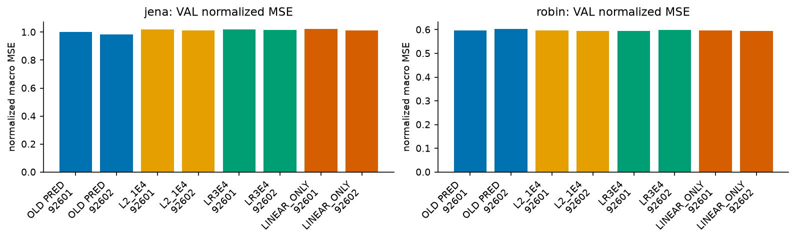
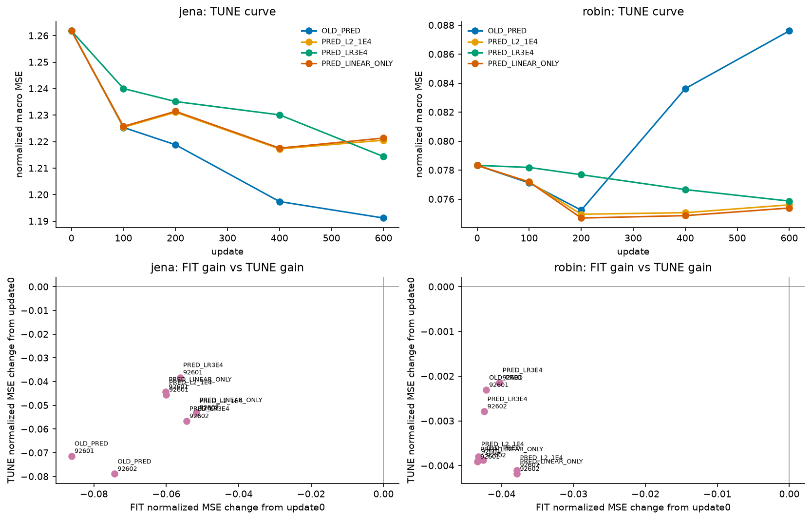
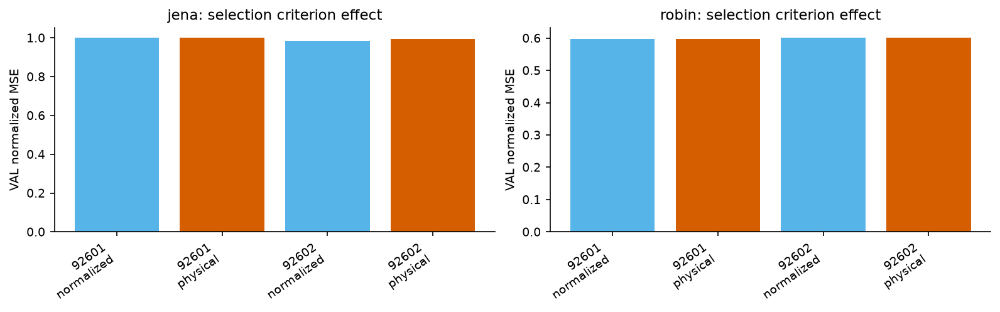

# Forecast Metric Alignment Study

2026-10-13 follow-up to `research/forecast_component_study_20261013`.

This run checks whether the previous PRED result survives after aligning the selection criterion with the normalized observed channel-macro MSE objective, then compares three small training changes under the same FIT/TUNE/VAL origins and batch order.

Main completed output:

- [Korean report](run_v3/REPORT_KO.md)
- [Metric rows](run_v3/metrics.csv)
- [Selection summary](run_v3/selection_summary.csv)
- [Contracts and origin hashes](run_v3/CONTRACTS.json)
- [Training records](run_v3/TRAINING_RECORDS.json)
- [Verification](run_v3/VERIFICATION.json)

Figures:

Failed preserved attempts:

- `run_v1`: stopped after checkpoint evaluation because checkpoint evaluation left the codec non-trainable before the first optimizer step.
- `run_v2`: completed training but stopped during report assembly due to an old CSV schema mismatch.

The completed run is `run_v3`. Protected TEST data was not opened. The run used the existing development VAL and should not be treated as independent generalization evidence.
