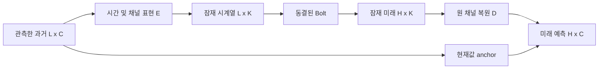

# 교수님 상담용 핵심 정리

**2026-10-16 우선순위 변경 후 실제 Jena 핵심 검증:** [B2·동일 표현 no-Bolt·별도 학습 no-Bolt·Raw/Ridge/G/PCA/LoRA의 정확도·CPU 비용](priority_b2_validation_20261016_v1/README_KO.md). 기존 scheduler와 실제 학습2개를 중단하고 checkpoint10개를 보존했다. 새 직접 대조2개는 학습·전체 V·독립 재채점·CPU 재추론·비용까지 완료했다. B2는 B0·직접 대조보다 나았으나 ridge/G/LoRA 대비 전체 우위는 미확보다. PeMS08·추가 seed는 후속이며 기존 전체 큐는 자동 재개하지 않는다. 아래의 과거 진행 기록은 작성 시점 snapshot이다.

## 후속 CPU 실험에서 지금 설명할 수 있는 방법론

**후보 구조는 확보했지만 강한 기준선 대비 성공한 최종 방법론은 아직 없다.** 아래는 후속 V-only 비교의 현재 판단이며, 뒤의 07:58 원 캠페인 snapshot과 G/checkpoint를 섞지 않는다. [Jena 정확도·전체 CPU 비용·실패 진단](postT_V_only_cpu_lag_20261016_v1/RESULTS_WITH_COST_KO.md), [PCA6 비교](postT_V_only_cpu_fixed_pca_20261016_v1/RESULTS_WITH_COST_KO.md), [core56의 현재·진행·잔여 exact ID](diagnostics/postT_core56_scope_20261016_v1/README_KO.md)가 근거다.

교수님께 제시할 중심 질문은 “원 입력을 잘 복원하는가”에서 **“동결된 TSFM이 사용할 수 있는 작은 K개의 시계열로 바꾸어도, 단순 예측기보다 유용한 정확도–전체 비용을 얻을 수 있는가”**로 좁힌다. 과거 창을 E로 변환하고 고정 Bolt로 잠재 미래를 예측한 뒤 D와 현재값 anchor로 원 채널을 복원한다. E/D는 미래 예측 오차로 학습하며 F의 가중치는 동결한다. 고정 PCA는 별도 고정 basis 복원이어서 이 학습 구조와 혼동하지 않는다.



예측 원점 이후의 실제 값은 배포 입력에 넣지 않는다. B2의 전체 과거 창 혼합은 창 내부의 뒷 시점도 사용할 수 있으므로 **예측 원점 기준 과거 전용**과 **매 시점 strictly causal 표현**을 같은 뜻으로 쓰지 않는다. 창 내부 양방향 lag도 관측한 창 안의 연결이며 실제 인과 그래프를 발견했다는 주장이 아니다.

현재 같은 Jena K6·frozen F·D·anchor·loss recipe에서 B0 MSE0.7841039310324822에 비해 B2는0.6834428963980711이었다. 다만 ridge0.5566463357048567/G0.632217057436123보다 나쁘고 MAE도 Raw보다 높다. 두 lag도 B2보다 나빴다. 따라서 시간 표현의 후보를 유지할 근거는 있지만 지연 그래프·Bolt의 필요성이나 새로운 논문 기여는 아직 입증하지 못했다. 학습 목적이 이미 미래 예측 MSE였으므로 “재구성 목표를 예측 목표로 바꾸면 해결된다”는 설명도 현재 증거와 맞지 않는다.

[full-C 고정 basis 검산](diagnostics/fullC_fixed_basis_diagnostic_20261016_v1/RESULTS_KO.md)에서는 Beijing K=C=11 basis rank11·condition1.000000073·max|EEᵀ−I|6.34e-8을 확인했다. 같은 F/scaler를 묶은 기존 V에서 Raw MSE0.796878654/MAE0.561862204와 비교해 full-C 회전은0.751789960/0.576547512였다. 차원을 버리지 않아도 점수가 달라지며 MSE 개선과 MAE 악화가 함께 나타났다. 가까운12단계는 두 지표 모두 나빴다. 고정 역투영에는 학습형 anchored D가 없으므로 이 비교를 해당 D의 실패로 합치지 않는다. 저장 충분통계·작은 basis 검산이며 새 모델 추론·독립 일반화·F 단독 원인 규명은 아니다.

현재 추가로 검증할 부분은 **학습된 압축의 정보 손실과 좌표 변환**, **하나의 모델을 여러 K에서 사용하는 기능·정확도·저장량·전환 비용**, **표준 포트/LoRA와 강한 native 대안 대비 추가 가치**다. 이 때문에 공유/max-K/독립 K·PCA, B4·표준 포트·LoRA, Beijing 시간/lag의15 fresh fit을 진행한다. fixed nested3의 검산 완료를 나머지 학습이나 새22V·비용 전체 완료로 바꾸어 말하지 않는다.

원 최소56의 GPU8과 별도로 과학 조건의 any-device 대응19/잔여37을 기록했다. 진행 중15fit이 원56에 새로 대응하는 것은8개뿐이며, 전부 성공해도27/56·잔여29다. 추가 seed·다른 시간·충분 수렴·M5 자료까지 해결된 것이 아니다. 현재 가능한 기여 표현은 **검증 가능한 비교 구조와 실패 경계**이며, 성능 우위가 입증되기 전에는 새로운 압축 방법의 우월성을 기여로 확정하지 않는다.

## 이하: 원 캠페인의 07:58 결과 snapshot

**PARTIAL — 2026-10-16 07:58 KST 반영.** 공식 T46·legacy B55·저장 예측499/공개 통계451·core/K 비용 검산과 실제 그림·52쌍 분해를 반영했다. 필수 학습 최소는 미완료다. 게시 상태는 이 문서를 포함한 Git 커밋과 최종 공개 검산 기록으로 확인한다. [보고서](REPORT_KO.md), [SCORES.csv](SCORES.csv), [비용](COST.csv), [검산](AUDIT_REPORT.json), [그림 색인](PUBLIC_FIGURES_KO.md)에 연결한다.

현재 연구 질문은 **고정 단변량 TSFM에 넣는 stream을 C에서 K로 줄이면서 원 C의 미래를 예측할 때, 강한 실제 대안 대비 정확도와 전체 비용이 유리한 조건이 있는가**다. 입력 재구성률을 높이는 것만으로 이 질문에 답할 수 없다. 현재 P/E/D는 예측 손실로 학습하고 있어 모든 실패를 재구성 목적의 문제로 설명하지 않는다.

방법은 과거→시간 P→채널 E→고정 Bolt F→현재값 anchor를 둔 D다. B0/B2/B4로 시간 처리의 가치를, 같은 G·동용량 Hpast/H_B0/H_B2/RawH·단순 alpha로 예측 보완성을, 고정 지연과 여러 K 대조로 시간 의미·자원 예산을 나눈다. G와 Raw/native/LoRA가 유리한 반례도 유지한다.

같은 deep G의 현재 V 정규화 MSE는 다음과 같다.

```text
Dataset       G           Hpast       H_B0        H_B2        RawH        AlphaFit
Beijing     0.814280395 0.812330290 0.781513471 0.790686260 0.782439323 0.792045666
Jena        0.603786477 0.603786477 0.603786477 0.603786477 0.600587380 0.582534731
Electricity 0.186229730 0.178848974 0.163089911 0.163089911 0.139925688 0.165315326
PeMS08      0.106050440 0.090959603 0.087727488 0.088752255 0.090817562 0.094452774
```

추가 예측 활용은 일부 V 조건에서 유용했다. 그러나 V에서는 H_B2가 H_B0보다 주 MSE에서 낮은 자료가 없었다. Jena H는 초기0 update가 선택됐고 Electricity B0/B2 부모도 초기 선택·동일 출력이었다. 학습된 시간 표현의 구조적 불가능성을 확정할 수 없다. PeMS MAE는 H_B2가 더 작아 주 MSE와 상충한다.

강한 반례는 Beijing/PeMS A-only LoRA0.735095062/0.084724874, Jena ridge0.556646336, Electricity RawSmall0.126620800이다. 따라서 약한 G 대비 개선을 TSFM 압축의 일반적 우월성으로 발표하지 않는다.


[같은 G MSE·MAE 그림 안내](PUBLIC_FIGURES_KO.md)에서 나머지 원수치와 실제 그림을 연결한다. 수치는 봉인된 원metadata와 동일하게 유지한다.

잠금 후 T에서는 조건에 따라 관찰이 바뀌었다. Beijing H_B0/H_B2는 G0.619307628보다 나빴고 Hpast0.605322500, LoRA0.586897832가 더 낮았다. Jena는 ridge0.953763201<RawH0.973154114<AlphaFit0.984842518<G/H1.050767676였다. Electricity는 Raw/CP0LoRA 약0.103405412가 H보다 낮았다. PeMS에서는 H_B2 0.074509947가 H_B0 0.074898935·RawH0.078953837·Hpast0.079192146·G0.086125172보다 낮았지만 LoRA0.074682225 대비 차이는약0.000172279(0.23%)로 작다. V와 순서가 역전했고 한 seed·한 cutoff·CI 없음이므로 유의한 우월성이나 보편 효과로 말하지 않는다. T를 보고 선택을 바꾸지 않았다.


위 그림은 고정9역할36행의 [원수치](publication_derivatives/gzip_extra_aux_20261016_v2/files/item_0002.csv.gz)와 일치한다. 별도 [52쌍 분해](publication_derivatives/gzip_extra_aux_20261016_v2/files/item_0012.json.gz)는 T 관찰 뒤 정한 보고용 구조 분석이며 기존 잠금의 모델/역할을 바꾸지 않았다. 전체52/block2990/horizon156/pattern624행을 보존했고 원14쌍과 독립 합산하지 않는다. PeMS H_B2−LoRA는 전체 MSE −0.000172278547753804지만13block중8개는 더 크고 가까움/중간 horizon도 악화했다. 관측 패턴그룹도4:4로 갈려 작고 균일하지 않은 이득이다. 원 target 재채점이나 새 T 선택은 하지 않았다.


다섯 축의 현재 판단은 시간 P **보류**, 압축 예산 **조건부**, 예측 결합 **조건부 유지**, 지연 일관성 **보류**, 가변 K **기능 확인·실용성 보류**다. 고정 lag 비교를 directed graph·인과성으로, ordered prefix 기능을 신규성 증명으로 바꾸어 말하지 않는다.

실행과 검증은 구분해 확인했다. B0/B2 우선 K28조건과 E3 우선12조건 V, 같은 G 통제 대조, 제한된 정보 경계 개입 검사를 실행했다. 최종 저장 예측499=V405+T46+M48, 공개 통계451, global SCORES·legacy B55가 errors0로 검산됐고 입력2557개는 불변이다. 실제 replay50=41fresh+9reuse는 고유 replay70의 부분집합이므로 합산하지 않는다. 제공 public audit entry의451행/451gzip·horizon451route/1353band도 대사했다. E0 B55는 새55학습이나 독립 unseen 평가가 아니다. 검사 통과와 예측 개선은 다른 주장이다.

core72는60 MEASURED/12 FAILED이며 별도 trial 감사가137report행/96receipt/6850trial/274summary를 통과했다. Jena Raw B8은4variant 추론 후 parity 실패, Electricity8건은 원 gate 실패까지 확인됐으나 상세 수치/OOM 원인은 미확정이다. [Electricity 증거](publication_derivatives/gzip_extra_aux_20261016_v1/files/item_0250.json.gz)에 원execution/log SHA를 남겼다. 정확한 deep-G Hpast fresh8은 미측정이고 옛 다른 G를 대체하지 않았다. 옛 PeMS LoRA fresh B1/B8은 selected artifact 등 exact 같고 원trial도 검산돼 재사용할 수 있지만 old balanced9와 new balanced5를 섞지 않는다. K20은20scope/3600resource-valid trial(기존1440+fresh2160)을 완료했고 옛 부분166은 역사적 실패로 분리 보존한다. core는 mean/median/min/max/p90을 확인했지만 K20은 median/ledger 검산이며 p90은 계산하지 않았다. PeMS B1 whole median은 C170 RawSmall0.05944069987162948초, K43 H_B2 0.1099006999284029초여서 작은 K가 전체 배포 속도를 보장하지 않는다. 서로 다른 방법 경로·rowsfull/128 조건을 명시하고 원 variant 전체값을 유지한다.

필수 학습은 여전히 neural56중 GPU3epoch 검색 완료8, CPU fresh9를 별도 장치로 포함17이다. 등록 nonCOMPLETE192 안에 GPU미달48이 포함되므로 더하지 않는다. 전체 K32/40, 추가 seed·시간 cutoff·subset·장기 수렴이 남았고 E0 full28의4800endpoint 미완료는19다. 이미 본 T로 재선택하지 않으며 참조 명령은 PRE_SELECTION_REFERENCE_ONLY다. GPU43030.3865/43200초의 잔여169.6135초에는 Beijing LoRA 새 비용 최소240초를 입장시키지 않았다.

현재 해결한 것은 정보 계약·대조 설계·실행·원수치 검산과 실패 경계다. 남은 것은 충분 학습, P/E/F/D 병목, 강한 대안 대비 전체 비용과 TSFM 유지의 필요성, 다른 시간·seed의 일반화다. 원단위 T46·6075채널, 패턴46/552그룹/168paired, 블록46/14쌍/878블록 분석은 같은 T의 보조 해석이며 CI/새 일반화가 아니다. PeMS5분 flow count의 H_B2 native MAE16.6638553/RMSE25.9238125, LoRA16.9466958/26.6465838은 주 정규화 MSE 선택을 바꾸지 않는 보조 수치다.

보조 bare root pytest의 Labour held-out 전체 역직렬화 사고는 [공개 사고 영수증](publication_derivatives/gzip_extra_aux_20261016_v1/files/item_0285.json.gz)에 분리했다. 옛2파일을 복구했고 새 INFORMS 선택/T는 불변이지만 세션 전체 보호값 접근0으로 말하지 않는다. 이 보고서 조립시점(게시전검사)에는 이번 산출물의 추가 commit/push가 미실행이었으며 원격 게시 SHA를 추정하지 않는다.

## 교수님 설명용 여섯 그림 그룹의 대응표

[원 계획의 그림·설명 요구](plan/MASTER_PLAN_PUBLIC.md)는 여섯 그룹의 질문, 그림, 한 문장 주장, 강한 반론을 연결하도록 정했다(581–583행). 아래는 설명 순서다. 그림은 [PUBLIC_FIGURES_KO.md](PUBLIC_FIGURES_KO.md) 한 색인으로 연결한다. 실제 v3 V405/71stem·T46/52stem과 원수치34/24CSV의 v2 byte 동일성을 확인했다. cost/Ttrace/accuracy/lag 대표 검토와 전수 검토는 다르며 학습 legend 겹침은 [보완9stem/18이미지](publication_derivatives/gzip_extra_aux_20261016_v2/files/item_0000.json.gz)를 생성해 분리했고 같은 CSV4개의 SHA를 유지했다. Beijing V를 실제 열어 확인했으며 다른 모든 그림의 전수 시각검토를 주장하지 않는다. 전그림 readability PASS나 최종 공개 링크 완료를 선행 주장하지 않는다. 실제 PPT 제작은 하지 않는다.

1. **자료별 K–정확도.** 질문: C를 K로 줄여도 강한 대안 대비 예측이 유용한가? 한 문장 주장: 일부 압축-H는 같은 G/RawH보다 낮은 오차를 보였지만 자료·구간 전체의 일반적 우월성은 확인되지 않았다. 가장 강한 반론: V의 LoRA/Ridge/Raw 반례가 남고, PeMS T의 H_B2–LoRA 차이는약0.23%로 작아 한 seed·한 cutoff에서 일반화할 수 없다. 그림 위치: [공개 그림 색인 그룹1](PUBLIC_FIGURES_KO.md); 각 K의 미실행/CP0/학습량과 지표 상충을 함께 표시한다.

2. **시간 P의 추가 효과.** 질문: 같은 E/D 구조·K·학습 recipe에서 B2가 B0에 무엇을 추가하는가? 한 문장 주장: 같은 G/H의 V MSE에서는 B2 추가 이득이 없었고 T에서는 자료에 따라 B0/B2 순서가 달랐다. 가장 강한 반론: 부모 CP0와 Jena H update0 선택, 충분 학습의 미완료 때문에 이 결과로 시간 처리의 구조적 불가능성을 확정할 수 없다. 그림 위치: [공개 그림 색인 그룹2](PUBLIC_FIGURES_KO.md); 같은 조건의 B2−B0와 MAE 반대 순서를 별도 표시한다.

3. **G 기준 결합의 추가 효과.** 질문: forecast 특징이 추가 과거 특징이나 단순 결합보다 유용한가? 한 문장 주장: 같은 G·동용량 neural H/Hpast/RawH와 별도 scalar AlphaFit 대조는 일부 보완성을 보여 주지만 Beijing T에는 V의 H 이득이 유지되지 않았다. 가장 강한 반론: Jena 단순 AlphaFit·ridge와 다수 자료의 RawH가 압축-H를 이기는 경로가 남아 압축된 forecast의 필수성이 증명되지 않았다. 그림 위치: [공개 그림 색인 그룹3](PUBLIC_FIGURES_KO.md); G identity가 없는 Raw/LoRA/Ridge는 강한 별도 대조임을 구분한다.

4. **학습량·시간 이전.** 질문: 낮은 성능이 충분 학습 후에도 유지되며 시간 구간을 옮겨도 같은가? 한 문장 주장: search 최대 epoch·선택 refit epoch·실제 updates·노출·장치와 primary/secondary를 분리했으나 필수 학습과 반복 검증은 여전히 부분 완료다. 가장 강한 반론: neural56 중 GPU3epoch 검색 완료8, CPU fresh까지 별도로 포함17이며3epoch 자체도 수렴 보장이 아니다; secondary2자료 한 구간을 독립 시간 일반화 완료로 부를 수 없다. 그림 위치: [공개 그림 색인 그룹4](PUBLIC_FIGURES_KO.md); 실제 endpoint·선택 checkpoint·누적 노출과 미완료 shared/max를 구별한다.

5. **정확도–시간–메모리.** 질문: 정확도 손실을 감수할 만한 실제 전체 경로 비용 이점이 있는가? 한 문장 주장: F stream 수 감소만으로 전체 배포 속도·메모리 우위를 주장할 수 없고 fresh whole-path 실측과 실패 상태를 함께 평가해야 한다. 가장 강한 반론: core72 중12실패를 제외해 유리한 frontier를 만들 수 없으며 학습 역전파 activation·계측 포함 전환 비용도 남는다. 그림 위치: [공개 그림 색인 그룹5](PUBLIC_FIGURES_KO.md); 검산된137report행/96receipt 및 K20/3600의 실제 범위를 표시하고 미측정 Hpast·실패12와 fresh/balanced 차이를 남긴다.

6. **대표 예측·가변 K.** 질문: 실제 시계열에서 어떤 오차가 남고 하나의 checkpoint로 K를 바꾸는 기능이 유용한가? 한 문장 주장: ordered prefix와 실제 K 전환 기능은 확인 가능한 범위가 있으나 정확도·학습된 순서화·실용 전환 이득은 별도 판단이다. 가장 강한 반론: 독립 K와 shared의 K별 학습 노출이 다르고 shared/max 심화가 미완료이며 계측된 전환 시간은 순수 배포 시간이 아니다. 그림 위치: [공개 그림 색인 그룹6](PUBLIC_FIGURES_KO.md); missing scope와 실제 trial을 남기고 PeMS는 elapsed index, 자료별 물리 시간과 비공개 원자료 경계를 유지한다.

공개 그림 색인은 실제 생성됐고 [비용74행 전사 대사](publication_derivatives/gzip_extra_aux_20261016_v3/files/item_0001.json.gz)도 PASS했다. [aux2995 전수·독립·반복 원형 복원](publication_derivatives/gzip_extra_aux_20261016_v1/BUILD_RESULT.json)과 [추가77 복원](publication_derivatives/gzip_extra_aux_20261016_v2/BUILD_RESULT.json)도 실제 완료다. 합3072원파일36,797,468B→물리9,893,189B이며 [원바이트 복원 색인](RESTORE_INDEX_KO.md)과 [후속 실제 집계·포장 감사](FINAL_POSTPROCESS_AUDIT.json)를 함께 확인한다. 원 AUDIT_REPORT의 당시 pending을 지우거나 최종 게시 PASS로 바꾸지 않는다. 최종 전체 공개 형식·링크·용량·원격 main SHA는 게시 단계에서 확인한다. 수치 검산 완료, 학습 미완료, 기여 미확정과 게시 대기를 분리한다.
